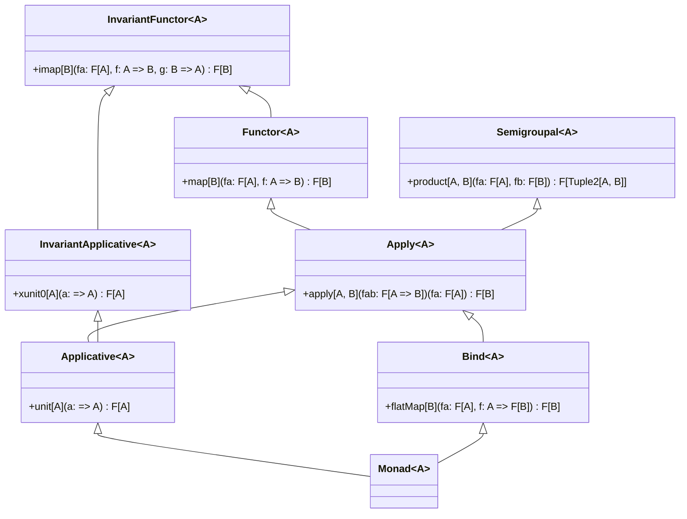

# Monad

A monad is a concept from functional programming that allows structuring computations
working within a certain context.
Monads help manage side effects such as error handling, asynchrony, and state,
making code more composable and predictable.

**Main characteristics of a monad:**

- **Context**:
  A monad "wraps" a value within a certain context. For example, a value may be "wrapped" in a container
  that indicates a potential absence of value (`Option`), an asynchronous computation (`Future`), or a collection of values (`List`).
- **Sequence of computations**:
  Monads allow chaining computations that return values in the same context.
  This is done using the `flatMap` operation (or `bind`).
- **Purity and predictability**:
  Monads help isolate side effects (e.g., errors or asynchrony)
  and make code more predictable while preserving its functional nature.

**Where are monads used?**

Monads are used in functional programming for working with:

- **Error handling** (e.g., `Option`, `Either`, `Try`).
- **Asynchronous computations** (e.g., `Future`, `IO`).
- **Collections of values** (e.g., `List`, `Set`).
- **State** (e.g., `State`).
- **Side effects** (e.g., `IO`).

**Examples of monads**

- **The `Option` monad (optional absence of value)**.
  Imagine a function that looks up a user by their ID.
  If the user is found, the function returns their data; if not, it returns "nothing."
  The `Option` monad allows handling such cases without manually checking whether a value exists.
  You can chain functions that return `Option`,
  and if at any point "nothing" is returned, the computation stops.
- **The `List` monad (a collection of values)**.
  Imagine a list of numbers, and for each number you need to generate a list of its possible modifications
  (e.g., the number itself and its square).
  The `List` monad allows "expanding" each list element into a new list
  and then combining all results into a single flat list.
- **The `Future` monad (asynchronous computations)**.
  Imagine an asynchronous operation that loads data from a database,
  and another operation that processes this data.
  The `Future` monad allows chaining these operations so that
  the second operation begins only after the first one completes successfully.
  If the first operation fails, the second will never start.
- **The `Either` monad (error handling)**.
  Imagine a function that checks whether a string is a number,
  and another function that converts a string to a number and performs some computation with it.
  The `Either` monad allows chaining these two operations so that the second function is executed only if
  the first one successfully determines that the string is a number.
  If the string is not a number, the process stops and an error is returned.
- **The `State` monad (state management)**.
  Imagine a program that works with some state (e.g., a counter).
  There are several operations, each of which modifies the state and returns a result.
  The `State` monad allows chaining these operations so that state is passed between them automatically,
  without the need to manage it manually.
- **The `IO` monad (side effects)**.
  Imagine a program that reads data from a file and then writes it to another file.
  The `IO` monad allows chaining these two operations so that the second operation (writing) is performed
  only after the first one (reading) completes successfully. If reading fails, writing will never start.
- **The `Try` monad (exception handling)**.
  Imagine a function that may throw an exception,
  and another function that works with the result of the first function.
  The `Try` monad allows chaining these two functions so that the second function is executed only if
  the first one completes successfully. If the first function throws an exception, the second will never start.

Monads are a powerful tool for structuring computations in functional programming.
They allow working with context (e.g., errors, asynchrony, state) and make code more predictable and composable.

## Formal Definition

A monad is an [`Applicative`](applicative.md)
that also supports [`Bind`](bind.md),
bound by the monad laws.

Monads are a natural extension of applicative functors; they solve the following problem:
if we have a value with a context, `m a`, how do we apply it to a function
that takes a normal value `a` and returns a value with a context.

The following laws must hold for `Monad` (+ all parent laws: `Applicative`, `Bind`, `Apply`, `Functor`, etc.):

- **Left identity** — the first law states that if we take a value (`A`),
  put it into the default context using `unit` and then pass it to a function using `flatMap` (`A => F[B]`),
  this is the same as simply taking the value and applying the function to it: `unit(a).flatMap(afb) == afb(a)`
- **Right identity** — the second law states that if we have a monadic value (`F[A]`) and use `flatMap`
  to pass it to `unit` (`a => unit(a)`), the result will be the original monadic value: `fa.flatMap(unit _) == fa`
- **Associativity** (inherited from `Bind`): the last law states that when we have a chain of applications
  of monadic functions with `flatMap`, it should not matter how they are nested: `fa.flatMap(f).flatMap(g) == fa.flatMap { a => f(a).flatMap(g) }`

## Code

```dotty
trait Monad[F[_]] extends Applicative[F], Bind[F]
```

### Laws

- All laws of [Applicative](applicative.md)
- All laws of [Bind](bind.md)
- Left identity: `unit(a).flatMap(afb) == afb(a)`
- Right identity: `fa.flatMap(a => unit(a)) == fa`

### Monad combinators

A monad defines some combinators:

```dotty
def sequence[A](fas: List[F[A]]): F[List[A]] =
  traverse(fas)(identity)

def traverse[A, B](as: List[A])(f: A => F[B]): F[List[B]] =
  as.foldRight(unit(List.empty[B]))((a, acc) => f(a).map2(acc)(_ :: _))

def replicateM[A](n: Int, fa: F[A]): F[List[A]] =
  sequence(List.fill(n)(fa))

// Kleisli arrows
def compose[A, B, C](f: A => F[B], g: B => F[C]): A => F[C] =
  a => f(a).flatMap(g)
```

## Exercises

### Exercise 2.7.1: Implementing `map` and `map2` via `flatMap` and `unit`

> [Repository with exercises and instructions][sample]

In a monad, all operations can be expressed through the primitives `unit` and `flatMap`.
Implement the `map` and `map2` methods via `flatMap` and `unit`.

```dotty
trait Monad[F[_]] extends Applicative[F], Bind[F]:
  def unit[A](a: => A): F[A]

  extension [A](fa: F[A])
    def flatMap[B](f: A => F[B]): F[B]

    override def map[B](f: A => B): F[B] = ???

    override def map2[B, C](fb: F[B])(f: (A, B) => C): F[C] = ???
```

**Examples:**

```dotty
import Monad.given

// For Option
val opt = Some(5)
opt.map(_ * 2)              // Some(10)
opt.map2(Some(3))(_ + _)    // Some(8)

// For List
val list = List(1, 2, 3)
list.map(_ * 2)                         // List(2, 4, 6)
list.map2(List(10, 20))(_ + _)          // List(11, 21, 12, 22)
```

@:note(🔍 Show solution)

In the `map` implementation we use `flatMap`: we extract the value `a` from the context `fa`
via `fa.flatMap`, then lift the result of applying the function `f` back
into the context via `unit(f(a))`. This works because `flatMap` "unwraps"
the container, allows applying the function to its contents, and then "rewraps" the result
back. For `map2` we first extract `a` from `fa` via `flatMap`, then
apply `fb.map(b => f(a, b))` to the obtained value. The inner `map` applies
the function `(a, b) => f(a, b)` to the contents of `fb` with a fixed `a`, which yields `F[C]`.

```dotty
trait Monad[F[_]] extends Applicative[F], Bind[F]:
  def unit[A](a: => A): F[A]

  extension [A](fa: F[A])
    def flatMap[B](f: A => F[B]): F[B]

    override def map[B](f: A => B): F[B] =
      fa.flatMap(a => unit(f(a)))

    override def map2[B, C](fb: F[B])(f: (A, B) => C): F[C] =
      fa.flatMap(a => fb.map(b => f(a, b)))
```

@:@

### Exercise 2.7.2: Implementing flatMap via compose

A monad can alternatively be defined using `compose` (monadic composition)
and `unit`, without an explicit `flatMap`. The `compose` operation (also known as `fish` or `>=>`)
composes two functions that return monadic values.

Implement `flatMap` via `compose` and `unit`.

```dotty
trait Monad[F[_]] extends Applicative[F], Bind[F]:
  def unit[A](a: => A): F[A]

  def compose[A, B, C](f: A => F[B], g: B => F[C]): A => F[C]

  extension [A](fa: F[A])
    def flatMapViaCompose[B](f: A => F[B]): F[B] = ???
```

In this case the monadic laws take the form:

- identity:
    - `compose(f, unit) == f`
    - `compose(unit, f) == f`
- associativity:
    - `compose(compose(f, g), h) == compose(f, compose(g, h))`

**Examples:**

```dotty
import Monad.given

val opt = Some(5)
val f: Int => Option[Int] = x => Some(x * 2)
opt.flatMapViaCompose(f)  // Some(10)

val list = List(1, 2)
val g: Int => List[Int] = x => List(x, x + 1)
list.flatMapViaCompose(g) // List(1, 2, 2, 3)
```

@:note(🔍 Show solution)

To implement `flatMapViaCompose` we use `compose` with three types: `Unit`, `A` and `B`.
The first function `_ => fa` ignores its argument of type `Unit` and always returns `fa`.
The second function is `f: A => F[B]`. The composition `compose(_ => fa, f)` gives a function
`Unit => F[B]`. Applying this function to `()` we obtain `F[B]`. This trick allows
expressing `flatMap` through `compose`, showing the equivalence of the two approaches to defining
a monad: via `flatMap` or via `compose`.

```dotty
trait Monad[F[_]] extends Applicative[F], Bind[F]:
  def unit[A](a: => A): F[A]

  def compose[A, B, C](f: A => F[B], g: B => F[C]): A => F[C]

  extension [A](fa: F[A])
    def flatMapViaCompose[B](f: A => F[B]): F[B] =
      compose[Unit, A, B](_ => fa, f)(())
```

@:@

### Exercise 2.7.3: Implementing flatMap and compose via join and map

A monad can be defined through `unit` and `join` (`flatten`) instead of `flatMap`.
`join: F[F[A]] => F[A]` "glues" two nested contexts into one.

Implement `flatMap` and `compose` via `map` and `join`. This approach demonstrates
that a monad is a functor with the ability to "glue" nested layers.

```dotty
trait Monad[F[_]] extends Applicative[F], Bind[F]:
  def unit[A](a: => A): F[A]

  extension [A](ffa: F[F[A]])
    def join: F[A]

  extension [A](fa: F[A])
    def map[B](f: A => B): F[B]

    def flatMapViaJoinAndMap[B](f: A => F[B]): F[B] = ???

  def composeViaJoinAndMap[A, B, C](f: A => F[B], g: B => F[C]): A => F[C] = ???
```

**Examples:**

```dotty
import Monad.given

// For Option
val opt = Some(5)
opt.flatMapViaJoinAndMap(x => Some(x * 2))  // Some(10)

// For List
val list = List(1, 2)
list.flatMapViaJoinAndMap(x => List(x, x + 1))  // List(1, 2, 2, 3)

// compose via join and map
val f: Int => Option[Int] = x => Some(x * 2)
val g: Int => Option[String] = x => Some(x.toString)
val composed = composeViaJoinAndMap(f, g)
composed(5)  // Some("10")
```

@:note(🔍 Show solution)

In `flatMapViaJoinAndMap` we first transform `fa: F[A]` into `F[F[B]]` using `map(f)`,
where `f: A => F[B]`. We obtain a nested context, which we then "glue" together by calling `join`,
turning `F[F[B]]` into `F[B]`. In `composeViaJoinAndMap` we apply the same principle:
first we compute `f(a)`, obtaining `F[B]`, then apply `map(g)` to the result,
obtaining `F[F[C]]`, and finally `join` glues the layers into `F[C]`.

This alternative
definition of a monad through `join` is often used in category theory, where `join`
is a natural transformation.

```dotty
trait Monad[F[_]] extends Applicative[F], Bind[F]:
  def unit[A](a: => A): F[A]

  extension[A] (ffa: F[F[A]])
    def join: F[A]

  extension [A](fa: F[A])
    def map[B](f: A => B): F[B]

    def flatMapViaJoinAndMap[B](f: A => F[B]): F[B] =
      fa.map(f).join

  def composeViaJoinAndMap[A, B, C](f: A => F[B], g: B => F[C]): A => F[C] =
    a => f(a).map(g).join
```

@:@

### Exercise 2.7.4: Implementing a Monad for the type Option

`Option[A]` is the simplest monad, representing computations that can end in
failure (a missing value). Implement a `Monad` instance for `Option`, using
`Some` for `unit` and pattern matching for `flatMap`.

```dotty
given Monad[Option] with
  override def unit[A](a: => A): Option[A] = ???

  extension [A](fa: Option[A])
    override def flatMap[B](f: A => Option[B]): Option[B] = ???
```

**Examples:**

```dotty
import Monad.given

// unit — creating a successful value
unit(42)
// Some(42)

// flatMap — sequential application
Some(5).flatMap(x => Some(x * 2))   // Some(10)
Some(5).flatMap(_ => None)          // None
None.flatMap((x: Int) => Some(x))   // None
```

@:note(🔍 Show solution)

The `unit` implementation is trivial: we simply wrap the value in `Some(a)`. For `flatMap`
we use pattern matching: if `fa` is `Some(a)`, we extract the value `a` and
apply the function `f` to it, returning `f(a)`. If `fa` is `None`, we return
`None`. Such an implementation matches the semantics of "optional" computations:
an error (`None`) interrupts the chain, and subsequent operations are not executed.

```dotty
given Monad[Option] with
  override def unit[A](a: => A): Option[A] =
    Some(a)

  extension [A](fa: Option[A])
    override def flatMap[B](f: A => Option[B]): Option[B] =
      fa match
        case Some(a) => f(a)
        case None    => None
```

@:@

### Exercise 2.7.5: Implementing a Monad for the type List

`List[A]` is a monad representing non-deterministic computations (zero,
one, or many results). Implement a `Monad` instance for `List`, using
`List(a)` for `unit` and recursive concatenation for `flatMap`.

```dotty
given Monad[List] with
  override def unit[A](a: => A): List[A] = ???

  extension [A](fa: List[A])
    override def flatMap[B](f: A => List[B]): List[B] = ???
```

**Examples:**

```dotty
import Monad.given

// unit — a single-element list
unit(42)
// List(42)

// flatMap — Cartesian product
List(1, 2).flatMap(x => List(x, x * 2))
// Result: List(1, 2, 2, 4)
```

@:note(🔍 Show solution)

The `unit` implementation creates a single-element list `List(a)`. For `flatMap` we use
recursive pattern matching: for the empty list `Nil` we return `Nil` (the recursion base);
for a non-empty list `h :: t` we first apply the function `f` to the head `h`, obtaining the list `f(h)`,
then recursively apply `flatMap` to the tail `t` and concatenate the results with `++`.
The order matters: the head is processed first, then the tail, preserving the order of elements.
As a result, for a list of `n` elements where each function returns a list of `m` elements,
the result will contain `n * m` elements (the Cartesian product).

```dotty
given Monad[List] with
  override def unit[A](a: => A): List[A] =
    List(a)

  extension [A](fa: List[A])
    override def flatMap[B](f: A => List[B]): List[B] =
      fa match
        case h :: t => f(h) ++ this.flatMap(t)(f)
        case Nil    => Nil
```

@:@

### Exercise 2.7.6: Implementing a Monad for the type Either

`Either[E, A]` is a monad representing computations that can end in
an error of type `E`. Implement a `Monad` instance for `Either[E, A]` with a fixed
error type `E`.

```dotty
given eitherMonad[E]: Monad[[x] =>> Either[E, x]] with
  override def unit[A](a: => A): Either[E, A] = ???

  extension [A](fa: Either[E, A])
    override def flatMap[B](f: A => Either[E, B]): Either[E, B] = ???
```

**Examples:**

```dotty
import Monad.given

// unit — a successful value
unit(42): Either[String, Int]
// Right(42)

// flatMap
Right(5).flatMap(x => Right(x * 2))  // Right(10)
Right(5).flatMap(_ => Left("error")) // Left("error")
Left("err").flatMap(x => Right(x))   // Left("err")
```

@:note(🔍 Show solution)

The `unit` implementation wraps the value in `Right(a)`. For `flatMap` we use
pattern matching: for `Right(a)` we extract the value `a` and apply the function `f`,
returning `f(a)`; for `Left(e)` we return `Left(e)` without calling `f`.
This implementation provides "short-circuiting" semantics: as soon as it encounters the
first error (`Left`), subsequent computations are skipped, and the error propagates
further along the chain. This behavior is analogous to exceptions, but expressed in a purely
functional way.

```dotty
given eitherMonad[E]: Monad[[x] =>> Either[E, x]] with
  override def unit[A](a: => A): Either[E, A] =
    Right(a)

  extension [A](fa: Either[E, A])
    override def flatMap[B](f: A => Either[E, B]): Either[E, B] =
      fa match
        case Right(a) => f(a)
        case Left(e)  => Left(e)
```

@:@

### Exercise 2.7.7: Implementing a Monad for the type Writer

`Writer[W, A]` is a monad representing computations that accumulate a
log (side output) of type `W`. It is required that `W` be a [monoid](../monoid/monoid.md)
(having `empty` and an associative `combine`). Implement a `Monad` instance for `Writer`.

```dotty
given writerMonad[W](using m: Monoid[W]): Monad[[x] =>> Writer[W, x]] with
  override def unit[A](a: => A): Writer[W, A] = ???

  extension [A](fa: Writer[W, A])
    override def flatMap[B](f: A => Writer[W, B]): Writer[W, B] = ???
```

**Examples:**

```dotty
import Monad.given
import ru.scalabook.typeclasses.monoid.Monoid.given

// For String as the log (monoid with concatenation)
val w1 = Writer(() => ("Step 1: init ", 5))
val w2 = Writer(() => ("Step 2: multiply ", (x: Int) => x * 2))

val result = w1.flatMap(x => w2.map(f => f(x)))
result.run()  // ("Step 1: init Step 2: multiply ", 10)

// For List[String] as the log
given Monoid[List[String]] with
  val empty: List[String] = Nil
  def combine(a: List[String], b: List[String]): List[String] = a ++ b

val logger = for
  _ <- Writer(() => (List("Logged action 1"), ()))
  x <- Writer(() => (List("Got value 42"), 42))
  _ <- Writer(() => (List("Logged action 2"), ()))
yield x

logger.run()  // (List("Logged action 1", "Got value 42", "Logged action 2"), 42)
```

@:note(🔍 Show solution)

In the `unit` implementation a `Writer` is created that, when executed, returns the pair
`(m.empty, a)` — an empty log and the passed value. For `flatMap` we create a new
`Writer` that, when `run()` is called, first executes `fa.run()`, obtaining `(w1, a)`,
then executes `f(a).run()`, obtaining `(w2, b)`, and finally returns `(m.combine(w1, w2), b)`.
Laziness is preserved: `flatMap` does not execute computations immediately, only
when `run()` is invoked. It is important that the order of combining logs matches the execution
order: first the logs from `fa`, then the logs from `f(a)`. This is the typical behavior
of the `Writer` monad, where logs are accumulated sequentially.

```dotty
given writerMonad[W](using m: Monoid[W]): Monad[[x] =>> Writer[W, x]] with
  override def unit[A](a: => A): Writer[W, A] =
    Writer[W, A](() => (m.empty, a))

  extension [A](fa: Writer[W, A])
    override def flatMap[B](f: A => Writer[W, B]): Writer[W, B] =
      Writer[W, B] { () =>
        val (w1, a) = fa.run()
        val (w2, b) = f(a).run()
        (m.combine(w1, w2), b)
      }
```

@:@

### Exercise 2.7.8: Implementing a Monad for the type State

`State[S, A]` is a monad representing pure functional computations
with mutable state. Implement a `Monad` instance for `State`.

```dotty
given stateMonad[S]: Monad[[x] =>> State[S, x]] with
  override def unit[A](a: => A): State[S, A] = ???

  extension [A](fa: State[S, A])
    override def flatMap[B](f: A => State[S, B]): State[S, B] = ???
```

**Examples:**

```dotty
import Monad.given

// Basic operations
val increment: State[Int, Int] = State(s => (s + 1, s))
val getState: State[Int, Int] = State(s => (s, s))
val setState: Int => State[Int, Unit] = n => State(_ => (n, ()))

// unit — the state does not change
unit(42).run(5)
// (5, 42)

// flatMap — passing state
increment.flatMap(x => State(s => (s, x * 2))).run(5)
// (6, 10)
```

@:note(🔍 Show solution)

In the `unit` implementation a `State` is created that takes a state `s` and returns
the pair `(s, a)` — the state does not change.
For `flatMap` we create a new `State` that takes the initial state `s`.
First we run `fa.run(s)`, obtaining the new state `s1` and the value `a`.
Then we run `f(a).run(s1)`, obtaining the final state `s2` and the value `b`.
The result is the pair `(s2, b)`.
The state is sequentially passed through the chain of computations, which allows
implementing the effect of state change in a purely functional style.
This monad is the basis for many functional approaches to state management.

```dotty
given stateMonad[S]: Monad[[x] =>> State[S, x]] with
  override def unit[A](a: => A): State[S, A] =
    State[S, A](s => (s, a))

  extension [A](fa: State[S, A])
    override def flatMap[B](f: A => State[S, B]): State[S, B] =
      State[S, B] { s =>
        val (s1, a) = fa.run(s)
        f(a).run(s1)
      }
```

@:@

## Diagram



## Implementation in libraries

### Implementation in Cats

```dotty
import cats.Monad
import cats.instances.option.*
import cats.instances.list.*

val opt1 = Monad[Option].pure(3)
// Some(3)
val opt2 = Monad[Option].flatMap(opt1)(a => Some(a + 2))
// Some(5)
val opt3 = Monad[Option].map(opt2)(a => 100 * a)
// Some(500)

val list1 = Monad[List].pure(3)
// List(3)
val list2 = Monad[List].flatMap(List(1, 2, 3))(a => List(a, a * 10))
// List(1, 10, 2, 20, 3, 30)
val list3 = Monad[List].map(list2)(a => a + 123)
// List(124, 133, 125, 143, 126, 153)

1.pure[Option]
// Some(1)
1.pure[List]
// List(1)
```

### tailRecM (the tail-recursive monad method)

In addition to requiring the `flatMap` and `pure` methods, Cats places an additional requirement on monads —
the implementation of the `tailRecM` method, which provides **stack-safe monadic recursion**.
This requirement is based on Phil Freeman's work [Stack Safety for Free](http://functorial.com/stack-safety-for-free/index.pdf)
("Stack safety for free").

#### Problem: recursion and stack overflow

In functional programming, monadic recursion is ubiquitous. It is used for:

- Processing sequences of data
- Implementing loops in a functional style
- Building parsers and interpreters
- Performing repeated I/O operations

However, on the JVM (as well as in JavaScript and Native environments) recursion is **not stack-safe** by default.
Each recursive call adds a new frame to the call stack, and when a certain depth is reached
(usually 2000–5000 calls) a stack overflow occurs (`StackOverflowError`).

#### Solution: tailRecM

Instead of requiring developers to take care of stack safety themselves
(using various workarounds such as [`Trampoline`](../../fp/external-effects/stack_overflow_error.md)
or manual tail-recursion implementation),
Cats **embeds** this requirement directly into the `Monad` type class.
This means that:

1. **All** monads in Cats are required to provide a stack-safe implementation of `tailRecM`.
2. **All** functions in Cats requiring monadic recursion use `tailRecM` to perform it.
3. The developer does not need to worry about stack overflow when using monads from Cats — the library guarantees safety.

### Example: implementing `Monad[Option]`

Let's look at what a stack-safe monad implementation looks like for `Option`.
Note the `@tailrec` annotation, which guarantees that
the recursive call is a tail call and the compiler optimizes it into a loop:

```dotty
import cats.Monad
import scala.annotation.tailrec

given Monad[Option] = new Monad[Option]:
  // Basic monad methods
  def flatMap[A, B](fa: Option[A])(f: A => Option[B]): Option[B] = fa.flatMap(f)
  def pure[A](a: A): Option[A]                                   = Some(a)

  // Stack-safe tailRecM
  @tailrec
  def tailRecM[A, B](a: A)(f: A => Option[Either[A, B]]): Option[B] =
    f(a) match
      // Recursion finished with an empty value
      case None => None
      // Continue recursion with a new value
      case Some(Left(nextA)) =>
        tailRecM(nextA)(f)
      // Recursion finished with a result
      case Some(Right(b)) => Some(b)
```

#### How does it work?

The signature of `tailRecM`:

```dotty
def tailRecM[A, B](a: A)(f: A => F[Either[A, B]]): F[B]
```

The method takes:

- **`a: A`** — the initial value.
- **`f: A => F[Either[A, B]]`** — a function that for a value `A` returns an effect `F` containing either:
    - `Left[A]` — continue recursion with a new value `A`.
    - `Right[B]` — finish recursion and return the result `B`.

In the case of `Option`:

- `f(a)` returns `Option[Either[A, B]]`.
- If the result is `None`, recursion finishes (no value).
- If the result is `Some(Left(nextA))`, we recursively call `tailRecM` with `nextA` (this is a **tail call**!).
- If the result is `Some(Right(b))`, we return `Some(b)`.

Thanks to the `@tailrec` annotation, the Scala compiler checks that the last call in the function is a recursive call to `tailRecM`,
and optimizes it into a loop, preventing stack growth.

#### Relationship with `flatMap` and `pure`

`tailRecM` is part of the `Monad` type class alongside `flatMap` and `pure`. This means that:

- To create a `Monad` instance, all three methods must be implemented.
- Cats provides `tailRecM` implementations for all standard monads (`Option`, `List`, `Either`, `Try`, `Future`, etc.).
- Custom monads must also provide a correct `tailRecM` implementation.

#### Where is `tailRecM` used?

In Cats, `tailRecM` is used in many functions that may require monadic recursion:

- **`Monad.whileM`** and **`Monad.untilM`** — looping operations in a monadic context.
- **`Foldable.foldM`** — monadic folding.
- **`Traverse.traverse`** — traversing structures with effects.
- And many other functions where recursive data processing is required.

A more detailed discussion of `tailRecM` can be found in the section ["What is tailRecM?"](../../libs/cats/jump_start_guide.md).

---

**References:**

- [Repository with exercises][sample]
- [Monad - wikipedia](https://en.wikipedia.org/wiki/Monad_(functional_programming))
- [A Monads Approach for Beginners, in Scala - Rock the JVM](https://www.youtube.com/watch?v=d-dy1x33moA&amp;list=PLmtsMNDRU0Bzj7INIrLugi3a_WClwQuiS)
- [Algebird](https://twitter.github.io/algebird/typeclasses/monad.html)
- [Cats](https://typelevel.org/cats/typeclasses/monad.html)
- [Functional Programming in Scala, Second Edition, Chapter 11](https://www.manning.com/books/functional-programming-in-scala-second-edition?query=Functional%20Programming%20in%20Scala,%20Second%20Edition)
- [Herding Cats](http://eed3si9n.com/herding-cats/Monad.html)
- [Learn Functional Programming course/tutorial on Scala](https://github.com/dehun/learn-fp)
- [Learning Scalaz](http://eed3si9n.com/learning-scalaz/Monad.html)
- [Monads are Dominoes](https://apocalisp.wordpress.com/2011/07/01/monads-are-dominoes/)
- [Monads are fractals](https://eed3si9n.com/monads-are-fractals/)
- [Monads are Elephants Part 1](https://james-iry.blogspot.com/2007/09/monads-are-elephants-part-1.html)
- [Monads are Elephants Part 2](https://james-iry.blogspot.com/2007/10/monads-are-elephants-part-2.html)
- [Monads are Elephants Part 3](https://james-iry.blogspot.com/2007/10/monads-are-elephants-part-3.html)
- [Monads are Elephants Part 4](https://james-iry.blogspot.com/2007/11/monads-are-elephants-part-4.html)
- [Monads in Scala](https://www.baeldung.com/scala/monads)
- [ObserveFunctorMonad](https://blog.tmorris.net/posts/observefunctormonad/index.html)
- [Of Algebirds, Monoids, Monads, and other Bestiary for Large-Scale Data Analytics](https://www.michael-noll.com/blog/2013/12/02/twitter-algebird-monoid-monad-for-large-scala-data-analytics/#monads)
- [Scala with Cats](https://scalawithcats.com/dist/scala-with-cats.html#sec:monads)
- [Scalaz API](https://javadoc.io/doc/org.scalaz/scalaz-core_3/7.3.6/scalaz/Monad.html)
- [SKB – Scala Monad](https://leobenkel.com/2021/01/skb-scala-monad/)
- [Strong Type Systems](https://blog.tmorris.net/posts/strong-type-systems/index.html)
- [Tour of Scala](https://tourofscala.com/scala/monad)
- [When you hear 'Monad', think 'Chainable'](https://jamesward.com/2017/10/02/when-you-hear-monad-think-chainable/)

[sample]: https://gitverse.ru/scalabook/typeclasses
