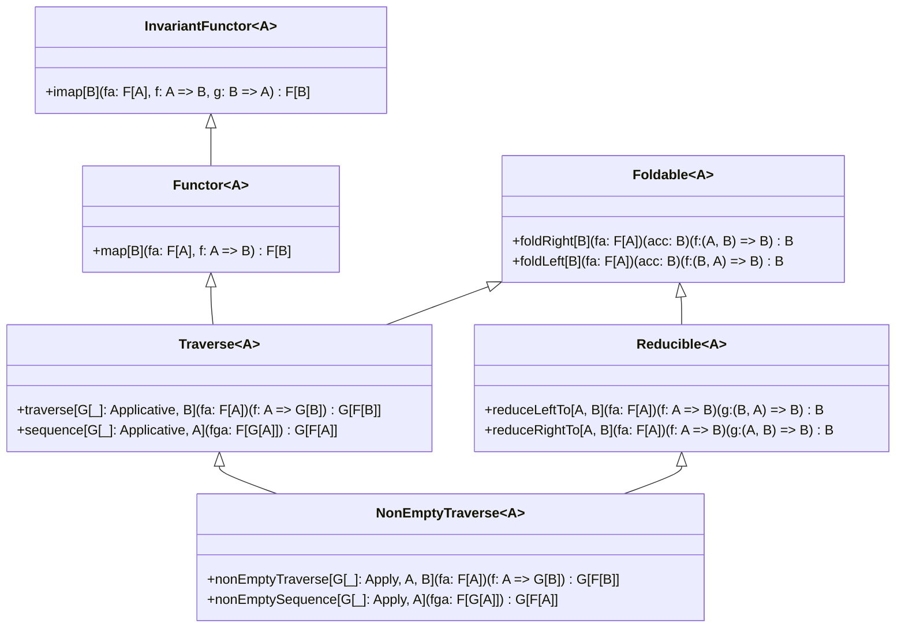

# NonEmptyTraverse

`NonEmptyTraverse` is the **non-empty version** of the [`Traverse`](traverse.md) type class,
similar to how [`Reducible`](reducible.md) is the non-empty version of [`Foldable`](foldable.md).
In the type class hierarchy, `NonEmptyTraverse` inherits from both `Reducible` and `Traverse`, combining their capabilities:

- From `Reducible` — the guarantee of non-emptiness and reduction methods without an identity element.
- From `Traverse` — the ability to traverse a structure with effects.

## Main Methods

`NonEmptyTraverse` provides two key methods:

```dotty
def nonEmptyTraverse[G[_]: Apply, A, B](fa: F[A])(f: A => G[B]): G[F[B]]

def nonEmptySequence[G[_]: Apply, A](fga: F[G[A]]): G[F[A]]
```

### Key Difference from `Traverse`

Unlike the `traverse` and `sequence` methods from `Traverse`,
which require an [`Applicative[G]`](applicative.md) instance (i.e., having `pure`),
the `nonEmptyTraverse` and `nonEmptySequence` methods require only [`Apply[G]`](apply.md) —
a weakened version of `Applicative`, **without the `pure` method**.

**Why is this important?**

Some types can form an `Apply` but not an `Applicative`,
because they lack an "empty" or "identity" value.
A classic example is `Map[K, *]`: it is impossible to implement `pure[A](a: A): Map[K, A]`,
because it needs a key `K`, which is not available in the general case.

## Using `nonEmptyTraverse`

Consider a practical example.
Suppose we have a list of text snippets,
and we want to count the frequency of each word in each snippet, then combine the results.

```dotty
import cats.syntax.all.*
import cats.data.NonEmptyList

// Function to count word frequencies in text
def countWords(text: String): Map[String, Int] =
  text.split(" ").groupBy(identity).view.mapValues(_.length).toMap

// Non-empty list of text snippets
val snippets = NonEmptyList.of("What do you do", "What are you doing")

val result = snippets.nonEmptyTraverse(countWords)
// Result:
// Map(
//   "What" -> NonEmptyList(1, 1),
//   "you"  -> NonEmptyList(1, 1)
// )
```

What happened here?

1. `countWords` is applied to each snippet, returning `Map[String, Int]`.
2. `nonEmptyTraverse` "traverses" the `NonEmptyList` structure, collecting results and combining maps for each key.
3. For each word, we get a list of frequencies — one value for each snippet.

### Equivalent notation using `map` and `nonEmptySequence`

The method `nonEmptyTraverse(f)` is equivalent to `map(f).nonEmptySequence`:

```dotty
val result = snippets.map(countWords).nonEmptySequence
// Result: completely identical to the previous one
```

This is similar to how in `Traverse` the method `traverse(f)` is equivalent to `map(f).sequence`.

## Code

```dotty
trait NonEmptyTraverse[F[_]] extends Traverse[F] with Reducible[F]:
  def nonEmptyTraverse[G[_]: Apply, A, B](fa: F[A])(f: A => G[B]): G[F[B]]

  def nonEmptySequence[G[_]: Apply, A](fga: F[G[A]]): G[F[A]] =
    nonEmptyTraverse(fga)(identity)

  extension [A](fa: F[A])
    override def traverse[G[_]: Applicative, B](f: A => G[B]): G[F[B]] =
      nonEmptyTraverse(fa)(f)

  def nonEmptyTraverseViaNes[G[_]: Apply, A, B](fa: F[A])(f: A => G[B])
      : G[F[B]] =
    nonEmptySequence(fa.map(f))
```

## Exercises

### Exercise 2.12.1: Implement NonEmptyTraverse for NonEmptyList

> [Repository with exercises and instructions][sample]

Your task is to fill in the blanks (`???`) in the implementation of the `nonEmptyTraverse` method.

```dotty
given NonEmptyTraverse[NonEmptyList] with
  def reduceLeftTo[A, B](fa: NonEmptyList[A])(f: A => B)(g: (B, A) => B): B =
    ???

  def reduceRightTo[A, B](fa: NonEmptyList[A])(f: A => B)(g: (A, B) => B): B =
    ???

  def nonEmptyTraverse[
      G[_]: Apply as app,
      A,
      B
  ](fa: NonEmptyList[A])(f: A => G[B])
      : G[NonEmptyList[B]] =
    ???
end given
```

**Examples:**

```dotty
import cats.data.NonEmptyList
import cats.syntax.all.*

// Example 1: Traversal with Option (applied only to non-empty strings)
val nel = NonEmptyList.of("hello", "world", "scala")

def toOption(s: String): Option[Int] =
  if s.nonEmpty then Some(s.length) else None

val result1 = NonEmptyTraverse[NonEmptyList].nonEmptyTraverse(nel)(toOption)
// Result: Some(NonEmptyList(5, 5, 5))

// Example 2: Traversal with Option, where some elements may be empty
val nel2 = NonEmptyList.of("hello", "", "scala")

def toOption2(s: String): Option[Int] =
  if s.nonEmpty then Some(s.length) else None

val result2 = NonEmptyTraverse[NonEmptyList].nonEmptyTraverse(nel2)(toOption2)
// Result: None (since the second element is an empty string)
```

@:note(🔍 Show solution)

To implement `nonEmptyTraverse`, recursive traversal of the list is used.
In the base case (a single-element list), we apply function `f` to the head, obtaining `G[B]`,
and use `map` to wrap the result in `NonEmptyList`.
In the recursive case (head + non-empty tail), we apply `f` to the head, recursively traverse the tail,
and then combine both results using `Apply[G].apply2`.
This method combines two effects into one, applying a function to their results.
Importantly, `apply2` requires only `Apply`, not `Applicative`, allowing the use of effects without `pure`.

```dotty
given NonEmptyTraverse[NonEmptyList] with
  def reduceLeftTo[A, B](fa: NonEmptyList[A])(f: A => B)(g: (B, A) => B): B =
    Reducible.given_Reducible_NonEmptyList.reduceLeftTo(fa)(f)(g)

  def reduceRightTo[A, B](fa: NonEmptyList[A])(f: A => B)(g: (A, B) => B): B =
    Reducible.given_Reducible_NonEmptyList.reduceRightTo(fa)(f)(g)

  def nonEmptyTraverse[
      G[_]: Apply as app,
      A,
      B
  ](fa: NonEmptyList[A])(f: A => G[B])
      : G[NonEmptyList[B]] =
    fa.tail match
      case Nil =>
        f(fa.head).map(a => NonEmptyList(a, Nil))
      case h :: t =>
        app.apply2(
          f(fa.head),
          nonEmptyTraverse[G, A, B](NonEmptyList(h, t))(f)
        )((a, nel) => NonEmptyList(a, nel.toList))
end given
```

@:@

## Schema



## Implementation in Libraries

### Implementation in Cats

```dotty
import cats.syntax.all.*
import cats.data.NonEmptyList

val snippets = NonEmptyList.of("What do you do", "What are you doing")
// snippets: NonEmptyList[String] = NonEmptyList(
//   head = "What do you do",
//   tail = List("What are you doing")
// )

def countWords(text: String): Map[String, Int] =
  text.split(" ").groupBy(identity).view.mapValues(_.length).toMap

snippets.nonEmptyTraverse(countWords)
// res0: Map[String, NonEmptyList[Int]] = Map(
//   "What" -> NonEmptyList(head = 1, tail = List(1)),
//   "you" -> NonEmptyList(head = 1, tail = List(1))
// )
```

---

**References:**

- [Link to the repository with exercises][sample]
- [Cats](https://typelevel.org/cats/typeclasses/nonemptytraverse.html)

[sample]: https://gitverse.ru/scalabook/typeclasses
