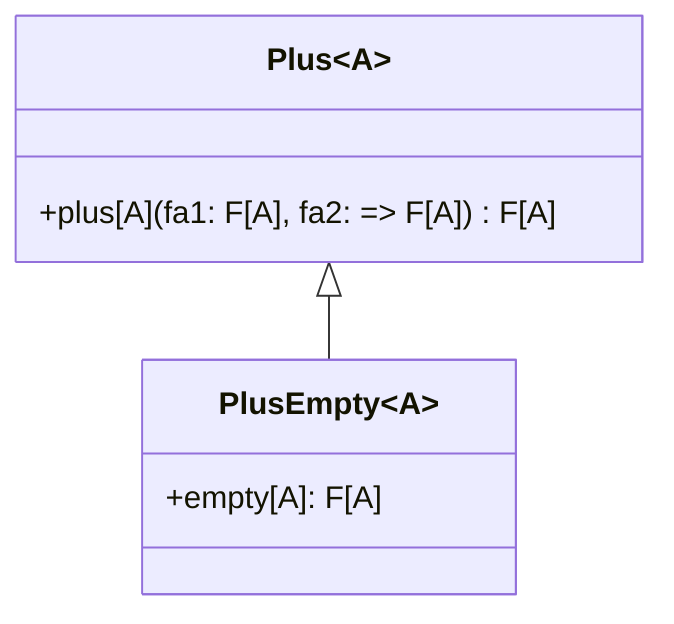

# PlusEmpty

`PlusEmpty` is an extension of the [`Plus`](plus.md) concept in functional programming
that adds the ability to work with an "empty" value (an identity element) within a context.
This value serves as a unit for the combining operation (`plus`, `combine`, or `<+>`)
and is often called an "empty" or "zero" element.

**Main characteristics of `PlusEmpty`:**

- **Empty value**:
  `PlusEmpty` introduces the concept of an "empty" value, which is an identity element for the combining operation.
  For example, for lists this is an empty list `[]`, for `Option` it is `None`, for sets it is an empty set `{}`.
- **Combining with an empty value**:
  When combining a value with an "empty" value, the result remains unchanged.
  For example, `Some(42) <+> None` will return `Some(42)`, and `[1, 2, 3] <+> []` will return `[1, 2, 3]`.
- **Working within a context**:
  `PlusEmpty` works with contexts such as lists, `Option`, `Either`, sets, and other monadic types.

**Examples of `PlusEmpty`**

- **Lists (`List`)**.
  Imagine you have a list of numbers `[1, 2, 3]` and an empty list `[]`.
  The `PlusEmpty` operation allows combining them, and the result will be `[1, 2, 3]`.
  An empty list here is an identity element that does not change the value when combining.
- **Parsers**.
  Imagine you have a parser that parses numbers and an "empty" parser that always returns an error.
  The `PlusEmpty` operation allows combining the results of these parsers.
  For example, if the first parser fails to parse the input, the second parser (empty) will not change the result.
  An empty value here is a parser that always returns an error.
- **Validators**.
  Imagine you have a validator that checks that a string is non-empty and an "empty" validator
  that always returns a successful result.
  The `PlusEmpty` operation allows combining validation results.
  For example, if the first validator returns an error, the second (empty) validator will not change the result.
  An empty value here is a validator that always returns success.
- **Asynchronous computations (`Future`)**.
  Imagine you have an asynchronous computation that returns a number,
  and an "empty" computation that always completes with an error.
  The `PlusEmpty` operation allows executing both computations and combining their results.
  For example, if the first computation fails, the second (empty) computation will not change the result.
  An empty value here is a `Future` that always completes with an error.

## Formal Definition

A universally quantified [monoid](../monoid/monoid.md).

`PlusEmpty` must satisfy the laws of a monoid:

- **Associativity**: `(x + y) + z = x + (y + z)`
- **Identity**: there exists `e ∈ M` such that `e + x = x + e = x`

## Code

```dotty
trait PlusEmpty[F[_]] extends Plus[F]:
  self =>

  def empty[A]: F[A]

  def monoid[A]: Monoid[F[A]] =
    new Monoid[F[A]]:
      override def combine(f1: F[A], f2: F[A]): F[A] = plus(f1, f2)
      override def empty: F[A] = self.empty[A]
```

### Laws

- Associativity is expressed as follows:
  `plus(plus(f1, f2), f3)` should be equal to `plus(f1, plus(f2, f3))`.
  This means that the order of combining elements does not affect the final result.
- Identity means that if you combine any element `fa` with an identity element (`empty`),
  the result will always be equal to `fa`. In other words, the identity element does not change the value of `fa` when combining.
  This can be written as:
    - `plus(fa, empty) == fa`
    - `plus(empty, fa) == fa`

### Example with List

```dotty
given PlusEmpty[List] with
  def plus[A](fa1: List[A], fa2: => List[A]): List[A] = fa1 ++ fa2
  def empty[A]: List[A] = List.empty[A]
```

## Schema



## Library Implementations

### Implementation in ScalaZ
