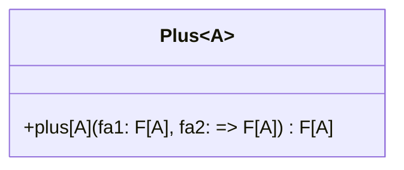

# Plus

`Plus` is a concept from functional programming that extends the idea of [monads](monad.md) and [applicative functors](applicative.md).
It adds the ability to combine two values within one context, using an operation similar to "addition".
This operation is often called `plus`, `combine`, or `<+>`.

**Main characteristics of `Plus`:**

- **Combining values**:
  `Plus` allows combining two values that are within the same context into a single value.
  For example, two lists can be combined into one, or two `Option` values can be combined by selecting the first existing value.
- **Working within a context**:
  `Plus` works with contexts such as lists, `Option`, `Either`, and other monadic types.

**Examples of `Plus`**

- **Lists (`List`)**.
  Imagine you have two lists: `[1, 2, 3]` and `[4, 5, 6]`.
  The `Plus` operation allows combining them into one list: `[1, 2, 3, 4, 5, 6]`.
- **Parsers**.
  Imagine you have two parsers: one parses numbers, the other parses strings.
  The `Plus` operation allows combining the results of these parsers.
  For example, if the first parser fails to parse the input, the second parser will try.
- **Validators**.
  Imagine you have two validators: one checks that a string is non-empty, the other checks that a string contains only letters.
  The `Plus` operation allows combining validation results.
  For example, if the first validator returns an error, the second validator will still be executed, and all errors will be collected together.

`Plus` is a powerful tool for combining values within one context.
It is used in various scenarios such as merging lists, handling possible absence of values,
aggregating validation or parsing results.

## Formal Definition

A universally quantified [semigroup](../monoid/semigroup.md).

`Plus` must satisfy the laws of a semigroup:

- **Associativity**: `(x + y) + z = x + (y + z)`


## Code

```dotty
trait Plus[F[_]]:
  def plus[A](fa1: F[A], fa2: => F[A]): F[A]

  def semigroup[A]: Semigroup[F[A]] = (f1: F[A], f2: F[A]) => plus(f1, f2)
```

### Laws

The laws of Plus are analogous to the laws of a [semigroup](../monoid/semigroup.md):

- Associativity is expressed as follows:
  `plus(plus(f1, f2), f3)` should be equal to `plus(f1, plus(f2, f3))`.
  This means that the order of combining elements does not affect the final result.

### Example with List

```dotty
given Plus[List] with
  def plus[A](fa1: List[A], fa2: => List[A]): List[A] = fa1 ++ fa2
```

## Schema



## Library Implementations

### Implementation in ScalaZ

```dotty
import scalaz.*
import Scalaz.*

List(1, 2) <+> List(3, 4)                   // List(1, 2, 3, 4)
```

---

**References:**

- [Link to exercise repository][sample]
- [Learning Scalaz](http://eed3si9n.com/learning-scalaz/MonadPlus.html)
- [Scalaz API](https://javadoc.io/doc/org.scalaz/scalaz-core_3/7.3.6/scalaz/Plus.html)

[sample]: https://gitverse.ru/scalabook/typeclasses
