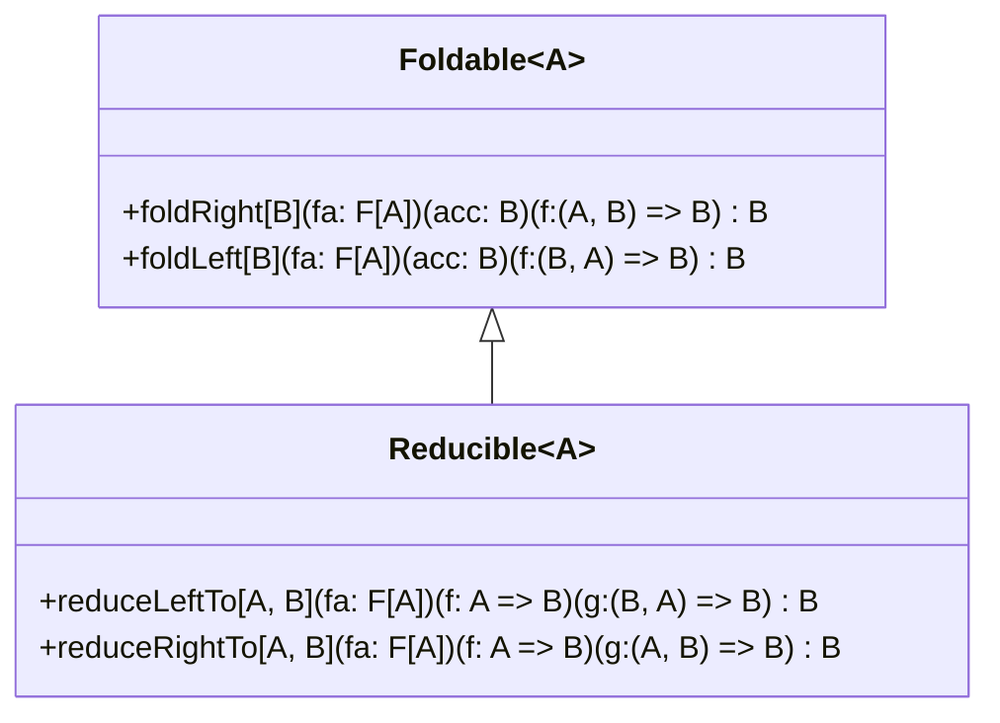

# Reducible

`Reducible` is a type class that extends `Foldable`, adding methods for **reducing** collections.
If you are familiar with the standard Scala library, you have likely encountered methods like `reduce`, `reduceLeft`, or `reduceOption` on collections.

Unlike `Foldable`, which requires an identity element (`empty`), `Reducible` works with **non-empty** collections.
This fundamental difference makes `Reducible` particularly useful for abstracting over non-empty data structures,
such as `NonEmptyList` or `NonEmptyVector`.

## Key Advantage

Since `Reducible` works only with non-empty collections,
the `reduce` and `reduceMap` methods **never throw exceptions** and **never return `Option`**.
This guarantees that a result always exists, which can be very convenient in the context of non-empty data structures.

This allows, for example, implementing `maximum` and `minimum` methods (maximum and minimum values)
based on `Reducible`, unlike `maximumOption` and `minimumOption` in `Foldable`, which return `Option`.

## Main Methods of `Reducible`

`Reducible[F]` is implemented based on two basic methods (in addition to the methods required by `Foldable`):

1. **`reduceLeftTo(fa)(f)(g)`** — strict reduction with an initial mapping function.
2. **`reduceRightTo(fa)(f)(g)`** — lazy reduction with an initial mapping function.

All other methods can be implemented via these two.

## Code

```dotty
trait Reducible[F[_]] extends Foldable[F]:
  /** Basic left-associative reduction with initial mapping
    * of the first element. Applies function `f` to the first element, then
    * sequentially combines the result with each subsequent element,
    * using binary operation `g`.
    */
  def reduceLeftTo[A, B](fa: F[A])(f: A => B)(g: (B, A) => B): B

  /** Basic right-associative reduction with initial mapping
    * of the last element. Applies function `f` to the last element, then
    * sequentially combines the result with each preceding element,
    * using binary operation `g`.
    */
  def reduceRightTo[A, B](fa: F[A])(f: A => B)(g: (A, B) => B): B

  /** Left-associative reduction using binary operation `f`.
    * Sequentially applies `f` to the elements of the collection from left to right.
    */
  def reduceLeft[A](fa: F[A])(f: (A, A) => A): A =
    reduceLeftTo(fa)(identity)(f)

  /** Right-associative reduction using binary operation `f`.
    * Sequentially applies `f` to the elements of the collection from right to left.
    */
  def reduceRight[A](fa: F[A])(f: (A, A) => A): A =
    reduceRightTo(fa)(identity)(f)

  /** Reduces a collection using the `combine` operation from `Semigroup[A]`.
    * Equivalent to `reduceLeft` with a semigroup operation.
    */
  def reduce[A: Semigroup as semi](fa: F[A]): A =
    reduceLeft(fa)(semi.combine)

  /** Maps each element to a value of type `B` and reduces the results,
    * using the `combine` operation from `Semigroup[B]`.
    */
  def reduceMap[A, B: Semigroup as semi](fa: F[A])(f: A => B): B =
    reduceLeftTo(fa)(f)((b, a) => semi.combine(b, f(a)))

  /** Converts a non-empty collection to a `NonEmptyList`, preserving the order
    * of elements. Uses right-associative reduction to build the list
    * from the end.
    */
  def toNonEmptyList[A](fa: F[A]): NonEmptyList[A] =
    reduceRightTo(fa)(a => NonEmptyList(a, Nil)): (a, lnel) =>
      NonEmptyList(a, lnel.toList)

  /** Finds the minimum element in a non-empty collection.
    */
  def minimum[A: Ordering as ord](fa: F[A]): A =
    reduceLeft(fa)(ord.min)

  /** Finds the maximum element in a non-empty collection.
    */
  def maximum[A: Ordering as ord](fa: F[A]): A =
    reduceLeft(fa)(ord.max)
```

## Exercises

### Exercise 2.11.1: Implement `Foldable` methods via `Reducible`

> [Repository with exercises and instructions][sample]

In this exercise, you will implement the methods of the `Foldable` trait for non-empty collections,
using the capabilities of `Reducible`.
Since `Reducible` extends `Foldable`, all `Foldable` methods must be implemented
via the basic methods of `Reducible`: `reduceLeftTo` and `reduceRightTo`.

Your task is to fill in the blanks (`???`) in the implementation of `foldRight`, `foldLeft`, `foldMap`, `combineAll`, and `toList`.
When implementing, pay attention to the following key points:

- `foldRight` and `foldLeft` can be expressed via function composition using `reduceRightTo` and `reduceLeftTo`, respectively.
- `foldMap` should map each element to a monoid value and combine the results.
- `combineAll` should combine all elements using the monoid operation.
- `toList` should convert a non-empty collection to an ordinary `List`.

```dotty
extension [A](as: F[A])
  override def foldRight[B](acc: B)(f: (A, B) => B): B =
    ???

  override def foldLeft[B](acc: B)(f: (B, A) => B): B =
    ???

  override def foldMap[B: Monoid as m](f: A => B): B =
    ???

  override def combineAll(using ma: Monoid[A]): A =
    ???

  override def toList: List[A] =
    ???
end extension
```

**Examples:**

```dotty
import cats.data.NonEmptyList

// Create a non-empty list
val nel = NonEmptyList.of(1, 2, 3, 4)

// 1. foldRight — right-associative fold
val sumRight = nel.foldRight(0)(_ + _)
// Result: 10 (1 + (2 + (3 + (4 + 0))))

val concatRight = nel.foldRight("")((i, s) => s + i.toString)
// Result: "4321"

// 2. foldLeft — left-associative fold
val sumLeft = nel.foldLeft(0)(_ + _)
// Result: 10 ((((0 + 1) + 2) + 3) + 4)

val concatLeft = nel.foldLeft("")((s, i) => s + i.toString)
// Result: "1234"

// 3. foldMap — map and fold
val stringConcat = nel.foldMap(_.toString)
// Result: "1234" (string concatenation)

val lengthSum = nel.foldMap(_.toString.length)
// Result: 4 (sum of string lengths: 1 + 1 + 1 + 1)

// 4. combineAll — combine all elements
val sumAll = nel.combineAll
// Result: 10 (sum of numbers)

val strs = NonEmptyList.of("a", "b", "c")
val concatAll = strs.combineAll
// Result: "abc" (string concatenation)

// 5. toList — convert to List
val list = nel.toList
// Result: List(1, 2, 3, 4)
```

@:note(🔍 Show solution)

To implement `Foldable` methods via `Reducible`, function composition technique is used.
In `foldRight`, each element is transformed into a function `B => B` (`g: A => B => B`),
which appends the element to the accumulator from the right.
Function `h` combines these functions during right-associative reduction.
Similarly, in `foldLeft`, functions are combined in reverse order.
`foldMap` uses `reduceLeftTo` with initial mapping of the first element and subsequent combination via monoid.
`combineAll` is a special case of `reduceLeft` with the monoid operation.
`toList` uses `toNonEmptyList` and then converts the result to an ordinary `List`.

```dotty
extension [A](as: F[A])
  override def foldRight[B](acc: B)(f: (A, B) => B): B =
    // g: transforms each element to a function B => B
    val g: A => B => B = (a: A) => (b: B) => f(a, b)
    // h: combines functions during right-associative reduction
    val h: (A, B => B) => (B => B) = (a, b2b) => b => f(a, b2b(b))
    // Reduce the collection from the right, obtaining a single function B => B
    val func = reduceRightTo[A, B => B](as)(g)(h)
    // Apply the resulting function to the initial value
    func(acc)

  override def foldLeft[B](acc: B)(f: (B, A) => B): B =
    // g: transforms each element to a function B => B
    val g: A => B => B = (a: A) => (b: B) => f(b, a)
    // h: combines functions during left-associative reduction
    val h: (B => B, A) => (B => B) = (b2b, a) => b => f(b2b(b), a)
    // Reduce the collection from the left, obtaining a single function B => B
    val func = reduceLeftTo[A, B => B](as)(g)(h)
    // Apply the resulting function to the initial value
    func(acc)

  override def foldMap[B: Monoid as m](f: A => B): B =
    // Start with mapping the first element, then combine with the rest
    reduceLeftTo(as)(f)((b: B, a: A) => m.combine(b, f(a)))

  override def combineAll(using ma: Monoid[A]): A =
    // Left-associative reduction with monoid operation
    reduceLeft(as)(ma.combine)

  override def toList: List[A] =
    // Convert to NonEmptyList, then to ordinary List
    toNonEmptyList(as).toList
end extension
```

@:@

### Exercise 2.11.2: Implement `Reducible` for `NonEmptyList`

In this exercise, you will implement the type class instance of `Reducible` for `NonEmptyList`.

```dotty
given Reducible[NonEmptyList] with
  def reduceLeftTo[A, B](fa: NonEmptyList[A])(f: A => B)(g: (B, A) => B): B =
    ???

  def reduceRightTo[A, B](fa: NonEmptyList[A])(f: A => B)(g: (A, B) => B): B =
    ???
```

**Examples:**

```dotty
import cats.data.NonEmptyList

val nel = NonEmptyList.of(1, 2, 3, 4)
val strs = NonEmptyList.of("a", "b", "c", "d")

// 1. reduceLeftTo — left-associative reduction
val sum = Reducible[NonEmptyList].reduceLeftTo(nel)(identity)(_ + _)
// Result: 10 (1 + 2 + 3 + 4)

val concat = Reducible[NonEmptyList].reduceLeftTo(strs)(identity)(_ ++ _)
// Result: "abcd"

val doubledSum = Reducible[NonEmptyList].reduceLeftTo(nel)(_ * 2)(_ + _)
// Result: 20 (1*2 + 2*2 + 3*2 + 4*2)

// 2. reduceRightTo — right-associative reduction
val sumRight = Reducible[NonEmptyList].reduceRightTo(nel)(identity)(_ + _)
// Result: 10 (1 + (2 + (3 + 4)))

val concatRight = Reducible[NonEmptyList].reduceRightTo(strs)(identity)(_ ++ _)
// Result: "abcd" ("a" ++ ("b" ++ ("c" ++ "d")))
```

@:note(🔍 Show solution)

For `reduceLeftTo`, the structure of `NonEmptyList` is used:
the head of the list serves as the initial accumulator value after applying function `f`,
and then `foldLeft` sequentially applies the binary operation `g` to the accumulator and each element of the tail.
This gives a left-associative reduction with O(n) time and O(1) space efficiency.

For `reduceRightTo`, the implementation is recursive: the base case is a single-element list, where `f(a)` is returned;
the recursive case is a head and a non-empty tail, where the tail is first reduced recursively,
and then `g` is applied to the head and the reduced result.
This implementation gives a right-associative reduction but requires O(n) space due to recursion.

```dotty
given Reducible[NonEmptyList] with
  def reduceLeftTo[A, B](fa: NonEmptyList[A])(f: A => B)(g: (B, A) => B): B =
    fa.tail.foldLeft(f(fa.head))(g)

  def reduceRightTo[A, B](fa: NonEmptyList[A])(f: A => B)(g: (A, B) => B): B =
    fa match
      case NonEmptyList(a, Nil) =>
        f(a)
      case NonEmptyList(a, h :: t) =>
        g(a, reduceRightTo(NonEmptyList(h, t))(f)(g))
```

@:@

## Schema



## Implementation in Libraries

### Implementation in Cats

```dotty
import cats.*
import cats.data.*
import cats.syntax.all.*

Reducible[NonEmptyList].reduce(NonEmptyList.of("a", "b", "c"))
// res0: String = "abc"
Reducible[NonEmptyList].reduceMap(NonEmptyList.of(1, 2, 4))(_.toString)
// res1: String = "124"
Reducible[NonEmptyVector].reduceK(NonEmptyVector.of(
  List(1, 2, 3),
  List(2, 3, 4)
))
// res2: List[Int] = List(1, 2, 3, 2, 3, 4)
Reducible[NonEmptyVector].reduceLeft(NonEmptyVector.of(1, 2, 3, 4))((s, i) =>
  s + i
)
// res3: Int = 10
Reducible[NonEmptyList].reduceRight(NonEmptyList.of(1, 2, 3, 4))((i, s) =>
  Later(s.value + i)
).value
// res4: Int = 10
Reducible[NonEmptyList].reduceLeftTo(NonEmptyList.of(1, 2, 3, 4))(_.toString)(
  (s, i) => s + i
)
// res5: String = "1234"
Reducible[NonEmptyList].reduceRightTo(NonEmptyList.of(1, 2, 3, 4))(_.toString)(
  (i, s) => Later(s.value + i)
).value
// res6: String = "4321"
Reducible[NonEmptyList].nonEmptyIntercalate(
  NonEmptyList.of("a", "b", "c"),
  ", "
)
// res7: String = "a, b, c"

def countChars(s: String) =
  s.toCharArray.groupBy(identity).view.mapValues(_.length).toMap

Reducible[NonEmptyList].nonEmptyTraverse_(NonEmptyList.of(
  "Hello",
  "World"
))(countChars)
// res8: Map[Char, Unit] = Map('l' -> (), 'o' -> ())
Reducible[NonEmptyVector].nonEmptyTraverse_(NonEmptyVector.of(
  "Hello",
  ""
))(countChars)
// res9: Map[Char, Unit] = Map()
Reducible[NonEmptyList].nonEmptySequence_(NonEmptyList.of(
  Map(1 -> 'o'),
  Map(1 -> 'o')
))
// res10: Map[Int, Unit] = Map(1 -> ())
```

---

**References:**

- [Link to the repository with exercises][sample]
- [Cats](https://typelevel.org/cats/typeclasses/reducible.html)

[sample]: https://gitverse.ru/scalabook/typeclasses
