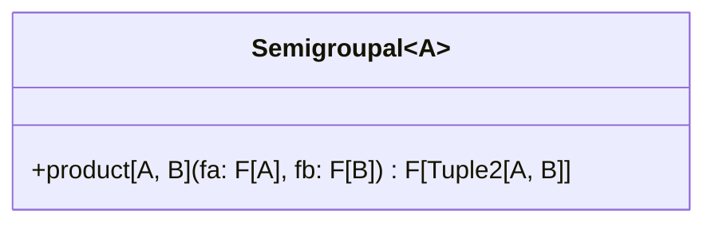

# Semigroupal

**Semigroupal** is an abstraction from functional programming that allows combining two or more values
that are within a context (e.g., in `Option`, `List`, `Future`, etc.) into a single value.
Unlike [`Applicative`](applicative.md), `Semigroupal` does not require the `pure` operation
(which lifts a value into a context), making it a more general and less strict abstraction.

**Why is Semigroupal needed?**

`Semigroupal` is useful when you need to:

- Combine several values within a context into a single value (e.g., a pair or tuple).
- Work with effects (e.g., asynchrony, optionality, errors) without needing to use
  stricter abstractions like `Applicative` or `Monad`.
- Create composable and expressive combinators for working with contexts.

**Examples of Semigroupal**

- `Option` as Semigroupal. `Option` is a container that can hold a value (`Some`) or be empty (`None`).
  `Semigroupal` allows combining two optional values into a pair.
- `List` as Semigroupal. `List` is a container holding multiple values.
  `Semigroupal` allows combining two lists, creating a Cartesian product.
- `Future` as Semigroupal. `Future` is a container representing an asynchronous computation.
  `Semigroupal` allows combining two asynchronous computations into one.

## Formal Definition

`Semigroupal` is a type class that allows combining contexts.
If you have two objects of type `F[A]` and `F[B]`, `Semigroupal[F]` allows combining them into an object of type `F[(A, B)]`:
`product: (F[A], F[B]) => F[(A, B)]` (also known as `tuple2`).

`Semigroupal` must satisfy the following laws:

- **associativity**: `product(a, product(b, c)) == product(product(a, b), c)`

## Code

```dotty
trait Semigroupal[F[_]]:
  def product[A, B](fa: F[A], fb: F[B]): F[(A, B)]
```

### Laws

The associativity law states that the order in which you combine values should not affect the result.
For example, if you have three values in a context: `fa`, `fb`, and `fc`, then:

- First combine `fa` and `fb`, then combine the result with `fc` — this is the same as:
- First combine `fb` and `fc`, then combine the result with `fa`.

The associativity law ensures predictability and consistency when working with contexts.
This is especially important in functional programming, where composition and operation combination are core principles.

## Exercises

### Exercise 2.3.1: Implement Semigroupal for the Identity type Id.

> [Repository with exercises and instructions][sample]

Implement a `Semigroupal` instance for the identity type `Id[A]`, which is a simple wrapper around a value `A`.
The `product` operation should create a pair of two values, wrapped in `Id`.

```dotty
type Id[A] = A
object Id:
  def apply[A](a: A): Id[A] = a

given Semigroupal[Id] with
  def product[A, B](fa: Id[A], fb: Id[B]): (A, B) = ???
```

**Examples:**

```dotty
import Semigroupal.given

val a: Id[Int] = Id(42)
val b: Id[String] = Id("Hello")
val c: Id[Boolean] = Id(true)

// Combining two values
val result1 = product(a, b)     // Id((42, "Hello"))
val result2 = product(a, c)     // Id((42, true))
val result3 = product(b, c)     // Id(("Hello", true))
```

@:note(🔍 Show solution)

The identity type `Id[A]` is simply a wrapper around a value `A`,
so `product` should take two such values `fa` and `fb`,
which are actually just values of types `A` and `B`,
and return a pair `(fa, fb)` wrapped in `Id`.

```dotty
given Semigroupal[Id] with
  def product[A, B](fa: Id[A], fb: Id[B]): (A, B) =
    Id((fa, fb))
```

@:@

### Exercise 2.3.2: Implement Semigroupal for the Option type

`Semigroupal` for `Option` should combine two values of type `Option[A]` and `Option[B]` into `Option[(A, B)]`.
Such behavior resembles logical "AND" for the presence of values.
Implement a `Semigroupal[Option]` instance following this rule.

```dotty
given Semigroupal[Option] with
  def product[A, B](fa: Option[A], fb: Option[B]): Option[(A, B)] = ???
```

**Examples:**

```dotty
import Semigroupal.given

val someInt: Option[Int] = Some(42)
val someString: Option[String] = Some("Hello")
val someBoolean: Option[Boolean] = Some(true)
val noneInt: Option[Int] = None

val result1 = product(someInt, someString)     // Some((42, "Hello"))
val result2 = product(someInt, someBoolean)    // Some((42, true))
val result3 = product(someString, someBoolean) // Some(("Hello", true))
val result4 = product(someInt, noneString)     // None
```

@:note(🔍 Show solution)

The solution uses pattern matching on the pair of values `(fa, fb)`.
If both values are `Some(a)` and `Some(b)`,
we extract their contents and return `Some((a, b))` — a pair of both values.
In all other cases (when at least one of the values is `None`) we return `None`.
Such an implementation matches the semantics of "fault-tolerant" combination:
if at least one of the components is absent, the entire result is considered absent.

```dotty
given Semigroupal[Option] with
  def product[A, B](fa: Option[A], fb: Option[B]): Option[(A, B)] =
    (fa, fb) match
      case (Some(a), Some(b)) => Some((a, b))
      case _                  => None
```

@:@

### Exercise 2.3.3: Implement Semigroupal for the List type

`Semigroupal` for `List` should combine two lists into a list of pairs of elements.
The implementation should create pairs from elements with the same indices (positions)
and stop combining when at least one of the lists ends.

Implement a `Semigroupal[List]` instance following this rule.

```dotty
given Semigroupal[List] with
  def product[A, B](fa: List[A], fb: List[B]): List[(A, B)] = ???
```

**Examples:**

```dotty
import Semigroupal.given

val numbers = List(1, 2, 3, 4, 5)
val strings = List("a", "b", "c")
val booleans = List(true, false)

val result1 = product(numbers, strings)   
// List((1,"a"), (2,"b"), (3,"c"))
val result2 = product(numbers, booleans)  
// List((1,true), (2,false))
```

@:note(🔍 Show solution)

The solution uses recursive pattern matching.
The base case is when at least one of the lists is empty (the pattern `_` combined with `Nil`), in which case an empty list `Nil` is returned.
The recursive case is when both lists are non-empty and have the form `a :: tailA` and `b :: tailB`.
In this case, we create a pair from the heads `(a, b)`, and prepend it to the result of the recursive call `product(tailA, tailB)`.
Importantly, this implementation truncates the result to the length of the shorter list,
which matches the behavior of the standard `zip` method.
This approach guarantees linear O(min(n, m)) complexity and preserves element order.

```dotty
given Semigroupal[List] with
  def product[A, B](fa: List[A], fb: List[B]): List[(A, B)] =
    (fa, fb) match
      case (a :: tailA, b :: tailB) =>
        (a, b) :: product(tailA, tailB)
      case _ => Nil
```

@:@

## Schema



## Implementation in Libraries

### Implementation in Cats

```dotty
import cats.Semigroupal
import cats.instances.option.*

Semigroupal[Option].product(Some(123), Some("abc")) // Some((123,abc))
Semigroupal.tuple3(Option(1), Option(2), Option(3)) // Some((1,2,3))
```

---

**References:**

- [Link to the repository with exercises][sample]
- [Cats API](https://typelevel.org/cats/api/cats/Semigroupal.html)
- [Herding Cats](http://eed3si9n.com/herding-cats/Semigroupal.html)
- [Scala with Cats](https://scalawithcats.com/dist/scala-with-cats.html#semigroupal)

[sample]: https://gitverse.ru/scalabook/typeclasses
