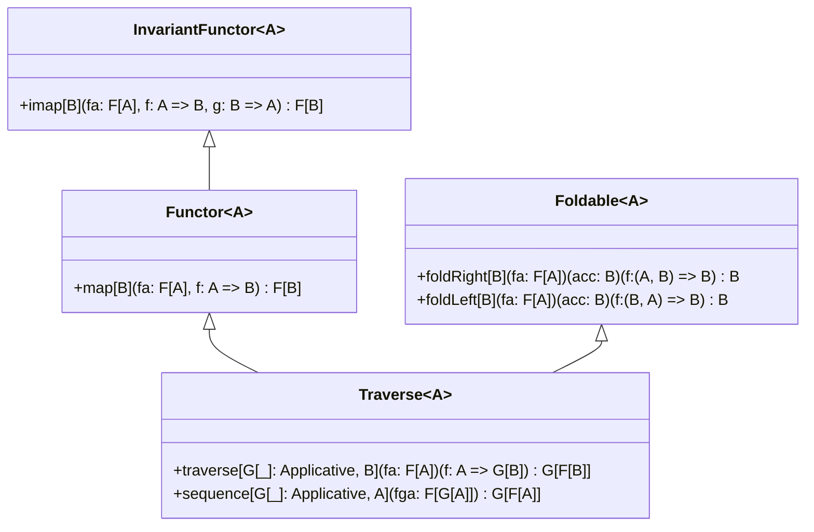

# Traverse

`Traverse` is a concept from functional programming
that extends the capabilities of [`Functor`](functor.md) and [`Foldable`](foldable.md).
It allows "traversing" a data structure, applying a function to each element
and collecting results into a new structure.

The main idea of `Traverse` is the ability to work with effects
(e.g., `Option`, `Future`, `Either`) inside a data structure.

**Main characteristics of `Traverse`:**

- **`traverse` operation**:
  Applies a function to each element of a data structure, collecting results into a new structure with an effect.
  For example, you can convert a list of numbers into a list of `Option` or `Future`.
- **`sequence` operation**:
  Converts a data structure containing effects into an effect containing a data structure.
  For example, you can convert a list of `Option` into an `Option` of a list.
- **Combination with effects**:
  `Traverse` allows working with effects (e.g., error handling, asynchronous computations) inside data structures.

**Examples of `Traverse`**

- **Converting a list of `Option` to an `Option` of a list**.
  Suppose you have a list of numbers and need to convert each number to an `Option` (e.g., checking whether the number is even).
  With `Traverse`, you can apply this operation to all elements of the list and obtain an `Option` of a list.
- **Converting a list of `Future` to a `Future` of a list**.
  Suppose you have a list of asynchronous computations (`Future`).
  With `Traverse`, you can convert this list into a single asynchronous computation that returns a list of results.
- **Error handling in a list**.
  Suppose you have a list of operations, each of which may fail (`Either`).
  With `Traverse`, you can execute all operations and collect the results into a single `Either`,
  which either contains a list of successful results or the first error.
- **Data validation**.
  Suppose you have a list of data, and you need to check each element against certain rules
  (e.g., using a validator). With `Traverse`, you can apply the validator to all elements
  and collect the results into a single object, which either contains all data or a list of errors.
- **JSON transformation**.
  Suppose you have a JSON object, and you need to convert each field to a certain type (e.g., a string to a number).
  With `Traverse`, you can apply the conversion function to all fields and collect the results into a new JSON object.

## Formal Definition

`Traverse` is a data type extending [`Functor`](functor.md) and [`Foldable`](foldable.md),
for which a `traverse` operation (and its variant `sequence`) is defined, satisfying the following properties:

- **`traverse` operation**:
  For a type `F[A]` (where `F` is a container and `A` is the element type) and an [applicative functor](applicative.md) `G`,
  the `traverse` operation has the signature:
  `def traverse[G[_]: Applicative, A, B](fa: F[A])(f: A => G[B]): G[F[B]]`
  Here:
    - `fa` — a container with elements of type `A`.
    - `f` — a function that takes an element of type `A` and returns a value of type `G[B]` (an effect).
    - `G` — an applicative functor of effects.
    - The result is a value of type `G[F[B]]`, where `F[B]` is a new data structure and `G` is the effect.
- **`sequence` operation**:
  This is a special case of `traverse` where function `f` is the identity transformation (`identity`).
  It converts a data structure containing effects into an effect containing a data structure:
   `def sequence[G[_]: Applicative, A](fga: F[G[A]]): G[F[A]]`

Using `traverse`, both `map` and `foldRight` can be expressed, as well as `sequence`, which maps `F[G[A]]` to `G[F[A]]`.
For this reason, `Traverse` is sometimes called a _traversable functor_.

### Laws of `Traverse`

For a data type to be considered `Traverse`, it must satisfy certain laws.
Here are the main ones:

- **Consistency law with `map`**:
  The `traverse` operation must be consistent with the `map` operation:
  `traverse(fa)(x => Applicative[G].pure(f(x))) == Applicative[G].pure(fa.map(f))`
- **Consistency law with `sequence`**:
  The `sequence` operation must be consistent with `traverse`:
  `sequence(fga) == traverse(fga)(identity)`
- Traversing `Id` is equivalent to `Functor#map`:
  ```dotty
  type Id[A] = A
  traverse[F, Id, A, B](fa, a => Id(f(a))) == fa.map(f)
  ```
- Two sequentially dependent effects can be combined into one, their composition:
  ```dotty
  val optFb: G[F[B]] = traverse[F, G, A, B](fa, a => unit(f(a)))
  val optListFc1: G[H[F[C]]] =
      map[G, F[B], H[F[C]]](
        optFb,
        fb => traverse[F, H, B, C](fb, b => unit(g(b)))
      )
  val optListFc2: G[H[F[C]]] =
      traverse[F, [X] =>> G[H[X]], A, C](
        fa,
        a => map[G, B, H[C]](unit(f(a)), b => unit(g(b)))
      )
  optListFc1 == optListFc2
  ```
- Two independent effects can be combined into one effect, their product
  ```dotty
  type GH[A] = (G[A], H[A])
  val t1: GH[F[B]] =
      (traverse[F, G, A, B](fa, a => unit(f(a))),
      traverse[F, H, A, B](fa, a => unit(f(a))))
  val t2: GH[F[B]] = traverse[F, GH, A, B](fa, a => (unit(f(a)), unit(f(a))))
  t1 == t2
  ```

## Code

```dotty
trait Traverse[F[_]] extends Functor[F], Foldable[F]:
  import Traverse.given

  extension [A](fa: F[A])
    def traverse[G[_]: Applicative, B](f: A => G[B]): G[F[B]]

    override def map[B](f: A => B): F[B] =
      traverse[[X] =>> X, B](a => f(a))

    override def foldMap[B](f: A => B)(using mb: Monoid[B]): B =
      val state: State[B, F[A]] =
        traverse(a => State[B, A]((b: B) => (mb.combine(b, f(a)), a)))(using
          stateApplicative
        )
      val (b, _) = state.run(mb.empty)
      b

  def sequence[G[_]: Applicative, A](fga: F[G[A]]): G[F[A]] =
    fga.traverse(ga => ga)
    
object Traverse:
  def apply[F[_]: Traverse]: Traverse[F] = summon[Traverse[F]]

  given Applicative[[X] =>> X] with
    override def unit[A](a: => A): A = a

    override def apply[A, B](fab: A => B)(fa: A): B =
      fab(fa)

  given stateApplicative[S]: Applicative[[X] =>> State[S, X]] = 
    ??? // Exercise 2.5.6: Implementation of Applicative for State type   
```

## Implementation of `map`, `foldMap`, and `sequence` in `Traverse`

### Implementing `map` via `traverse`

```dotty
override def map[B](f: A => B): F[B] =
  traverse[[X] =>> X, B](a => f(a))
```

**How it works:**

`map` is a special case of `traverse` where the effect `G` is the **identity type** `Id[A] = A` (no effect).

- `traverse[G[_]: Applicative, B](f: A => G[B]): G[F[B]]`
- Substitute `G = [X] =>> X` (identity functor)
- `f: A => Id[B] = A => B`
- Result: `Id[F[B]] = F[B]`

An instance is defined in the `Traverse` object:

```dotty
given Applicative[[X] =>> X] with
  override def unit[A](a: => A): A = a
  override def apply[A, B](fab: A => B)(fa: A): B = fab(fa)
```

This instance makes the identity type an applicative functor:

- `unit(a)` simply returns `a`
- `apply` applies a function to an argument

### Implementing `foldMap` via `traverse`

```dotty
override def foldMap[B](f: A => B)(using mb: Monoid[B]): B =
  val state: State[B, F[A]] =
    traverse(a => 
      State[B, A] { (b: B) =>
        (mb.combine(b, f(a)), a)
      }
    )(using stateApplicative)
  
  val (result, _) = state.run(mb.empty)
  result
```

**Step 1: Transforming each element to a State computation**

For each element `a`, a `State[B, A]` is created:

```dotty
State[B, A] { (b: B) =>
  (mb.combine(b, f(a)), a)
}
```

This computation:

- Takes the current accumulator `b` (of type `B`)
- Combines it with `f(a)` using the monoid operation: `mb.combine(b, f(a))`
- Returns a pair `(new_accumulator, original_element_a)`

**Step 2: traverse with State**

```dotty
val state: State[B, F[A]] = traverse(...)(using stateApplicative)
```

`traverse` traverses the structure `F[A]` and:

- For each element `a`, creates a `State` computation that updates the accumulator
- Combines them using the `State` applicative
- Result: `State[B, F[A]]` — a computation that:
    - Takes an initial state (the empty element of the monoid)
    - Returns the final state and the original structure `F[A]`

**Step 3: Running the State computation**

```dotty
val (result, _) = state.run(mb.empty)
```

- Run State with the initial accumulator `mb.empty`
- Get the final accumulator `result` — this is the result of `foldMap`
- Ignore `F[A]` (the original structure)

#### Why does this work as `foldMap`?

For each element of the structure, we sequentially combine the accumulator with `f(a)`:

```dotty
// For a list [a1, a2, a3] with empty initial value:

// Step 1: (empty, a1) -> combine(empty, f(a1)) = f(a1)
// Step 2: (f(a1), a2) -> combine(f(a1), f(a2))
// Step 3: (combine(f(a1), f(a2)), a3) -> combine(combine(f(a1), f(a2)), f(a3))

// Result: combine(combine(combine(empty, f(a1)), f(a2)), f(a3))
```

This is exactly left-associative fold, which for a monoid is equivalent to `foldMap` (since the monoid is associative).

### Example for a list of integers

```dotty
val list = List(1, 2, 3, 4)

// foldMap for sum
list.foldMap(identity)(using Monoid.intAdditionMonoid)

// Process:
// 1. state.run(0): (0, 1) -> combine(0, 1) = 1
// 2. (1, 2) -> combine(1, 2) = 3
// 3. (3, 3) -> combine(3, 3) = 6
// 4. (6, 4) -> combine(6, 4) = 10
// Result: 10

// foldMap for string concatenation
list.foldMap(_.toString)(using Monoid.stringMonoid)

// Result: "1234"
```

### Implementing `sequence`

```dotty
def sequence[G[_]: Applicative, A](fga: F[G[A]]): G[F[A]] =
  fga.traverse(ga => ga)
```

**How it works:**

`sequence` "flips" the structures: from `F[G[A]]` it produces `G[F[A]]`.

- Input: `F[G[A]]` — structure `F` containing effects `G`
- Output: `G[F[A]]` — effect `G` containing structure `F[A]`

**Implementation via `traverse`:**

```dotty
fga.traverse(ga => ga)
```

- `traverse` expects a function `A => G[B]`
- Here `fga: F[G[A]]`, meaning each element has type `G[A]`
- Function `ga => ga` is the **identity function**: `G[A] => G[A]`
- `traverse` applies this function to each element and collects results

**Types:**

- `traverse[G[_], B](f: A => G[B]): G[F[B]]`
- Substitute `A = G[A]` (element of structure `F` has type `G[A]`)
- Substitute `B = A`
- `f: G[A] => G[A]` — identity function
- Result: `G[F[A]]`

**Example for `List[Option[Int]]`:**

```dotty
val listOpt: List[Option[Int]] = List(Some(1), Some(2), Some(3))

// sequence flips the structure
val optList = sequence(listOpt)  // Some(List(1, 2, 3))

// How it works:
// traverse iterates over the list: Some(1), Some(2), Some(3)
// Each element ga => ga returns Some(1), Some(2), Some(3)
// Applicative[Option] combines them: Some(1) *> Some(2) *> Some(3)
// Result: Some(List(1, 2, 3))

// If there is a None:
val listOpt2: List[Option[Int]] = List(Some(1), None, Some(3))
val optList2 = sequence(listOpt2)  // None
```

**Example for `Option[List[Int]]`:**

```dotty
val optList: Option[List[Int]] = Some(List(1, 2, 3))

// sequence flips the structure
val listOpt = sequence(optList)  // List(Some(1), Some(2), Some(3))
```

### Summary

| Method       | Expressed via         | Key idea                    |
|--------------|-----------------------|------------------------------|
| `map`        | `traverse` with `Id`  | Identity effect              |
| `foldMap`    | `traverse` with `State` | Accumulator as state       |
| `sequence`   | `traverse` with `identity` | Flipping effects          |

`Traverse` combines the capabilities of `Functor`, `Foldable`, and adds an **effectful traversal** over a data structure,
which makes it one of the most powerful abstractions in functional programming.

## Exercises

### Exercise 2.10.1: Implement Traverse for type Option.

> [Repository with exercises and instructions][sample]

Implement the `Traverse` instance for `Option`:

```dotty
given Traverse[Option] with
  extension [A](fa: Option[A])
    override def traverse[G[_]: Applicative, B](f: A => G[B]): G[Option[B]] = ???
```

**Examples:**

```dotty
val opt = Some(5)

// traverse with List as effect
opt.traverse(x => List(x, x * 2)) 
// List(Some(5), Some(10))

// Type conversion
opt.traverse(x => Right(x.toString): Either[String, String]) 
// Right(Some("5"))
```

@:note(🔍 Show solution)

The implementation uses pattern matching: for `Some(a)` we apply `f(a)`, obtaining `G[B]`,
then use `map` to lift the result into `Some`, getting `G[Option[B]]`.
For `None` we simply return `None` lifted into the `G` context via `ap.unit(None)`.

```dotty
given Traverse[Option] with
  extension [A](fa: Option[A])
    override def traverse[G[_]: Applicative as ap, B](f: A => G[B])
        : G[Option[B]] =
      fa match
        case Some(a) => f(a).map(Some(_))
        case None    => ap.unit(None)
```

@:@

### Exercise 2.10.2: Implement Traverse for type List.

Implement the `Traverse` instance for `List`.

```dotty
given Traverse[List] with
  extension [A](fa: List[A])
    override def traverse[G[_]: Applicative, B](f: A => G[B]): G[List[B]] = ???
```

**Examples:**

```dotty
// traverse with Option as effect
val list1 = List(1, 2, 3)
list1.traverse(x => Some(x * 2))   // Some(List(2, 4, 6))
list1.traverse(x => if x % 2 == 0 then Some(x) else None) // None

// traverse with Either as effect
list1.traverse(x => Right(x.toString): Either[String, String]) // Right(List("1","2","3"))
list1.traverse(x => if x > 0 then Right(x) else Left("negative")) // Right(List(1,2,3))
```

@:note(🔍 Show solution)

We use `foldRight`, starting with `g.unit(List[B]())` — an empty list in the `G` context.
For each element `a` and current accumulator `acc`, we apply `f(a)`, obtaining `G[B]`,
and combine it with `acc` via `map2`.
The function `(b, bs) => b :: bs` prepends a new element to the list,
which restores the original order when traversing from right to left.

```dotty
given Traverse[List] with
  extension [A](fa: List[A])
    override def traverse[G[_]: Applicative as g, B](
        f: A => G[B]
    ): G[List[B]] =
      fa.foldRight(g.unit(List[B]()))((a, acc) => f(a).map2(acc)(_ :: _))
```

@:@

### Exercise 2.10.3: Implement Traverse for a pair (tuple2).

Implement the `Traverse` instance for a pair `(X, X)`.

```dotty
given Traverse[[X] =>> (X, X)] with
  extension [A](fa: (A, A))
    override def traverse[G[_]: Applicative, B](f: A => G[B]): G[(B, B)] = ???
```

**Examples:**

```dotty
val pair = (1, 2)

// traverse with Option as effect
pair.traverse(x => Some(x * 2))    // Some((2, 4))
pair.traverse(x => None)           // None

// traverse with List as effect
pair.traverse(x => List(x, x * 2)) 
// List((1,2), (1,4), (2,2), (2,4))

// traverse with Either as effect
pair.traverse(x => Right(x.toString)) // Right(("1","2"))
```

@:note(🔍 Show solution)

We create a curried function `b1 => b2 => (b1, b2)`, lift it into `G` via `g.unit`. Then apply this function first to `f(fa._1)`, obtaining `G[B => (B, B)]`, and then to `f(fa._2)`, obtaining `G[(B, B)]`. This is a standard pattern for applicative traversal of tuples.

```dotty
given Traverse[[X] =>> (X, X)] with
  extension [A](fa: (A, A))
    override def traverse[G[_]: Applicative as g, B](f: A => G[B])
        : G[(B, B)] =
      val func: G[B => B => (B, B)] = g.unit(b1 => b2 => (b1, b2))
      g.apply(g.apply(func)(f(fa._1)))(f(fa._2))
```

@:@

### Exercise 2.10.4: Implement Traverse for a triple (tuple3).

Implement the `Traverse` instance for a triple `(X, X, X)`.

```dotty
given Traverse[[X] =>> (X, X, X)] with
  extension [A](fa: (A, A, A))
    override def traverse[G[_]: Applicative, B](f: A => G[B]): G[(B, B, B)] = ???
```

**Examples:**

```dotty
val triple = (1, 2, 3)

// traverse with Option as effect
triple.traverse(x => Some(x * 2))    // Some((2, 4, 6))
triple.traverse(x => None)           // None

// traverse with List as effect
triple.traverse(x => List(x, x * 2)) 
// 8 variants: all combinations (1/2, 2/4, 3/6)

// traverse with Either as effect
triple.traverse(x => Right(x.toString)) // Right(("1","2","3"))
```

@:note(🔍 Show solution)

We create a curried function of three arguments `b1 => b2 => b3 => (b1, b2, b3)`,
lift it into `G` via `g.unit`.
Then we apply `g.apply` three times: first to `f(fa._1)`, obtaining `G[B => B => (B, B, B)]`,
then to `f(fa._2)`, obtaining `G[B => (B, B, B)]`,
and finally to `f(fa._3)`, obtaining `G[(B, B, B)]`.

```dotty
given Traverse[[X] =>> (X, X, X)] with
  extension [A](fa: (A, A, A))
    override def traverse[G[_]: Applicative as g, B](f: A => G[B])
        : G[(B, B, B)] =
      val func: G[B => B => B => (B, B, B)] =
        g.unit(b1 => b2 => b3 => (b1, b2, b3))
      g.apply(g.apply(g.apply(func)(f(fa._1)))(f(fa._2)))(f(fa._3))
```

@:@

### Exercise 2.10.5: Implement Traverse for a binary tree (Tree).

`Tree` is a recursive data structure where each node contains a value (`head`) and a list of subtrees (`tail`).
When traversing a tree, we must:

1. Apply the effectful function `f` to the node `head`
2. Recursively traverse all subtrees in `tail` using `traverse` (a list of trees)
3. Combine results via `map2` using the constructor `Tree(_, _)`

Implement the `Traverse` instance for `Tree`.

```dotty
case class Tree[+A](head: A, tail: List[Tree[A]])

given Traverse[Tree] with
  extension [A](ta: Tree[A])
    override def traverse[G[_]: Applicative, B](f: A => G[B]): G[Tree[B]] = ???
```

**Examples:**

```dotty
val tree = Tree(1, List(Tree(2, Nil), Tree(3, Nil)))

// traverse with Option as effect
tree.traverse(x => Some(x * 2))   
// Some(Tree(2, List(Tree(4, Nil), Tree(6, Nil))))

tree.traverse(x => if x % 2 == 0 then Some(x) else None) // None

// traverse with Either as effect
tree.traverse(x => Right(x.toString)) 
// Right(Tree("1", List(Tree("2", Nil), Tree("3", Nil))))
```

@:note(🔍 Show solution)

For the tree node, we first apply `f` to `head`, obtaining `G[B]`.
Then we recursively traverse `tail` — a list of subtrees. To do this, we call `ta.tail.traverse(_.traverse(f))`.
Note: `ta.tail` has type `List[Tree[A]]`, so `.traverse` requires a function `Tree[A] => G[Tree[B]]`.
We obtain this function by applying `_.traverse(f)`.
Then we use `map2` to combine the result for the head and the list of subtrees, using `Tree(_, _)`.

```dotty
case class Tree[+A](head: A, tail: List[Tree[A]])

given Traverse[Tree] with
  extension [A](ta: Tree[A])
    override def traverse[G[_]: Applicative, B](f: A => G[B]): G[Tree[B]] =
      f(ta.head).map2(ta.tail.traverse(a => a.traverse(f)))(Tree(_, _))
```

@:@

### Exercise 2.10.6: Implement Traverse for Map.

`Map[K, A]` is a data structure that maps keys to values.
When traversing a map, we must apply the effectful function `f` to each value, while preserving the corresponding keys.

Implement the `Traverse` instance for `Map[K, *]` (fixed key type `K`).

```dotty
given mapTraverse[K]: Traverse[[X] =>> Map[K, X]] with
  extension [A](m: Map[K, A])
    override def traverse[G[_]: Applicative, B](f: A => G[B]): G[Map[K, B]] = ???
```

**Examples:**

```dotty
val map = Map("a" -> 1, "b" -> 2, "c" -> 3)

// traverse with Option as effect
map.traverse(x => Some(x * 2))   // Some(Map("a" -> 2, "b" -> 4, "c" -> 6))
map.traverse(x => None)          // None

// traverse with List as effect
map.traverse(x => List(x, x * 2))
// 2^3 = 8 variants: for each key the value can be x or x*2

// traverse with Either as effect
map.traverse(x => Right(x.toString)) // Right(Map("a" -> "1", "b" -> "2", "c" -> "3"))
```

@:note(🔍 Show solution)

We use `foldLeft` over the map, starting with `g.unit(Map.empty[K, B])`. For each entry `(k, a)`, the current accumulator `acc` has type `G[Map[K, B]]`. Using `acc.map2(f(a))` we combine the existing map with the result of applying `f` to value `a`. The function `(m, b) => m + (k -> b)` adds the new pair to the map. The result is `G[Map[K, B]]` — a map where all values are transformed while preserving keys.

```dotty
given mapTraverse[K]: Traverse[[X] =>> Map[K, X]] with
  extension [A](m: Map[K, A])
    override def traverse[G[_]: Applicative, B](f: A => G[B]): G[Map[K, B]] =
      m.foldLeft(summon[Applicative[G]].unit(Map.empty[K, B])) {
        case (acc, (k, a)) =>
          acc.map2(f(a))((m, b) => m + (k -> b))
      }
```

@:@

## Schema



## Implementation in Libraries

### Implementation in Cats

```dotty
import scala.concurrent.*
import scala.concurrent.duration.*
import scala.concurrent.ExecutionContext.Implicits.global

val hostnames = List(
  "alpha.example.com",
  "beta.example.com",
  "gamma.demo.com"
)

def getUptime(hostname: String): Future[Int] =
  Future(hostname.length * 60)

val allUptimes: Future[List[Int]] =
  Future.traverse(hostnames)(getUptime)

Await.result(allUptimes, 1.second)  // List(1020, 960, 840)
```

### Implementation in ScalaZ

```dotty
import scalaz.*
import Scalaz.*

List(1, 2, 3) traverse { x => (x > 0) option (x + 1) }  // Some(List(2, 3, 4))
List(1.some, 2.some).sequence                           // Some(List(1, 2))
1.success[String].leaf.sequenceU map {_.drawTree}       // Success(1)
```

---

**References:**

- [Link to the repository with exercises][sample]
- [Classic abstractions used in FP](https://habr.com/ru/articles/896660/)
- [Cats](https://typelevel.org/cats/typeclasses/traverse.html)
- [Functional Programming in Scala, Second Edition](https://www.manning.com/books/functional-programming-in-scala-second-edition?query=Functional%20Programming%20in%20Scala,%20Second%20Edition)
- [Herding Cats](http://eed3si9n.com/herding-cats/Traverse.html)
- [Learn Functional Programming course/tutorial on Scala](https://github.com/dehun/learn-fp)
- [Scala with Cats](https://scalawithcats.com/dist/scala-with-cats.html#sec:traverse)
- [Scalaz API](https://javadoc.io/doc/org.scalaz/scalaz-core_3/7.3.6/scalaz/Traverse.html)
- [SKB – Scala Traversable](https://leobenkel.com/2021/01/skb-scala-traversable/)
- [Tour of Scala](https://tourofscala.com/scala/traversable)

[sample]: https://gitverse.ru/scalabook/typeclasses
