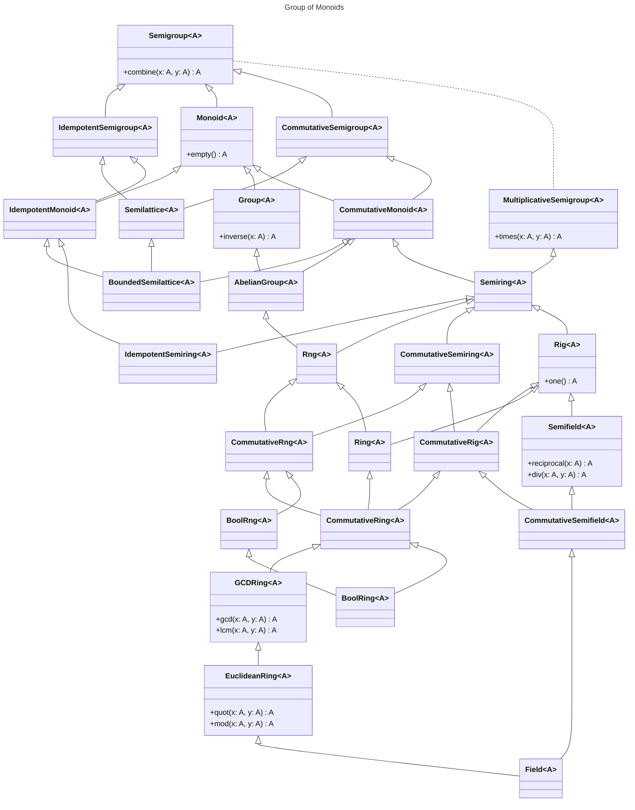
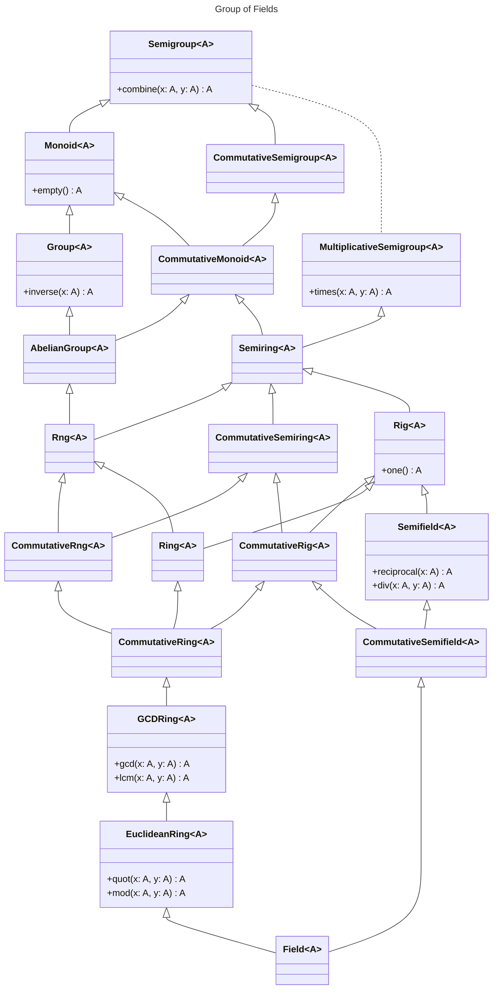
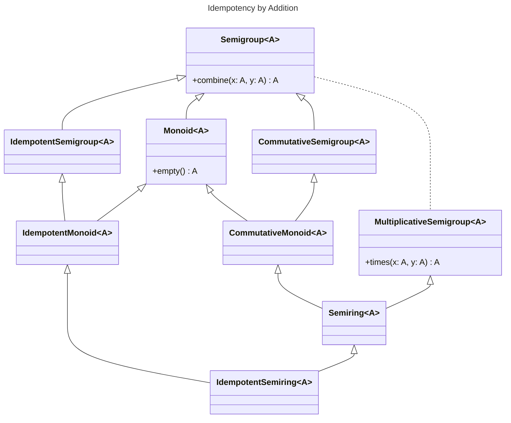
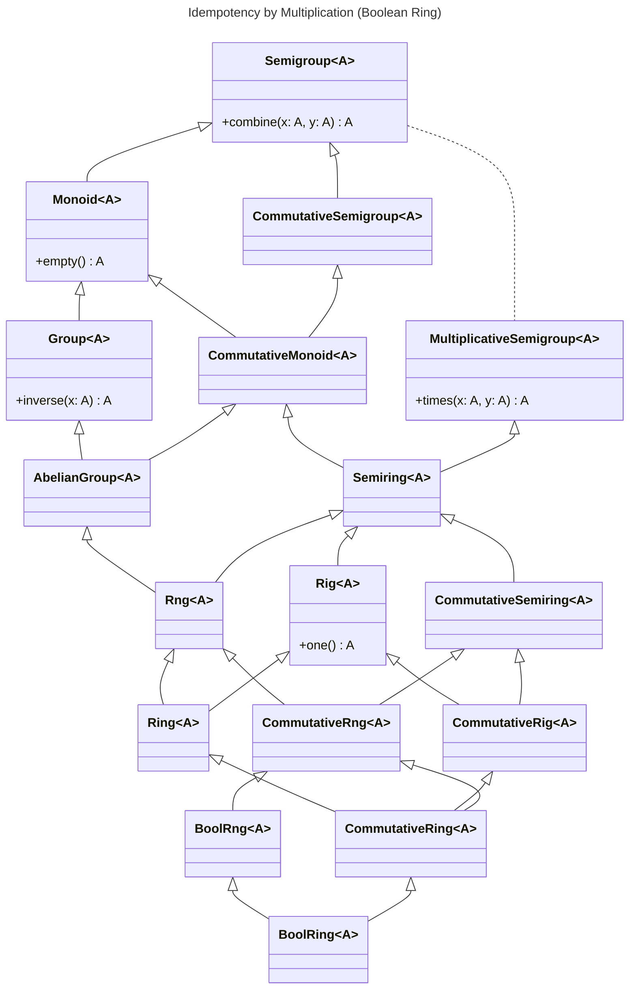
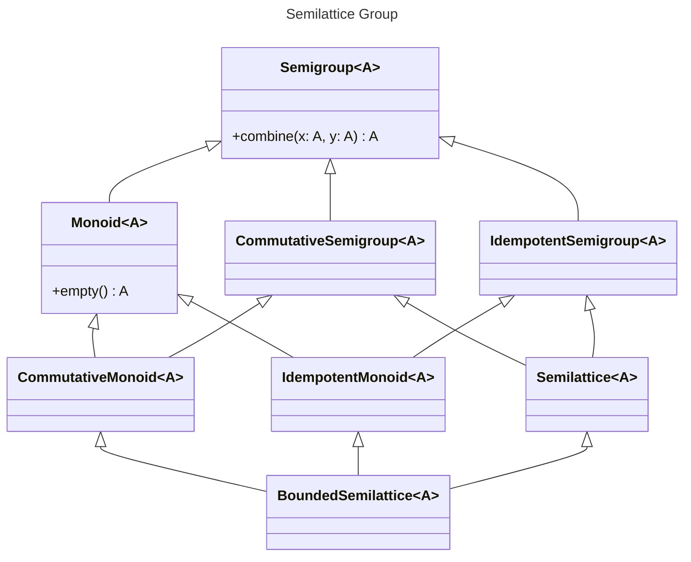

# Group of Monoids

**Monoids** are a fundamental concept in mathematics and computer science,
with broad applications in many fields,
including category theory, functional programming, and data processing.
A monoid is a structure consisting of a set of elements and a binary operation
that satisfies two key properties: associativity and the existence of an identity element.

## Usage

Monoids play an important role in various fields of mathematics and computer science due to their versatility
and ability to model a wide range of operations and data structures. Here are several reasons why monoids are useful:

### Generalization of operations

Monoids provide an abstract model for many common operations, such as addition of numbers,
concatenation of strings, union of sets, and others.
This allows the development of generalized algorithms and data structures
that can be applied to many different data types without the need to rewrite code for each specific case.

### Associativity

An associative operation, one of the main characteristics of monoids, means that
the order in which operations are performed does not affect the result.
This property makes monoids convenient for optimizing computations,
since it allows rearranging operations for improved execution efficiency.

### Identity element

The existence of an identity element guarantees that applying the operation to this element leaves the result unchanged.
For example, adding zero to a number or concatenating an empty string to another string does not change the original value.
This property is useful for initializing variables and handling edge cases.

### Functional programming

In functional programming, monoids are often used to create higher-order functions
that process collections of data. For example, a `fold` (or `reduce`) function can take any monoidal operator
and apply it to a sequence of elements,
which makes it easy to write generalized algorithms for summing, merging, and other operations.

### Parallel computations

Thanks to the property of associativity, operations in a monoid can be executed in parallel,
which significantly speeds up task execution on multiprocessor systems or clusters.
For example, the sum of a large array of numbers can be computed faster
by splitting the array into parts, summing each part separately, and then merging the results.

### Category theory

In category theory, monoids are an important building block for describing various mathematical structures.
They help formalize relationships between objects and morphisms,
which has applications in theoretical computer science, physics, and other sciences.

### Practical applications

Monoids find applications in many different fields, including text processing,
data analysis, cryptography, machine learning, and many others.
For example, the use of monoidal structures allows efficient processing of large volumes of data,
such as event logs or streaming data.

Thus, monoids represent a powerful tool for developing generalized,
efficient, and scalable solutions in various fields of science and engineering.

## Example

Monoids are commonly used for folding sequences.
For example, here is how you can compute the product of numbers:

```dotty
trait Semigroup[A]:
  def combine(x: A, y: A): A

trait Monoid[A] extends Semigroup[A]:
  def empty: A

given Monoid[Int] with
  val empty = 1
  def combine(x: Int, y: Int): Int = x * y

def fold[A](xs: List[A])(using m: Monoid[A]): A =
  xs.foldLeft(m.empty)(m.combine)

fold(List(1, 2, 3, 4, 5))
// 120
```

## Monoid Diagram



And more detailed:









---

**References:**

- [Repository with exercises and instructions for completion][sample]
- [Learning Scalaz](http://eed3si9n.com/learning-scalaz/sum+function.html)
- [More on Monoids and Monads](https://apocalisp.wordpress.com/2010/07/21/more-on-monoids-and-monads/)
- [On Monoids](https://apocalisp.wordpress.com/2010/06/14/on-monoids/)
- [Scala with Cats][Scala with Cats]
- [Semigroups and Monoids in Scala](https://www.youtube.com/watch?v=LmBTiFYa-V4&amp;list=PLmtsMNDRU0Bzj7INIrLugi3a_WClwQuiS)

[sample]: https://gitverse.ru/scalabook/typeclasses
[Scala with Cats]: https://scalawithcats.com/dist/scala-with-cats.html#applications-of-monoids
