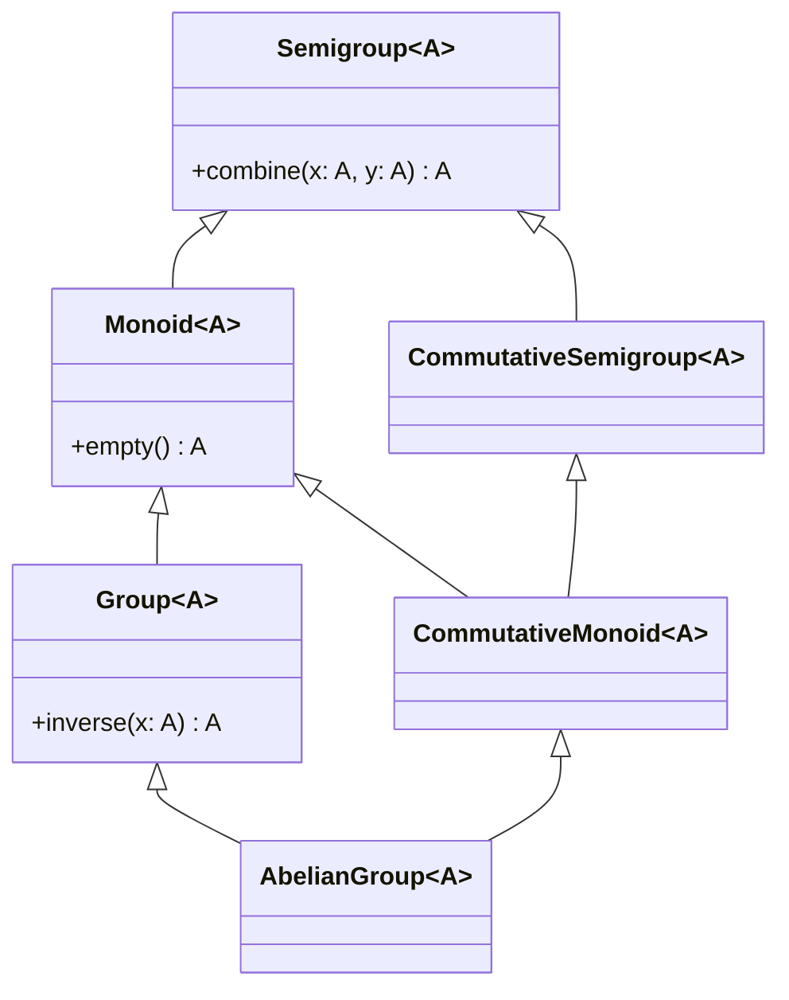

# Abelian Group

An **Abelian group** (or commutative group) is an algebraic structure
that combines the properties of a [group](group.md) and [commutativity](cmonoid.md).

Thus, an abelian group is a group in which the operation \\(\cdot\\) is commutative.
That is:

- **Associativity**: \\((a \cdot b) \cdot c = a \cdot (b \cdot c)\\) for any \\(a, b, c \in G\\).
- **Existence of identity element**: there exists \\(e \in G\\) such that \\(e \cdot a = a \cdot e = a\\) for any \\(a \in G\\).
- **Existence of inverse element**: for any \\(a \in G\\) there exists \\(a^{-1} \in G\\) such that \\(a \cdot a^{-1} = a^{-1} \cdot a = e\\).
- **Commutativity**: \\(a \cdot b = b \cdot a\\) for any \\(a, b \in G\\).

**Examples of abelian groups**

- **Set of integers with addition**:
    - Operation: \\(+\\).
    - Identity element: \\(0\\).
    - Inverse element for \\(a\\): \\(-a\\).
    - Commutativity: \\(a + b = b + a\\).
- **Set of real numbers with addition**:
    - Operation: \\(+\\).
    - Identity element: \\(0\\).
    - Inverse element for \\(a\\): \\(-a\\).
    - Commutativity: \\(a + b = b + a\\).
- **Set of complex numbers with addition**:
    - Operation: \\(+\\).
    - Identity element: \\(0\\).
    - Inverse element for \\(a\\): \\(-a\\).
    - Commutativity: \\(a + b = b + a\\).
- **Set of nonzero real numbers with multiplication**:
    - Operation: \\(\times\\).
    - Identity element: \\(1\\).
    - Inverse element for \\(a\\): \\(\frac{1}{a}\\).
    - Commutativity: \\(a \times b = b \times a\\).
- **Set of vectors in the plane with vector addition**:
    - Operation: \\(+\\).
    - Identity element: zero vector \\(\overrightarrow{0}\\).
    - Inverse element for \\(\overrightarrow{a}\\): \\(-\overrightarrow{a}\\).
    - Commutativity: \\(\overrightarrow{a} + \overrightarrow{b} = \overrightarrow{b} + \overrightarrow{a}\\).

Abelian groups play an important role in mathematics and its applications:

- **Algebra**: studied as basic algebraic structures.
- **Number theory**: used to analyze the properties of numbers and their operations.
- **Linear algebra**: vector spaces are abelian groups with respect to vector addition.
- **Topology**: used in algebraic topology to study homologies and cohomologies.
- **Physics**: used to describe symmetries in physical systems.

## Formal Definition

`AbelianGroup[A]` is an "abelian group", a [group](group.md) that is [commutative](cmonoid.md).

In addition to the laws of a group:

- _Closure_ (_closure_): for \\(\forall x, y \in G\\), \\(x + y \in G\\).
- _Associativity_ (_associativity_): for \\(\forall x, y, z \in G\\), \\((x + y) + z = x + (y + z)\\).
- _Identity_ (_identity_): there exists \\(\exists e \in G\\) such that
  for \\(\forall x \in G\\), \\(e + x = x + e = x\\)
- _Invertibility_: for \\(\forall x \in G\\) there exists \\((-x)\\) such that \\(x + (-x) = (-x) + x = 0\\)

the following law must hold:

- _Commutativity_ (_commutative_): for \\(\forall x, y \in G\\), \\(x + y = y + x\\).

## Code

```dotty
trait AbelianGroup[A] extends Group[A], CMonoid[A]
```

### Laws

Laws are inherited from [group](group.md) and [commutative monoid](cmonoid.md).

- Closure follows from the definition of the `combine` function: the result type of this function matches the type of the variables
  it takes.
- Associativity is expressed as follows:
  `g.combine(x, g.combine(y, z))` must equal `g.combine(g.combine(x, y), z)`.
  This means that the order of combining elements does not affect the final result.
- Identity means that if you combine any element `x` with the identity element (`g.empty`),
  the result will always equal `x`. In other words, the identity element does not change `x` when combined.
  This can be written as:
  - `g.combine(x, g.empty) == x`
  - `g.combine(g.empty, x) == x`
- Invertibility means that for every element `x` there exists an inverse `x.inverse`,
  which when combined with `x` yields the identity element `g.empty`.
  This can be written as:
  - `g.combine(x.inverse, x) == g.empty`
  - `g.combine(x, x.inverse) == g.empty`
- Commutativity means that the order of elements when combining does not matter.
  In other words, the result of the `combine` operation will be the same regardless of
  the order in which you pass elements `x` and `y`.
  This can be written as: `g.combine(x, y) == g.combine(y, x)`

## Exercises

### Exercise 1.4.1: Implementation of an abelian group for integers by addition.

> [Repository with exercises and instructions for completion][sample]

Fill in the missing parts (`???`):

```dotty
given AbelianGroup[Int] with
  val empty: Int = ???

  def combine(x: Int, y: Int): Int = ???

  extension (a: Int)
    def inverse: Int = ???
```

@:note(🔍 Show solution)

```dotty
given AbelianGroup[Int] with
  val empty = 0

  def combine(x: Int, y: Int): Int = x + y

  extension (a: Int)
    def inverse: Int = -a   
```

**Example calls**:

```dotty
AbelianGroup[Int].combine(5, 3)
// 8
AbelianGroup[Int].combine(3, 5)
// 8
AbelianGroup[Int].empty
// 0
AbelianGroup[Int].inverse(5)
// -5
```

@:@

## Diagram



## Implementation in Libraries

### [Implementation in Spire](../../libs/spire.md)

`AbGroup[A]` is an "abelian group", a group that is commutative.

```dotty
import spire.algebra.AbGroup

AbGroup[Int].inverse(1) // -1
```

---

**References:**

- [Repository with exercises and instructions for completion][sample]
- [Spire home page](https://typelevel.org/spire/)
- [Wikipedia](https://en.wikipedia.org/wiki/Abelian_group)

[sample]: https://gitverse.ru/scalabook/typeclasses
