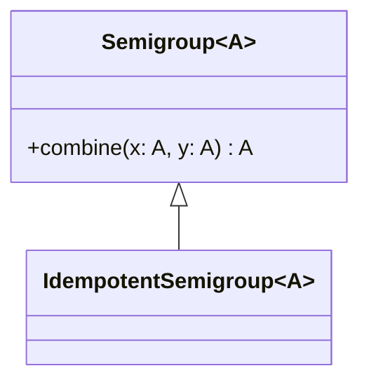

# Band

A **Band** is an algebraic structure consisting of a semigroup
in which all elements possess the property of idempotency.
Idempotency means that the result of an operation on any element with itself yields the same element,
that is, for any \\(a \in S\\), \\(a \cdot a = a\\) holds.

Thus, a band is a semigroup in which every element is "self-contained"
in the sense that multiplying it by itself does not change it.

**Why are bands needed?**

Bands play an important role in various fields of mathematics and applied sciences.
Here are several reasons:

- **Lattice theory**: Bands are closely related to lattices.
  In fact, any band can be represented as a lattice, and vice versa.
  This makes them useful for studying partially ordered sets.
- **Automata theory**: Bands are used to model the behavior of automata and processes,
  where the role of operations that do not change the state of the system is important
  (e.g., union or intersection operations on states).
- **Graph theory**: In graph theory, bands are used to describe operations
  on subsets of vertices or edges, such as union or intersection.
- **Programming and computer science**: In computer science, bands are used to model operations
  that are independent of the order of execution (e.g., operations on sets or boolean values).
- **Theory of formal languages**: Bands help describe rules for composing strings
  or characters in formal languages.

**Examples of bands**

- **Set of boolean values with the disjunction operation**:
  Consider the set \\(\{0, 1\}\\) with the disjunction operation \\(\lor\\). This is a band, because:
    - \\(0 \lor 0 = 0\\),
    - \\(1 \lor 1 = 1\\),
    - The operation \\(\lor\\) is associative.
- **Set of subsets with the union operation**:
  Let \\(S\\) be the set of all subsets of some universal set \\(U\\).
  The union operation \\(\cup\\) on \\(S\\) forms a band, because:
    - \\(A \cup A = A\\) for any \\(A \subseteq U\\),
    - The operation \\(\cup\\) is associative.

## Formal Definition

_Band_ is a [semigroup](semigroup.md) that is also idempotent,
i.e., adding a value to itself yields the same value.

`Band` must satisfy the following laws:

- _Closure_ (_closure_): for \\(\forall x, y \in B\\), \\(x + y \in B\\).
- _Associativity_ (_associativity_): for \\(\forall x, y, z \in B\\), \\((x + y) + z = x + (y + z)\\).
- _Idempotency_ (_idempotency_): for \\(\forall x \in B\\), \\(x + x = x\\).

## Code

```dotty
trait Band[A] extends Semigroup[A]:
  override def combineN(a: A, n: Int): Either[String, A] =
    if n <= 0 then
      Left("Repeated combining for semigroups must have n > 0")
    else Right(a) // combine(a, a) == a
```

### Laws

- Closure follows from the definition of the `combine` function: the result type of this function matches the type of the variables
  it takes.
- Associativity is expressed as follows:
  `s.combine(x, s.combine(y, z))` must equal `s.combine(s.combine(x, y), z)`.
  This means that the order of combining elements does not affect the final result.
- Idempotency is stated as:
  `s.combine(x, x)` must equal `x`.
  This means that combining an element with itself does not change it.

## Diagram



---

**References:**

- [Repository with exercises and instructions for completion][sample]
- [Scalaz API](https://javadoc.io/doc/org.scalaz/scalaz-core_3/7.3.6/scalaz/Band.html)

[sample]: https://gitverse.ru/scalabook/typeclasses
