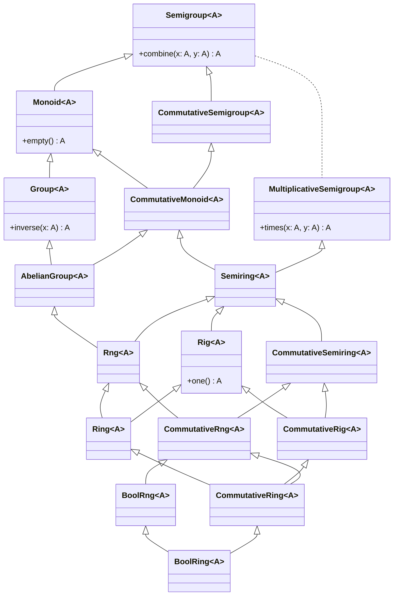

# Boolean Ring

A Boolean ring is a [ring](cring.md) in which multiplication is idempotent, i.e. `a · a = a` for all elements `a`.
This property also implies `a + a = 0` for all `a`, as well as the commutativity of multiplication: `a · b = b · a`.

A Boolean ring can be represented as a [commutative ring with identity](cring.md)
in which every element is idempotent with respect to multiplication.
In terms of lattice theory, a Boolean ring is a distributive lattice with complements.

The following laws must hold for a Boolean ring:

- _Additive closure_ (_closure_): for \\(\forall x, y \in B\\), \\(x + y \in B\\).
- _Additive associativity_ (_associativity_): for \\(\forall x, y, z \in B\\), \\((x + y) + z = x + (y + z)\\).
- _Existence of zero element_: there exists \\(\exists 0 \in B\\) such that for \\(\forall x \in B\\), \\(0 + x = x + 0 = x\\).
- _Additive invertibility_: for \\(\forall x \in B\\) there exists \\((-x)\\) such that \\(x + (-x) = (-x) + x = 0\\).
  In boolean algebra, \\(-x = x\\).
- _Additive commutativity_ (_commutative_): for \\(\forall x, y \in B\\), \\(x + y = y + x\\).
- _Multiplicative closure_ (_closure_): for \\(\forall x, y \in B\\), \\(x \* y \in B\\).
- _Multiplicative associativity_ (_associativity_): for \\(\forall x, y, z \in B\\), \\((x \* y) \* z = x \* (y \* z)\\).
- _Existence of unit element_: \\(\exists 1 \in B \quad \forall x \in B \quad x \* 1 = 1 \* x = x\\).
- _Multiplicative commutativity_: for \\(\forall x, y \in B\\), \\(x \* y = y \* x\\).
- _Distributivity_ (_distributivus_, _distributive law_): for \\(\forall x, y, z \in B\\),
  \\(x \* (y + z) = x \* y + x \* z\\) and \\((x + y) \* z = x \* z + y \* z\\).
- _Multiplicative idempotency_: for \\(\forall x \in B\\), \\(x \* x = x\\).
- _Negation property_: for \\(\forall x \in B\\), \\(x + x = 0\\).

## Code

```dotty
trait BoolRng[A] extends CommutativeRng[A]:
  extension (a: A)
    override def inverse: A = a
    
trait BoolRing[A] extends BoolRng[A], CommutativeRing[A]
```

## Diagram



---

**References:**

- [Repository with exercises and instructions for completion][sample]

[sample]: https://gitverse.ru/scalabook/typeclasses
