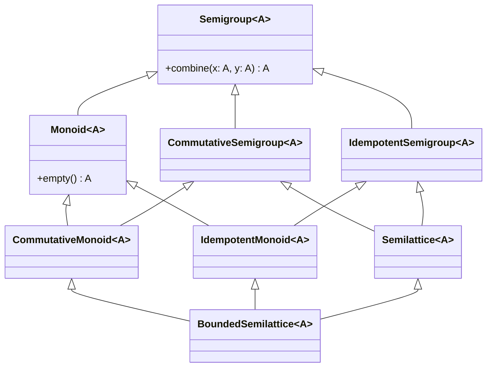

# Bounded Semilattice

`BoundedSemilattice[A]` is a [commutative](cmonoid.md) and [idempotent](idempotent-monoid.md) monoid,
a [semilattice](semilattice.md) with an identity element.

Laws of a bounded semilattice:

- _Closure_ (_closure_): for \\(\forall x, y \in CM\\), \\(x + y \in CM\\).
- _Associativity_ (_associativity_): for \\(\forall x, y, z \in CM\\), \\((x + y) + z = x + (y + z)\\).
- _Identity_ (_identity_): there exists \\(\exists e \in CM\\) such that
  for \\(\forall x \in CM\\), \\(e + x = x + e = x\\)
- _Commutativity_ (_commutative_): for \\(\forall x, y \in CM\\), \\(x + y = y + x\\).
- _Idempotency_ (_idempotency_): for \\(\forall x \in B\\), \\(x + x = x\\).

## Code

```dotty
trait BoundedSemilattice[A] extends Semilattice[A], IdempotentMonoid[A], CMonoid[A]
```

## Diagram



## Implementation in Libraries

### Implementation in Cats

```dotty
import cats.kernel.BoundedSemilattice
import cats.implicits.*

BoundedSemilattice.combine(Set(1, 2), BoundedSemilattice[Set[Int]].empty)
// Set(1, 2)
```

---

**References:**

- [Repository with exercises and instructions for completion][sample]
- [Spire home page](https://typelevel.org/spire/)

[sample]: https://gitverse.ru/scalabook/typeclasses
