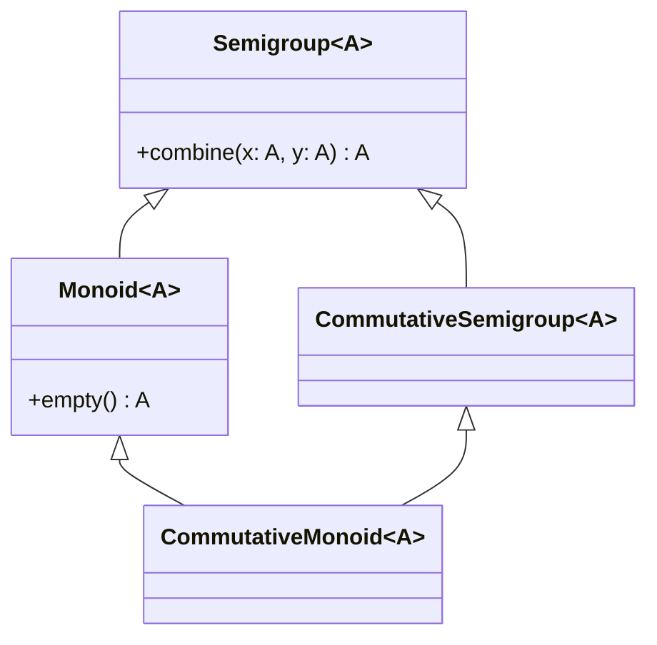

# Commutative Monoid

`CMonoid[A]` is a [monoid](monoid.md) that is [commutative](csemigroup.md).

In addition to the laws of a monoid:

- _Closure_ (_closure_): for \\(\forall x, y \in CM\\), \\(x + y \in CM\\).
- _Associativity_ (_associativity_): for \\(\forall x, y, z \in CM\\), \\((x + y) + z = x + (y + z)\\).
- _Identity_ (_identity_): there exists \\(\exists e \in CM\\) such that
  for \\(\forall x \in CM\\), \\(e + x = x + e = x\\)

the following law must hold:

- _Commutativity_ (_commutative_): for \\(\forall x, y \in CM\\), \\(x + y = y + x\\).

## Code

```dotty
trait CMonoid[A] extends Monoid[A], CSemigroup[A]
```

### Laws

Laws are inherited from [monoid](monoid.md) and [commutative semigroup](csemigroup.md).

## Diagram



## Implementation in Libraries

### [Implementation in Spire](../../libs/spire.md)

`CMonoid[A]` is a monoid that is commutative.

```dotty
import spire.algebra.CMonoid

CMonoid.combine(100, CMonoid.empty[Int]) // 100
```

---

**References:**

- [Repository with exercises and instructions for completion][sample]
- [Spire home page](https://typelevel.org/spire/)

[sample]: https://gitverse.ru/scalabook/typeclasses
