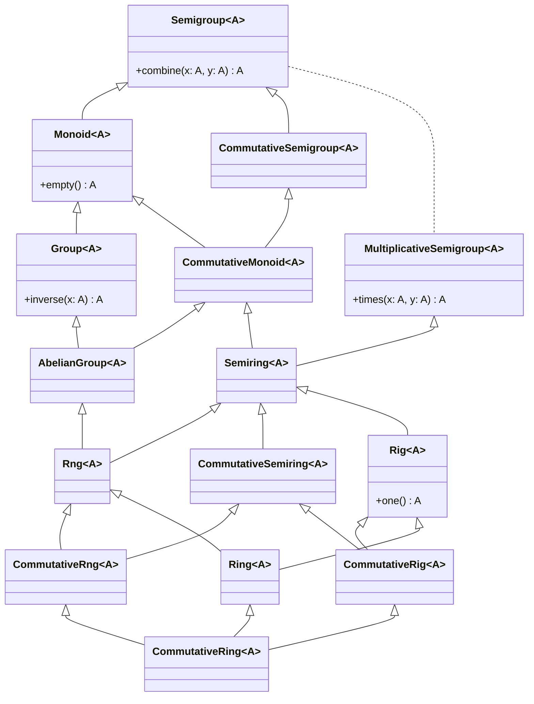

# Commutative Ring

A commutative ring with identity combines the properties of a [commutative ring without identity](crng.md) and a [ring with identity](ring.md).

The following laws must hold for a commutative ring with identity:

- _Additive closure_ (_closure_): for \\(\forall x, y \in R\\), \\(x + y \in R\\).
- _Additive associativity_ (_associativity_): for \\(\forall x, y, z \in R\\), \\((x + y) + z = x + (y + z)\\).
- _Existence of zero element_: there exists \\(\exists 0 \in R\\) such that
  for \\(\forall x \in R\\), \\(0 + x = x + 0 = x\\)
- _Additive invertibility_: for \\(\forall x \in R\\) there exists \\((-x)\\) such that
  \\(x + (-x) = (-x) + x = 0\\)
- _Additive commutativity_ (_commutative_): for \\(\forall x, y \in R\\), \\(x + y = y + x\\).
- _Multiplicative closure_ (_closure_): for \\(\forall x, y \in R\\), \\(x \* y \in R\\).
- _Multiplicative associativity_ (_associativity_): for \\(\forall x, y, z \in R\\), \\((x \* y) \* z = x \* (y \* z)\\).
- _Existence of unit element_: \\(\exists 1 \in R \quad \forall x \in R \quad x \* 1 = 1 \* x = x\\)
- _Multiplicative commutativity_: for \\(\forall x, y \in R\\), \\(x \* y = y \* x\\).
- _Distributivity_ (_distributivus_, _distributive law_):
  for \\(\forall x, y, z \in R\\), \\(x \* (y + z) = x \* y + x \* z\\) and \\((x + y) \* z = x \* z + y \* z\\).

## Code

```dotty
trait CommutativeRing[A] extends Ring[A], CommutativeRng[A], CommutativeRig[A]
```

### Laws

Laws are inherited from the laws of a [commutative ring](crng.md) and a [ring with identity](ring.md).

## Exercises

### Exercise 1.6.1: Implementation of a commutative ring with identity for integers.

> [Repository with exercises and instructions for completion][sample]

Fill in the missing parts (`???`):

```dotty
given CommutativeRing[Int] with
  val empty: Int = ???

  val one: Int = ???

  def combine(x: Int, y: Int): Int = ???

  def times(x: Int, y: Int): Int = ???

  extension (a: Int)
    def inverse: Int = ???
```

@:note(🔍 Show solution)

```dotty
given CommutativeRing[Int] with
  val empty: Int = 0

  val one: Int = 1

  def combine(x: Int, y: Int): Int = x + y

  def times(x: Int, y: Int): Int = x * y

  extension (a: Int)
    def inverse: Int = -a
```

**Example calls**:

```dotty
CommutativeRing[Int].combine(5, 3)
// 8
CommutativeRing[Int].empty
// 0
CommutativeRing[Int].inverse(5)
// -5
CommutativeRing[Int].times(5, 3)
// 15
CommutativeRing[Int].one
// 1
```

@:@

## Diagram



## Implementation in Libraries

### [Implementation in Spire](../../libs/spire.md)

`CRing[A]` provides commutative `+`, `zero`, `-`, commutative `*`, and `one`.
`CRing[A]` extends `Ring[A]` and `MultiplicativeCMonoid[A]`.

```dotty
import spire.algebra.CRing
import spire.math.Rational

CRing.plus(Rational(1, 2), Rational(1, 3))
// val res0: spire.math.Rational = 5/6
CRing.times(Rational(1, 2), Rational(1, 3))
// val res1: spire.math.Rational = 1/6
CRing.pow(Rational(1, 2), 3)
// val res2: spire.math.Rational = 1/8
CRing.negate(Rational(1, 2))
// val res3: spire.math.Rational = -1/2
CRing.minus(Rational(1, 2), Rational(1, 3))
// val res4: spire.math.Rational = 1/6
CRing.zero[Rational]
// val res5: spire.math.Rational = 0
CRing.one[Rational]
// val res6: spire.math.Rational = 1
```

---

**References:**

- [Repository with exercises and instructions for completion][sample]
- [Spire home page](https://typelevel.org/spire/)
- [Spire User's Guide](https://typelevel.org/spire/guide.html)

[sample]: https://gitverse.ru/scalabook/typeclasses
