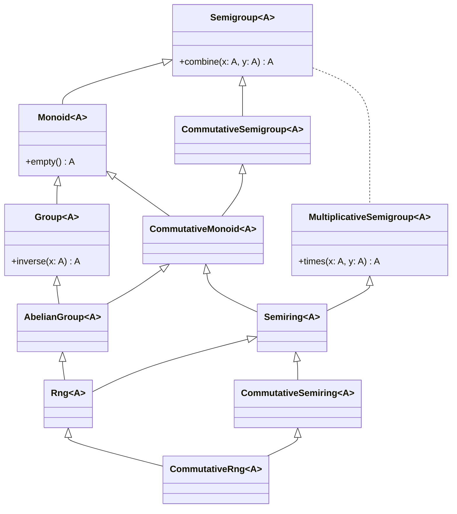

# Commutative Ring Without Identity

A commutative ring is a [ring without identity](rng.md), commutative with respect to multiplication.

A commutative ring must satisfy all the laws of a ring:

- _Additive closure_ (_closure_): for \\(\forall x, y \in R\\), \\(x + y \in R\\).
- _Additive associativity_ (_associativity_): for \\(\forall x, y, z \in R\\), \\((x + y) + z = x + (y + z)\\).
- _Existence of zero element_: there exists \\(\exists 0 \in R\\) such that
  for \\(\forall x \in R\\), \\(0 + x = x + 0 = x\\)
- _Additive invertibility_: for \\(\forall x \in R\\) there exists \\((-x)\\) such that
  \\(x + (-x) = (-x) + x = 0\\)
- _Additive commutativity_ (_commutative_): for \\(\forall x, y \in R\\), \\(x + y = y + x\\).
- _Multiplicative closure_ (_closure_): for \\(\forall x, y \in R\\), \\(x \* y \in R\\).
- _Multiplicative associativity_ (_associativity_): for \\(\forall x, y, z \in R\\), \\((x \* y) \* z = x \* (y \* z)\\).
- _Distributivity_ (_distributivus_, _distributive law_):
  for \\(\forall x, y, z \in R\\), \\(x \* (y + z) = x \* y + x \* z\\) and \\((x + y) \* z = x \* z + y \* z\\).

as well as the law of multiplicative commutativity:

- _Multiplicative commutativity_: for \\(\forall x, y \in R\\), \\(x * y = y * x\\).

## Code

```dotty
trait CommutativeRng[A] extends Rng[A], CSemiring[A]
```

### Laws

Laws are inherited from the laws of a [ring](rng.md) and a [commutative semiring](csemiring.md).

## Diagram



## Implementation in Libraries

### [Implementation in Spire](../../libs/spire.md)

`CRing[A]` provides commutative `+`, `zero`, `-`, commutative `*`, and `one`.
`CRing[A]` extends `Ring[A]` and `MultiplicativeCMonoid[A]`.

```dotty
import spire.algebra.CRing
import spire.math.Rational

CRing.plus(Rational(1, 2), Rational(1, 3))
// val res0: spire.math.Rational = 5/6
CRing.times(Rational(1, 2), Rational(1, 3))
// val res1: spire.math.Rational = 1/6
CRing.pow(Rational(1, 2), 3)
// val res2: spire.math.Rational = 1/8
CRing.negate(Rational(1, 2))
// val res3: spire.math.Rational = -1/2
CRing.minus(Rational(1, 2), Rational(1, 3))
// val res4: spire.math.Rational = 1/6
CRing.zero[Rational]
// val res5: spire.math.Rational = 0
CRing.one[Rational]
// val res6: spire.math.Rational = 1
```

---

**References:**

- [Repository with exercises and instructions for completion][sample]
- [Spire home page](https://typelevel.org/spire/)
- [Spire User's Guide](https://typelevel.org/spire/guide.html)
- [Wikipedia](https://ru.wikipedia.org/wiki/%D0%9A%D0%BE%D0%BC%D0%BC%D1%83%D1%82%D0%B0%D1%82%D0%B8%D0%B2%D0%BD%D0%BE%D0%B5_%D0%BA%D0%BE%D0%BB%D1%8C%D1%86%D0%BE)

[sample]: https://gitverse.ru/scalabook/typeclasses
