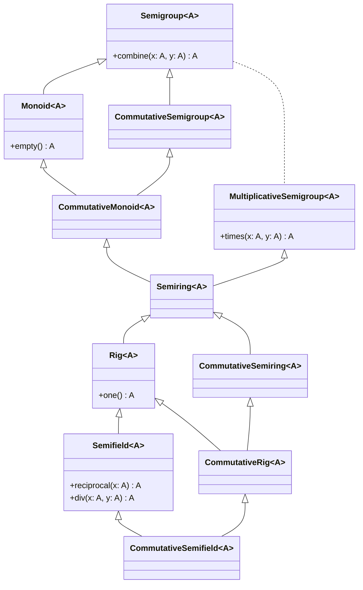

# Commutative Semifield

A commutative semifield is a [semifield](semifield.md) with commutative multiplication.

The following laws must hold for a commutative semifield:

- _Additive closure_ (_closure_): for \\(\forall x, y \in S\\), \\(x + y \in S\\).
- _Additive associativity_ (_associativity_): for \\(\forall x, y, z \in S\\), \\((x + y) + z = x + (y + z)\\).
- _Existence of zero element_: there exists \\(\exists 0 \in S\\) such that
  for \\(\forall x \in S\\), \\(0 + x = x + 0 = x\\)
- _Additive commutativity_ (_commutative_): for \\(\forall x, y \in S\\), \\(x + y = y + x\\).
- _Multiplicative closure_ (_closure_): for \\(\forall x, y \in S\\), \\(x \* y \in S\\).
- _Multiplicative associativity_ (_associativity_): for \\(\forall x, y, z \in S\\), \\((x \* y) \* z = x \* (y \* z)\\).
- _Multiplicative commutativity_: for \\(\forall x, y \in R\\), \\(x \* y = y \* x\\).
- _Distributivity_ (_distributivus_, _distributive law_):
  for \\(\forall x, y, z \in S\\), \\(x \* (y + z) = x \* y + x \* z\\) and \\((x + y) \* z = x \* z + y \* z\\).
- _Multiplicative zero property_: \\(a \* 0 = 0 \* a = 0\\)
- _Existence of unit element_: \\(\exists 1 \in S \quad \forall x \in S \quad x \* 1 = 1 \* x = x\\)
- _Existence of inverse element_: for any \\(a \in F\\), \\(a \neq 0\\), there exists an element \\(a^{-1} \in F\\) such that \\(a \cdot a^{-1} = 1\\).

## Code

```dotty
trait CommutativeSemifield[A] extends Semifield[A], CommutativeRig[A]
```

## Diagram



---

**References:**

- [Repository with exercises and instructions for completion][sample]
- [Spire home page](https://typelevel.org/spire/)
- [Spire User's Guide](https://typelevel.org/spire/guide.html)
- [Wikipedia](https://ru.wikipedia.org/wiki/%D0%9F%D0%BE%D0%BB%D1%83%D0%BA%D0%BE%D0%BB%D1%8C%D1%86%D0%BE)

[sample]: https://gitverse.ru/scalabook/typeclasses
