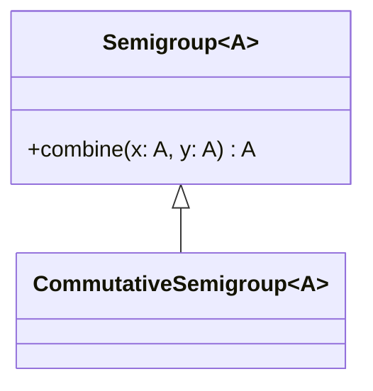

# Commutative Semigroup

`CSemigroup[A]` is a [semigroup](semigroup.md) that is commutative.

In addition to the laws of a semigroup:

- _Closure_ (_closure_): for \\(\forall x, y \in CS\\), \\(x + y \in CS\\).
- _Associativity_ (_associativity_): for \\(\forall x, y, z \in CS\\), \\((x + y) + z = x + (y + z)\\).

the following law must hold:

- _Commutativity_ (_commutative_): for \\(\forall x, y \in CS\\), \\(x + y = y + x\\).

## Code

```dotty
trait CSemigroup[A] extends Semigroup[A]
```

### Laws

Commutativity means that the order of elements when combining does not matter.
In other words, the result of the `combine` operation will be the same regardless of
the order in which you pass elements `x` and `y`.
This can be written as: `cs.combine(x, y) == cs.combine(y, x)`

## Diagram



## Implementation in Libraries

### [Implementation in Spire](../../libs/spire.md)

```dotty
import spire.algebra.CSemigroup

CSemigroup.combine(1, 2) == CSemigroup.combine(2, 1)
```

---

**References:**

- [Repository with exercises and instructions for completion][sample]
- [Spire home page](https://typelevel.org/spire/)

[sample]: https://gitverse.ru/scalabook/typeclasses
