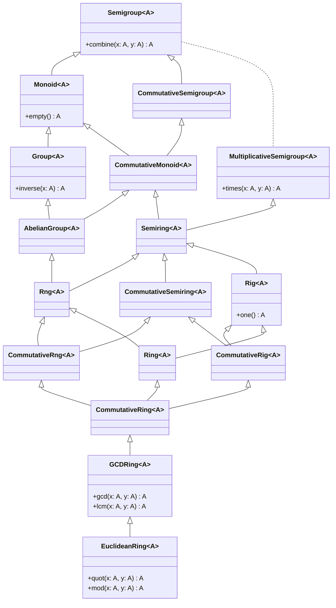

# Euclidean Ring

A **Euclidean ring** is a [commutative ring with identity](cring.md) in which a function called a **Euclidean norm** is defined,
generalizing Euclid's algorithm for finding the [greatest common divisor (GCD)](gcdring.md).
Euclidean rings are an important class of algebraic structures generalizing the properties of integers and polynomials.

**Definition of a Euclidean ring**

A Euclidean ring is a commutative ring with identity \\(R\\),
on which a function \\(\nu: R \setminus \{0\} \to \mathbb{N}_0\\) (called a **Euclidean norm**) is defined,
satisfying the following conditions:

- **Division with remainder property**:
  For any elements \\(a, b \in R\\), where \\(b \neq 0\\), there exist elements \\(q, r \in R\\) such that
  \\(a = b \cdot q + r\\), where either \\(r = 0\\) or \\(\nu(r) < \nu(b)\\).
- **Monotonicity of the norm**:
  For any nonzero elements \\(a, b \in R\\), the inequality \\(\nu(a) \leq \nu(a \cdot b)\\) holds.

**Examples of Euclidean rings**

- **Ring of integers \\(\mathbb{Z}\\)**:
    - Euclidean norm: \\(\nu(a) = |a|\\) (absolute value of the number).
    - Euclid's algorithm for finding GCD is based on division with remainder.
- **Polynomial ring \\(\mathbb{R}\[x\]\\) over the field \\(\mathbb{R}\\)**:
    - Euclidean norm: \\(\nu(f(x)) = \deg(f(x))\\) (degree of the polynomial).
    - Euclid's algorithm for finding the GCD of polynomials is also based on division with remainder.
- **Gaussian integers \\(\mathbb{Z}\[i\]\\)**:
    - This is the ring of numbers of the form \\(a + bi\\), where \\(a, b \in \mathbb{Z}\\), and \\(i\\) is the imaginary unit.
    - Euclidean norm: \\(\nu(a + bi) = a^2 + b^2\\).
    - Euclid's algorithm can also be applied in this ring.
- **Polynomial ring \\(\mathbb{F}\[x\]\\) over an arbitrary field \\(\mathbb{F}\\)**:
    - Euclidean norm: \\(\nu(f(x)) = \deg(f(x))\\).
    - Euclid's algorithm works similarly to the \\(\mathbb{R}\[x\]\\) case.

**Properties of Euclidean rings**

- **Existence of GCD**:
  In a Euclidean ring, for any two elements \\(a, b \in R\\), their greatest common divisor \\(\text{GCD}(a, b)\\) exists.
- **Euclid's algorithm**:
  Euclid's algorithm can be applied in a Euclidean ring to find the GCD of two elements.
- **Factored form**:
  Every Euclidean ring is a **unique factorization domain**,
  i.e., in it a unique decomposition into prime factors holds (up to order and association).
- **Principal Ideal Ring (PID)**:
  Every Euclidean ring is a principal ideal ring, i.e., every ideal in it is generated by a single element.

Euclidean rings find applications in various fields:

- **Number theory**: used to study divisibility properties and GCD-finding algorithms.
- **Algebra**: studied as a generalization of the properties of integers and polynomials.
- **Cryptography**: used in algorithms based on number theory, such as RSA.
- **Computer science**: used in algorithms for working with polynomials and integers.

## Formal Definition

A Euclidean ring is a [GCD ring](gcdring.md)
that also supports Euclidean division (e.g., staged or integer division).

Formally, Euclidean rings define a _Euclidean function_ `f` such that for any `a` and `b` in `A`,
if `y` is nonzero, then there exist `q` and `r` (quotient and remainder) such that `a = b*q + r` and `r = 0` or `f(r) < f(b)`.
For integers, `f` is usually the absolute value function.

`EuclideanRing[A]` adds the following operations:

- `quot` (`/~`, `a /~ b`): quotient (Euclidean division)
- `mod` (`%`, `a % b`): remainder

In integers, Euclidean quotient and remainder correspond to division with remainder;
however, the sign of the result is a matter of convention.
For rational numbers (or floating-point), `a /~ b = a / b` and `a % b = 0` by definition.

In addition to the GCD ring laws:

- _Additive closure_ (_closure_): for \\(\forall x, y \in R\\), \\(x + y \in R\\).
- _Additive associativity_ (_associativity_): for \\(\forall x, y, z \in R\\), \\((x + y) + z = x + (y + z)\\).
- _Existence of zero element_: there exists \\(\exists 0 \in R\\) such that
  for \\(\forall x \in R\\), \\(0 + x = x + 0 = x\\)
- _Additive invertibility_: for \\(\forall x \in R\\) there exists \\((-x)\\) such that
  \\(x + (-x) = (-x) + x = 0\\)
- _Additive commutativity_ (_commutative_): for \\(\forall x, y \in R\\), \\(x + y = y + x\\).
- _Multiplicative closure_ (_closure_): for \\(\forall x, y \in R\\), \\(x \* y \in R\\).
- _Multiplicative associativity_ (_associativity_): for \\(\forall x, y, z \in R\\), \\((x \* y) \* z = x \* (y \* z)\\).
- _Existence of unit element_: \\(\exists 1 \in R \quad \forall x \in R \quad x \* 1 = 1 \* x = x\\)
- _Multiplicative commutativity_: for \\(\forall x, y \in R\\), \\(x \* y = y \* x\\).
- _Distributivity_ (_distributivus_, _distributive law_):
  for \\(\forall x, y, z \in R\\), \\(x \* (y + z) = x \* y + x \* z\\) and \\((x + y) \* z = x \* z + y \* z\\).
- for \\(\forall x, y \in R\\), \\(gcd(x, y) * lcm(x, y) = x * y\\).
- _Associativity of GCD_: for \\(\forall x, y, z \in R\\), \\(gcd(gcd(x, y), z) = gcd(x, gcd(y, z))\\).
- _Commutativity of GCD_: for \\(\forall x, y \in R\\), \\(gcd(x, y) = gcd(y, x)\\).
- _Associativity of LCM_: for \\(\forall x, y, z \in R\\), \\(lcm(lcm(x, y), z) = lcm(x, lcm(y, z))\\).
- _Commutativity of LCM_: for \\(\forall x, y \in R\\), \\(lcm(x, y) = lcm(y, x)\\).

the following law must hold:

- `b * (a /~ b) + (a % b) = a`

## Code

```dotty
trait EuclideanRing[A] extends GCDRing[A]:
  def quot(x: A, y: A): A

  def mod(x: A, y: A): A
```

### Laws

Laws are inherited from [GCD Ring](gcdring.md).

Additionally:

- **Quotient and remainder law**: The statement asserts that for any two numbers \\(x\\) and \\(y\\) (where \\(y \neq 0\\)),
  if we divide \\(x\\) by \\(y\\) with remainder, the result can be recovered using the quotient and remainder.
  `er.combine(er.times(y, er.quot(x, y)), er.mod(x, y)) == x`

## Exercises

### Exercise 1.8.1: Implementation of a Euclidean ring for integers.

> [Repository with exercises and instructions for completion][sample]

Fill in the missing parts (`???`):

```dotty
given EuclideanRing[BigInt] with
  val empty: BigInt = ???

  val one: BigInt = ???

  def combine(x: BigInt, y: BigInt): BigInt =
    ???

  def times(x: BigInt, y: BigInt): BigInt =
    ???

  extension (a: BigInt)
    def inverse: BigInt = ???

  def gcd(x: BigInt, y: BigInt): BigInt =
    ???

  def lcm(x: BigInt, y: BigInt): BigInt =
    ???

  def quot(x: BigInt, y: BigInt): BigInt =
    ???

  def mod(x: BigInt, y: BigInt): BigInt =
    ???
```

@:note(🔍 Show solution)

```dotty
given EuclideanRing[BigInt] with
  val empty: BigInt = 0

  val one: BigInt = 1

  def combine(x: BigInt, y: BigInt): BigInt = x + y

  def times(x: BigInt, y: BigInt): BigInt = x * y

  extension (a: BigInt)
    def inverse: BigInt = a * BigInt(-1)
    
  def gcd(x: BigInt, y: BigInt): BigInt =
    if y == 0 then x.abs else gcd(y, x % y)

  def lcm(x: BigInt, y: BigInt): BigInt =
    val g = gcd(x, y)
    if g == 0 then 0 else times(x, y) / g

  def quot(x: BigInt, y: BigInt): BigInt =
    x / y

  def mod(x: BigInt, y: BigInt): BigInt =
    x % y
```

**Example calls**:

```dotty
EuclideanRing[BigInt].combine(5, 3)
// 8
EuclideanRing[BigInt].empty
// 0
EuclideanRing[BigInt].inverse(5)
// -5
EuclideanRing[BigInt].times(5, 3)
// 15
EuclideanRing[BigInt].one
// 1
EuclideanRing[BigInt].gcd(12, 18)
// 6
EuclideanRing[BigInt].lcm(12, 18)
// 36
EuclideanRing[BigInt].quot(17, 5)
// 3
EuclideanRing[BigInt].mod(17, 5)
// 2
EuclideanRing[BigInt].quot(20, 4)
// 5
EuclideanRing[BigInt].mod(20, 4)
// 0
```

@:@

## Diagram



## Implementation in Libraries

### [Implementation in Spire](../../libs/spire.md)

Spire supports Euclidean rings (called `EuclideanRing[A]`).
A Euclidean ring is a GCD ring (extends `GCDRing[A]`)
that also supports Euclidean division (e.g., staged or integer division).
This structure generalizes many useful properties of integers (e.g., quotient and remainder, as well as greatest common divisor).

Formally, Euclidean rings define a _Euclidean function_ `f` such that for any `x` and `y` in `A`,
if `y` is nonzero, then there exist `q` and `r` (quotient and remainder) such that `a = b*q + r` and `r = 0` or `f(r) < f(b)`.
For integers, `f` is usually the absolute value function.

`EuclideanRing[A]` supports the following operations:

- `equot` (`/~`, `a /~ b`): quotient (Euclidean division)
- `emod` (`%`, `a % b`): remainder
- `equotmod` (`/%`, `a /% b`): quotient and remainder, combines `quot` and `mod` into one operation.

Spire requires that `b * (a /~ b) + (a % b)` is equivalent to `a`.

In integers, Euclidean quotient and remainder correspond to division with remainder;
however, the sign of the result is a matter of convention.
For rational numbers (or floating-point), `a /~ b = a / b` and `a % b = 0` by definition.

```dotty
import spire.algebra.EuclideanRing
import spire.std.int.*

EuclideanRing.plus(15, 10)
// val res0: Int = 25
EuclideanRing.times(15, 10)
// val res1: Int = 150
EuclideanRing.pow(15, 2)
// val res2: Int = 225
EuclideanRing.negate(15)
// val res3: Int = -15
EuclideanRing.minus(15, 10)
// val res4: Int = 5
EuclideanRing.zero[Int]
// val res5: Int = 0
EuclideanRing.one[Int]
// val res6: Int = 1
EuclideanRing.gcd(15, 10)
// val res7: Int = 5
EuclideanRing.lcm(15, 10)
// val res8: Int = 30
EuclideanRing.equot(15, 10)
// val res9: Int = 1
EuclideanRing.emod(15, 10)
// val res10: Int = 5
EuclideanRing.equotmod(15, 10)
// val res11: (Int, Int) = (1,5)
```

---

**References:**

- [Repository with exercises and instructions for completion][sample]
- [Spire home page](https://typelevel.org/spire/)
- [Spire User's Guide](https://typelevel.org/spire/guide.html)
- [Wikipedia](https://en.wikipedia.org/wiki/Euclidean_domain)

[sample]: https://gitverse.ru/scalabook/typeclasses
