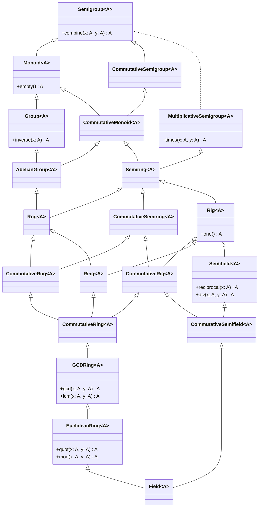

# Field

A **Field** is an algebraic structure that is a [Euclidean ring](euclidean-ring.md)
and a [commutative semifield](csemifield.md).
Fields are one of the key structures in mathematics, generalizing the properties of numbers and operations on them.

**Field definition**

A field is a set \\(F\\) on which two binary operations are defined:

- **Addition** (\\(+\\)): a commutative and associative operation.
- **Multiplication** (\\(\cdot\\)): a commutative and associative operation.

These operations must satisfy the following axioms:

- **Additive commutativity**: \\(a + b = b + a\\) for any \\(a, b \in F\\).
- **Additive associativity**: \\((a + b) + c = a + (b + c)\\) for any \\(a, b, c \in F\\).
- **Existence of zero element**: there exists an element \\(0 \in F\\) such that \\(0 + a = a + 0 = a\\) for any \\(a \in F\\).
- **Existence of opposite element**: for any \\(a \in F\\) there exists an element \\(-a \in F\\) such that \\(a + (-a) = 0\\).
- **Multiplicative commutativity**: \\(a \cdot b = b \cdot a\\) for any \\(a, b \in F\\).
- **Multiplicative associativity**: \\((a \cdot b) \cdot c = a \cdot (b \cdot c)\\) for any \\(a, b, c \in F\\).
- **Existence of unit element**: there exists an element \\(1 \in F\\) such that \\(a \cdot 1 = a\\) for any \\(a \in F\\).
- **Existence of inverse element**: for any \\(a \in F\\), \\(a \neq 0\\), there exists an element \\(a^{-1} \in F\\) such that \\(a \cdot a^{-1} = 1\\).
- **Distributivity of multiplication over addition**:
    - \\(a \cdot (b + c) = a \cdot b + a \cdot c\\) (left distributivity),
    - \\((a + b) \cdot c = a \cdot c + b \cdot c\\) (right distributivity).

**Examples of fields**

- **Field of rational numbers \\(\mathbb{Q}\\)**:
    - Operations: addition and multiplication.
    - Zero element: \\(0\\).
    - Unit element: \\(1\\).
    - Inverse element for \\(a \neq 0\\): \\(\frac{1}{a}\\).
- **Finite fields (Galois fields)**:
    - For example, the field \\(\mathbb{Z}/p\mathbb{Z}\\), where \\(p\\) is a prime number.
    - Operations: addition and multiplication modulo \\(p\\).
    - Zero element: \\(0\\).
    - Unit element: \\(1\\).
    - Inverse element for \\(a \neq 0\\): an element \\(b\\) such that \\(a \cdot b \equiv 1 \pmod{p}\\).

**Properties of fields**

- **Invertibility of nonzero elements**:
  In a field, every nonzero element has an inverse with respect to multiplication.
- **Absence of zero divisors**:
  In a field, if \\(a \cdot b = 0\\), then \\(a = 0\\) or \\(b = 0\\).

Fields find applications in various fields:

- **Algebra**: studied as basic algebraic structures.
- **Number theory**: used to analyze the properties of numbers and their operations.
- **Geometry**: used in algebraic geometry.
- **Physics**: used to describe symmetries in physical systems.
- **Cryptography**: finite fields are used in encryption algorithms.
- **Computer science**: used in algorithms for working with polynomials and numbers.

## Formal Definition

_Field_ is an algebra over the set \\(\mathbf{F}\\),
forming a [commutative group](abgroup.md) under addition \\(\mathbf{+}\\) over \\(\mathbf{F}\\) with identity element \\(\mathbf{0}\\)
and a commutative group under multiplication \\(\mathbf{\*}\\) over nonzero elements \\(\mathbf{F} \backslash \begin{Bmatrix} \mathbf{0} \end{Bmatrix}\\),
with the multiplicative distributivity over addition property holding.
It is also assumed that the operation \\(\mathbf{\*}\\) applies to the zero element of addition
while preserving the distributivity property over the entire set \\(\mathbf{F}\\).

If we unpack the definition, then the set \\(\mathbf{F}\\) with the algebraic operations \\(\mathbf{+}\\) and \\(\mathbf{\*}\\) defined on it
(\\(\mathbf{+}\colon \mathbf{F} \times \mathbf{F} \to \mathbf{F},\mathbf{\*}\colon \mathbf{F} \times \mathbf{F} \to \mathbf{F}\\),
i.e. \\(\forall a, b \in F \quad (a + b) \in F, (a \* b) \in F\\))
is called a _field_ \\(\left< F, +, \* \right>\\) if the following axioms are satisfied:

- _Additive associativity_: for \\(\forall x, y, z \in F\\), \\((x + y) + z = x + (y + z)\\).
- _Existence of zero element_: there exists \\(\exists 0 \in F\\) such that
  for \\(\forall x \in F\\), \\(0 + x = x + 0 = x\\)
- _Additive invertibility_: for \\(\forall x \in F\\) there exists \\((-x)\\) such that
  \\(x + (-x) = (-x) + x = 0\\)
- _Additive commutativity_: for \\(\forall x, y \in F\\), \\(x + y = y + x\\).
- _Multiplicative associativity_: for \\(\forall x, y, z \in F\\), \\((x \* y) \* z = x \* (y \* z)\\).
- _Existence of unit element_: \\(\exists 1 \in F \quad \forall x \in F \quad x \* 1 = 1 \* x = x\\)
- _Multiplicative commutativity_: for \\(\forall x, y \in F\\), \\(x \* y = y \* x\\).
- _Existence of inverse for nonzero elements_: \\((\forall x \in F: x \neq 0) \quad \exists x^{-1} \in F: \quad x \* x^{-1} = 1\\).
- _Distributivity of multiplication over addition_:
  for \\(\forall x, y, z \in F\\), \\(x \* (y + z) = x \* y + x \* z\\) and \\((x + y) \* z = x \* z + y \* z\\).

## Code

```dotty
trait Field[A] extends EuclideanRing[A], CommutativeSemifield[A]
```

### Laws

Laws are inherited from [Euclidean ring](euclidean-ring.md) and [commutative semifield](csemifield.md).

## Exercises

### Exercise 1.9.1: Implementation of a field for rational numbers.

> [Repository with exercises and instructions for completion][sample]

Fill in the missing parts (`???`):

```dotty
import spire.math.Rational

given Field[Rational] with
  val empty: Rational = ???

  val one: Rational = ???

  def combine(x: Rational, y: Rational): Rational = 
    ???

  def times(x: Rational, y: Rational): Rational = 
    ???

  def gcd(x: Rational, y: Rational): Rational = 
    ???

  def lcm(x: Rational, y: Rational): Rational = 
    ???

  def quot(x: Rational, y: Rational): Rational = 
    ???

  def mod(x: Rational, y: Rational): Rational = 
    ???

  extension (a: Rational)
    def inverse: Rational    = 
      ???
      
    def reciprocal: Rational = 
      ???
end given
```

@:note(🔍 Show solution)

```dotty
import spire.math.Rational

given Field[Rational] with
  val empty: Rational = Rational(0)

  val one: Rational = Rational(1)

  def combine(x: Rational, y: Rational): Rational = 
    x + y

  def times(x: Rational, y: Rational): Rational = 
    x * y

  def gcd(x: Rational, y: Rational): Rational = 
    one

  def lcm(x: Rational, y: Rational): Rational = 
    times(x, y)

  def quot(x: Rational, y: Rational): Rational = 
    x / y

  def mod(x: Rational, y: Rational): Rational = 
    empty

  extension (a: Rational)
    def inverse: Rational    = 
      Rational(-a.numerator, a.denominator)
      
    def reciprocal: Rational = 
      Rational(a.denominator, a.numerator)
end given
```

**Example calls**:

```dotty
val a = Rational(1, 2)  // 1/2
val b = Rational(2, 3)  // 2/3
val c = Rational(3, 4)  // 3/4

// Basic field operations
Field[Rational].combine(a, b) = 1/2 + 2/3 = 7/6
Field[Rational].times(a, b) = 1/2 * 2/3 = 2/6 = 1/3
Field[Rational].inverse(a) = -1/2
Field[Rational].reciprocal(a) = 2/1 = 2
Field[Rational].empty = Rational(0) = 0/1
Field[Rational].one = Rational(1) = 1/1

// GCD and LCM operations in a field
Field[Rational].gcd(a, b) = 1 (always)
Field[Rational].lcm(a, b) = times(a, b) = 1/3

// Euclidean ring operations
Field[Rational].quot(a, b) = (1/2) / (2/3) = 3/4
Field[Rational].mod(a, b) = 0 (always)
```

@:@

## Diagram



## Implementation in Libraries

### [Implementation in Spire](../../libs/spire.md)

Fields are commutative rings with commutative multiplication and multiplicative inverses for all nonzero elements.
`spire.Field[A]` extends `algebra.Field[A]` and `EuclideanRing[A]`.
Fields generalize what most people think of as rational numbers.

`Field[A]` supports the following operations:

- `reciprocal` (`a.reciprocal`): inverse of multiplication. Multiplicative inverse of `a`, i.e. `one/a`.
- `div` (`/`, `a / b`): division of `a` by `b`.
- `ceil`: rounding up
- `floor`: rounding down
- `round`: rounding to nearest

Although fields are at the top of the ring hierarchy,
there are many operations that fields do not provide:

- equality and ordering (provided by `Eq[A]` and `Order[A]`).
- square root and other roots (provided by `NRoot[A]`).
- sine, cosine, and trigonometric functions (provided by `Trig[A]`).

```dotty
import spire.math.Real.apply

15.reciprocal
// val res0: spire.math.Real = 1/15
15 / 3
// val res1: Int = 5
15.24.ceil
// val res2: spire.math.Real = 16
15.24.floor
// val res3: spire.math.Real = 15
15.24.round
// val res4: spire.math.Real = 15
```

#### Irrational and transcendental type classes

Spire supports square roots and fractional powers through `NRoot[A]`.
The following methods are available:

- `nroot` (`a nroot k`): k-th root of `a` (type of k is `Int`)
- `sqrt` (`a.sqrt`): square root of `a`
- `fpow` (`**`, `a fpow b`): exponentiation (accepts fractional exponent)

Spire does not have fractional types that could exactly represent irrational roots.
This means that many laws that could be written about roots will be weaker than desired:

- `a.sqrt` = `(a nroot 2)` = `(a fpow 2.reciprocal)`
- if `A` can exactly represent `1/k`, then `(a nroot k)` = `(a fpow k.reciprocal)`
- if `(a nroot k)` is rational, then `(a nroot k).pow(k)` = `a`

Approximate-value types, such as `Double` and `BigDecimal`, contain built-in precision,
with which Spire can find roots.
Exact types, such as `Rational`, do not have default `NRoot` instances defined,
but instances can be created with user-defined precision.

```dotty
import spire.math.Real.apply

9 nroot 2
// val res1: spire.math.Real = 3
9.sqrt
// val res2: spire.math.Real = 3
3 fpow 2
// val res3: spire.math.Real = 9
```

---

**References:**

- [Repository with exercises and instructions for completion][sample]
- [Spire home page](https://typelevel.org/spire/)
- [Spire User's Guide](https://typelevel.org/spire/guide.html)
- [Wikipedia](https://ru.wikipedia.org/wiki/%D0%9F%D0%BE%D0%BB%D0%B5_(%D0%B0%D0%BB%D0%B3%D0%B5%D0%B1%D1%80%D0%B0))

[sample]: https://gitverse.ru/scalabook/typeclasses
