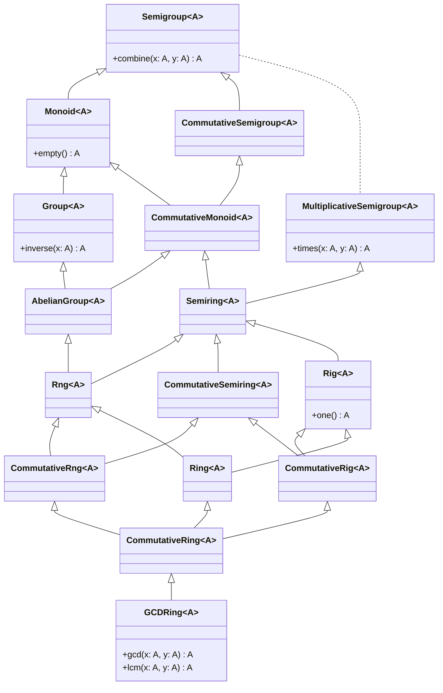

# GCD Rings

**GCD rings** (rings with greatest common divisor) are [commutative rings with identity](cring.md)
in which for any two elements a greatest common divisor (GCD) exists.
These rings are an important class of algebraic structures generalizing the properties of integers.

**Definition of a GCD ring**

A GCD ring is a commutative ring with identity \\(R\\), in which for any two elements \\(a, b \in R\\)
there exists a **greatest common divisor** (GCD).
The greatest common divisor \\(d = \text{GCD}(a, b)\\) is defined as follows:

- \\(d\\) is a common divisor of \\(a\\) and \\(b\\), i.e. \\(d \mid a\\) and \\(d \mid b\\).
- Any other common divisor \\(a\\) and \\(b\\) divides \\(d\\), i.e. if \\(c \mid a\\) and \\(c \mid b\\), then \\(c \mid d\\).

**Properties of GCD rings**

- **Existence of GCD**:
  In a GCD ring, for any two elements \\(a, b \in R\\), their greatest common divisor \\(\text{GCD}(a, b)\\) exists.
- **Properties of GCD**:
    - The GCD is defined up to invertible elements (associated elements).
      That is, if \\(d\_1\\) and \\(d\_2\\) are two GCDs of elements \\(a\\) and \\(b\\),
      then \\(d\_1 = u \cdot d\_2\\), where \\(u\\) is an invertible element of ring \\(R\\).
    - The GCD can be expressed as a linear combination: if \\(d = \text{GCD}(a, b)\\),
      then there exist elements \\(x, y \in R\\) such that \\(d = a \cdot x + b \cdot y\\).
- **Connection with other classes of rings**:
    - Every **factorial ring** (a ring with unique factorization into prime factors) is a GCD ring.
    - However, not every GCD ring is factorial.

**Examples of GCD rings**

- **Ring of integers \\(\mathbb{Z}\\)**:
    - For any two integers \\(a\\) and \\(b\\), their greatest common divisor \\(\text{GCD}(a, b)\\) exists.
    - For example, \\(\text{GCD}(12, 18) = 6\\).
- **Polynomial ring \\(\mathbb{R}\[x\]\\)**:
    - For any two polynomials \\(f(x)\\) and \\(g(x)\\), their greatest common divisor exists.
    - For example, \\(\text{GCD}(x^2 - 1, x^2 + x - 2) = x - 1\\).
- **Ring of Gaussian integers \\(\mathbb{Z}\[i\]\\)**:
    - This is the ring of numbers of the form \\(a + bi\\), where \\(a, b \in \mathbb{Z}\\), and \\(i\\) is the imaginary unit.
    - For any two Gaussian integers, their greatest common divisor exists.
- **Principal Ideal Domain (PID)**:
    - Every principal ideal domain is a GCD ring.
    - For example, the ring of integers \\(\mathbb{Z}\\) and the polynomial ring \\(\mathbb{R}\[x\]\\) are principal ideal domains.

GCD rings find applications in various fields:

- **Number theory**: used to study divisibility properties and GCD-finding algorithms (e.g., Euclid's algorithm).
- **Algebra**: studied as a generalization of the properties of integers and polynomials.
- **Cryptography**: used in algorithms based on number theory, such as RSA.
- **Computer science**: used in algorithms for working with polynomials and integers.

## Formal Definition

GCD rings are [commutative rings with identity](cring.md)
with the addition of greatest common divisor and least common multiple.

GCD rings support the following operations:

- `gcd`: greatest common divisor
- `lcm`: least common multiple

For a GCD ring the laws of the parent types must hold:

- _Additive closure_ (_closure_): for \\(\forall x, y \in R\\), \\(x + y \in R\\).
- _Additive associativity_ (_associativity_): for \\(\forall x, y, z \in R\\), \\((x + y) + z = x + (y + z)\\).
- _Existence of zero element_: there exists \\(\exists 0 \in R\\) such that
  for \\(\forall x \in R\\), \\(0 + x = x + 0 = x\\)
- _Additive invertibility_: for \\(\forall x \in R\\) there exists \\((-x)\\) such that
  \\(x + (-x) = (-x) + x = 0\\)
- _Additive commutativity_ (_commutative_): for \\(\forall x, y \in R\\), \\(x + y = y + x\\).
- _Multiplicative closure_ (_closure_): for \\(\forall x, y \in R\\), \\(x \* y \in R\\).
- _Multiplicative associativity_ (_associativity_): for \\(\forall x, y, z \in R\\), \\((x \* y) \* z = x \* (y \* z)\\).
- _Existence of unit element_: \\(\exists 1 \in R \quad \forall x \in R \quad x \* 1 = 1 \* x = x\\)
- _Multiplicative commutativity_: for \\(\forall x, y \in R\\), \\(x \* y = y \* x\\).
- _Distributivity_ (_distributivus_, _distributive law_):
  for \\(\forall x, y, z \in R\\), \\(x \* (y + z) = x \* y + x \* z\\) and \\((x + y) \* z = x \* z + y \* z\\).

as well as the following laws:

- for \\(\forall x, y \in R\\), \\(gcd(x, y) * lcm(x, y) = x * y\\).
- _Associativity of GCD_: for \\(\forall x, y, z \in R\\), \\(gcd(gcd(x, y), z) = gcd(x, gcd(y, z))\\).
- _Commutativity of GCD_: for \\(\forall x, y \in R\\), \\(gcd(x, y) = gcd(y, x)\\).
- _Associativity of LCM_: for \\(\forall x, y, z \in R\\), \\(lcm(lcm(x, y), z) = lcm(x, lcm(y, z))\\).
- _Commutativity of LCM_: for \\(\forall x, y \in R\\), \\(lcm(x, y) = lcm(y, x)\\).

## Code

```dotty
trait GCDRing[A] extends CommutativeRing[A]:
  def gcd(x: A, y: A): A

  def lcm(x: A, y: A): A
```

### Laws

Laws are inherited from [commutative ring with identity](cring.md):

- _Additive closure_ (_closure_): for \\(\forall x, y \in R\\), \\(x + y \in R\\).
- _Additive associativity_ (_associativity_): for \\(\forall x, y, z \in R\\), \\((x + y) + z = x + (y + z)\\).
- _Existence of zero element_: there exists \\(\exists 0 \in R\\) such that
  for \\(\forall x \in R\\), \\(0 + x = x + 0 = x\\)
- _Additive invertibility_: for \\(\forall x \in R\\) there exists \\((-x)\\) such that
  \\(x + (-x) = (-x) + x = 0\\)
- _Additive commutativity_ (_commutative_): for \\(\forall x, y \in R\\), \\(x + y = y + x\\).
- _Multiplicative closure_ (_closure_): for \\(\forall x, y \in R\\), \\(x \* y \in R\\).
- _Multiplicative associativity_ (_associativity_): for \\(\forall x, y, z \in R\\), \\((x \* y) \* z = x \* (y \* z)\\).
- _Existence of unit element_: \\(\exists 1 \in R \quad \forall x \in R \quad x \* 1 = 1 \* x = x\\)
- _Multiplicative commutativity_: for \\(\forall x, y \in R\\), \\(x \* y = y \* x\\).
- _Distributivity_ (_distributivus_, _distributive law_):
  for \\(\forall x, y, z \in R\\), \\(x \* (y + z) = x \* y + x \* z\\) and \\((x + y) \* z = x \* z + y \* z\\).

Additionally:

- **Product of GCD and LCM must equal the product of the numbers**:
    - If you take two numbers \\(x\\) and \\(y\\), then the product of their greatest common divisor (GCD)
      and least common multiple (LCM) will equal the product of the numbers \\(x\\) and \\(y\\) themselves.
    - Formula: `gr.times(gr.gcd(x, y), gr.lcm(x, y)) == gr.times(y, x)`.
- **Associativity of GCD**:
    - If you need to find the GCD for three numbers \\(x\\), \\(y\\), and \\(z\\), the order does not matter.
      You can first find the GCD for \\(x\\) and \\(y\\), and then for the result and \\(z\\), or first for \\(y\\) and \\(z\\),
      and then for \\(x\\) and the result — the answer will be the same.
    - Formula: `gr.gcd(gr.gcd(x, y), z) == gr.gcd(x, gr.gcd(y, z))`.
- **Commutativity of GCD**:
    - The order of numbers does not matter when computing the GCD. GCD for \\(x\\) and \\(y\\) will be the same as GCD for \\(y\\) and \\(x\\).
    - Formula: `gr.gcd(x, y) == gr.gcd(y, x)`.
- **Associativity of LCM**:
    - Similarly to GCD, for the LCM of three numbers \\(x\\), \\(y\\), and \\(z\\) the order of computation does not matter.
      You can first find the LCM for \\(x\\) and \\(y\\), and then for the result and \\(z\\), or first for \\(y\\) and \\(z\\),
      and then for \\(x\\) and the result — the answer will be the same.
    - Formula: `gr.lcm(gr.lcm(x, y), z) == gr.lcm(x, gr.lcm(y, z))`.
- **Commutativity of LCM**:
    - The order of numbers does not matter when computing the LCM. LCM for \\(x\\) and \\(y\\) will be the same as LCM for \\(y\\) and \\(x\\).
    - Formula: `gr.lcm(x, y) == gr.lcm(y, x)`.

## Exercises

### Exercise 1.7.1: Implementation of a GCD ring for integers.

> [Repository with exercises and instructions for completion][sample]

Fill in the missing parts (`???`):

```dotty
given GCDRing[BigInt] with
  val empty: BigInt = ???

  val one: BigInt = ???

  def combine(x: BigInt, y: BigInt): BigInt = ???

  def times(x: BigInt, y: BigInt): BigInt = ???

  def gcd(x: BigInt, y: BigInt): BigInt =
    ???

  def lcm(x: BigInt, y: BigInt): BigInt =
    ???

  extension (a: BigInt)
    def inverse: BigInt = ???
```

@:note(🔍 Show solution)

```dotty
given GCDRing[BigInt] with
  val empty: BigInt = 0

  val one: BigInt = 1

  def combine(x: BigInt, y: BigInt): BigInt = x + y

  def times(x: BigInt, y: BigInt): BigInt = x * y

  def gcd(x: BigInt, y: BigInt): BigInt =
    if y == 0 then x.abs else gcd(y, x % y)

  def lcm(x: BigInt, y: BigInt): BigInt =
    times(x, y) / gcd(x, y)

  extension (a: BigInt)
    def inverse: BigInt = a * BigInt(-1)
```

**Example calls**:

```dotty
GCDRing[BigInt].combine(5, 3)
// 8
GCDRing[BigInt].empty
// 0
GCDRing[BigInt].inverse(5)
// -5
GCDRing[BigInt].times(5, 3)
// 15
GCDRing[BigInt].one
// 1
GCDRing[BigInt].gcd(12, 18)
// 6
GCDRing[BigInt].lcm(12, 18)
// 36
```

@:@

## Diagram



## Implementation in Libraries

### [Implementation in Spire](../../libs/spire.md)

Commutative rings (also called _domains_ in literature) have a rich structure.

`GCDRing[A]` is a commutative ring (extends `CRing[A]`)
with the addition of greatest common divisor and least common multiple.

`GCDRing[A]` supports the following operations:

- `gcd` (`a gcd b`): greatest common divisor
- `lcm` (`a lcm b`): least common multiple

And obeys the following laws:

- `d * m === a * b` for `d = gcd(a, b)` and `m = lcm(a, b)`,
- `gcd` is associative and commutative,
- `lcm` is associative and commutative.

Note that the GCD is defined up to a unit element (associate);
in particular, its sign is a matter of convention.

Spire requires that these operations are commutative.
Note that fields have freedom to define the GCD operation.
In practice, instances of `Field[A]` provide either a trivial implementation `gcd(x != 0, y != 0) == 1`,
or a definition extending the one used for the integer ring (`gcd(a / b, c / d) == gcd(a, c) / lcm(b, d)`).

```dotty
import spire.algebra.GCDRing
import spire.math.Rational
import spire.std.int.*

GCDRing.plus(Rational(1, 2), Rational(1, 3))
// val res0: spire.math.Rational = 5/6
GCDRing.times(Rational(1, 2), Rational(1, 3))
// val res1: spire.math.Rational = 1/6
GCDRing.pow(Rational(1, 2), 3)
// val res2: spire.math.Rational = 1/8
GCDRing.negate(Rational(1, 2))
// val res3: spire.math.Rational = -1/2
GCDRing.minus(Rational(1, 2), Rational(1, 3))
// val res4: spire.math.Rational = 1/6
GCDRing.zero[Rational]
// val res5: spire.math.Rational = 0
GCDRing.one[Rational]
// val res6: spire.math.Rational = 1
GCDRing.gcd(15, 10)
// val res7: Int = 5
GCDRing.lcm(15, 10)
// val res8: Int = 30
```

---

**References:**

- [Repository with exercises and instructions for completion][sample]
- [Spire home page](https://typelevel.org/spire/)
- [Spire User's Guide](https://typelevel.org/spire/guide.html)

[sample]: https://gitverse.ru/scalabook/typeclasses
