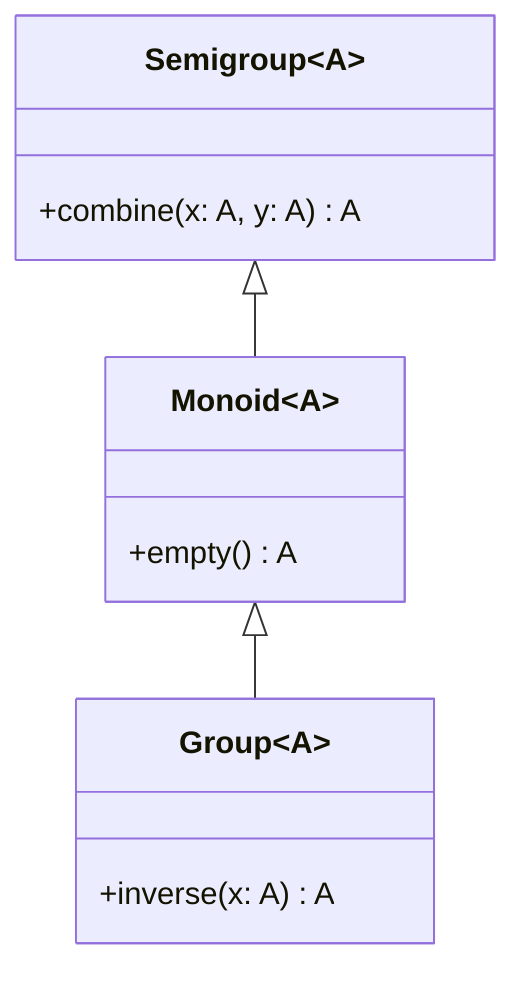

# Group

Monoids, as basic algebraic structures, represent ordered sets
with one associative operation and an identity element.
They serve as a foundation for studying more complex structures such as **groups**,
which are a natural continuation and extension of monoids.
Groups add to the properties of monoids a key requirement — the existence of an inverse element for every element of the set.
This allows groups to have a richer set of properties and find applications in a wide range of fields,
from number theory and geometry to physics and cryptography.

**What is a group?**

A **group** is an algebraic structure that formalizes the concept of symmetry and operations
subordinating themselves to certain rules. Formally, a group is defined as a set \\(G\\),
on which a binary operation \\(\cdot\\) - "dot" (called "multiplication" or "group operation") is defined,
satisfying four axioms:

- **Closure**: For any two elements \\(a, b \in G\\), the result of the operation \\(a \cdot b\\) also belongs to \\(G\\).
- **Associativity**: For any \\(a, b, c \in G\\), \\((a \cdot b) \cdot c = a \cdot (b \cdot c)\\) holds.
  This property allows ignoring the order of operation execution.
- **Existence of identity element**: In a group there exists an element \\(e \in G\\), called the identity,
  such that for any \\(a \in G\\), \\(a \cdot e = e \cdot a = a\\) holds.
- **Existence of inverse element**: For each element \\(a \in G\\) there exists an inverse element \\(a^{-1} \in G\\),
  such that \\(a \cdot a^{-1} = a^{-1} \cdot a = e\\).

**Examples of groups**

- **Integers under addition**: The set \\(\mathbb{Z}\\) with the addition operation \\(+\\) is a group.
  The identity element is 0, and the inverse element of a is -a.
- **Non-negative rational numbers under multiplication**: The set \\(\mathbb{Q}^+\\) (positive rational numbers)
  with the multiplication operation \\(\cdot\\) is a group.
  The identity element is 1, and the inverse element of a is \\(\frac{1}{a}\\).
- **Symmetry group of a figure**: The set of all transformations (e.g., rotations and reflections)
  preserving the symmetry of a figure forms a group with respect to the composition operation of transformations.
- Natural numbers are not a group under addition (given a number x in \\(\mathbb{N}\\), but -x is not in \\(\mathbb{N}\\)).
- Neither integers nor natural numbers form a group under multiplication,
  but the set of nonzero rational numbers (\\(\frac{n}{d}\\) for any \\(n, d \in N, n \neq 0, d \neq 0\\))
  forms an ([abelian](abgroup.md)) group under multiplication with the identity element 1.

**Important properties of groups**

- **Commutativity (abelian)**: If for any \\(a, b \in G\\), \\(a \cdot b = b \cdot a\\) holds,
  then the group is called an **[abelian](abgroup.md)** (or commutative) group. Otherwise, the group is called **non-abelian**.
- **Order of a group**: The order of a group \\(G\\) is the number of elements in it.
  If a group contains a finite number of elements, it is called a **finite group**.
  If it contains infinitely many elements, it is called an **infinite group**.

## Formal Definition

A group **G** is a [monoid](monoid.md) with an inverse \\(g^{-1}\\) for each element g.

A set \\(G\\) with a binary operation +: \\(G \times G \to G\\) defined on it is called a _group_
\\((G, +)\\) if the following axioms are satisfied:

- _Closure_ (_closure_): for \\(\forall x, y \in G\\), \\(x + y \in G\\).
- _Associativity_ (_associativity_): for \\(\forall x, y, z \in G\\), \\((x + y) + z = x + (y + z)\\).
- _Identity_ (_identity_):
  there exists \\(\exists e \in G\\) such that for \\(\forall x \in G\\), \\(e + x = x + e = x\\)
- _Invertibility_: for \\(\forall x \in G\\) there exists \\((-x)\\) such that \\(x + (-x) = (-x) + x = e\\)

## Code

```dotty
trait Group[A] extends Monoid[A]:
  extension (a: A) 
    def inverse: A
    
  /** Remove `b` from `a`. */
  def remove(a: A, b: A): A = combine(a, inverse(b))  
```

### Group Laws

- Closure follows from the definition of the `combine` function: the result type of this function matches the type of the variables
  it takes.
- Associativity is expressed as follows:
  `g.combine(x, g.combine(y, z))` must equal `g.combine(g.combine(x, y), z)`.
  This means that the order of combining elements does not affect the final result.
- Identity means that if you combine any element `x` with the identity element (`g.empty`),
  the result will always equal `x`. In other words, the identity element does not change `x` when combined.
  This can be written as:
  - `g.combine(x, g.empty) == x`
  - `g.combine(g.empty, x) == x`
- Invertibility means that for every element `x` there exists an inverse `x.inverse`,
  which when combined with `x` yields the identity element `g.empty`.
  This can be written as:
  - `g.combine(x.inverse, x) == g.empty`
  - `g.combine(x, x.inverse) == g.empty`

## Exercises

### Exercise 1.3.1: Implementation of a group for integers by addition.

> [Repository with exercises and instructions for completion][sample]

Your task is to fill in the missing parts (`???`) to implement a group under addition:

```dotty
given Group[Int] with
  val empty: Int = ???

  def combine(x: Int, y: Int): Int = ???

  extension (a: Int)
    def inverse: Int = ???
```

@:note(🔍 Show solution)

```dotty
given Group[Int] with
  val empty: Int = 0

  def combine(x: Int, y: Int): Int = x + y

  extension (a: Int)
    def inverse: Int = -a    
```

**Example calls**:

```dotty
Group[Int].combine(5, 3)
// 8
Group[Int].empty
// 0
Group[Int].inverse(5)
// -5
```

@:@

### Exercise 1.3.2: Implementation of a group for rational numbers by multiplication.

Your task is to fill in the missing parts (`???`) to implement a group under multiplication:

```dotty
import spire.math.Rational

given Group[Rational] with
  val empty: Rational = ???

  def combine(x: Rational, y: Rational): Rational = ???

  extension (a: Rational)
    def inverse: Rational = ???
```

@:note(🔍 Show solution)

```dotty
import spire.math.Rational

given Group[Rational] with
  val empty: Rational = Rational(1, 1)

  def combine(x: Rational, y: Rational): Rational = x * y

  extension (a: Rational)
    def inverse: Rational = Rational(a.denominator, a.numerator)   
```

**Example calls**:

```dotty
val r1 = Rational(2, 3)
val r2 = Rational(3, 4)
    
Group[Rational].combine(r1, r2)
// Rational(6, 12) = Rational(1, 2)
Group[Rational].empty
// Rational(1, 1)
Group[Rational].inverse(r1)
// Rational(3, 2)
```

@:@

## Diagram



## Implementation in Libraries

### Implementation in Cats

```dotty
import cats.*
import cats.syntax.all.*

1.inverse()       // -1
1 |+| 1.inverse() // 0
```

### [Implementation in Spire](../../libs/spire.md)

`Group` is a monoid that also has an inverse operation (`inverse` or `|-|`). `Group` extends `Monoid`.

- `inverse`: unary operator

```dotty
import spire.algebra.Group
import spire.syntax.group.*

1.inverse       // -1
1 |+| 1.inverse // 0
```

---

**References:**

- [Repository with exercises and instructions for completion][sample]
- [Algebird](https://twitter.github.io/algebird/typeclasses/group.html)
- [Herding Cats](http://eed3si9n.com/herding-cats/Grp.html)
- [Spire home page](https://typelevel.org/spire/)
- [The Group Typeclass](https://www.inner-product.com/posts/define-group/)
- [Wikipedia](https://ru.wikipedia.org/wiki/%D0%93%D1%80%D1%83%D0%BF%D0%BF%D0%B0_(%D0%BC%D0%B0%D1%82%D0%B5%D0%BC%D0%B0%D1%82%D0%B8%D0%BA%D0%B0))

[sample]: https://gitverse.ru/scalabook/typeclasses
