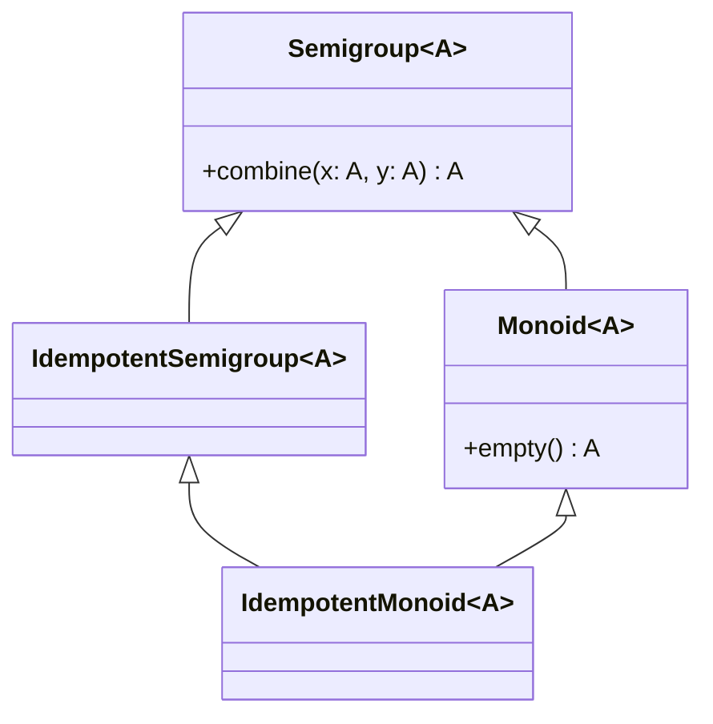

# Idempotent Monoid

_IdempotentMonoid_ is a [monoid](monoid.md)
that is also [idempotent](band.md),
i.e. adding a value to itself yields the same value.

`IdempotentMonoid` must satisfy the laws of its parent types:

- _Closure_ (_closure_): for \\(\forall x, y \in IM\\), \\(x + y \in IM\\).
- _Associativity_ (_associativity_): for \\(\forall x, y, z \in IM\\), \\((x + y) + z = x + (y + z)\\).
- _Identity_ (_identity_):
  there exists \\(\exists e \in IM\\) such that for \\(\forall x \in IM\\), \\(e + x = x + e = x\\)
- _Idempotency_ (_idempotency_): for \\(\forall x \in IM\\), \\(x + x = x\\).

## Code

```dotty
trait IdempotentMonoid[A] extends Monoid[A], Band[A]:
  override def combineN(a: A, n: Int): Either[String, A] =
    if n < 0 then
      Left("Repeated combining for monoids must have n >= 0")
    else if n == 0 then Right(empty)
    else Right(a) // combine(a, a) == a
```

### Sets

Some set operations are idempotent: union, intersection, etc.
For example, the union of sets forms an `IdempotentMonoid`:

```dotty
given [A]: IdempotentMonoid[Set[A]] with
  def empty: Set[A] = Set.empty[A]
  def combine(x: Set[A], y: Set[A]): Set[A] = x ++ y
```

### Laws

Laws are inherited from [monoid](monoid.md) and [idempotent semigroup](band.md).

## Diagram



---

**References:**

- [Repository with exercises and instructions for completion][sample]

[sample]: https://gitverse.ru/scalabook/typeclasses
