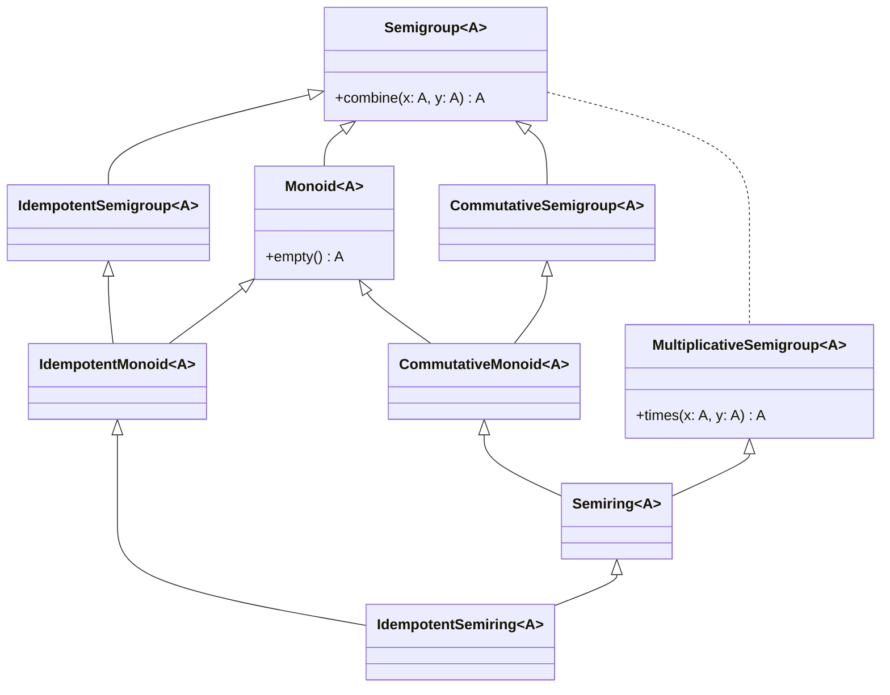

# Idempotent Semiring

An idempotent semiring is a [semiring](semiring.md) that is also [idempotent](band.md),
i.e. adding a value to itself yields the same value.

All laws of a semiring must hold for an idempotent semiring:

- _Additive closure_ (_closure_): for \\(\forall x, y \in S\\), \\(x + y \in S\\).
- _Additive associativity_ (_associativity_): for \\(\forall x, y, z \in S\\), \\((x + y) + z = x + (y + z)\\).
- _Existence of zero element_: there exists \\(\exists 0 \in S\\) such that
  for \\(\forall x \in S\\), \\(0 + x = x + 0 = x\\)
- _Additive commutativity_ (_commutative_): for \\(\forall x, y \in S\\), \\(x + y = y + x\\).
- _Multiplicative closure_ (_closure_): for \\(\forall x, y \in S\\), \\(x \* y \in S\\).
- _Multiplicative associativity_ (_associativity_): for \\(\forall x, y, z \in S\\), \\((x \* y) \* z = x \* (y \* z)\\).
- _Distributivity_ (_distributivus_, _distributive law_):
  for \\(\forall x, y, z \in S\\), \\(x \* (y + z) = x \* y + x \* z\\) and \\((x + y) \* z = x \* z + y \* z\\).
- _Multiplicative zero property_: \\(a \* 0 = 0 \* a = 0\\)

as well as the law of additive idempotency:

- _Idempotency_ (_idempotency_): for \\(\forall x \in S\\), \\(x + x = x\\).

## Code

```dotty
trait ISemiring[A] extends Semiring[A], IdempotentMonoid[A]
```

### Laws

- Laws of a [semiring](semiring.md)
- Idempotency is stated as:
  `s.combine(x, x)` must equal `x`.
  This means that combining an element with itself does not change it.

## Diagram



---

**References:**

- [Repository with exercises and instructions for completion][sample]
- [Wikipedia](https://en.wikipedia.org/wiki/Semiring)

[sample]: https://gitverse.ru/scalabook/typeclasses
