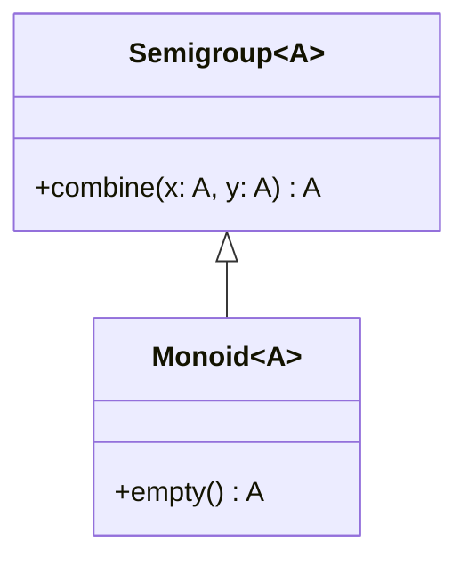

# Monoid

**Monoids** are a fundamental concept in functional programming,
allowing one to abstract from specific data types and work with common operations
such as combining, summing, or concatenating.
This abstraction not only makes code more universal and reusable,
but also helps better understand the principles of data and function composition.

**What is a monoid?**

A monoid is a mathematical structure that consists of:

- **A set of elements** (e.g., numbers, strings, lists).
- **A binary operation** (e.g., addition, concatenation) that combines two elements of the set into one.
- **An identity element** (e.g., 0 for addition or empty string for concatenation) that does not change the result of the operation.

The following two key properties must hold:

- **Associativity**: The result of the operation does not depend on the order of computation. For example, `(a + b) + c` equals `a + (b + c)`.
- **Identity element**: An operation with the identity element does not change the value. For example, `a + 0` equals `a`.

**Why are monoids needed?**

Monoids play an important role in functional programming because they allow:

- **Abstraction from specific data types**: You can define common operations
  (e.g., list concatenation or number addition) independently of the specific data type.
- **Creating composable functions**: Monoids allow combining data into larger structures,
  which is useful when working with collections, aggregating data, or parallel processing.
- **Simplifying code**: Using monoids makes code more declarative and reduces the amount of boilerplate code.
- **Working with parallelism**: The associativity of monoids allows efficiently breaking tasks into subtasks and executing them in parallel.

**Examples of monoids**

- **Numbers with addition**: Set — numbers, operation — addition, identity element — 0.
- **Strings with concatenation**: Set — strings, operation — concatenation, identity element — empty string.
- **Lists with concatenation**: Set — lists, operation — concatenation, identity element — empty list.
- **Boolean values with AND**: Set — boolean values, operation — logical AND, identity element — `true`.

## Formal Definition

A monoid is a [semigroup](semigroup.md) with an identity (neutral) element.

\\((M, +)\\) is a monoid for a given set \\(M\\) and operation \\(+\\),
if it satisfies the following properties for any \\(x, y, z \in M\\):

- _Closure_ (_closure_): for \\(\forall x, y \in M\\), \\(x + y \in M\\).
- _Associativity_ (_associativity_): for \\(\forall x, y, z \in M\\), \\((x + y) + z = x + (y + z)\\).
- _Identity_ (_identity_):
  there exists \\(\exists e \in M\\) such that for \\(\forall x \in M\\), \\(e + x = x + e = x\\)

> The first two laws are inherited from the semigroup.

It is also said that _M is a monoid with respect to +_.

#### Definition from monoidal category

A monoid in a monoidal category is an object \\(m\\) equipped with two morphisms:

- \\(\mu  : m \bigotimes m \to m\\)
- \\(\eta  : I \to m\\)

satisfying the unit and associativity laws:

- \\(id\_{m} \bigotimes m = m \bigotimes id\_{m} = m\\)
- \\((m \bigotimes m) \bigotimes m = m \bigotimes (m \bigotimes m)\\)

## Code

```dotty
trait Monoid[A] extends Semigroup[A]:
  def empty: A
  
  override def combineN(a: A, n: Int): Either[String, A] =
    if n < 0 then
      Left("Repeated combining for monoids must have n >= 0")
    else if n == 0 then
      Right(empty)
    else super.combineN(a, n)
```

For the addition operation, the following names are found in [semigroup](semigroup.md):
`combine`, `append`, `mappend` (Haskell), `op`, `plus`, `times`.
For the identity element, the following names are found: `empty`, `mempty` (Haskell), `id`.

### Laws

- Closure follows from the definition of the `combine` function: the result type of this function matches the type of the variables
  it takes.
- Associativity is expressed as follows:
  `m.combine(x, m.combine(y, z))` must equal `m.combine(m.combine(x, y), z)`.
  This means that the order of combining elements does not affect the final result.
- Identity means that if you combine any element `x` with the identity element (`m.empty`),
  the result will always equal `x`. In other words, the identity element does not change `x` when combined.
  This can be written as:
  - `m.combine(x, m.empty) == x`
  - `m.combine(m.empty, x) == x`

## Exercises

### Exercise 1.2.1: Implementation of an addition monoid

> [Repository with exercises and instructions for completion][sample]

Your task is to fill in the missing parts (`???`) to implement a monoid:

- Natural numbers N under addition

```dotty
given additionMonoid: Monoid[Int] with
  val empty = ???

  def combine(x: Int, y: Int): Int = ???
```

@:note(🔍 Show solution)

```dotty
given additionMonoid: Monoid[Int] with
  val empty = 0

  def combine(x: Int, y: Int): Int = x + y     
```

**Example calls**:

```dotty
additionSemigroup.combine(5, 3)
// 8
additionSemigroup.empty
// 0
```

`Int` under addition with `0` forms a monoid, because:

- addition is associative: `(a + b) + c = a + (b + c)`
- `0` is the identity element with respect to addition: `0 + a = a + 0 = a`

@:@

### Exercise 1.2.2: Implementation of a multiplication monoid

Your task is to fill in the missing parts (`???`) to implement a monoid:

- Natural numbers N under multiplication

```dotty
given multiplicationMonoid: Monoid[Int] with
  val empty = ???

  def combine(x: Int, y: Int): Int = ???
```

@:note(🔍 Show solution)

```dotty
given multiplicationMonoid: Monoid[Int] with
  val empty = 1

  def combine(x: Int, y: Int): Int = x * y    
```

**Example calls**:

```dotty
multiplicationMonoid.combine(4, 5) 
// 20
multiplicationMonoid.empty
// 1
```

`Int` under multiplication with identity element `1` forms a monoid, because:

- multiplication is associative: `(a * b) * c = a * (b * c)`
- `1` is the identity element with respect to multiplication: `1*a = a*1 = a`

@:@

### Exercise 1.2.3: Implementation of a string concatenation monoid

Your task is to fill in the missing parts (`???`) to implement a monoid:

```dotty
given concatenationMonoid: Monoid[String] with
  val empty = ???
  
  def combine(x: String, y: String): String = ???
```

@:note(🔍 Show solution)

```dotty
given concatenationMonoid: Monoid[String] with
  val empty = ""
  
  def combine(x: String, y: String): String = x + y   
```

**Example calls**:

```dotty
concatenationMonoid.combine("Hello, ", "World!")
// "Hello, World!"
concatenationMonoid.empty
// ""
```

`String` under string concatenation with identity element empty string `""` forms a monoid, because:

- string concatenation is associative: `(a + b) + c = a + (b + c)`
    - `"mom" + ("washed" + "the" + "dish") =`
    - `("mom" + "washed") + "the" + "dish" =`
    - `"momwashedthedish"`
- `""` is the identity element with respect to concatenation: `"" + a = a + "" = a`

@:@

### Exercise 1.2.4: Implementation of a monoid for lists

Your task is to fill in the missing parts (`???`) to implement a monoid:

```dotty
given listMonoid[T]: Monoid[List[T]] with
  val empty = ???

  def combine(x: List[T], y: List[T]): List[T] = ???
```

@:note(🔍 Show solution)

```dotty
given listMonoid[T]: Monoid[List[T]] with
  val empty = List.empty[T]

  def combine(x: List[T], y: List[T]): List[T] = x ++ y  
```

**Example calls**:

```dotty
listMonoid[Int].combine(List(1, 2), List(3, 4)) 
// List(1, 2, 3, 4)
listMonoid[Int].empty
// List()
```

@:@

### Exercise 1.2.5: Implementation of a monoid for tuples

Your task is to fill in the missing parts (`???`) to implement a monoid:

```dotty
given nestedMonoid[A: Monoid as am, B: Monoid as bm]: Monoid[(A, B)] with
  val empty: (A, B) = ???

  def combine(x: (A, B), y: (A, B)): (A, B) =
    ???
```

@:note(🔍 Show solution)

```dotty
given nestedMonoid[A: Monoid as am, B: Monoid as bm]: Monoid[(A, B)] with
  val empty: (A, B) = (am.empty, bm.empty)

  def combine(x: (A, B), y: (A, B)): (A, B) =
    (am.combine(x._1, y._1), bm.combine(x._2, y._2))  
```

**Example calls**:

```dotty
nestedMonoid[Int, String].combine((1, "a"), (2, "b"))
// (3, "ab")
nestedMonoid[Int, String].empty
// (0, "")
```

@:@

### Exercise 1.2.6: Implementation of a monoid for Option

`Option` is a monoid if its type parameter is a semigroup.

Your task is to fill in the missing parts (`???`) to implement a monoid:

```dotty
given optionMonoidInstance[A: Semigroup as sm]: Monoid[Option[A]] with
  val empty: Option[A] = ???

  def combine(x: Option[A], y: Option[A]): Option[A] =
    ???
```

@:note(🔍 Show solution)

```dotty
given optionMonoidInstance[A: Semigroup as sm]: Monoid[Option[A]] with
  val empty: Option[A] = None

  def combine(x: Option[A], y: Option[A]): Option[A] =
    (x, y) match
      case (Some(a1), Some(a2)) => Some(sm.combine(a1, a2))
      case (Some(_), None)      => x
      case (None, Some(_))      => y
      case (None, None)         => None 
```

**Example calls**:

```dotty
optionMonoidInstance[Int].combine(Some(1), Some(2))
// Some(3)
optionMonoidInstance[Int].combine(Some(1), None)
// Some(1)
optionMonoidInstance[Int].combine(None, Some(1))
// Some(1)
optionMonoidInstance[Int].empty
// None
```

@:@

### Exercise 1.2.7: Implementation of a monoid for Boolean (logical AND)

Your task is to fill in the missing parts (`???`) to implement a monoid:

```dotty
given booleanAnd: Monoid[Boolean] with
  val empty: Boolean = ???
  
  def combine(a1: Boolean, a2: Boolean): Boolean = 
    ???
```

@:note(🔍 Show solution)

```dotty
given booleanAnd: Monoid[Boolean] with
  val empty: Boolean = true
  
  def combine(a1: Boolean, a2: Boolean): Boolean = a1 && a2   
```

**Example calls**:

```dotty
booleanAnd.combine(true, false)
// false
booleanAnd.combine(true, true)
// true
booleanAnd.empty
// true
```

@:@

### Exercise 1.2.8: Implementation of a monoid for Boolean (logical OR)

Your task is to fill in the missing parts (`???`) to implement a monoid:

```dotty
given booleanOr: Monoid[Boolean] with
  val empty: Boolean = ???
  
  def combine(a1: Boolean, a2: Boolean): Boolean = 
    ???
```

@:note(🔍 Show solution)

```dotty
given booleanOr: Monoid[Boolean] with
  val empty: Boolean = false
  
  def combine(a1: Boolean, a2: Boolean): Boolean = 
    a1 || a2  
```

**Example calls**:

```dotty
booleanOr.combine(false, true)
// true
booleanOr.combine(false, false)
// false
booleanOr.empty
// false
```

@:@

### Exercise 1.2.9: Obtaining a dual monoid

You can obtain the dual of any monoid by simply reversing the `combine` operation.

Your task is to fill in the missing parts (`???`) to implement a monoid:

```dotty
def dual[A](m: Monoid[A]): Monoid[A] = new:
  val empty: A = ???

  def combine(x: A, y: A): A = ???
```

@:note(🔍 Show solution)

```dotty
def dual[A](m: Monoid[A]): Monoid[A] = new:
  val empty: A = m.empty 

  def combine(x: A, y: A): A = m.combine(y, x)
```

**Example calls**:

```dotty
val intAddition = additionMonoid
val intDualAddition = dual(intAddition)

intDualAddition.combine(1, 2) returns 
// 3 (but with combine(y, x))
```

@:@

### Exercise 1.2.10: Implementation of an endomorphism monoid

Your task is to fill in the missing parts (`???`) to implement a monoid:

```dotty
def endoMonoid[A]: Monoid[A => A] = new:
  val empty: A => A = ???

  def combine(f: A => A, g: A => A): A => A = ???
```

@:note(🔍 Show solution)

Monoid for functions `A => A` with the composition operation (`andThen`) and identity element.

```dotty
def endoMonoid[A]: Monoid[A => A] = new:
  val empty: A => A = identity

  def combine(f: A => A, g: A => A): A => A = f andThen g  
```

**Example calls**:

```dotty
val f: Int => Int = _ + 1
val g: Int => Int = _ * 2
endoMonoid[Int].combine(f, g).apply(3) 
// ((3 + 1) * 2) = 8
```

@:@

## Additional Properties

Any monoid has exactly one identity element.
This follows from the properties of the identity element: \\(e\_1 = e\_1 + e\_2 = e\_2 \to e\_1 = e\_2\\).

Using the definition of the natural power of a semigroup element ("adding n times") as:
\\(a^{n} = \overset{n}{a + ... + a}\\), we can extend the definition to 0 power: \\(a^{0} = e\\).

## Usage

Monoids are closely related to lists.
For example, here is how you can fold a list using a monoid:

```dotty
given Monoid[Int] with
  val empty = 1

  def combine(x: Int, y: Int): Int = x * y

def combineAll[A: Monoid as m](as: List[A]): A =
  as.foldLeft(m.empty)(m.combine)

combineAll(List(1, 2, 3, 4))
// 24
```

The fact that the `combine` operation of a monoid is associative means that you can choose
how to fold a data structure such as a list.
If you have a monoid, you can reduce a list using a balanced fold,
which may be more efficient for some operations and also allows parallelism.

As an example, suppose you have a sequence of `a`, `b`, `c`, `d`,
that needs to be folded using some monoid.
A _balanced fold_ looks like this:

```dotty
combine(combine(a, b), combine(c, d))
```

Note that a _balanced fold_ allows parallelism,
because the two internal calls are independent of each other and can be executed simultaneously.
But beyond that, a more balanced tree-like structure can be more efficient in cases where
the cost of each operation is proportional to the size of its combined arguments.

For example, consider the performance of this expression at runtime:

```dotty
List("lorem", "ipsum", "dolor", "sit").foldLeft("")(_ + _)
```

At each fold step, a full intermediate string is allocated only to be
discarded, and a `String` allocates a larger string in the next step.
Recall that values are immutable, and that `String` computation for strings
requires allocating a new character array and copying `a + b` for strings `a` and `b` into this new array.
This takes time proportional to `a.length + b.length`.

Here is a trace of the computation of the previous expression:

```dotty
List("lorem", "ipsum", "dolor", "sit").foldLeft("")(_ + _)
List("ipsum", "dolor", "sit").foldLeft("lorem")(_ + _)
List("dolor", "sit").foldLeft("loremipsum")(_ + _)
List("sit").foldLeft("loremipsumdolor")(_ + _)
List().foldLeft("loremipsumdolorsit")(_ + _)
"loremipsumdolorsit"
```

Note that the intermediate strings are created and then immediately discarded.
A more efficient strategy would be to merge halves of the sequence,
which is called a _balanced fold_ —
first `"loremipsum"` and `"dolorsit"` are built, and then they are combined together.

## Operations with Monoids

Monoids can be combined:
if `A` and `B` are monoids, then the tuple `(A, B)` is also a monoid (called a _product_)

```dotty
given productMonoid[A: Monoid as ma, B: Monoid as mb]: Monoid[(A, B)] with
  def combine(x: (A, B), y: (A, B)): (A, B) =
    (ma.combine(x(0), y(0)), mb.combine(x(1), y(1)))

  val empty: (A, B) = (ma.empty, mb.empty)
```

A `Map` is also a monoid if a monoid is available for its values:

```dotty
given mapMergeMonoid[K, V: Monoid as mv]: Monoid[Map[K, V]] with
  def combine(a: Map[K, V], b: Map[K, V]): Map[K, V] =
    (a.keySet ++ b.keySet).foldLeft(empty) { (acc, k) =>
      acc.updated(
        k,
        mv.combine(a.getOrElse(k, mv.empty), b.getOrElse(k, mv.empty))
      )
    }

  val empty: Map[K, V] = Map()
```

A function whose results are monoids is itself a monoid.

```dotty
given functionMonoid[A, B: Monoid as mb]: Monoid[A => B] with
  def combine(f: A => B, g: A => B): A => B = a => mb.combine(f(a), g(a))

  val empty: A => B = _ => mb.empty
```

The fact that multiple monoids can be combined into one means that
you can perform multiple computations simultaneously when folding a data structure.
For example, you can take the length and sum of a list simultaneously to compute the mean:

```dotty
val p = List(1, 2, 3, 4).foldMap(a => (1, a))
// p: Tuple2[Int, Int] = (4, 10)
val mean = p(0) / p(1).toDouble
// mean: Double = 0.4
```

## Folding a Semigroup Without Identity Element

In Cats there are many types that can form a [`Semigroup`](semigroup.md),
but cannot form a `Monoid`.
The reason is that `Monoid` requires an **identity element** (`empty`) — a value
that when combined with any other value does not change it.
Some types simply do not have such an "empty" value by their nature.

Consider the classic example: **`NonEmptyList`** — a non-empty list.
It is certainly a semigroup, because two non-empty lists can be combined (concatenated),
and the result will always be a non-empty list. However, it has no identity element:
whatever we substitute as the "empty" list, combining it with a non-empty list must yield the same non-empty list.
But an empty list, by definition, cannot be a value of type `NonEmptyList`.
Therefore, `NonEmptyList` cannot be a monoid.

### Example: `NonEmptyList`

First, let's define the type `NonEmptyList` and its `Semigroup` instance:

```dotty
import cats.Semigroup

final case class NonEmptyList[A](head: A, tail: List[A]):
  // Method to combine two non-empty lists
  def ++(other: NonEmptyList[A]): NonEmptyList[A] =
    NonEmptyList(head, tail ++ other.toList)

  // Conversion to a regular list
  def toList: List[A] = head :: tail

object NonEmptyList:
  // Semigroup instance for NonEmptyList
  given nonEmptyListSemigroup[A]: Semigroup[NonEmptyList[A]] = _ ++ _
```

Here the method `++` simply concatenates two lists, keeping the first element as the head and the rest as the tail.
Obviously, the operation is associative, but there is no identity element.

### Problem: How to fold `List[NonEmptyList[A]]`?

Suppose we have a list of non-empty lists:

```dotty
val list = List(
  NonEmptyList(1, List(2, 3)),
  NonEmptyList(4, List(5, 6))
)
```

We want to merge all these non-empty lists into one `NonEmptyList` using the combine operation.
For that we need a `Monoid[NonEmptyList[A]]` with an `empty` method.
But, as discussed, such a monoid does not exist.

**Solution:** we can "lift" our type into `Option` to get a monoid even for types that lack an identity element.

### `Option` as a Wrapper for `Semigroup`

The idea is simple: if we have a type `A` that forms a semigroup, then the type `Option[A]` can form a monoid.
The identity element will be `None` (empty value), and the combine operation works as follows:

- If both values are `None`, the result is `None`.
- If one of the values is `None`, the result is the other value (this works as a replacement for the missing value).
- If both values are `Some`, we combine their inner values using the `combine` operation from `Semigroup[A]`.

Let's define this explicitly:

```dotty
import cats.syntax.all.*

given optionMonoid[A: Semigroup]: Monoid[Option[A]] =
  new Monoid[Option[A]]:
    // Identity element — None
    def empty: Option[A] = None

    // Combine operation
    def combine(x: Option[A], y: Option[A]): Option[A] =
      (x, y) match
        // if x — None, return y
        case (None, _) => y
        // if y — None, return x
        case (_, None) => x
        // both present — combine
        case (Some(xv), Some(yv)) => Some(xv |+| yv)
```

Let's examine the logic of the `combine` method step by step:

| Case | `x`        | `y`        | Result            | Explanation                                               |
|:-------|:-----------|:-----------|:--------------------|:----------------------------------------------------------|
| 1      | `None`     | `None`     | `None`              | Both empty — result is empty                              |
| 2      | `None`     | `Some(yv)` | `Some(yv)`          | Empty value behaves as identity on the left               |
| 3      | `Some(xv)` | `None`     | `Some(xv)`          | Empty value behaves as identity on the right              |
| 4      | `Some(xv)` | `Some(yv)` | `Some(xv |+| yv)`  | Both non-empty — combine inner values                     |

This behavior fully corresponds to monoid laws:

- **Associativity:** `(a ⊕ b) ⊕ c == a ⊕ (b ⊕ c)`
- **Identity element:** `a ⊕ empty == empty ⊕ a == a`

### Application: Folding `List[Option[NonEmptyList[A]]]`

We have a `List[NonEmptyList[Int]]`.
We can convert each element to `Option[NonEmptyList[Int]]` (simply wrapping it in `Some`),
and then use `Monoid.combineAll` to fold all elements into one:

```dotty
import cats.Monoid
import cats.data.NonEmptyList
import cats.syntax.all.*

val list = List(
  NonEmptyList(1, List(2, 3)),
  NonEmptyList(4, List(5, 6))
)

// Lift each non-empty list into Option
val lifted = list.map(nel => Option(nel))

// Fold all elements using Monoid[Option[NonEmptyList[Int]]]
Monoid.combineAll(lifted)
```

**Result**:

```dotty
Some(NonEmptyList(1, List(2, 3, 4, 5, 6)))
```

We got an `Option[NonEmptyList[Int]]` containing the combined list.
If the original list were empty, the result would be `None` — that is the identity element of the monoid.

### Ready solution in Cats: `Semigroup.combineAllOption`

Cats provides a built-in method for performing this kind of "lifting" and folding — `Semigroup.combineAllOption`.
This method takes an `IterableOnce[A]` (a collection of elements) and returns `Option[A]`, where:

- If the collection is empty — `None` is returned.
- If the collection is non-empty — all elements are combined using `Semigroup[A].combine`, and the result is wrapped in `Some`.

Thus, we don't need to manually wrap each element in `Option` and call `Monoid.combineAll`. Instead, we can write:

```dotty
import cats.Semigroup
import cats.data.NonEmptyList
import cats.syntax.all.*

val list = List(
  NonEmptyList(1, List(2, 3)),
  NonEmptyList(4, List(5, 6))
)

Semigroup[NonEmptyList[Int]].combineAllOption(list)
// Result: Some(NonEmptyList(1, List(2, 3, 4, 5, 6)))
```

## Diagram



## Implementation in Libraries

### Implementation in Cats

```dotty
import cats.*
import cats.implicits.*

Monoid[Int].combine(1, Monoid[Int].empty)   // 1
"Hi " |+| "there" |+| Monoid[String].empty  // Hi there
```

### [Implementation in Spire](../../libs/spire.md)

`Monoid` is a semigroup that also has an identity element `id`. `Monoid` extends `Semigroup`.

- `id`: identity element of the monoid
- `isId`: check for equality with the identity element (together with `Eq`)

```dotty
import spire.algebra.Monoid
import spire.implicits.semigroupOps

1 |+| Monoid.empty[Int]           // 1
Monoid.isEmpty(Monoid.empty[Int]) // true
```

## Universal Monoid for Type Constructors

```dotty
trait MonoidK[F[_]] extends SemigroupK[F]:
  self =>

  def empty[A]: F[A]

  def isEmpty[A](a: F[A])(using ev: Equal[F[A]]): Boolean =
    ev.equal(a, empty)

  override def algebra[A]: Monoid[F[A]] =
    new Monoid[F[A]]:
      def empty: F[A] =
        self.empty

      def combine(x: F[A], y: F[A]): F[A] =
        self.combineK(x, y)
```

`MonoidK` is a **universal monoid** that works with type constructors
taking one argument (i.e., with types of kind `* -> *`).
If `Monoid[A]` is a monoid for a concrete type `A`, then `MonoidK[F]` is a monoid for a **type constructor** `F`,
which can be parameterized with any type `A`.

This type class is useful when a type constructor `F[_]` has a structure
that can be **combined** for any concrete type,
and at the same time has an **"empty"** representation (identity element).
Thus, `MonoidK` can be seen as an analog of `Monoid` for parameterized types.

Key property: **`MonoidK[F]` can generate `Monoid[F[A]]` for any type `A`**.
This means that if you have a `MonoidK` instance for `List`,
you can get `Monoid[List[Int]]`, `Monoid[List[String]]`, and so on — for any element type.

`MonoidK` extends [`SemigroupK`](semigroup.md), adding the `empty` method.

### Difference between `Monoid` and `MonoidK`

To better understand the difference, let's look at them separately:

| Characteristic        | `Monoid[A]`                                        | `MonoidK[F]`                                                 |
|:----------------------|:---------------------------------------------------|:-------------------------------------------------------------|
| **Operates on**       | Concrete type `A`                                  | Type constructor `F[_]`                                      |
| **Kind**              | `*`                                                | `* -> *`                                                     |
| **`empty` method**    | Returns `A`                                        | Returns `F[A]` for any `A` (parameterized)                    |
| **`combine` method**  | Takes two `A`, returns `A`                          | Takes two `F[A]`, returns `F[A]` (parameterized)              |
| **Dependence on type `A`** | Depends on the specific type                   | Does not depend on type `A`, only on the structure of `F`    |
| **Example**            | `Monoid[String]` — empty string `""` and concatenation | `MonoidK[List]` — empty list `Nil` and list concatenation |
| **What can you do**   | Combine values of type `A`                          | Combine containers `F[A]` for any `A`                         |

In simpler terms:

- **`Monoid[A]`** answers the question: "How to combine two values of type `A` and what value is the identity?"
- **`MonoidK[F]`** answers the question: "How to combine two containers of type `F[A]` and which container is empty?" —
  and the answer does not depend on what lies inside the container.

### Import setup

For working with the examples we will need the following imports:

```dotty
import cats.{Monoid, MonoidK}
import cats.syntax.all.*
```

The import `cats.*` gives us access to the type classes themselves, and `cats.syntax.all.*` — to the syntax extensions.

### `empty` method: creating an empty value

`MonoidK[F]` has an `empty` method, but unlike `Monoid[A].empty`, it is **parameterized** by the type of the element contained in `F`. This means we can create an empty container for any type:

```dotty
Monoid[List[String]].empty
// Result: List() — empty list of strings

MonoidK[List].empty[String]
// Result: List() — empty list of strings (same as above)

MonoidK[List].empty[Int]
// Result: List() — empty list of integers
```

Note: in the first case we use `Monoid[List[String]]` — a specific monoid for a list of strings.
In the second and third cases we use `MonoidK[List]` and specify the element type explicitly.
The result is always the same — an empty list. This demonstrates that `MonoidK` does not depend on the element type.

### `combineK` method: combining containers

Instead of `combine`, `MonoidK` has a `combineK` method, which also takes a type parameter:

```dotty
Monoid[List[String]].combine(List("hello", "world"), List("goodbye", "moon"))
// Result: List("hello", "world", "goodbye", "moon")

MonoidK[List].combineK[String](List("hello", "world"), List("goodbye", "moon"))
// Result: List("hello", "world", "goodbye", "moon")

MonoidK[List].combineK[Int](List(1, 2), List(3, 4))
// Result: List(1, 2, 3, 4)
```

Here `combineK[String]` explicitly specifies the element type, but in practice the Scala compiler can usually infer it automatically:

```dotty
MonoidK[List].combineK(List("hello", "world"), List("goodbye", "moon"))
// Result: List("hello", "world", "goodbye", "moon")

MonoidK[List].combineK(List(1, 2), List(3, 4))
// Result: List(1, 2, 3, 4)
```

In both cases the compiler automatically determines that we are working with lists of strings and integers respectively,
and substitutes the appropriate type parameter.

### Laws for `MonoidK`

`MonoidK` must obey the same laws as `Monoid`, but at the level of type constructors:

1. **Associativity:** `combineK(x, combineK(y, z)) == combineK(combineK(x, y), z)` for any `x, y, z: F[A]`.
2. **Identity element:** `combineK(empty[A], x) == combineK(x, empty[A]) == x` for any `x: F[A]`.

These laws ensure that `MonoidK` behaves predictably and can be used in generalized algorithms.

---

**References:**

- [Classic abstractions used in FP](https://habr.com/ru/articles/896660/)
- [Algebird](https://twitter.github.io/algebird/typeclasses/monoid.html)
- [Category Theory for Programmers - Bartosz Milewski](https://bartoszmilewski.com/2014/12/05/categories-great-and-small/)
- [Cats](https://typelevel.org/cats/typeclasses/monoid.html)
- [Functional Programming in Scala, Second Edition, Chapter 10](https://www.manning.com/books/functional-programming-in-scala-second-edition?query=Functional%20Programming%20in%20Scala,%20Second%20Edition)
- [Herding Cats](http://eed3si9n.com/herding-cats/Monoid.html)
- [Learn Functional Programming course/tutorial on Scala](https://github.com/dehun/learn-fp)
- [Learning Scalaz](http://eed3si9n.com/learning-scalaz/Monoid.html#Monoid)
- [Leveraging Monoids for More Powerful Summarization](https://www.inner-product.com/posts/leveraging-monoids/)
- [Monoids and Semigroups in Scala](https://www.baeldung.com/scala/monoids-semigroups)
- [Of Algebirds, Monoids, Monads, and other Bestiary for Large-Scale Data Analytics](https://www.michael-noll.com/blog/2013/12/02/twitter-algebird-monoid-monad-for-large-scala-data-analytics/#monoids)
- [Scala with Cats](https://scalawithcats.com/dist/scala-with-cats.html#definition-of-a-monoid)
- [Scalaz API](https://javadoc.io/doc/org.scalaz/scalaz-core_3/7.3.6/scalaz/Monoid.html)
- [Semigroups and Monoids in Scala](https://www.youtube.com/watch?v=LmBTiFYa-V4&amp;list=PLmtsMNDRU0Bzj7INIrLugi3a_WClwQuiS)
- [Spire home page](https://typelevel.org/spire/)
- [Wikipedia](https://ru.wikipedia.org/wiki/%D0%9C%D0%BE%D0%BD%D0%BE%D0%B8%D0%B4)

[sample]: https://gitverse.ru/scalabook/typeclasses
