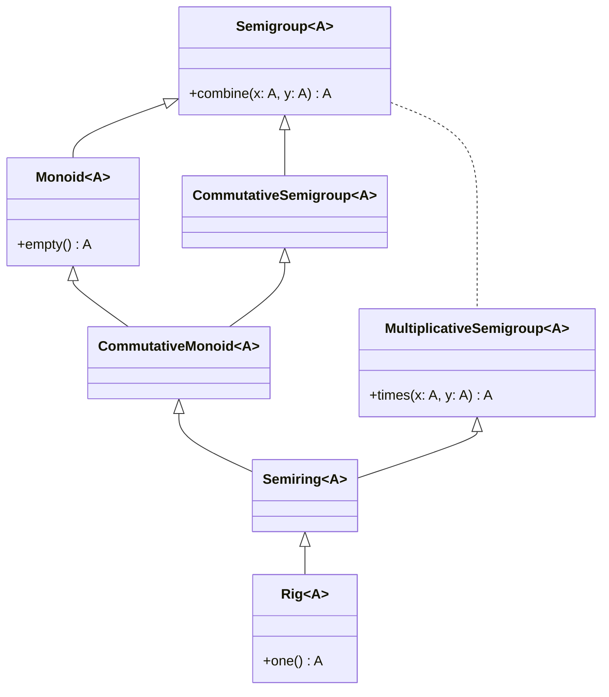

# Rig

A rig with identity is a [semiring](semiring.md) in which there is an identity element for multiplication (called identity):
\\(\exists 1 \in S \quad \forall a \in S \quad  a \* 1 = 1 \* a = a\\).

All laws of a semiring must hold for a rig with identity:

- _Additive closure_ (_closure_): for \\(\forall x, y \in S\\), \\(x + y \in S\\).
- _Additive associativity_ (_associativity_): for \\(\forall x, y, z \in S\\), \\((x + y) + z = x + (y + z)\\).
- _Existence of zero element_: there exists \\(\exists 0 \in S\\) such that
  for \\(\forall x \in S\\), \\(0 + x = x + 0 = x\\)
- _Additive commutativity_ (_commutative_): for \\(\forall x, y \in S\\), \\(x + y = y + x\\).
- _Multiplicative closure_ (_closure_): for \\(\forall x, y \in S\\), \\(x \* y \in S\\).
- _Multiplicative associativity_ (_associativity_): for \\(\forall x, y, z \in S\\), \\((x \* y) \* z = x \* (y \* z)\\).
- _Distributivity_ (_distributivus_, _distributive law_):
  for \\(\forall x, y, z \in S\\), \\(x \* (y + z) = x \* y + x \* z\\) and \\((x + y) \* z = x \* z + y \* z\\).
- _Multiplicative zero property_: \\(a \* 0 = 0 \* a = 0\\)

as well as the law of multiplicative identity:

- _Existence of unit element_: \\(\exists 1 \in S \quad \forall x \in S \quad x \* 1 = 1 \* x = x\\)

## Code

```dotty
trait Rig[A] extends Semiring[A]:
  def one: A
```

### Laws

- Laws of a [semiring](semiring.md)
- Check for the existence of an identity element.
  The identity element (`su.one`) is such an element that when multiplied by any other element `x` it does not change its value.
  This can be expressed in two ways:
  - If you multiply `x` by the identity element (`su.one`), the result will be equal to `x`: `su.times(x, su.one) == x`
  - If you multiply the identity element (`su.one`) by `x`, the result will also be equal to `x`: `su.times(su.one, x) == x`

## Diagram



## Implementation in Libraries

### [Implementation in Spire](../../libs/spire.md)

`Rig[A]` provides `+`, `zero`, `*`, and `one`.
`Rig[A]` extends `Semiring[A]` and `MultiplicativeMonoid[A]`.

- `zero`: additive identity
- `one`: multiplicative identity (an element such that for any `x`, `x * one = x`)

```dotty
import spire.algebra.Rig
import spire.math.Rational

Rig.plus(Rational(1, 2), Rational(1, 3))
// val res0: spire.math.Rational = 5/6
Rig.times(Rational(1, 2), Rational(1, 3))
// val res1: spire.math.Rational = 1/6
Rig.pow(Rational(1, 2), 3)
// val res2: spire.math.Rational = 1/8
Rig.zero[Rational]
// val res3: spire.math.Rational = 0
Rig.one[Rational]
// val res4: spire.math.Rational = 1
```

---

**References:**

- [Repository with exercises and instructions for completion][sample]
- [Spire home page](https://typelevel.org/spire/)
- [Spire User's Guide](https://typelevel.org/spire/guide.html)
- [Wikipedia](https://ru.wikipedia.org/wiki/%D0%9F%D0%BE%D0%BB%D1%83%D0%BA%D0%BE%D0%BB%D1%8C%D1%86%D0%BE)

[sample]: https://gitverse.ru/scalabook/typeclasses
