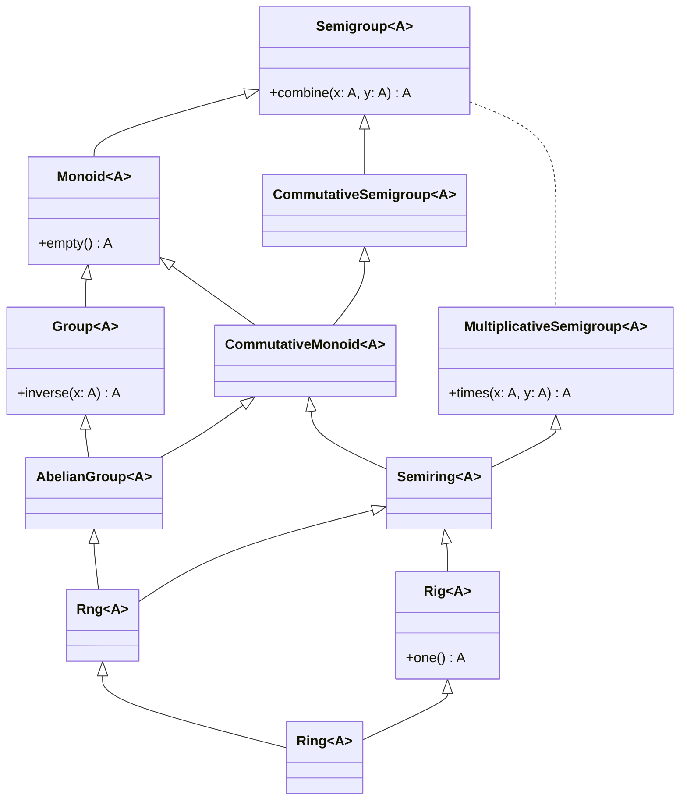

# Ring

**Ring** is one of the key algebraic structures in mathematics, generalizing the notion of numbers and operations on them.
A ring is defined as a set on which two binary operations are defined (usually called addition and multiplication),
satisfying certain axioms.

A ring is an [rng](rng.md) that has a [multiplicative identity](rig.md).

The following laws must hold for a ring:

- _Closure under addition_ (_closure_): for \\(\forall x, y \in R\\), \\(x + y \in R\\).
- _Associativity of addition_ (_associativity_): for \\(\forall x, y, z \in R\\), \\((x + y) + z = x + (y + z)\\).
- _Existence of a zero element_: there exists \\(\exists 0 \in R\\) such that
  for \\(\forall x \in R\\), \\(0 + x = x + 0 = x\\).
- _Existence of additive inverses_: for \\(\forall x \in R\\) there exists \\((-x)\\) such that
  \\(x + (-x) = (-x) + x = 0\\).
- _Commutativity of addition_ (_commutative_): for \\(\forall x, y \in R\\), \\(x + y = y + x\\).
- _Closure under multiplication_ (_closure_): for \\(\forall x, y \in R\\), \\(x \* y \in R\\).
- _Associativity of multiplication_ (_associativity_): for \\(\forall x, y, z \in R\\), \\((x \* y) \* z = x \* (y \* z)\\).
- _Distributivity_ (_distributivity_):
  for \\(\forall x, y, z \in R\\), \\(x \* (y + z) = x \* y + x \* z\\) and \\((x + y) \* z = x \* z + y \* z\\).
- _Existence of a multiplicative identity_: \\(\exists 1 \in R \quad \forall x \in R \quad x \* 1 = 1 \* x = x\\).

## Code

```dotty
trait Ring[A] extends Rng[A], Rig[A]
```

### Laws

The laws are inherited from the [laws of a ring](rng.md) and [rig](rig.md).

## Diagram



## Library Implementations

### [Implementation in Spire](../../libs/spire.md)

`Ring[A]` provides commutative `+`, `zero`, `-`, `*`, and `one`.
`Ring[A]` extends `Rig[A]` and `Rng[A]`.

```dotty
import spire.algebra.Ring
import spire.math.Rational

Ring.plus(Rational(1, 2), Rational(1, 3))
// val res0: spire.math.Rational = 5/6
Ring.times(Rational(1, 2), Rational(1, 3))
// val res1: spire.math.Rational = 1/6
Ring.pow(Rational(1, 2), 3)
// val res2: spire.math.Rational = 1/8
Ring.negate(Rational(1, 2))
// val res3: spire.math.Rational = -1/2
Ring.minus(Rational(1, 2), Rational(1, 3))
// val res4: spire.math.Rational = 1/6
Ring.zero[Rational]
// val res5: spire.math.Rational = 0
Ring.one[Rational]
// val res6: spire.math.Rational = 1
```

---

**References:**

- [Link to the exercises repository][sample]
- [Spire home page](https://typelevel.org/spire/)
- [Spire User's Guide](https://typelevel.org/spire/guide.html)
- [Wikipedia](https://en.wikipedia.org/wiki/Ring_(mathematics))

[sample]: https://gitverse.ru/scalabook/typeclasses
