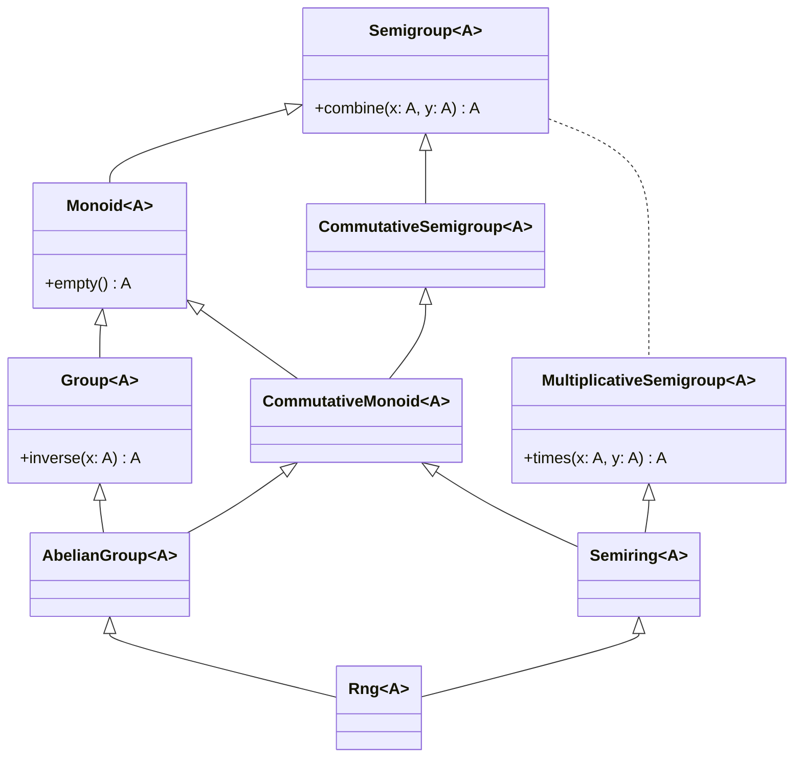

# Ring without Unit (Rng)

Given a set `R` and operations `+` and `*`, 
we say that `(R, +, *)` is a rng (ring without unit) if it satisfies the following properties:

- `(R, +)` is an [abelian group](abgroup.md).
- For any `x` and `y ∈ R`: `x * y ∈ R`.
- For any `x`, `y`, and `z ∈ R`: `(x * y) * z = x * (y * z)`.
- For any `x`, `y`, and `z ∈ R`: `x * (y + z) = x * y + x * z` and `(x + y) * z = x * z + y * z`.

Laws of a rng:

- _Closure under addition_ (_closure_): for \\(\forall x, y \in R\\), \\(x + y \in R\\).
- _Associativity of addition_ (_associativity_): for \\(\forall x, y, z \in R\\), \\((x + y) + z = x + (y + z)\\).
- _Existence of a zero element_: there exists \\(\exists 0 \in R\\) such that
  for \\(\forall x \in R\\), \\(0 + x = x + 0 = x\\).
- _Existence of additive inverses_: for \\(\forall x \in R\\) there exists \\((-x)\\) such that
  \\(x + (-x) = (-x) + x = 0\\).
- _Commutativity of addition_ (_commutative_): for \\(\forall x, y \in R\\), \\(x + y = y + x\\).
- _Closure under multiplication_ (_closure_): for \\(\forall x, y \in R\\), \\(x \* y \in R\\).
- _Associativity of multiplication_ (_associativity_): for \\(\forall x, y, z \in R\\), \\((x \* y) \* z = x \* (y \* z)\\).
- _Distributivity_ (_distributivity_):
  for \\(\forall x, y, z \in R\\), \\(x \* (y + z) = x \* y + x \* z\\) and \\((x + y) \* z = x \* z + y \* z\\).

## Code

```dotty
trait Rng[A] extends AbelianGroup[A], Semiring[A]
```

### Laws

The laws are inherited from the [laws of an abelian group](abgroup.md) and [semiring](semiring.md).

## Diagram



## Library Implementations

### [Implementation in Spire](../../libs/spire.md)

`Rng[A]` provides commutative `+`, `zero`, `-`, and `*`.
`Rng[A]` extends `Semiring[A]` and `AdditiveAbGroup[A]`.

- `negate` (`-`): additive inverse operation
- `minus` (`-`): subtraction
- `zero`: additive identity (an element such that for any `x` in the set, `x + zero = x`)

```dotty
import spire.algebra.Rng
import spire.math.Rational

Rng.plus(Rational(1, 2), Rational(1, 3))
// val res0: spire.math.Rational = 5/6
Rng.times(Rational(1, 2), Rational(1, 3))
// val res1: spire.math.Rational = 1/6
Rng.pow(Rational(1, 2), 3)
// val res2: spire.math.Rational = 1/8
Rng.negate(Rational(1, 2))
// val res3: spire.math.Rational = -1/2
Rng.minus(Rational(1, 2), Rational(1, 3))
// val res4: spire.math.Rational = 1/6
Rng.zero[Rational]
// val res5: spire.math.Rational = 0
```

---

**References:**

- [Link to the exercises repository][sample]
- [Algebird](https://twitter.github.io/algebird/typeclasses/ring.html)
- [Spire home page](https://typelevel.org/spire/)
- [Spire User's Guide](https://typelevel.org/spire/guide.html)
- [Wikipedia](https://ru.wikipedia.org/wiki/%D0%9A%D0%BE%D0%BB%D1%8C%D1%86%D0%BE_(%D0%BC%D0%B0%D1%82%D0%B5%D0%BC%D0%B0%D1%82%D0%B8%D0%BA%D0%B0))

[sample]: https://gitverse.ru/scalabook/typeclasses
