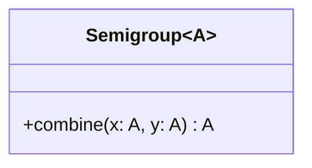

# Semigroup

**Semigroup** is an important mathematical structure 
that lies at the foundation of many concepts in modern algebra and category theory. 
It consists of a set of elements and a single binary operation that is associative. 
Unlike [groups](group.md) and [monoids](monoid.md), a semigroup does not require the presence of an identity element 
or inverse elements for each of its elements.

Semigroups allow abstracting away from specific data types 
and working with union, addition, or concatenation operations, 
making them useful in various scenarios, especially when working with collections and data aggregation.

**What is a semigroup?**

A **semigroup** is a structure consisting of:

- **A set of elements** (e.g., numbers, strings, lists).
- **A binary operation** (e.g., addition, concatenation) that combines two elements of the set into one.

It satisfies a single key property:

- **Associativity**: The result of the operation does not depend on the order of evaluation. For example, `(a + b) + c` equals `a + (b + c)`.

It is important to note that a semigroup **lacks an identity element**. 
This makes semigroups a more general concept than monoids, allowing work with data types 
for which it is impossible or meaningless to define an identity element.

**Why are semigroups useful?**

Semigroups are useful because they:

- **Abstract union operations**: You can work with different data types (numbers, strings, lists, etc.)
  using the same interface for combining.
- **Simplify composition**: Semigroups allow easy data combination,
  which is especially useful when working with collections or aggregating results.
- **Extend the capabilities of monoids**: If a monoid requires an identity element,
  then a semigroup can be applicable in a broader range of tasks where no such element is defined.
- **Improve code readability**: Using semigroups makes code more declarative and clear,
  as you explicitly express the intention to combine data.

**Examples of semigroups**

Some examples of semigroups commonly encountered in programming:

- Number addition: Operation — addition.
- Number multiplication: Operation — multiplication.
- String concatenation: Operation — concatenation.
- Set union: Operation — union.
- Lists: Operation — list concatenation.

> Note that these examples lack an identity element, but the operation remains associative.

## Formal Definition

\\((S, +)\\) is a _semigroup_ for a set \\(S\\) and operation \\(+\\), 
if it satisfies the following properties for any \\(x, y, z \in S\\):

- _Closure_ (_closure_): for \\(\forall x, y \in S\\), \\(x + y \in S\\).
- _Associativity_ (_associativity_): for \\(\forall x, y, z \in S\\), \\((x + y) + z = x + (y + z)\\).

We also say that _S forms a semigroup under +_.

## Code

```dotty
trait Semigroup[A]:
  def combine(x: A, y: A): A
```

For the "addition" operation, the following names are used:
`combine`, `append`, `mappend` (Haskell), `op`, `plus`, `times`.

### Laws

The laws of a semigroup take the following form:

- Closure follows from the definition of the `combine` function: the return type of this function matches the type of the variables
  it accepts, assuming the implementation uses only [pure side-effect-free functions](../../fp/fp/pure_function.md).
- Associativity is expressed as follows:
  `s.combine(x, s.combine(y, z))` should equal `s.combine(s.combine(x, y), z)`.  
  This means that the order of combining elements does not affect the final result.

## Exercise 1.1.1: Implementing Semigroups

> [Exercises repository with instructions][sample]

Your task is — by filling in the missing parts (`???`) — to implement the following semigroups:

- Natural numbers N under addition
- Natural numbers N under multiplication
- Strings under concatenation
- Sequences under the union operation


```dotty
given additionSemigroup: Semigroup[Int] = 
  (x: Int, y: Int) => ???
     
given multiplicationSemigroup: Semigroup[Int] = 
  (x: Int, y: Int) => ???

given concatenationSemigroup: Semigroup[String] =
  (x: String, y: String) => ??? 
   
given listSemigroup[T]: Semigroup[List[T]] =
  (x: List[T], y: List[T]) => ???  
```

@:note(🔍 Show Solution)

```dotty
given additionSemigroup: Semigroup[Int] = (x: Int, y: Int) => x + y
     
given multiplicationSemigroup: Semigroup[Int] = (x: Int, y: Int) => x * y

given concatenationSemigroup: Semigroup[String] =
  (x: String, y: String) => x + y  
   
given listSemigroup[T]: Semigroup[List[T]] =
  (x: List[T], y: List[T]) => x ++ y      
```

- addition is associative: `(a + b) + c = a + (b + c)`
- multiplication is associative: `(a * b) * c = a * (b * c)`
- concatenation is associative: 
  ```
    ("first" + "second") + "third" = 
    "first" + ("second" + "third") = 
    "firstsecondthird"
  ```
- sequence union is associative: 
  ```
  (List(1, 2) ++ List(3, 4)) ++ List(5, 6) = 
  List(1, 2) ++ (List(3, 4) ++ List(5, 6)) = 
  List(1, 2, 3, 4, 5, 6)
  ```

**Example calls**:

```dotty
additionSemigroup.combine(5, 3)
// 8
multiplicationSemigroup.combine(4, 5)
// 20
concatenationSemigroup.combine("Hello, ", "World!")
// "Hello, World!"
listSemigroup[Int].combine(List(1, 2), List(3, 4))
// List(1, 2, 3, 4)
```

@:@

## Additional Properties

Since we know that `Semigroup#combine` must be associative, we can leverage this when writing code. 
For example, to sum a `List[Int]`, we can choose either `foldLeft` or `foldRight`, 
since only the associativity changes.

```dotty
val leftwards = List(1, 2, 3).foldLeft(0)(_ |+| _)

val rightwards = List(1, 2, 3).foldRight(0)(_ |+| _)
```

Associativity also allows us to split a list and sum parts in parallel, collecting results at the end.

```dotty
val list          = List(1, 2, 3, 4, 5)
val (left, right) = list.splitAt(2)
val sumLeft       = left.foldLeft(0)(_ |+| _)
val sumRight      = right.foldLeft(0)(_ |+| _)
val result        = sumLeft |+| sumRight
```

### Power of a Semigroup Element

Also, thanks to associativity, we can correctly define the natural power of a semigroup element ("add n times") as:

\\(a^{n} = \overset{n}{a + ... + a}\\)

The following identities hold for the power of an element: \\(a^{n + m} = a^{m}+a^{n}, (a^{m})^{n} = a^{mn}, \forall n,m \in \mathbb{N}\\).

```dotty
def combineN(a: A, n: Int): Either[String, A] =
  if n <= 0 then
    Left("Repeated combining for semigroups must have n > 0")
  else if n == 1 then
    Right(a)
  else
    @tailrec
    def loop(b: A, k: Int, extra: A): A =
      if k == 1 then combine(b, extra)
      else
        val x = if (k & 1) == 1 then combine(b, extra) else extra
        loop(combine(b, b), k >>> 1, x)

    Right(loop(a, n - 1, a))
```

## Diagram



## Library Implementations

### Implementation in Cats

```dotty
import cats.*
import cats.implicits.*

1 |+| 2                                     // 3
("hello", 123) |+| ("world", 321)           // ("helloworld",444)

val map1 = Map("hello" -> 1, "world" -> 1)
val map2 = Map("hello" -> 2, "cats" -> 3)
Semigroup[Map[String, Int]].combine(map1, map2)
map1 |+| map2
// Map(hello -> 3, cats -> 3, world -> 1)
```

### [Implementation in Spire](../../libs/spire.md)

`Semigroup`:

- `op` (`|+|`): associative binary operation

```dotty
import spire.algebra.Semigroup
import spire.syntax.semigroup.*

1 |+| 2                           // 3
("hello", 123) |+| ("world", 321) // ("helloworld",444)
Semigroup.combineN(3, 5)          // 15
```

## SemigroupK in Cats Library (Semigroup for Type Constructors)

```dotty
trait SemigroupK[F[_]]:
  def combineK[A](x: F[A], y: F[A]): F[A]

  def algebra[A]: Semigroup[F[A]] = combineK(_, _)
```

`SemigroupK` has a structure very similar to `Semigroup`, but with one important difference: 
`SemigroupK` works with **type constructors** that accept exactly one argument. 
If `Semigroup` operates on fully applied types (e.g., `Int`, `List[Int]`, or `Option[Int]`), 
then `SemigroupK` works with type constructors like `List` and `Option`.

To understand the difference, think of a type constructor as a "function" in the space of types. 
For example, the type `List` can be viewed as a function that takes a concrete type (say, `Int`) 
and returns another concrete type — `List[Int]`. 
This pattern in the terminology of kinds is denoted as `* -> *` (read "star to star"). 
For comparison:

| Type     | Kind       | Description                                    |
|:---------|:-----------|:-----------------------------------------------|
| `Int`    | `*`        | Simple concrete type                           |
| `List`   | `* -> *`   | Type constructor taking one argument           |
| `Map`    | `*,* -> *` | Type constructor taking two arguments          |

The letter **K** in `SemigroupK` refers to the concept of **Kind** — it indicates that 
this type class operates at the level of constructors, not at the level of concrete types.

### Example for `List`: identical behavior

For `List`, the `combine` operation from `Semigroup` and the `combineK` operation from `SemigroupK` behave the same — 
both perform list concatenation:

```dotty
import cats.*
import cats.syntax.all.*

SemigroupK[List].combineK(List(1, 2, 3), List(4, 5, 6))
// List(1, 2, 3, 4, 5, 6)
Semigroup[List[Int]].combine(List(1, 2, 3), List(4, 5, 6))
// List(1, 2, 3, 4, 5, 6)
```

Both sides of this expression yield the same result: `List(1, 2, 3, 4, 5, 6)`. 
Because for lists the union operation is trivial — it does not depend on the element type. 
Whether they are `Int`, `String`, or something else, concatenation works the same way.

### Example for `Option`: fundamentally different

For `Option`, the situation changes dramatically. Here the behavior of `Semigroup` and `SemigroupK` differs.

### `Semigroup[Option[A]]`

`Semigroup` operates on the fully applied type `Option[A]`, where `A` is a concrete type. 
Since `A` is known, `Semigroup[Option[A]]` can use `Semigroup[A].combine` to combine inner values. 
This means:

- For `Semigroup[Option[Int]]` an implicit `Semigroup[Int]` is required (which, in turn, uses number addition).
- The result will be the combination of the contents of two `Option`s using the operation defined for type `A`.

#### `SemigroupK[Option]`

`SemigroupK[Option]` operates on the type constructor `Option`, where the inner type is undefined 
and can be anything — it is "universally quantified" (i.e., works for any `A`). 
Since we do not know what exact type lies inside, 
we have no way to "combine" two inner values (this would require a `Semigroup[A]` that is unknown). 
Therefore `SemigroupK[Option]` has no choice but to use the built-in `orElse` method to select the first non-empty value:

```dotty
Semigroup[Option[Int]].combine(Some(1), Some(2))
// Result: Some(3) — numbers are added

SemigroupK[Option].combineK(Some(1), Some(2))
// Result: Some(1) — the first Some is chosen

SemigroupK[Option].combineK(Some(1), None)
// Result: Some(1) — the first Some is chosen

SemigroupK[Option].combineK(None, Some(2))
// Result: Some(2) — the first non-empty is chosen
```

### Syntax: Operators `|+|` and `<+>`

Cats provides a convenient inline syntax for both type classes. 
Following the conventions from the **scalaz** library, the following operators are used:

| Operator | Type class   | Description                                                                      |
|:---------|:-------------|:---------------------------------------------------------------------------------|
| `\|+\|`  | `Semigroup`  | Combine two values using the operation from `Semigroup`                          |
| `<+>`    | `SemigroupK` | Combine two type constructors using the operation from `SemigroupK`              |

Prepare values for examples:

```dotty
import cats.syntax.all.*

val one            = Option(1)
val two            = Option(2)
val n: Option[Int] = None
```

Pay attention to important details:

1. We use `Option(1)` instead of `Some(1)` — this ensures that the value type is exactly `Option[Int]`, 
   not the more specific subtype `Some[Int]`. This is necessary because type class instances are defined for `Option`, 
   not for its subtypes.
2. For `n` we explicitly specify the type `Option[Int]` for the same reason — so the compiler knows it is `Option`, not `None.type`.

Now let us compare the behavior of operators:

```dotty
// Semigroup: adds numbers inside Option
one |+| two
// Result: Some(3)

// SemigroupK: selects the first non-empty Option
one <+> two
// Result: Some(1)

// Semigroup: None + Some = None (since None contains no value to add)
n |+| two
// Result: None

// SemigroupK: None + Some = Some (selects the first non-empty)
n <+> two
// Result: Some(2)

// Both None give None
n |+| n
// Result: None
n <+> n
// Result: None

// Some + None under Semigroup gives None (since None has no value for combine)
two |+| n
// Result: None

// Some + None under SemigroupK gives Some (selects the first non-empty)
two <+> n
// Result: Some(2)
```

### Important Note on Types: Why `Some` and `None` Don't Work

As mentioned, the `SemigroupK` type class instance is defined for the type constructor `Option`, 
not for its subtypes `Some` and `None`. 
If you try to use the `<+>` operator directly with `Some` or `None`, the compiler will emit an error:

```dotty
Some(1) <+> None
// Error: cannot find SemigroupK[Some] instance
// (expected SemigroupK[Option], but got SemigroupK[Some])

None <+> Some(1)
// Error: cannot find SemigroupK[None] instance
// (expected SemigroupK[Option], but got SemigroupK[None])
```

**Why does this happen?** `Some` and `None` are separate types extending `Option`, but they are not themselves `Option`. 
In Scala each of them is an independent type, and no `SemigroupK` instances are defined for them 
(and they couldn't be, since they are not type constructors with kind `* -> *`). 
Therefore, always use `Option(...)` or explicitly specify the type so the compiler sees the expected constructor.

### When to Use `SemigroupK` vs `Semigroup`

| Scenario                                                              | Preferred Type Class  | Reason                                                       |
|:----------------------------------------------------------------------|:----------------------|:-------------------------------------------------------------|
| The element type is known and a combining operation is defined for it | `Semigroup`           | Can use `combine` operation for inner values                 |
| Element type is unknown or can be anything (universal code)           | `SemigroupK`          | Uses container structure without knowing the inner type      |
| Need to combine two containers selecting the first non-empty (e.g. `Option`) | `SemigroupK`    | `combineK` provides exactly this behavior                    |
| Need to combine container contents considering element type           | `Semigroup`           | `combine` considers type `A` and its `Semigroup`             |

### Law for `SemigroupK`

`SemigroupK` obeys the same associativity law as `Semigroup`:

```dotty
combineK(x, combineK(y, z)) == combineK(combineK(x, y), z)
```

This means that the order of grouping during combination does not affect the result. 
For `Option` this property holds, since `orElse` is associative:

```dotty
val a              = Option(1)
val b: Option[Int] = None
val c              = Option(2)

(a <+> b) <+> c == a <+> (b <+> c)
// true, since both sides yield Some(1)
```

### Practical Applications of `SemigroupK`

1. **Combining collections:** `SemigroupK[List]` and `SemigroupK[Vector]` allow combining collections without being tied to element types.
2. **Selecting the first successful value:** For `Option`, `Either` (via `EitherK`), or other monadic types, `SemigroupK` 
   provides a way to select the first successful result.
3. **Composing parsers:** When building parsers, it is common to try one parser and, if it fails, try another. 
    `SemigroupK` is ideal for this task.
4. **Alternatives in HTTP routing:** When defining routes, a "first match" strategy is often used, 
    which is naturally expressed through `combineK`.

### Summary

| Aspect                                 | `Semigroup`                                     | `SemigroupK`                                    |
|:---------------------------------------|:------------------------------------------------|:------------------------------------------------|
| **Operates on**                        | Concrete types (`Int`, `List[Int]`, `Option[Int]`) | Type constructors (`List`, `Option`, `Either`) |
| **Kind**                               | `*`                                             | `* -> *`                                       |
| **Operator**                           | `\|+\|`                                         | `<+>`                                          |
| **Method**                             | `combine`                                       | `combineK`                                     |
| **Knows inner type `A`?**              | Yes                                             | No                                             |
| **Example for `Option`**               | Adds numbers inside `Some`                      | Selects the first non-empty `Option`           |
| **Requires `Semigroup[A]`?**           | Yes, for `Option[A]`                            | No                                             |

---

**References:**

- [Link to the exercises repository][sample]
- [Classic abstractions used in FP](https://habr.com/ru/articles/896660/)
- [Algebird](https://twitter.github.io/algebird/typeclasses/semigroup.html)
- [Cats](https://typelevel.org/cats/typeclasses/semigroup.html)
- [Herding Cats](http://eed3si9n.com/herding-cats/Semigroup.html)
- [Learn Functional Programming course/tutorial on Scala](https://github.com/dehun/learn-fp)
- [Learning Scalaz](http://eed3si9n.com/learning-scalaz/Monoid.html#Monoid)
- [Math world](https://mathworld.wolfram.com/Semigroup.html)
- [Scala with Cats](https://scalawithcats.com/dist/scala-with-cats.html#definition-of-a-semigroup)
- [Scalaz API](https://javadoc.io/doc/org.scalaz/scalaz-core_3/7.3.6/scalaz/Semigroup.html)
- [Spire home page](https://typelevel.org/spire/)
- [Symbolic operators and type classes for Cats](https://typelevel.org/blog/2015/08/07/symbolic-operators.html)
- [Wikipedia](https://en.wikipedia.org/wiki/Semigroup)

[sample]: https://gitverse.ru/scalabook/typeclasses
