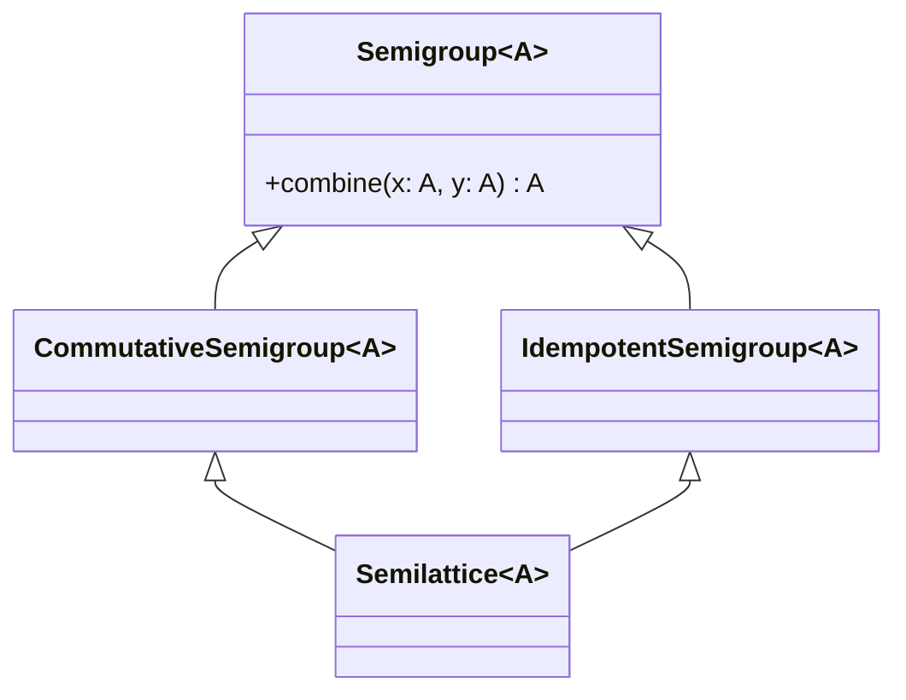

# Semilattice

`Semilattice[A]` is a [commutative](csemigroup.md) and [idempotent](band.md) semigroup.

Laws:

- _Closure_ (_closure_): for \\(\forall x, y \in CS\\), \\(x + y \in CS\\).
- _Associativity_ (_associativity_): for \\(\forall x, y, z \in CS\\), \\((x + y) + z = x + (y + z)\\).
- _Commutativity_ (_commutative_): for \\(\forall x, y \in CS\\), \\(x + y = y + x\\).
- _Idempotency_ (_idempotency_): for \\(\forall x \in B\\), \\(x + x = x\\).

## Code

```dotty
trait Semilattice[A] extends Band[A] with CSemigroup[A]
```

### Laws

- Closure follows from the definition of the `combine` function: the return type of this function matches the type of the variables
  it accepts.
- Associativity is expressed as follows:
  `s.combine(x, s.combine(y, z))` should equal `s.combine(s.combine(x, y), z)`.  
  This means that the order of combining elements does not affect the final result.
- Idempotency is stated as:  
  `s.combine(x, x)` should equal `x`.  
  This means that combining an element with itself does not change it.
- Commutativity means that the order of elements during combination does not matter.
  In other words, the result of the `combine` operation will be the same regardless of the
  order in which you pass elements `x` and `y`.
  This can be written as: `cs.combine(x, y) == cs.combine(y, x)`

## Diagram



## Library Implementations

### Implementation in Cats

```dotty
import cats.kernel.Semilattice
import cats.implicits.*

Semilattice.combine(Set(1, 2), Set(2, 3))
// Set(1, 2, 3)
```

---

**References:**

- [Link to the exercises repository][sample]
- [Spire home page](https://typelevel.org/spire/)

[sample]: https://gitverse.ru/scalabook/typeclasses
