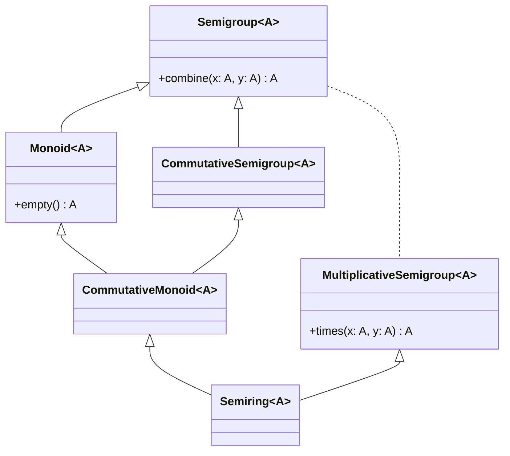

# Semiring

While a [group](group.md), [monoid](monoid.md), and [semigroup](semigroup.md) 
are defined by a set and a single operation, a semiring is defined by a set and two operations. 
Given a set `R` and operations `+` and `*`, 
we say that `(R, +, *)` is a semiring if it satisfies the following properties:

- `(R, +)` is a [commutative monoid](cmonoid.md).
- `(R, *)` is a [semigroup](semigroup.md).

The laws of a commutative monoid under addition must hold for a semiring:

- _Closure_ (_closure_): for \\(\forall x, y \in S\\), \\(x + y \in S\\).
- _Associativity_ (_associativity_): for \\(\forall x, y, z \in S\\), \\((x + y) + z = x + (y + z)\\).
- _Identity_ (_identity_): there exists \\(\exists e \in S\\) such that
  for \\(\forall x \in S\\), \\(e + x = x + e = x\\).
- _Commutativity_ (_commutative_): for \\(\forall x, y \in S\\), \\(x + y = y + x\\).

and the laws of a semigroup under multiplication:

- _Closure_ (_closure_): for \\(\forall x, y \in S\\), \\(x \* y \in S\\).
- _Associativity_ (_associativity_): for \\(\forall x, y, z \in S\\), \\((x \* y) \* z = x \* (y \* z)\\).

as well as distributivity and the multiplicative zero property:

- _Distributivity_ (_distributivity_):
  for \\(\forall x, y, z \in S\\), \\(x \* (y + z) = x \* y + x \* z\\) and \\((x + y) \* z = x \* z + y \* z\\).
- _Multiplicative zero property_: \\(a \* 0 = 0 \* a = 0\\).

## Code

```dotty
trait MultiplicativeSemigroup[A]:
  def times(x: A, y: A): A

trait Semiring[A] extends CMonoid[A], MultiplicativeSemigroup[A]    
```

### Laws

- Closure follows from the definition of the `combine` function: the return type of this function matches the type of the variables
  it accepts.
- Associativity is expressed as follows:
  `sr.combine(x, sr.combine(y, z))` should equal `sr.combine(sr.combine(x, y), z)`.  
  This means that the order of combining elements does not affect the final result.
- Identity means that if you combine any element `x` with the identity element (`sr.empty`),
  the result will always be `x`. In other words, the identity element does not change the value of `x` when combining.
  This can be written as:
    - `sr.combine(x, sr.empty) == x`
    - `sr.combine(sr.empty, x) == x`
- Commutativity means that the order of elements during combination does not matter.
  In other words, the result of the `combine` operation will be the same regardless of the
  order in which you pass elements `x` and `y`.
  This can be written as: `sr.combine(x, y) == sr.combine(y, x)`
- Associativity under multiplication is expressed as follows:
  `sr.times(x, sr.times(y, z))` should equal `sr.times(sr.times(x, y), z)`.  
  This means that the order of multiplying elements does not affect the final result.
- Distributivity means that the multiplication operation (`times`) distributes over the addition operation (`combine`). 
  This can be expressed in two ways:
    - If you multiply the result of `(x + y)` by `z`, it is the same as adding the results of multiplying `x` by `z` and `y` by `z`:
      `sr.times(sr.combine(x, y), z) == sr.combine(sr.times(x, z), sr.times(y, z))`
    - If you multiply `x` by the result of `(y + z)`, it is the same as adding the results of multiplying `x` by `y` and `x` by `z`:
      `sr.times(x, sr.combine(y, z)) == sr.combine(sr.times(x, y), sr.times(x, z))`
- The multiplicative property involves the identity element (`sr.empty`). 
  It means that multiplying any element by the identity element always yields the identity element:
    - If you multiply the identity element (`sr.empty`) by `x`, the result will be the identity element:
      `sr.times(sr.empty, x) == sr.empty`
    - If you multiply `x` by the identity element (`sr.empty`), the result will also be the identity element:
      `sr.times(x, sr.empty) == sr.empty`

## Exercises

### Exercise 1.5.1: Implementing a Semiring for Integers.

> [Exercises repository with instructions][sample]

Fill in the missing parts (`???`):

```dotty
given Semiring[Int] with
  val empty: Int = ???
  
  def combine(x: Int, y: Int): Int = 
    ???
    
  def times(x: Int, y: Int): Int = 
    ???
```

@:note(🔍 Show Solution)

```dotty
given Semiring[Int] with
  val empty: Int = 0
  
  def combine(x: Int, y: Int): Int = 
    x + y
    
  def times(x: Int, y: Int): Int = 
    x * y 
```

**Example calls**:

```dotty
Semiring[Int].combine(5, 3)
// 8
Semiring[Int].empty
// 0
Semiring[Int].times(5, 3)
// 15
```

@:@

## Diagram



## Library Implementations

### [Implementation in Spire](../../libs/spire.md)

`Semiring[A]` provides `+`, `zero`, and `*`.
`Semiring[A]` extends `AdditiveCommutativeMonoid[A]` and `MultiplicativeSemigroup[A]`.

- `plus` (`+`): addition
- `times` (`*`): multiplication
- `pow` (`**`): exponentiation (integral exponent)

```dotty
import spire.algebra.Semiring
import spire.math.Rational

Semiring.plus(Rational(1, 2), Rational(1, 3))
// val res0: spire.math.Rational = 5/6
Semiring.times(Rational(1, 2), Rational(1, 3))
// val res1: spire.math.Rational = 1/6
Semiring.pow(Rational(1, 2), 3)
// val res2: spire.math.Rational = 1/8
```

---

**References:**

- [Link to the exercises repository][sample]
- [A tale on Semirings](https://typelevel.org/blog/2018/11/02/semirings.html)
- [Spire home page](https://typelevel.org/spire/)
- [Spire User's Guide](https://typelevel.org/spire/guide.html)
- [Wikipedia](https://ru.wikipedia.org/wiki/%D0%9F%D0%BE%D0%BB%D1%83%D0%BA%D0%BE%D0%BB%D1%8C%D1%86%D0%BE)

[sample]: https://gitverse.ru/scalabook/typeclasses
