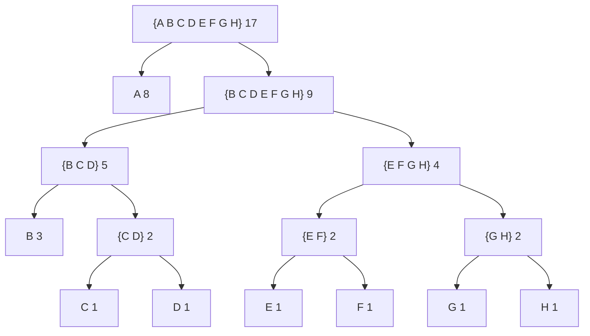

# Деревья кодирования по Хаффману

Стандартный код ASCII, который используется для представления текста в компьютерах, 
кодирует каждый символ как последовательность из семи бит. 
Семь бит позволяют нам обозначить \\(2^7\\), то есть 128 различных символов. 
В общем случае, если нам требуется различать n символов, потребуется \\(log\_{2}(n)\\) бит для каждого символа.

Такие коды, как ASCII, известны под названием кодов с _фиксированной длиной_, 
поскольку каждый символ сообщения они представляют с помощью одного и того же числа битов. 
Иногда полезно использовать и коды с _переменной длиной_ (_variable-length_), 
в которых различные символы могут представляться различным числом битов. 
Например, азбука Морзе не для всех букв алфавита использует одинаковое число точек и тире. 
В частности, E, наиболее частая (в английском) буква, представляется с помощью одной точки. 
В общем случае, если наши сообщения таковы, что некоторые символы встречаются очень часто, 
а некоторые очень редко, то мы можем кодировать свои данные более эффективно (т.е. с помощью меньшего числа битов на сообщение),
если более частым символам мы назначим более короткие коды.

Одна из сложностей при работе с кодом с переменной длиной состоит в том, чтобы узнать, 
когда при чтении последовательности единиц и нулей достигнут конец символа.
В азбуке Морзе эта проблема решается при помощи специального _кода-разделителя_
(_separator code_) (в данном случае паузы) после последовательности точек и тире для каждой буквы. 
Другое решение состоит в том, чтобы построить систему кодирования так, 
чтобы никакой полный код символа не совпадал с началом (или _префиксом_) кода никакого другого символа. 
Такой код называется _префиксным_ (_prefix_). 
Например, если A кодируется 0, а B - 100, то никакой другой символ не может иметь код, который начинается на 0 или 100.

В общем случае можно добиться существенной экономии, если использовать коды с переменной длиной, 
использующие относительные частоты символов в подлежащих кодированию сообщениях. 
Одна из схем такого кодирования называется кодированием по Хаффману, в честь своего изобретателя, Дэвида Хаффмана. 
Код Хаффмана может быть представлен как бинарное дерево, на листьях которого лежат кодируемые символы.
В каждом нетерминальном узле находится множество символов с тех листьев, которые лежат под данным узлом. 
Кроме того, каждому символу на листе дерева присваивается вес (представляющий собой относительную частоту), 
а каждый нетерминальный узел имеет вес, который равняется сумме весов листьев, лежащих под данным узлом. 
Веса не используются в процессе кодирования и декодирования. 
Ниже мы увидим, как они оказываются полезными при построении дерева.

Рисунок изображает дерево Хаффмана для кода от A до H.
Веса в вершинах дерева указывают, что дерево строилось для сообщений, 
где A встречается с относительной частотой 8, B с относительной частотой 3, 
а все остальные буквы с относительной частотой 1.



Имея дерево Хаффмана, можно найти код любого символа, если начать с корня и двигаться вниз до тех пор, 
пока не будет достигнута концевая вершина, содержащая этот символ. 
Каждый раз, как мы спускаемся по левой ветви, мы добавляем 0 к коду, а спускаясь по правой ветви, добавляем 1. 
(Мы решаем, по какой ветке двигаться, проверяя, не является ли одна из веток концевой вершиной, 
а также содержит ли множество при вершине символ, который мы ищем.) 
Например, начиная с корня на картине выше, мы попадаем в концевую вершину D, сворачивая на правую дорогу, затем на левую, 
затем на правую, затем, наконец, снова на правую ветвь; следовательно, код для D — 1011.

Чтобы раскодировать последовательность битов при помощи дерева Хаффмана, 
мы начинаем с корня и просматриваем один за другим биты в последовательности, 
чтобы решить, нужно ли нам спускаться по левой или по правой ветви. 
Каждый раз, как мы добираемся до листовой вершины, мы порождаем новый символ сообщения и 
возвращаемся к вершине дерева, чтобы найти следующий символ. 
Например, пусть нам дано дерево, изображенное на рисунке, и последовательность 10001010. 
Начиная от корня, мы идем по правой ветви (поскольку первый бит в строке 1), 
затем по левой (поскольку второй бит 0), затем опять по левой (поскольку и третий бит 0). 
Здесь мы попадаем в лист, соответствующий B, так что первый символ декодируемого сообщения — B. 
Мы снова начинаем от корня и идем налево, поскольку следующий бит строки 0. 
Тут мы попадаем в лист, изображающий символ A. 
Мы опять начинаем от корня с остатком строки 1010, двигаемся направо, налево, направо, налево и приходим в C. 
Таким образом, все сообщение было BAC.

## Порождение деревьев Хаффмана

Если нам дан «алфавит» символов и их относительные частоты, как мы можем породить «наилучший» код? 
(Другими словами, какое дерево будет кодировать сообщения при помощи наименьшего количества битов?) 
Хаффман дал алгоритм для решения этой задачи и показал, что получаемый этим алгоритмом код — 
действительно наилучший код с переменной длиной для сообщений, 
где относительная частота символов соответствует частотам, для которых код строился.

Алгоритм порождения дерева Хаффмана весьма прост. 
Идея состоит в том, чтобы упорядочить дерево так, чтобы символы с наименьшей частотой оказались дальше всего от корня. 
Начнем с множества терминальных вершин, содержащих символы и их частоты, 
как указано в исходных данных, из которых нам надо построить дерево. 
Теперь найдем два листа с наименьшими весами и сольем их, получая вершину, 
у которой предыдущие две являются левым и правым потомками. 
Вес новой вершины равен сумме весов ее ветвей. 
Исключим два листа из исходного множества и заменим их новой вершиной. Продолжим этот процесс. 
На каждом шаге будем сливать две вершины с самыми низкими весами, исключая их из множества 
и заменяя вершиной, для которой они являются левой и правой ветвями. 
Этот процесс заканчивается, когда остается только одна вершина, которая и является корнем всего дерева. 
Вот как было порождено дерево Хаффмана с рисунка:

- Исходный набор листьев: `{(A 8) (B 3) (C 1) (D 1) (E 1) (F 1) (G 1) (H 1)}`
- Слияние: `{(A 8) (B 3) ({C D} 2) (E 1) (F 1) (G 1) (H 1)}`
- Слияние: `{(A 8) (B 3) ({C D} 2) ({E F} 2) (G 1) (H 1)}`
- Слияние: `{(A 8) (B 3) ({C D} 2) ({E F} 2) ({G H} 2)}`
- Слияние: `{(A 8) (B 3) ({C D} 2) ({E F G H} 4)}`
- Слияние: `{(A 8) ({B C D} 5) ({E F G H} 4)}`
- Слияние: `{(A 8) ({B C D E F G H} 9)}`
- Окончательное слияние `{({A B C D E F G H} 17)}`

Алгоритм не всегда приводит к построению единственно возможного дерева, 
поскольку на каждом шаге выбор вершин с наименьшим весом может быть не единственным.
Выбор порядка, в котором будут сливаться две вершины (то есть, 
какая из них будет левым, а какая правым поддеревом) также произволен.

## Представление деревьев Хаффмана

Листья дерева представляются в виде структуры, состоящей из символа, содержащегося в листе, и веса.
Дерево в общем случае будет списком из левой ветви, правой ветви, множества символов и веса.
Вот как можно представить дерево Хаффмана:

```dotty
sealed trait HuffmanTree:
  def symbols: Vector[Char]
  def weight: Int

case class HuffmanLeaf(symbol: Char, weight: Int) extends HuffmanTree:
  val symbols = Vector(symbol)
case class HuffmanBranch(
    symbols: Vector[Char],
    weight: Int,
    left: HuffmanTree,
    right: HuffmanTree
) extends HuffmanTree
```

Когда мы порождаем дерево слиянием двух вершин, то получаем вес дерева как сумму весов этих вершин, 
а множество символов как объединение множеств их символов. 

```dotty
object HuffmanTree:
  def makeCodeTree(left: HuffmanTree, right: HuffmanTree) =
    HuffmanBranch(
      symbols = left.symbols ++ right.symbols,
      weight = left.weight + right.weight,
      left = left,
      right = right
    )
```

## Процедура декодирования

Следующая процедура реализует алгоритм декодирования. 
В качестве аргументов она принимает список из единиц и нулей, а также дерево Хаффмана.

```dotty
object HuffmanTree:
  enum Bit:
    case Zero, One

  def decode(bits: List[Bit], tree: HuffmanBranch): Vector[Char] =
    def decodeLoop(
        bits: List[Bit],
        currentBranch: HuffmanTree,
        message: Vector[Char]
    ): Vector[Char] =
      (bits, currentBranch) match
        case (_, HuffmanLeaf(symbol, _)) =>
          decodeLoop(bits, tree, message :+ symbol)
        case (Nil, _) => message
        case (Bit.Zero :: tail, HuffmanBranch(_, _, left, _)) =>
          decodeLoop(tail, left, message)
        case (Bit.One :: tail, HuffmanBranch(_, _, _, right)) =>
          decodeLoop(tail, right, message)

    decodeLoop(bits, tree, Vector.empty)
  end decode
```

Процедура `decodeLoop` принимает два аргумента: список остающихся битов и текущую позицию в дереве. 
Она двигается «вниз» по дереву, выбирая левую или правую ветвь в зависимости от того, 
ноль или единица следующий бит в списке. 
Когда процедура достигает листа, то возвращает символ из него как очередной символ сообщения, 
присоединяя его к результату декодирования остатка сообщения, начиная от корня дерева. 

Пример использования процедуры:

```dotty
val tree =
  HuffmanTree.makeCodeTree(
    HuffmanLeaf('A', 4),
    HuffmanTree.makeCodeTree(
      HuffmanLeaf('B', 2),
      HuffmanTree.makeCodeTree(HuffmanLeaf('D', 1), HuffmanLeaf('C', 1))
    )
  )
val bits = List(
  Bit.Zero,
  Bit.One,
  Bit.One,
  Bit.Zero,
  Bit.Zero,
  Bit.One,
  Bit.Zero,
  Bit.One,
  Bit.Zero,
  Bit.One,
  Bit.One,
  Bit.One,
  Bit.Zero
)

val decoded = HuffmanTree.decode(bits, tree)
// Vector('A', 'D', 'A', 'B', 'B', 'C', 'A')
```

## Множества взвешенных элементов

В нашем представлении деревьев каждая нетерминальная вершина содержит множество символов. 
Однако алгоритм порождения дерева, который обсуждался выше, требует, 
чтобы мы работали еще и с множествами листьев и деревьев, последовательно сливая два наименьших элемента.
Поскольку нам нужно будет раз за разом находить наименьший элемент множества,
удобно для такого множества использовать упорядоченное представление.

Мы представим множество листьев и деревьев как список элементов, 
упорядоченный по весу в возрастающем порядке. 
В следующей процедуре `adjoinSet` для построения множеств элементы сравниваются по своим весам. 
При этом предполагается, что добавляемый элемент не содержится в множестве.

```dotty
def adjoinSet(
    tree: HuffmanTree,
    trees: List[HuffmanTree]
): List[HuffmanTree] =
  trees match
    case Nil =>
      List(tree)
    case head :: tail if tree.weight < head.weight =>
      tree :: head :: tail
    case head :: tail =>
      head :: adjoinSet(tree, tail)
```

Следующая процедура принимает список пар вида символ–частота, например `((A 4) (B 2) (C 1) (D 1))`, 
и порождает исходное упорядоченное множество листьев, готовое к слиянию по алгоритму Хаффмана:

```dotty
def makeLeafSet(pairs: List[(Char, Int)]): List[HuffmanTree] =
  pairs match
    case Nil => List.empty
    case (symbol, weigth) :: tail =>
      val leaf = HuffmanLeaf(symbol, weigth)
      adjoinSet(leaf, makeLeafSet(tail))
```

## Кодирование сообщения

Процедура `encode` получает в качестве аргументов сообщение и дерево, 
и порождает список битов, который представляет закодированное сообщение.
`encodeSymbol` — процедура, возвращающая список битов, который кодирует данный символ в соответствии с заданным деревом. 
Она сообщает об ошибке, если символ не содержится в дереве.

Алгоритм работы метода `encode`:

1. Если сообщение пустое, то возвращается пустой список битов.
2. Если сообщение не пустое, то для первого символа сообщения и дерева вызывается метод `encodeSymbol`.
3. Результат вызова `encodeSymbol` добавляется к результату вызова `encode` для остальной части сообщения.
4. Если `encodeSymbol` возвращает список битов, то метод `encode` возвращает список битов, полученный в результате объединения списков битов из `encodeSymbol` и `encode` для остальной части сообщения.
5. Иначе возвращается ошибка.

Алгоритм работы метода `encodeSymbol`:

1. Если дерево является листом и символ в нем совпадает с искомым символом, то возвращается пустой список битов.
2. Если дерево является ветвью и искомый символ находится в левой части дерева, то метод `encodeSymbol` вызывается рекурсивно для левой части дерева, а к результату добавляется бит `0`.
3. Если дерево является ветвью и искомый символ находится в правой части дерева, то метод `encodeSymbol` вызывается рекурсивно для правой части дерева, а к результату добавляется бит `1`.
4. Если искомый символ не найден в дереве, то метод возвращает ошибку.

```dotty
def encode(
    message: List[Char],
    tree: HuffmanTree
): Either[String, List[Bit]] =
  message match
    case Nil => Right(List.empty)
    case head :: tail =>
      for
        encodedHead <- encodeSymbol(head, tree)
        encodedTail <- encode(tail, tree)
      yield encodedHead ++ encodedTail

def encodeSymbol(symbol: Char, tree: HuffmanTree): Either[String, List[Bit]] =
  tree match
    case leaf: HuffmanLeaf if leaf.symbol == symbol => Right(List.empty)
    case HuffmanBranch(_, _, left, _) if left.symbols.contains(symbol) =>
      encodeSymbol(symbol, left).map: bits =>
        Bit.Zero :: bits
    case HuffmanBranch(_, _, _, right) if right.symbols.contains(symbol) =>
      encodeSymbol(symbol, right).map: bits =>
        Bit.One :: bits
    case _ => Left(s"Symbol $symbol not found in tree")
```

Пример закодированного сообщения:

```dotty
val tree =
  HuffmanTree.makeCodeTree(
    HuffmanLeaf('A', 4),
    HuffmanTree.makeCodeTree(
      HuffmanLeaf('B', 2),
      HuffmanTree.makeCodeTree(HuffmanLeaf('D', 1), HuffmanLeaf('C', 1))
    )
  )
val message = List('A', 'D', 'A', 'B', 'B', 'C', 'A')
val encoded = HuffmanTree.encode(message, tree)
// Right(List(Bit.Zero, Bit.One, Bit.One, Bit.Zero, Bit.Zero, Bit.One, Bit.Zero, 
//   Bit.One, Bit.Zero, Bit.One, Bit.One, Bit.One, Bit.Zero))
```

## Построение дерева кодирования по Хаффману

Следующая процедура берет в качестве аргумента список пар вида символ-частота 
(где ни один символ не встречается более, чем в одной паре) и порождает дерево кодирования по Хаффману 
в соответствии с алгоритмом Хаффмана.

Алгоритм работы метода `successiveMerge`:

1. Сортируем список деревьев по весу в порядке возрастания.
2. Если список деревьев пуст, возвращаем `None`.
3. Если в списке деревьев только одно дерево, возвращаем его.
4. Если в списке деревьев более одного дерева, извлекаем два дерева с наименьшим весом, 
   объединяем их в новое дерево и добавляем его в список деревьев.
5. Повторяем шаги 1-4, пока в списке деревьев не останется только одно дерево.

```dotty
def generateHuffmanTree(pairs: List[(Char, Int)]): Option[HuffmanTree] =
  successiveMerge(makeLeafSet(pairs))

def successiveMerge(trees: List[HuffmanTree]): Option[HuffmanTree] =
  trees match
    case Nil         => None
    case head :: Nil => Some(head)
    case first :: second :: tail =>
      successiveMerge(adjoinSet(makeCodeTree(first, second), tail))
```

---

**Ссылки:**

- [Abelson Harold, Sussman Gerald Jay, Sussman Julie - Structure and Interpretation of Computer Programs][SICP]

[SICP]: https://web.mit.edu/6.001/6.037/sicp.pdf
