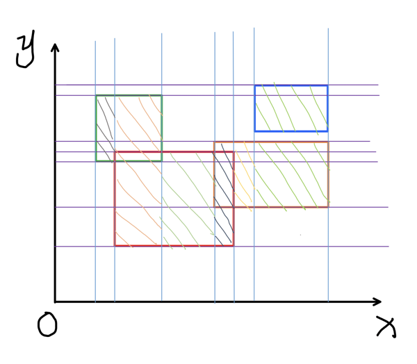

# Сканирующая прямая

Метод сканирующей прямой (англ. *scanline*) заключается в сортировке точек на координатной прямой либо 
каких-то абстрактных «событий» по какому-то признаку и последующему проходу по ним.

Он часто используется для решения задач на структуры данных, когда все запросы известны заранее, 
а также в геометрии для нахождения объединений фигур.

### Точка, покрытая наибольшим количеством отрезков

**Задача.** Дан набор из \\(n\\) отрезков на прямой, заданных координатами начал и концов \\(\[l\_i, r\_i\]\\). 
Требуется найти любую точку на прямой, покрытую наибольшим количеством отрезков.

Рассмотрим функцию \\(f(x)\\), равную числу отрезков, покрывающих точку \\(x\\). 
Понятно, что каждую точку этой функции мы проверить не можем.

Назовем *интересными* те точки, в которых происходит смена количества отрезков, которыми она покрыта. 
Так как смена ответа может происходить только в интересной точке, то максимум достигается также в какой-то из интересных точек. 
Отсюда сразу следует решение за \\(O(n^2)\\): просто перебрать все интересные точки (это будут концы заданных отрезков) 
и проверить для каждой по отдельности ответ.

Это решение можно улучшить. Отсортируем интересные точки по возрастанию координаты и пройдем по ним слева направо, 
поддерживая количество отрезков `cnt`, которые покрывают данную точку. 
Если в данной точке начинается отрезок, то надо увеличить `cnt` на единицу, а если заканчивается, то уменьшить. 
После этого пробуем обновить ответ на задачу текущим значением `cnt`.

Как такое писать: нужно представить интересные точки в виде структур с полями «координата» и «тип» (начало / конец) 
и отсортировать со своим компаратором. 
Удобно начало отрезка обозначать +1, а конец -1, чтобы просто прибавлять к `cnt` это значение и не разбивать на случаи.

Единственный нюанс — если координаты двух точек совпали, чтобы получить правильный ответ, 
сначала надо рассмотреть все начала отрезков, 
а только потом концы (чтобы при обновлении ответа в этой координате учлись и правые, и левые граничные отрезки).

```dotty
final case class Event(x: Int, delta: Int)

def scanline(segments: List[(Int, Int)]): (Int, Int) =
  val events: List[Event] =
    segments.flatMap { (l, r) => List(Event(l, 1), Event(r, -1)) }

  // при равенстве координат сначала идут начала (+1), потом концы (-1)
  val sorted = events.sortBy(e => (e.x, -e.delta))

  sorted.foldLeft((0, (0, 0))) { case ((count, (maxPoint, maxCount)), e) =>
    val newCnt = count + e.delta
    (
      newCnt,
      if newCnt > maxCount then (e.x, newCnt) else (maxPoint, maxCount)
    )
  }._2
```

**Как это работает.** Для отрезков `List((1, 4), (2, 5), (4, 6))` получим события:

```
(1, +1) (4, -1)  (2, +1) (5, -1)  (4, +1) (6, -1)
```

После сортировки по координате (а при равенстве координат — сначала `+1`, потом `-1`) идём по ним слева направо, 
накапливая текущее число покрывающих отрезков `cnt`:

| координата | событие | `cnt` | максимум |
| ---------: | ------: | ----: | -------: |
|          1 |      +1 |     1 |        1 |
|          2 |      +1 |     2 |        2 |
|          4 |      +1 |     3 |        3 |
|          4 |      −1 |     2 |        3 |
|          5 |      −1 |     1 |        3 |
|          6 |      −1 |     0 |        3 |


Максимум `3` достигается на любой точке внутри отрезка `[4, 4]`.

```dotty
scanline(List((1, 4), (2, 5), (4, 6))) // (4,3)
```

Такое решение работает за \\(O(n \log n)\\) на сортировку. Если координаты небольшие, 
то от логарифма можно избавиться, если создать массив событий для каждой различной координаты 
и просто итерироваться по всем целочисленным координатам и событиям в них. 
Также всегда хорошей идеей будет [сжать координаты](../geometry.md).

Рассмотрим теперь несколько смежных задач.

### Длина объединения отрезков

**Задача.** Дан набор из \\(n\\) отрезков на прямой, заданных координатами начал и концов \\(\[l\_i, r\_i\]\\). 
Требуется найти суммарную длину их объединения.

Как и в прошлой задаче, отсортируем все интересные точки и при проходе будем поддерживать число отрезков, покрывающих текущую точку. 
Если оно больше 0, то отрезок, который мы прошли с прошлой рассмотренной точки, принадлежит объединению, и его длину нужно прибавить к ответу:

```dotty
def unionLength(segments: List[(Int, Int)]): Int =
  val events: List[Event] =
    segments
      .flatMap { (l, r) => List(Event(l, 1), Event(r, -1)) }
      .sortBy(e => (e.x, -e.delta))

  @tailrec
  def loop(cnt: Int, res: Int, prev: Int, events: List[Event]): Int =
    events match
      case Nil                   => res
      case Event(x, delta) :: xs =>
        val newRes =
          if cnt > 0 then res + x - prev else res

        loop(cnt + delta, newRes, x, xs)

  events match
    case Nil                   => 0
    case Event(x, delta) :: xs =>
      loop(delta, 0, x, xs)
```

**Как это работает.** Для отрезков `List((1, 4), (2, 5), (7, 9))` события после сортировки те же. 
`prev` хранит координату предыдущего обработанного события, а `cnt` — число покрытий на полосе `[prev, e.x]`. 
Если `cnt > 0`, эта полоса принадлежит объединению, и её длину `e.x - prev` прибавляем к ответу:

| событие | `cnt` до | полоса | добавлено |
| ------: | -------: | -----: | --------: |
| (1, +1) |        0 |      — |         0 |
| (2, +1) |        1 |  {1,2} |         1 |
| (4, −1) |        2 |  {2,4} |         2 |
| (5, −1) |        1 |  {4,5} |         1 |
| (7, +1) |        0 |      — |         0 |
| (9, −1) |        1 |  {7,9} |         2 |

Итог `1 + 2 + 1 + 2 = 6` — это и есть суммарная длина объединения `[1, 5] ∪ [7, 9]`.

```dotty
unionLength(List((1, 4), (2, 5), (7, 9))) // 6
```

Время работы \\(O(n \log n)\\).

### Скольким отрезкам принадлежит точка

Пусть теперь надо для \\(q\\) точек (не обязательно являющихся концами отрезков) ответить на вопрос: скольким отрезкам принадлежит данная точка?

Воспользуемся следующим приемом: сразу считаем все запросы и сохраним их, чтобы потом ответить на все сразу. 
Добавим точки запросов как события с новым типом 0, который будет означать, 
что в этой точке надо ответить на запрос, и отдельным полем для номера запроса.

Теперь аналогично отсортируем точки интереса и пройдем по ним слева направо, поддерживая `cnt` и отвечая на запросы, когда их встретим.

```dotty
def scanline(segments: List[(Int, Int)], queries: List[Int]): Map[Int, Int] =
  case class Event(x: Int, delta: Int, idx: Int)

  val events =
    segments.flatMap { (l, r) => List(Event(l, 1, -1), Event(r, -1, -1)) } ++
      queries.zipWithIndex.map { (q, i) => Event(q, 0, i) }

  // при равенстве координат сначала идут добавления (+1), 
  // потом запросы (0), потом удаления (-1)
  val sorted = events.sortBy(e => (e.x, -e.delta))

  sorted.foldLeft((0, Map.empty[Int, Int])) {
    case ((cnt, res), e) =>
      (
        cnt + e.delta,
        if e.delta == 0 then res.updated(e.x, cnt) else res
      )
  }._2
```

**Как это работает.** Для отрезков `List((1, 4), (2, 5))` и запросов `List(3, 0, 5)` события имеют тип: 
`+1` для начала отрезка, `−1` для конца и `0` для точки-запроса. 
При равенстве координат порядок такой: сначала `+1`, потом `0` (запрос), потом `−1`. Пройдём по отсортированным событиям:

| координата | тип | `cnt` | запрос?       |
| ---------: | --: | ----: | ------------- |
|          0 |   0 |     0 | да → `0 -> 0` |
|          1 |  +1 |     1 | нет           |
|          2 |  +1 |     2 | нет           |
|          3 |   0 |     2 | да → `3 -> 2` |
|          4 |  −1 |     1 | нет           |
|          5 |   0 |     1 | да → `5 -> 1` |
|          5 |  −1 |     0 | нет           |

Точка `3` покрыта обоими отрезками (`2`), точка `0` — ни одним (`0`), точка `5` — только отрезком `[2, 5]` (`1`, так как `[1, 4]` уже закончился).

```dotty
scanline(List((1, 4), (2, 5)), List(3, 0, 5)) 
// Map(0 -> 0, 3 -> 2, 5 -> 1)
```

Асимптотика \\(O((n+q)\log(n+q))\\).

### Количество пересекающихся отрезков

**Задача.** Дан набор из \\(n\\) отрезков на прямой, заданных координатами начал и концов \\(\[l\_i, r\_i\]\\). 
Требуется для каждого отрезка сказать, с каким количеством отрезков он пересекается 
(в частности, он может иметь одну общую точку или быть вложенным).

Вместо того, чтобы для каждого отрезка считать количество отрезков, 
с которыми он пересекается, посчитаем количество отрезков, с которыми он *не* пересекается, и вычтем это число из \\((n-1)\\).

Отрезок \\(\[l\_1, r\_1\]\\) не пересекается с другим отрезком \\(\[l\_2, r\_2\]\\) 
только если \\(r\_2 < l\_1\\) или \\(r\_1 < l\_2\\). 
Посчитаем количество отрезков для каждого из этих случаев. 
Без ограничения общности, рассмотрим первый случай, то есть найдем для каждого отрезка количество отрезков, лежащих строго слева. 
Для этого нужно ввести два типа событий:

1. Какой-то отрезок закончился в координате \\(r\_i\\).
2. Какой-то отрезок с таким-то индексом начался в координате \\(l\_j\\).

Теперь нам достаточно пройтись по этим событиям слева направо, поддерживая количество встреченных событий первого типа
и вычитая его из ячейки ответа для событий второго типа.

Аналогично пройдемся справа налево, находя отрезки, лежащие строго справа. Итоговое время работы будет \\(O(n \log n)\\) на сортировку.

**Код.** Для каждого отрезка посчитаем число пересекающихся с ним (по принципу «из \\(n-1\\) вычесть число не пересекающихся»). 
Разложим «не пересекается» на два взаимоисключающих случая: чужой отрезок закончился строго до начала текущего (\\(r\_j < l\_i\\)), 
или чужой отрезок начался строго после конца текущего (\\(l\_j > r\_i\\)). 
Первое считаем одним проходом слева направо (события «начало» и «конец»), второе — зеркальным проходом справа налево:

```dotty
def countIntersections(segments: List[(Int, Int)]): List[Int] =
  val n = segments.length
  // события: (координата, тип, индекс); тип: 0 = начало, 1 = конец
  val events: List[(Int, Int, Int)] =
    segments.zipWithIndex.flatMap { case ((l, r), i) =>
      List((l, 0, i), (r, 1, i))
    }
      .sortBy(e => (e._1, e._2, e._3))

  // слева направо: сколько отрезков закончилось строго до начала текущего
  val ans = events.foldLeft((0, Map.empty[Int, Int])) {
    case ((finished, ans), (x, t, i)) =>
      if t == 1 then (finished + 1, ans)
      else (finished, ans.updated(i, n - 1 - finished))
  }._2

  // справа налево: сколько отрезков началось строго после конца текущего
  events.foldRight((0, ans)) {
    case ((x, t, i), (started, ans)) =>
      if t == 0 then (started + 1, ans)
      else (started, ans.updated(i, ans.getOrElse(i, n - 1) - started))
  }._2.values.toList
```

Разберём сортировку: при одинаковой координате начало (тип `0`) идёт раньше конца (тип `1`). 
Это важно, потому что «не пересекается» строго — отрезки, у которых конец совпадает с началом текущего (\\(r\_j = l\_i\\)), 
считаются пересекающимися, и их конец обрабатывается *после* начала текущего, то есть не попадает в `finished`. 
Зеркально устроен и обратный проход.

```dotty
countIntersections(List((1, 4), (4, 6), (2, 3)))
// (1,4) пересекается с обоими; (2,3) пересекается только с (1,4);
// (4,6) пересекается только с (1,4) (с (2,3) не пересекается, так как 3 < 4)
// List(2, 1, 1)
```

### Сумма на прямоугольнике

Перейдем к двумерной сканирующей прямой.

**Задача.** Даны \\(n\\) точек на плоскости. Требуется ответить на \\(m\\) запросов количества точек на прямоугольнике.

Во-первых, сожмем все координаты (и точек, и запросов): будем считать, что они все порядка \\(O(n + m)\\).

Теперь разобьём каждый запрос на два запроса суммы на префиксах: 
сумма на прямоугольнике \\(\[x\_1, x\_2\] \times \[y\_1, y\_2\]\\) равна сумме 
на прямоугольнике \\(\[0, x\_2\] \times \[y\_1, y\_2\]\\) минус сумме на прямоугольнике \\(\[0, x\_1\] \times \[y\_1, y\_2\]\\).

Создадим дерево отрезков для суммы и массив `ans` для ответов на запросы. 
Теперь будем проходиться в порядке увеличения по всем интересным \\(x\\) — координатам точек 
и правых границ префиксных запросов — и обрабатывать события трёх типов:

1. Если мы встретили точку, то добавляем единицу к ячейке \\(y\\) в дереве отрезков.
2. Если мы встретили «левый» запрос префиксной суммы, то посчитаем через дерево отрезков сумму на отрезке \\(\[y\_1, y\_2\]\\) и *вычтем* его из ячейки ответа.
3. Если мы встретили «правый» запрос, то аналогично *прибавим* сумму на \\(\[y\_1, y\_2\]\\) к ячейке ответа.

Таким образом, мы решим задачу в оффлайн за \\(O(n \log n)\\): сжатие координат / сортировка плюс \\(O(n)\\) 
запросов к дереву отрезков (или любой другой структуре для динамической суммы).

Сумма на прямоугольнике как вспомогательная подзадача также часто используется в задачах на инверсии в перестановках и запросы на поддеревьях.

### Площадь объединения прямоугольников

**Задача.** Дано \\(n\\) прямоугольников, требуется найти площадь их объединения.

Можно создать два типа событий:

1. прямоугольник с \\(y\\)-координатами от \\(y\_1\\) до \\(y\_2\\) начинается в точке \\(x\_1\\);
2. прямоугольник с \\(y\\)-координатами от \\(y\_1\\) до \\(y\_2\\) заканчивается в точке \\(x\_2\\);

и затем как-то пройтись по этим событиям в порядке увеличения \\(x\\) 
и посчитать общую площадь подобно тому, как мы делали с одномерными отрезками.



Если обобщать подход напрямую, то нам нужно завести массив размера \\(Y\\) (максимальной \\(y\\)-координаты) 
и для каждой \\(y\\)-параллели поддерживать число прямоугольников, 
которые её покрывают, и каждый раз, когда \\(x\\)-координата события меняется, 
добавлять к ответу разницу \\(x\\)-координат старого и нового события, 
помноженную на число ненулевых элементов в массиве 
(точек на вертикальной сканирующей прямой, которые покрываются хотя бы одним прямоугольником).

Но это в худшем случае работает за \\(O(nY)\\), что достаточно долго. 
Чтобы получить более приятную асимптотику, заменим массив деревом отрезков, 
в узлах которого будет храниться минимум и число элементов с таким минимумом (изначально минимум 0 и таких элементов на всём массиве \\(Y\\)).

Чтобы обновить ответ, нужно помножить разницу \\(x\\)-координат соседних событий на число ненулевых элементов, 
которое можно найти, вычтя из \\(Y\\) количество минимумов-нулей на всём дереве. 

Такой алгоритм работает за \\(O(n \log n)\\), если аккуратно сжать координаты, и за \\(O(n \log Y)\\), если этого не делать. 
Этот метод также обобщается на задачу нахождения площадей и других геометрических фигур.

---

**Ссылки:**

- [Исходный код][sample]
- [Алгоритмика - Сканирующая прямая](https://ru.algorithmica.org/cs/decomposition/scanline/)

[sample]: https://gitverse.ru/scalabook/algorithms
