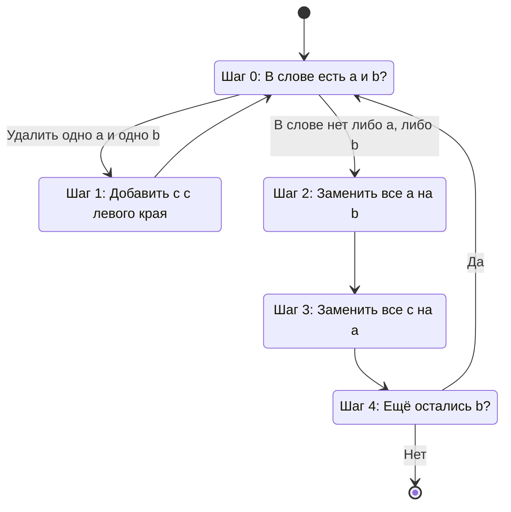



# Алгоритмы

**Алгоpитм** – это строго определенная последовательность действий, необходимых для решения данной задачи.

Алгоpитм имеет пять важных особенностей.

- **Конечность**. Алгоритм всегда должен заканчиваться после выполнения конечного числа шагов.
- **Определенность**. Каждый шаг алгоритма должен быть точно определен.
- **Ввод**. Алгоритм имеет некоторое (возможно, равное нулю) число _входных данных_,
  т.е. величин, которые задаются до начала его работы или определяются динамически во время его работы.
- **Вывод**. У алгоритма есть одно или несколько _выходных данных_,
  т.е. величин, имеющих вполне определенную связь с входными данными.
- **Эффективность**. Алгоритм обычно считается _эффективным_, если все его операторы достаточно просты для того,
  чтобы их можно было точно выполнить в течение конечного промежутка времени с помощью карандаша и бумаги.

> Название "алгоритм" берет начало от имени автора знаменитого персидского учебника по математике,
> Abu Abd Allah Muhammad ibn Musa al-Khwarizmı (Абу Абд Аллах Мухаммед ибн Муса аль-Хорезми) (ок. 825 г.),
> означающего буквально "Отец Абдуллы, Мухаммед, сын Мусы, уроженец Хорезма".
> Аральское море в Центральной Азии когда-то называлось озером Хорезм,
> и район Хорезма (Khwarizm) расположен в бассейне реки Амударьи южнее этого моря.
> Аль-Хорезми написал знаменитую книгу Kitab aljabr wal-muqabala
> (Китаб аль-джебр валь-мукабала — "Книга о восстановлении и противопоставлении").
> От названия этой книги, которая была посвящена решению линейных и квадратных уравнений,
> произошло еще одно слово— "алгебра".

## Более формальное определение

Определим _метод вычислений_ как четверку **(Q, I, Ω, f)**,
где **Q** — это множество, содержащее подмножества **I** и **Ω**, а **f** — функция, переводящая множество **Q** в себя.
Кроме того, **f** оставляет неподвижными точки множества **Ω**,
т.е. **f(q)** равно **q** для всех элементов **q** из множества **Ω**.
Эти четыре элемента, **Q**, **I**, **Ω**, **f**, представляют соответственно
состояния вычисления, ввод, вывод и правило вычислений.
Каждое входное значение **x** из множества **I** определяет _вычисляемую последовательность_
\\(x\_{0}, x\_{1}, x\_{2}, ...\\) следующим образом: \\(x\_{0} = x\\) и \\(x\_{k+1} = f(x\_{k})\\) для \\(k \geq 0\\).
Говорят, что вычисляемая последовательность _заканчивается через k шагов_,
если \\(k\\) — это наименьшее целое число, для которого \\(x\_{k}\\) принадлежит **Ω**,
и что она дает выходное значение \\(x\_{k}\\) для заданного \\(x\\).
(Заметим, что если \\(x\_{k}\\) принадлежит **Ω**, то и \\(x\_{k+1}\\) принадлежит **Ω**,
так как в этом случае \\(x\_{k+1} = x\_{k}\\).)
Некоторые вычисляемые последовательности могут никогда не заканчиваться,
но _алгоритм_ — это метод вычислений, который заканчивается через конечное число шагов для всех **x** из **I**.

## Эффективный формальный алгоритм

В этой формулировке понятия "алгоритм" не содержится ограничение, касающееся эффективности.
Например, \\(Q\\) может быть множеством бесконечных последовательностей,
которые нельзя вычислить с помощью карандаша и бумаги, а \\(f\\) может включать операции,
далеко не всегда выполнимые простому смертному.
Если мы хотим ограничить понятие "алгоритм" таким образом,
чтобы в нем могли содержаться только элементарные операции,
то введем ограничения на элементы \\(Q\\), \\(I\\), \\(Ω\\) и \\(f\\), например, следующим образом.
Пусть \\(A\\) — это ограниченное множество букв,
а \\(A^{\*}\\) — множество всех строк, определенных на множестве \\(A\\)
(т.е. множество всех упорядоченных последовательностей \\(x\_{1}x\_{2}...x\_{n}\\),
где \\(n \geq 0\\) и \\(x\_{j}\\) принадлежит \\(A\\) для \\(1 \leq j \leq n\\)).
Идея заключается в следующем:
закодировать состояния вычисления таким образом, чтобы они были представлены строками из множества \\(A^{\*}\\).
Теперь пусть \\(N\\) — целое неотрицательное число, а \\(Q\\) — множество всех пар \\((\sigma, j)\\),
где \\(\sigma\\) принадлежит \\(A^{\*}\\), а \\(j\\) — целое число, \\(0 \leq j \leq N\\).
Пусть \\(I\\) — подмножество пар из \\(Q\\), для которых \\(j = 0\\),
а \\(Ω\\) — подмножество пар из \\(Q\\), для которых \\(j = N\\).
Если \\(\Theta\\) и \\(\sigma\\) — строки из \\(A^{\*}\\),
то мы будем говорить, что \\(\Theta\\) входит в \\(\sigma\\), если \\(\sigma\\) имеет вид \\(\alpha\Theta\omega\\),
где \\(\alpha\\) и \\(\omega\\) — некоторые строки.
И в завершение определим функцию \\(f\\) с помощью строк \\(\Theta\_{j}\\), \\(\phi\_{j}\\)
и целых чисел \\(a\_{j}\\), \\(b\_{j}\\), \\(0 \leq j < N\\) следующим образом:

- \\(f(\sigma, j) = (\sigma, a\_{j})\\), если \\(\Theta\_{j}\\) не входит в \\(\sigma\\)
  (переход к следующему шагу, если условние не выполнено);
- \\(f(\sigma, j) = (\alpha\phi\_{j}\omega, b\_{j})\\), если \\(\alpha\\) является самой короткой строкой,
  для которой \\(\sigma = \alpha\Theta\_{j}\omega\\)
  (переход к следующему шагу, если условие выполнено);
- \\(f(\sigma, N) = (\sigma, N)\\)

### Пример описания эффективного формального алгоритма

> взят из упражнения 1.1.8 ["Искусство программирования"][TAOCP]

Пример эффективного формального алгоритма вычисления наибольшего общего делителя целых положительных чисел \\(m\\) и \\(n\\).
Пусть входные данные представлены строкой \\(a^{m}b^{n}\\),
т.е. за \\(a\\), взятым \\(m\\) раз, следует \\(b\\), взятое \\(n\\) раз.

Эффективный формальный алгоритм может выглядеть так:

Пусть \\(A = {a, b, c}, N = 5\\).
Выполнение алгоритма закончится тогда, когда получим строку \\(a^{gcd(m, n)}\\).

| j     | θ\_j            | φ\_j            | b\_j | a\_j | Комментарий                                                          |
|-------|-----------------|-----------------|------|------|----------------------------------------------------------------------|
| **0** | `ab`            | (Пустая строка) | 1    | 2    | Удалить одно `a` и одно `b` и перейти к **1**, либо перейти к **2**. |
| **1** | (Пустая строка) | `c`             | 0    | 0    | Добавить `c` с левого края, перейти к **0**.                         |
| **2** | `a`             | `b`             | 2    | 3    | Заменить все `a` на `b`.                                             |
| **3** | `c`             | `a`             | 3    | 4    | Заменить все `c` на `a`.                                             |
| **4** | `b`             | `b`             | 0    | 5    | Если `b` еще остались, повторить.                                    |

### Пример вычисления

Рассмотрим вычисление НОД для пары `(6, 3)`:

- Итерация 1
    - **Шаг 0**: `aaaaaabbb` -> `aaaaabb`
    - **Шаг 1**: `aaaaabb` -> `caaaaabb`
    - **Шаг 0**: `caaaaabb` -> `caaaab`
    - **Шаг 1**: `caaaab` -> `ccaaaab`
    - **Шаг 0**: `ccaaaab` -> `ccaaa`
    - **Шаг 1**: `ccaaa` -> `cccaaa`
    - **Шаг 0**: `cccaaa` => переход к **Шагу 2**
    - **Шаг 2**: `cccaaa` -> `cccbbb`
    - **Шаг 3**: `cccbbb` -> `aaabbb`
    - **Шаг 4**: `aaabbb` => следующая итерация
- Итерация 2
    - **Шаг 0**: `aaabbb` -> `aabb`
    - **Шаг 1**: `aabb` -> `caabb`
    - **Шаг 0**: `caabb` -> `cab`
    - **Шаг 1**: `cab` -> `ccab`
    - **Шаг 0**: `ccab` -> `cc`
    - **Шаг 1**: `cc` -> `ccc`
    - **Шаг 0**: `ccc` => переход к **Шагу 2**
    - **Шаг 2**: `ccc` -> `ccc`
    - **Шаг 3**: `ccc` -> `aaa`
    - **Шаг 4**: `aaa` => завершение алгоритма

Итоговый ответ `aaa` означает, что НОД чисел 6 и 3 равен 3.

## Математическая индукция

Пусть `P(n)` — некоторое утверждение, касающееся целого числа `n`.
Предположим, нужно доказать, что _утверждение `P(n)` верно для всех положительных целых чисел `n`_.
Важный метод доказательства этого факта состоит в следующем:

- a) Доказать, что `P(1)` верно.
- b) Доказать, что "если `P(1), P(2), ..., P(n)` справедливы, то `P(n + 1)` также справедливо";
  это доказательство должно иметь силу для любого целого положительного `n`.

Этот метод называется _доказательством методом математической индукции_.

### Пример

Метод математической индукции — мощный инструмент для доказательства утверждений, которые зависят от натуральных чисел.
Он состоит из двух основных шагов: базового случая и индукционного шага.
Рассмотрим пример доказательства с использованием этого метода.

#### Утверждение

Для любого натурального числа n верно, что сумма первых n натуральных чисел равна \\(\frac{n(n + 1)}{2}\\).
То есть: \\(1 + 2 + 3 + \ldots + n = \frac{n(n + 1)}{2}\\).

#### Доказательство методом математической индукции

**Базовый случай**: Проверим утверждение для n = 1.

\\(1 = \frac{1(1 + 1)}{2} = \frac{1 \times 2}{2} = 1\\)

Утверждение верно для n = 1.

**Индукционное предположение**: Предположим, что утверждение верно для некоторого натурального числа k, то есть:

\\(1 + 2 + 3 + \ldots + k = \frac{k(k + 1)}{2}\\)

**Индукционный шаг**: Теперь нужно доказать, что утверждение верно для k + 1:

\\(1 + 2 + 3 + \ldots + k + (k + 1) = \frac{(k + 1)(k + 2)}{2}\\)

Согласно индукционному предположению, мы можем заменить сумму первых k чисел:

\\(1 + 2 + 3 + \ldots + k + (k + 1) = \frac{k(k + 1)}{2} + (k + 1)\\)

Теперь упростим правую часть:

\\(\frac{k(k + 1)}{2} + (k + 1) = \frac{k(k + 1)}{2} + \frac{2(k + 1)}{2} = \frac{k(k + 1) + 2(k + 1)}{2} = \frac{(k + 1)(k + 2)}{2}\\)

Таким образом, мы получили:

\\(1 + 2 + 3 + \ldots + (k + 1) = \frac{(k + 1)(k + 2)}{2}\\)

**Заключение**: Доказано, что если утверждение верно для k, то оно верно и для k + 1.
Поскольку базовый случай верен, по принципу математической индукции утверждение верно для всех натуральных чисел n.

Таким образом, доказательство, что сумма первых n натуральных чисел равна \\(\frac{n(n + 1)}{2}\\) для всех \\(n \in \mathbb{N}\\), завершено.

## Асимптотические представления

Асимптотические представления — это математические инструменты,
используемые для описания поведения функций при стремлении их аргументов к определённым значениям, обычно к бесконечности.
Они позволяют упростить анализ сложных функций, предоставляя более понятные и удобные формы для сравнения и оценки.

### Асимптотическое поведение

Функция \\(f(n)\\) называется асимптотически эквивалентной функции \\(g(n)\\) при \\(n \to \infty\\),
если: \\(\lim_{n \to \infty} \frac{f(n)}{g(n)} = 1\\).
Обозначается как \\(f(n) \sim g(n)\\).

### О-нотация: Символ O ("О большое") - ограничение сверху

Запись \\(g(n) = O(f(n))\\) обозначает следующее: существуют положительные константы \\(M\\) и \\(n\_{0}\\),
такие, что величина \\(g(n)\\), представленная в виде \\(O(f(n))\\),
удовлетворяет условию \\(\left|g(n)\right| \leq M \left|f(n)\right|\\) для всех целых \\(n \geq n\_0\\).

Это означает, что g(n) растёт не быстрее, чем f(n) при больших n.

#### Некоторые свойства "О большого"

- **Формула 1**: \\(f(n) = O(f(n))\\).
- **Формула 2**: \\(c*O(f(n)) = O(f(n))\\), если c - константа.
- **Формула 3**: \\(O(f(n)) + O(f(n)) = O(f(n))\\).
- **Формула 4**: \\(O(O(f(n))) = O(f(n))\\).
- **Формула 5**: \\(O(f(n))O(g(n)) = O(f(n)g(n))\\).
- **Формула 6**: \\(O(f(n)g(n)) = f(n)O(g(n))\\).

### \\(\Omega\\)-нотация: Символ \\(\Omega\\) ("большая омега") - ограничение снизу

Утверждение \\(g(n) = \Omega(f(n))\\) означает, что существуют положительные константы \\(L\\) и \\(n\_{0}\\),
такие, что \\(\left|g(n)\right| \geq L \left|f(n)\right|\\) для всех целых \\(n \geq n\_0\\).

Это означает, что g(n) растёт не медленнее, чем f(n) при больших n.

### \\(\Theta\\)-нотация: Символ \\(\Theta\\) ("большая тета") - ограничение сверху и снизу

\\(g(n) = \Theta(f(n)) \Leftrightarrow g(n) = O(f(n))\\) и \\(g(n) = \Omega(f(n)) \\)

Если g(n) ограничено как сверху, так и снизу некоторыми константами, умноженными на f(n), то мы пишем: \\(g(n) = \Theta(f(n))\\).

Это означает, что f(n) и g(n) растут с одинаковой скоростью при больших n.

### Примеры асимптотических представлений

**Пример 1**:

Рассмотрим функцию \\( f(n) = 3n^2 + 2n + 1 \\).
При \\( n \to \infty \\): \\( f(n) \sim 3n^2 \\).
То есть, \\( f(n) = O(n^2) \\) и \\( f(n) = \Omega(n^2) \\), следовательно, \\( f(n) = \Theta(n^2) \\).

**Пример 2**:

Для функции \\( f(n) = n \log n \\) можно сказать, что: \\( f(n) \sim n \log n \\).
Это означает, что при больших n функция f(n) ведёт себя как \\( n \log n \\).

**Пример 3**:

Рассмотрим функцию \\( f(n) = e^n \\) и \\( g(n) = n^k \\) для любого фиксированного k.
При \\( n \to \infty \\): \\(f(n) \gg g(n) \\).
То есть, \\( e^n \\) растёт значительно быстрее, чем любое полиномиальное выражение \\( n^k \\).

### Применение асимптотических представлений

Асимптотические представления широко используются в различных областях, включая:

- **Анализ алгоритмов**: Для оценки времени выполнения и использования памяти.
- **Комбинаторика**: Для оценки количества различных комбинаций и перестановок.
- **Теория вероятностей**: Для анализа распределений и предельных теорем.
- **Физика и инженерия**: Для упрощения сложных математических моделей.

---

**Ссылки:**

- [Исходный код](https://gitverse.ru/artemkorsakov/scalabook/content/master/examples/src/main/scala/ru/scalabook/algorithms)
- [Тесты](https://gitverse.ru/artemkorsakov/scalabook/content/master/examples/src/test/scala/ru/scalabook/algorithms)
- [The Art of Computer Programming - Donald E. Knuth][TAOCP]
- [Марков А.А., Нагорный Н.М. - Теория алгорифмов](https://www.ozon.ru/product/teoriya-algorifmov-markov-andrey-andreevich-nagornyy-nikolay-makarovich-1799472833/)

[TAOCP]: https://www-cs-faculty.stanford.edu/~knuth/taocp.html
