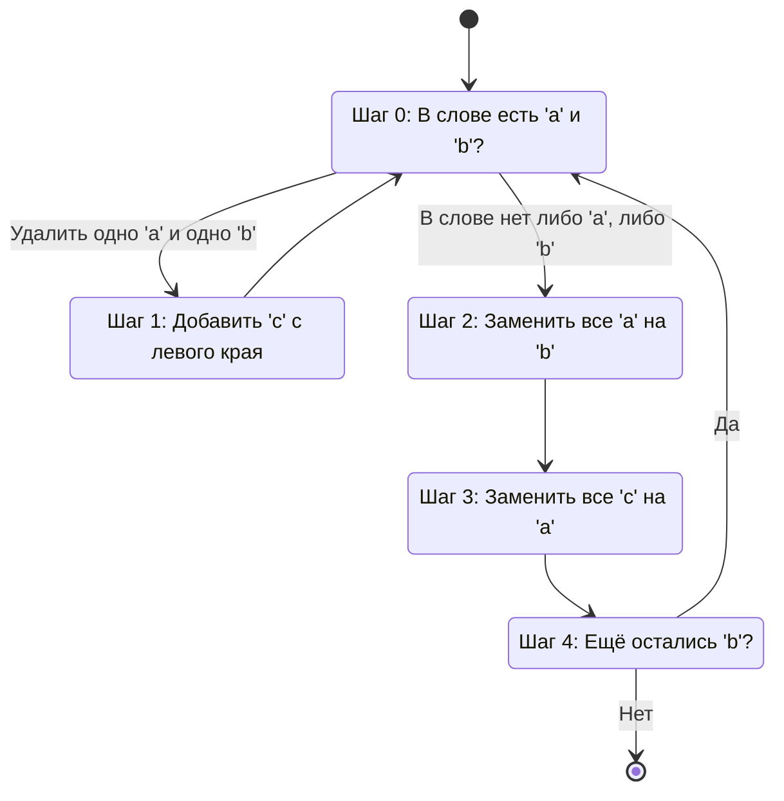

# Алгоритмы

**Алгоpитм** – это строго определенная последовательность действий, необходимых для решения данной задачи.

Алгоpитм имеет пять важных особенностей.

- **Конечность**. Алгоритм всегда должен заканчиваться после выполнения конечного числа шагов.
- **Определенность**. Каждый шаг алгоритма должен быть точно определен.
- **Ввод**. Алгоритм имеет некоторое (возможно, равное нулю) число _входных данных_,
  т.е. величин, которые задаются до начала его работы или определяются динамически во время его работы.
- **Вывод**. У алгоритма есть одно или несколько _выходных данных_,
  т.е. величин, имеющих вполне определенную связь с входными данными.
- **Эффективность**. Алгоритм обычно считается _эффективным_, если все его операторы достаточно просты для того,
  чтобы их можно было точно выполнить в течение конечного промежутка времени с помощью карандаша и бумаги.

> Название "алгоритм" берет начало от имени автора знаменитого персидского учебника по математике,
> Abu Abd Allah Muhammad ibn Musa al-Khwarizmı (Абу Абд Аллах Мухаммед ибн Муса аль-Хорезми) (ок. 825 г.),
> означающего буквально "Отец Абдуллы, Мухаммед, сын Мусы, уроженец Хорезма".
> Аральское море в Центральной Азии когда-то называлось озером Хорезм,
> и район Хорезма (Khwarizm) расположен в бассейне реки Амударьи южнее этого моря.
> Аль-Хорезми написал знаменитую книгу Kitab aljabr wal-muqabala
> (Китаб аль-джебр валь-мукабала — "Книга о восстановлении и противопоставлении").
> От названия этой книги, которая была посвящена решению линейных и квадратных уравнений,
> произошло еще одно слово— "алгебра".

## Более формальное определение

Определим _метод вычислений_ как четверку **(Q, I, Ω, f)**,
где **Q** — это множество, содержащее подмножества **I** и **Ω**, а **f** — функция, переводящая множество **Q** в себя.
Кроме того, **f** оставляет неподвижными точки множества **Ω**,
т.е. **f(q)** равно **q** для всех элементов **q** из множества **Ω**.
Эти четыре элемента, **Q**, **I**, **Ω**, **f**, представляют соответственно
состояния вычисления, ввод, вывод и правило вычислений.
Каждое входное значение **x** из множества **I** определяет _вычисляемую последовательность_
\\(x\_{0}, x\_{1}, x\_{2}, ...\\) следующим образом: \\(x\_{0} = x\\) и \\(x\_{k+1} = f(x\_{k})\\) для \\(k \geq 0\\).
Говорят, что вычисляемая последовательность _заканчивается через k шагов_,
если \\(k\\) — это наименьшее целое число, для которого \\(x\_{k}\\) принадлежит **Ω**,
и что она дает выходное значение \\(x\_{k}\\) для заданного \\(x\\).
(Заметим, что если \\(x\_{k}\\) принадлежит **Ω**, то и \\(x\_{k+1}\\) принадлежит **Ω**,
так как в этом случае \\(x\_{k+1} = x\_{k}\\).)
Некоторые вычисляемые последовательности могут никогда не заканчиваться,
но _алгоритм_ — это метод вычислений, который заканчивается через конечное число шагов для всех **x** из **I**.

## Эффективный формальный алгоритм

В этой формулировке понятия "алгоритм" не содержится ограничение, касающееся эффективности.
Например, \\(Q\\) может быть множеством бесконечных последовательностей,
которые нельзя вычислить с помощью карандаша и бумаги, а \\(f\\) может включать операции,
далеко не всегда выполнимые простому смертному.
Если мы хотим ограничить понятие "алгоритм" таким образом,
чтобы в нем могли содержаться только элементарные операции,
то введем ограничения на элементы \\(Q\\), \\(I\\), \\(Ω\\) и \\(f\\), например, следующим образом.
Пусть \\(A\\) — это ограниченное множество букв,
а \\(A^{\*}\\) — множество всех строк, определенных на множестве \\(A\\)
(т.е. множество всех упорядоченных последовательностей \\(x\_{1}x\_{2}...x\_{n}\\),
где \\(n \geq 0\\) и \\(x\_{j}\\) принадлежит \\(A\\) для \\(1 \leq j \leq n\\)).
Идея заключается в следующем:
закодировать состояния вычисления таким образом, чтобы они были представлены строками из множества \\(A^{\*}\\).
Теперь пусть \\(N\\) — целое неотрицательное число, а \\(Q\\) — множество всех пар \\((\sigma, j)\\),
где \\(\sigma\\) принадлежит \\(A^{\*}\\), а \\(j\\) — целое число, \\(0 \leq j \leq N\\).
Пусть \\(I\\) — подмножество пар из \\(Q\\), для которых \\(j = 0\\),
а \\(Ω\\) — подмножество пар из \\(Q\\), для которых \\(j = N\\).
Если \\(\Theta\\) и \\(\sigma\\) — строки из \\(A^{\*}\\),
то мы будем говорить, что \\(\Theta\\) входит в \\(\sigma\\), если \\(\sigma\\) имеет вид \\(\alpha\Theta\omega\\),
где \\(\alpha\\) и \\(\omega\\) — некоторые строки.
И в завершение определим функцию \\(f\\) с помощью строк \\(\Theta\_{j}\\), \\(\phi\_{j}\\)
и целых чисел \\(a\_{j}\\), \\(b\_{j}\\), \\(0 \leq j < N\\) следующим образом:

- \\(f(\sigma, j) = (\sigma, a\_{j})\\), если \\(\Theta\_{j}\\) не входит в \\(\sigma\\)
  (переход к следующему шагу, если условние не выполнено);
- \\(f(\sigma, j) = (\alpha\phi\_{j}\omega, b\_{j})\\), если \\(\alpha\\) является самой короткой строкой,
  для которой \\(\sigma = \alpha\Theta\_{j}\omega\\)
  (переход к следующему шагу, если условие выполнено);
- \\(f(\sigma, N) = (\sigma, N)\\)

### Пример описания эффективного формального алгоритма

> взят из упражнения 1.1.8 ["Искусство программирования"][TAOCP]

Пример эффективного формального алгоритма вычисления наибольшего общего делителя целых положительных чисел \\(m\\) и \\(n\\).
Пусть входные данные представлены строкой \\(a^{m}b^{n}\\),
т.е. за \\(a\\), взятым \\(m\\) раз, следует \\(b\\), взятое \\(n\\) раз.

Эффективный формальный алгоритм может выглядеть так:

Пусть \\(A = {a, b, c}, N = 5\\).
Выполнение алгоритма закончится тогда, когда получим строку \\(a^{gcd(m, n)}\\).

| j     | θ\_j            | φ\_j            | b\_j | a\_j | Комментарий                                                          |
|-------|-----------------|-----------------|------|------|----------------------------------------------------------------------|
| **0** | `ab`            | (Пустая строка) | 1    | 2    | Удалить одно `a` и одно `b` и перейти к **1**, либо перейти к **2**. |
| **1** | (Пустая строка) | `c`             | 0    | 0    | Добавить `c` с левого края, перейти к **0**.                         |
| **2** | `a`             | `b`             | 2    | 3    | Заменить все `a` на `b`.                                             |
| **3** | `c`             | `a`             | 3    | 4    | Заменить все `c` на `a`.                                             |
| **4** | `b`             | `b`             | 0    | 5    | Если `b` еще остались, повторить.                                    |

### Пример вычисления

Рассмотрим вычисление НОД для пары `(6, 3)`:

- Итерация 1
    - **Шаг 0**: `aaaaaabbb` -> `aaaaabb`
    - **Шаг 1**: `aaaaabb` -> `caaaaabb`
    - **Шаг 0**: `caaaaabb` -> `caaaab`
    - **Шаг 1**: `caaaab` -> `ccaaaab`
    - **Шаг 0**: `ccaaaab` -> `ccaaa`
    - **Шаг 1**: `ccaaa` -> `cccaaa`
    - **Шаг 0**: `cccaaa` => переход к **Шагу 2**
    - **Шаг 2**: `cccaaa` -> `cccbbb`
    - **Шаг 3**: `cccbbb` -> `aaabbb`
    - **Шаг 4**: `aaabbb` => следующая итерация
- Итерация 2
    - **Шаг 0**: `aaabbb` -> `aabb`
    - **Шаг 1**: `aabb` -> `caabb`
    - **Шаг 0**: `caabb` -> `cab`
    - **Шаг 1**: `cab` -> `ccab`
    - **Шаг 0**: `ccab` -> `cc`
    - **Шаг 1**: `cc` -> `ccc`
    - **Шаг 0**: `ccc` => переход к **Шагу 2**
    - **Шаг 2**: `ccc` -> `ccc`
    - **Шаг 3**: `ccc` -> `aaa`
    - **Шаг 4**: `aaa` => завершение алгоритма

Итоговый ответ `aaa` означает, что НОД чисел 6 и 3 равен 3.

---

**Ссылки:**

- [Исходный код][sample]
- [Тесты](https://gitverse.ru/scalabook/algorithms/content/master/algorithms/src/test/scala/ru/scalabook/algorithms)
- [The Art of Computer Programming - Donald E. Knuth][TAOCP]
- [Марков А.А., Нагорный Н.М. - Теория алгорифмов](https://www.ozon.ru/product/teoriya-algorifmov-markov-andrey-andreevich-nagornyy-nikolay-makarovich-1799472833/)

[TAOCP]: https://www-cs-faculty.stanford.edu/~knuth/taocp.html
[sample]: https://gitverse.ru/scalabook/algorithms
