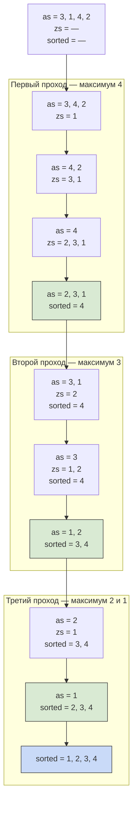

# Сортировка пузырьком

**Алгоритм:**

Алгоритм [сортировки пузырьком](https://ru.wikipedia.org/wiki/%D0%A1%D0%BE%D1%80%D1%82%D0%B8%D1%80%D0%BE%D0%B2%D0%BA%D0%B0_%D0%BF%D1%83%D0%B7%D1%8B%D1%80%D1%8C%D0%BA%D0%BE%D0%BC) 
состоит из повторяющихся проходов по сортируемому массиву. 
За каждый проход элементы последовательно сравниваются попарно 
и, если порядок в паре неверный, выполняется перестановка элементов. 
Проходы по массиву повторяются N-1 раз или до тех пор, пока на очередном проходе не окажется, 
что обмены больше не нужны, что означает — массив отсортирован. 
При каждом проходе алгоритма по внутреннему циклу очередной наибольший элемент массива ставится 
на своё место в конце массива рядом с предыдущим «наибольшим элементом», 
а наименьший элемент перемещается на одну позицию к началу массива 
(«всплывает» до нужной позиции, как пузырёк в воде — отсюда и название алгоритма).

**Оценка:**

- **Время**:
    - Худшее - \\(O(n^{2})\\)
    - Лучшее - \\(O(n)\\)
    - Среднее - \\(O(n^{2})\\)
- **Память** - \\(O(1)\\)

**Код:**

Реализация сортировки пузырьком с помощью функционального программирования основана на трёх списках,
`as`, `zs` и `sorted`, состояние которых на каждом шаге показано на схеме выше.
Работа ведётся рекурсивной функцией `loop`, которая за один вызов выполняет один проход по ещё не
сравненной части `as`:

- если неотсортированная часть `as` пустая, то все элементы уже отсортированы, и возвращаем `sorted`;
  данная ситуация возможна только, если и `zs` пустая, т.к. когда `as` сокращается до 1 элемента, то в него перемещается `zs`,
  и так до тех пор, пока `zs` не опустеет.
- если `as` состоит из одного элемента, то он — максимальный среди ещё не отсортированной части:
    - добавляем максимальный в начало отсортированного списка `sorted` и продолжаем попарное сравнение среди `zs`;
- если `as` состоит из нескольких элементов, то сравниваем первые два элемента между собой:
    - если `h1 > h2`, меняем их местами — больший элемент «всплывает» вперёд и будет сравниваться со следующим, 
      а меньший откладывается в `zs`;
    - иначе больший элемент `h2` (или равный) идёт вперёд, а `h1` откладывается в `zs`.

Таким образом, рано или поздно самый большой элемент каждой неотсортированной части окажется первым в `as`,
попадёт в `sorted` и «выпадет» из дальнейшего рассмотрения, как пузырёк, всплывающий вверх.

```dotty
import scala.annotation.tailrec
import scala.math.Ordered.orderingToOrdered

def bubbleSort[A: Ordering](list: List[A]): List[A] =
  @tailrec
  def loop(as: List[A], zs: List[A], sorted: List[A]): List[A] =
    as match
      case Nil       => sorted
      case h1 :: Nil => loop(zs, Nil, h1 :: sorted)
      case h1 :: h2 :: t =>
        if h1 > h2 then loop(h1 :: t, h2 :: zs, sorted)
        else loop(h2 :: t, h1 :: zs, sorted)

  loop(list, Nil, Nil)

bubbleSort(List(3, 1, 4, 2))
// List(1, 2, 3, 4)
```

**Визуализация:**

Разберём, как алгоритм работает на примере списка `3, 1, 4, 2`.
Ниже показано состояние трёх списков (`as`, `zs`, `sorted`) на каждом шаге рекурсивной функции `loop`:

| Шаг | `as` до | Операция | `as` после | `zs` | `sorted` |
|-----|---------|----------|------------|------|----------|
| 1 | 3, 1, 4, 2 | 3 > 1: обмен | 3, 4, 2 | 1 | — |
| 2 | 3, 4, 2 | 3 < 4: без обмена | 4, 2 | 3, 1 | — |
| 3 | 4, 2 | 4 > 2: обмен | 4 | 2, 3, 1 | — |
| 4 | 4 | один элемент: максимум 4 | 2, 3, 1 | — | 4 |
| 5 | 2, 3, 1 | 2 < 3: без обмена | 3, 1 | 2 | 4 |
| 6 | 3, 1 | 3 > 1: обмен | 3 | 1, 2 | 4 |
| 7 | 3 | один элемент: максимум 3 | 1, 2 | — | 3, 4 |
| 8 | 1, 2 | 1 < 2: без обмена | 2 | 1 | 3, 4 |
| 9 | 2 | один элемент: максимум 2 | 1 | — | 2, 3, 4 |
| 10 | 1 | один элемент: максимум 1 | — | — | 1, 2, 3, 4 |
| 11 | — | `as` пуст: готово | — | — | 1, 2, 3, 4 |



Жёлтыми цветом выделены шаги, на которых очередной максимум попадает в начало отсортированной части
(«всплывает», как пузырёк), а итоговое состояние отмечено синим.

---

**Ссылки:**

- [Исходный код][sample]
- [Bhim P. Upadhyaya - Data Structures and Algorithms with Scala](https://idp.springer.com/authorize?response_type=cookie&amp;client_id=springerlink&amp;redirect_uri=https%3A%2F%2Flink.springer.com%2Fbook%2F10.1007%2F978-3-030-12561-5)
- [Scalacaster](https://github.com/vkostyukov/scalacaster/tree/master)
- [Алгоритмика - Сортировка пузырьком](https://ru.algorithmica.org/cs/sorting/bubble/)
- [Никлаус Вирт - Алгоритмы + Структуры данных = Программы](https://en.wikipedia.org/wiki/Algorithms_%2B_Data_Structures_%3D_Programs)

[sample]: https://gitverse.ru/scalabook/algorithms
