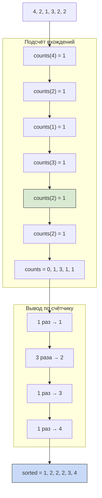

# Сортировка подсчетом

**Алгоритм:**

[Алгоритм сортировки подсчётом](https://ru.wikipedia.org/wiki/%D0%A1%D0%BE%D1%80%D1%82%D0%B8%D1%80%D0%BE%D0%B2%D0%BA%D0%B0_%D0%BF%D0%BE%D0%B4%D1%81%D1%87%D1%91%D1%82%D0%BE%D0%BC) (англ. _counting sort_) отличается от остальных: он не сравнивает элементы между собой, а использует то, что область значений заранее известна и мала.

Если известно, что все значения — целые числа от `0` до `k`, то:

- создаём массив-счётчик `counts` размера `k + 1`, в котором будем хранить, сколько раз встретилось каждое число;
- проходим по всем элементам исходного списка и увеличиваем соответствующую ячейку счётчика на `1`;
- после подсчёта проходим по счётчику от `0` до `k` и выписываем число `i` столько раз, сколько оно встретилось (т.е. `counts(i)` раз).

Время работы составляет \\(O(k + n)\\), где `k` — размер области значений, а `n` — число элементов.
Если `k` относительно невелико, сортировка подсчётом — одно из самых оптимальных решений.

Функциональная реализация использует неизменяемый вектор-счётчик, который обновляется через `foldLeft`,
а результат собирается с помощью `flatMap` по диапазону значений.

**Оценка:**

- **Время**:
  - Худшее - \\(O(k + n)\\)
  - Лучшее - \\(O(k + n)\\)
  - Среднее - \\(O(k + n)\\)
- **Память** - \\(O(k)\\)

**Код:**

```dotty
def countingSort(list: List[Int], max: Int): List[Int] =
  val counts =
    list.foldLeft(Vector.fill(max + 1)(0))((v, x) => v.updated(x, v(x) + 1))
  (0 to max).flatMap(n => Vector.fill(counts(n))(n)).toList

countingSort(List(3, 1, 4, 2), 4)
// List(1, 2, 3, 4)

countingSort(List(4, 2, 1, 3, 2), 4)
// List(1, 2, 2, 3, 4)
```

**Визуализация:**

Разберём, как алгоритм работает на примере списка `4, 2, 1, 3, 2, 2` при `max = 4`.
Сначала строится счётчик `counts` — сколько раз встретилось каждое число от `0` до `4`:

| Шаг | Элемент `x` | Увеличиваем счётчик | `counts`          |
| --- | ----------- | ------------------- | ----------------- |
| 1   | 4           | `counts(4)`         | 0, 0, 0, 0, **1** |
| 2   | 2           | `counts(2)`         | 0, 0, **1**, 0, 1 |
| 3   | 1           | `counts(1)`         | 0, **1**, 1, 0, 1 |
| 4   | 3           | `counts(3)`         | 0, 1, 1, **1**, 1 |
| 5   | 2           | `counts(2)`         | 0, 1, **2**, 1, 1 |
| 6   | 2           | `counts(2)`         | 0, 1, **3**, 1, 1 |

Затем по счётчику выписываем результат: число `0` — `0` раз, `1` — один раз, `2` — три раза, `3` — один раз, `4` — один раз.



Зелёным выделен заполненный счётчик, а итоговый отсортированный список отмечен синим.

---

**Ссылки:**

- [Исходный код][sample]
- [Алгоритмика - Сортировка подсчетом](https://ru.algorithmica.org/cs/sorting/counting/)

[sample]: https://gitverse.ru/scalabook/algorithms