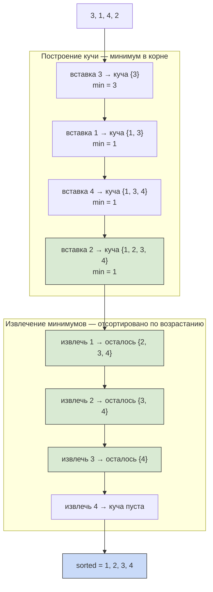

# Сортировка кучей

**Алгоритм:**

[Алгоритм сортировки кучей](https://ru.wikipedia.org/wiki/%D0%9F%D0%B8%D1%80%D0%B0%D0%BC%D0%B8%D0%B4%D0%B0%D0%BB%D1%8C%D0%BD%D0%B0%D1%8F_%D1%81%D0%BE%D1%80%D1%82%D0%B8%D1%80%D0%BE%D0%B2%D0%BA%D0%B0) (пирамидальная сортировка, _heapsort_) состоит из двух этапов:

- построить из исходного набора элементов [кучу][heap wiki], такую, что минимальный элемент всегда находится в её корне (min-куча);
- по одному извлекать минимальный элемент из кучи и дописывать его к отсортированной части результата.

Ключевая идея в том, что куча поддерживает быстрое извлечение минимума за
\\(O(log(n))\\) на операцию. Выполнив \\(n\\) извлечений, получаем отсортированный набор за
\\(O(n log(n))\\).

В этой функциональной реализации используется _левосторонняя куча_ (leftist heap),
для которой слияние двух куч также выполняется за \\(O(log(n))\\):

- свойство кучи: `min` в узле не больше, чем `min` любого из его потомков;
- левосторонность: ранг левого поддерева (`rank`) не меньше ранга правого; `rank` — длина правого пути от корня до пустого узла.

Благодаря слиянию за \\(O(log(n))\\) вставка элемента — это просто слияние одноэлементной кучи с текущей,
а извлечение минимума — слияние левого и правого поддеревьев корня.

**Оценка:**

- **Время**:
  - Худшее - \\(O(n log(n))\\)
  - Лучшее - \\(O(n log(n))\\)
  - Среднее - \\(O(n log(n))\\)
- **Память** - \\(O(n)\\)

**Код:**

Определим [левостороннюю кучу `LeftistHeap`](../../data-structures/heap.md) 
как бинарное дерево: пустой узел `Leaf` и узел `Branch`,
хранящий ранг, минимальный элемент `min`, а также левое и правое поддеревья:

```dotty
enum LeftistHeap[+A]:
  import LeftistHeap.*

  case Leaf

  case Branch(
      min: A,
      left: LeftistHeap[A],
      right: LeftistHeap[A],
      override val rank: Int
  )

  val rank: Int = this match
    case neh: Branch[A] => neh.rank
    case _              => 0

  def insert[B >: A: Ordering](x: B): LeftistHeap[B] = this match
    case Branch(min, left, right, _) =>
      if left.rank > right.rank then bubble(min, left, right.insert(x))
      else bubble(min, left.insert(x), right)
    case _ => LeftistHeap(x)
end LeftistHeap

object LeftistHeap:
  def apply[A: Ordering](x: A): LeftistHeap[A] =
    LeftistHeap(x, Leaf, Leaf)

  private def apply[A: Ordering](
      x: A,
      l: LeftistHeap[A],
      r: LeftistHeap[A]
  ): LeftistHeap[A] =
    Branch(x, l, r, r.rank + 1)

  private def bubble[A: Ordering](
      x: A,
      l: LeftistHeap[A],
      r: LeftistHeap[A]
  ): LeftistHeap[A] =
    (l, r) match
      case (Branch(y, lt, rt, _), _) if x > y =>
        LeftistHeap(y, LeftistHeap(x, lt, rt), r)
      case (_, Branch(z, lt, rt, _)) if x > z =>
        LeftistHeap(z, l, LeftistHeap(x, lt, rt))
      case (_, _) => LeftistHeap(x, l, r)

  def merge[A: Ordering](x: LeftistHeap[A], y: LeftistHeap[A]): LeftistHeap[A] =
    (x, y) match
      case (_, Leaf) => x
      case (Leaf, _) => y
      case (
            Branch(xx, xl, xr, _),
            Branch(yy, yl, yr, _)
          ) =>
        if xx < yy then swap(xx, xl, merge(xr, y))
        else swap(yy, yl, merge(yr, x))

  private def swap[A: Ordering](
      x: A,
      l: LeftistHeap[A],
      r: LeftistHeap[A]
  ): LeftistHeap[A] =
    if l.rank < r.rank then LeftistHeap(x, r, l)
    else LeftistHeap(x, l, r)

end LeftistHeap
```

- ранг узла — длина правого пути до пустого узла; у `Leaf` ранг равен `0`;
- `insert` собирает узел, помещая поддерево с большим рангом слева;
- `merge` сливает две кучи, выбирая в корень меньший минимум и рекурсивно сливая одно из поддеревьев;
- вставка — слияние одноэлементной кучи с существующей;
- `extract` по одному забирает корневой минимум, каждый раз сливая левое и правое поддеревья.

```dotty
def heapSort[A: Ordering](list: List[A]): List[A] =
  import LeftistHeap.*

  @tailrec
  def extract(h: LeftistHeap[A], acc: List[A]): List[A] = h match
    case Leaf               => acc.reverse
    case Branch(x, l, r, _) => extract(merge(l, r), x :: acc)

  val heap =
    list.foldLeft(Leaf: LeftistHeap[A])((h, x) => h.insert(x))
  extract(heap, Nil)

heapSort(List(3, 1, 4, 2))
// List(1, 2, 3, 4)
```

**Визуализация:**

Разберём, как алгоритм работает на примере списка `3, 1, 4, 2`.
Сначала строится min-куча (вставка каждого элемента — это слияние с текущей кучей),
затем по одному извлекается корневой минимум:

Построение кучи:

| Шаг | Вставляем | Куча (минимум в корне) | Минимум кучи |
|-----|-----------|------------------------|--------------|
| 1 | 3 | 3 | 3 |
| 2 | 1 | 1, затем 3 | 1 |
| 3 | 4 | 1, затем 3 и 4 | 1 |
| 4 | 2 | 1, затем 3, 4 и 2 | 1 |

Извлечение минимумов:

| Шаг | Извлекаем | Куча после | `sorted` (в порядке извлечения) |
|-----|-----------|------------|---------------------------------|
| 5 | 1 | 2 (и 3, 4) | 1 |
| 6 | 2 | 3 (и 4) | 1, 2 |
| 7 | 3 | 4 | 1, 2, 3 |
| 8 | 4 | — | 1, 2, 3, 4 |



Зелёным цветом выделены шаги, на которых из кучи извлекается очередной минимум,
а итоговый отсортированный список отмечен синим.

---

**Ссылки:**

- [Исходный код][sample]
- [Алгоритмика - Сортировка кучей](https://ru.algorithmica.org/cs/sorting/heapsort/)
- [Куча - структура данных][heap wiki]

[sample]: https://gitverse.ru/scalabook/algorithms
[heap wiki]: https://ru.wikipedia.org/wiki/%D0%9A%D1%83%D1%87%D0%B0_(%D1%81%D1%82%D1%80%D1%83%D0%BA%D1%82%D1%83%D1%80%D0%B0_%D0%B4%D0%B0%D0%BD%D0%BD%D1%8B%D1%85)