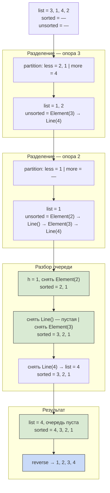

# Быстрая сортировка

**Алгоритм:**

Общая идея [алгоритма быстрой сортировки](https://ru.wikipedia.org/wiki/%D0%91%D1%8B%D1%81%D1%82%D1%80%D0%B0%D1%8F_%D1%81%D0%BE%D1%80%D1%82%D0%B8%D1%80%D0%BE%D0%B2%D0%BA%D0%B0) состоит в следующем:

- выбрать из массива элемент, называемый опорным. Это может быть любой из элементов массива. 
  От выбора опорного элемента не зависит корректность алгоритма, но в отдельных случаях может сильно зависеть его эффективность.
- сравнить все остальные элементы с опорным и переставить их в массиве так, чтобы разбить массив на три непрерывных отрезка, 
  следующих друг за другом: «элементы меньшие опорного», «равные» и «большие».
- для отрезков «меньших» и «больших» значений выполнить рекурсивно ту же последовательность операций, если длина отрезка больше единицы

**Оценка:**

- **Время**:
    - Худшее - \\(O(n^{2})\\)
    - Лучшее - \\(O(n log(n))\\)
    - Среднее - \\(O(n log(n))\\)
- **Память** - \\(O(n)\\)

**Код и пояснение:**

- Определение функций:
    - `quickSort`: Основная функция, которая принимает список элементов и запускает процесс сортировки.
    - `partitionAndSort`: Вспомогательная рекурсивная функция, которая выполняет разделение и сортировку элементов.
    - `partition`: Функция, которая разделяет элементы на три части: меньше, равно и больше опорного элемента.
- Инициализация: Функция `quickSort` принимает список `list` и вызывает `partitionAndSort` с пустым списком для отсортированных элементов 
  и пустой очередью для неотсортированных элементов.
- Рекурсивное разделение: 
    - Функция `partitionAndSort` принимает три параметра:
        - `list` - текущий список, который необходимо отсортировать.
        - `sorted` - уже отсортированные список (в обратном порядке - от большего к меньшему), 
          все элементы которого меньше любого элемента в `list`.
        - `unsorted` - коллекция "очередей", составленная таким образом, что каждое "звено", содержит элементы большие любого из `list`, 
          но при этом меньше элементов следующего звена цепи.
    - Начальное состояние: `list` - исходный список, `sorted` - пустой список, `unsorted` - пустая очередь.
    - В цикле: Если список `list` содержит более одного элемента:
        - Вызов `partition` для разделения элементов на три части: меньше (`less`), равно (`p`) и больше (`more`)
        - Рекурсивный вызов `partitionAndSort` с новыми параметрами: `list` - `less`, `sorted` - `sorted`, `unsorted` - 
          в очередь добавляем два звена: вначале `Line(g)` - список элементов больше `p`и потом `Element(p)` - звено из текущего опорного элемента.
          Важно отметить, что свойства (`list`, `sorted`, `unsorted`) не меняются: `list` по определению содержит элементы больше `sorted` (который пока пустой),
          сам `sorted` не меняется, а `unsorted` содержит звенья, элементы которого больше любого элемента в `list` и при этом
          каждое звено содержит элементы меньшие любого элемента в следующем звене.
    - В цикле: Если список `list` содержит ноль или один элемент, то обновляем `sorted`: 
      добавляем в начало `sorted` элемент из `list`, если он есть. При этом свойство `sorted` не меняется - элементы отсортированы от большего к меньшему.
      Считываем следующий элемент из очереди `unsorted`.
    - Если очередь `unsorted` пустая, то неотсортированных элементов не осталось - возвращаем обновленный `sorted`.
    - Если очередь `unsorted` не пустая, то берем первый элемент из очереди:
        - Если это `Element(p)`, то добавляем в начало `sorted` элемент `p`, т.к. `p` следующий по "старшинству" элемент 
          (больше всех из `sorted` и меньше всех из `unsorted`). 
          Вызываем `partitionAndSort` с пустым `list`, обновленным `sorted` и `unsorted` - оставшиеся в очереди элементы.
        - Если это `Line(g)`, то рекурсивно вызываем `partitionAndSort` с `list` - `g`, обновленным `sorted` и `unsorted` - оставшиеся в очереди элементы.
          Важно отметить, что свойства (`list`, `sorted`, `unsorted`) также не меняются: `list` содержит элементы больше `sorted` (т.к. в нём элементы больше опорного `p`, которым начинается `sorted`), сам `sorted` остается отсортированным от большего к меньшему, 
          а `unsorted` содержит звенья, элементы которого больше любого элемента в `list` по своему определению, т.к. это его бывшее первое звено.
- Разделение элементов: С помощью функции `partition` элементы списка разделяются на три группы:
    - `less`: элементы меньше опорного.
    - `p`: опорный элемент.
    - `more`: элементы больше опорного.
- После завершения всех рекурсивных вызовов, возвращается отсортированный в обратном порядке список `sorted`.

```dotty
def quickSort[A: Ordering](list: List[A]): List[A] =
  sealed trait Queue[A]
  case class Element[A](head: A)    extends Queue[A]
  case class Line[A](list: List[A]) extends Queue[A]

  @tailrec
  def partitionAndSort(
      list: List[A],
      sorted: List[A],
      unsorted: List[Queue[A]]
  ): List[A] =
    (list, unsorted) match
      case (Nil, Nil)      => sorted
      case (h :: Nil, Nil) => h :: sorted
      case (Nil, hq :: tq) =>
        hq match
          case Element(el) =>
            partitionAndSort(Nil, el :: sorted, tq)
          case Line(list) =>
            partitionAndSort(list, sorted, tq)
      case (h :: Nil, hq :: tq) =>
        hq match
          case Element(el) =>
            partitionAndSort(Nil, el :: h :: sorted, tq)
          case Line(list) =>
            partitionAndSort(list, h :: sorted, tq)
      case (h :: t, _) =>
        val (l, p, g) = partition(h, t)
        partitionAndSort(l, sorted, Element(p) :: Line(g) :: unsorted)

  def partition(p: A, rest: List[A]): (List[A], A, List[A]) =
    @tailrec
    def loop(
        p: A,
        rest: List[A],
        less: List[A],
        more: List[A]
    ): (List[A], A, List[A]) =
      rest match
        case Nil             => (less, p, more)
        case h :: t if h < p => loop(p, t, h :: less, more)
        case h :: t          => loop(p, t, less, h :: more)

    loop(p, rest, Nil, Nil)

  partitionAndSort(list, Nil, Nil).reverse
end quickSort
      
quickSort(List(3, 1, 4, 2))      
// List(1, 2, 3, 4)      
```

**Визуализация:**

Разберём, как алгоритм работает на примере списка `3, 1, 4, 2`. Каждая строка таблицы — один вызов
`partitionAndSort(list, sorted, unsorted)`:

- если `list` содержит несколько элементов, вызывается `partition`, которая выбирает опорный элемент `p` 
  (первый в списке) и возвращает `less` (меньше `p`) и `more` (больше `p`); затем рекурсивно обрабатывается `less`,
  а в очередь `unsorted` добавляются звенья `Element(p)` и `Line(more)`;
- если `list` — один элемент, он «нетерпеливо» добавляется в голову `sorted`, после чего разбирается очередь,
  так как `sorted` хранится от большего к меньшему, а обрабатываются элементы по убыванию;
- очередь `unsorted` (от головы к хвосту) разбирается так: `Element(p)` добавляет `p` в голову `sorted`,
  а `Line(g)` запускает обработку списка `g`.

| Шаг | `list`     | Действие                                                           | `sorted` после | `unsorted` после (голова → хвост)            |
| --- | ---------- | ------------------------------------------------------------------ | -------------- | -------------------------------------------- |
| 1   | 3, 1, 4, 2 | `partition`, опора 3: `less = 2, 1`, `more = 4`; рекурсия в `less` | —              | `Element(3) → Line(4)`                       |
| 2   | 1, 2       | `partition`, опора 2: `less = 1`, `more = `; рекурсия в `less`     | —              | `Element(2) → Line() → Element(3) → Line(4)` |
| 3   | 1          | один элемент: `h = 1`; снимаем `Element(2)`                        | 2, 1           | `Line() → Element(3) → Line(4)`              |
| 4   | —          | снимаем `Line()`, часть пустая — ничего не добавляем               | 2, 1           | `Element(3) → Line(4)`                       |
| 5   | —          | снимаем `Element(3)`                                               | 3, 2, 1        | `Line(4)`                                    |
| 6   | —          | снимаем `Line(4)` → становится новым `list`                        | 3, 2, 1        | —                                            |
| 7   | 4          | один элемент, очередь пуста                                        | 4, 3, 2, 1     | —                                            |


После седьмого шага очередь `unsorted` пуста и функция возвращает `sorted = 4, 3, 2, 1`.
Финальный `.reverse` даёт `1, 2, 3, 4`.



Зелёным цветом выделены шаги, на которых опорный элемент переходит в отсортированную часть,
а итоговое состояние отмечено синим.

---

**Ссылки:**

- [Исходный код][sample]
- [Bhim P. Upadhyaya - Data Structures and Algorithms with Scala](https://idp.springer.com/authorize?response_type=cookie&amp;client_id=springerlink&amp;redirect_uri=https%3A%2F%2Flink.springer.com%2Fbook%2F10.1007%2F978-3-030-12561-5)
- [Scalacaster](https://github.com/vkostyukov/scalacaster/tree/master)
- [Никлаус Вирт - Алгоритмы + Структуры данных = Программы](https://en.wikipedia.org/wiki/Algorithms_%2B_Data_Structures_%3D_Programs)

[sample]: https://gitverse.ru/scalabook/algorithms
