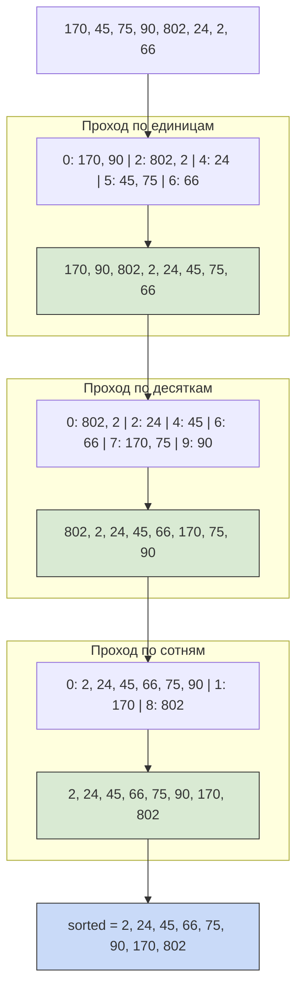

# Цифровая сортировка

**Алгоритм:**

[Алгоритм цифровой сортировки](https://ru.wikipedia.org/wiki/%D0%A6%D0%B8%D1%84%D1%80%D0%BE%D0%B2%D0%B0%D1%8F_%D1%81%D0%BE%D1%80%D1%82%D0%B8%D1%80%D0%BE%D0%B2%D0%BA%D0%B0) (англ. _radix sort_) применяет идею [сортировки подсчётом][counting] к большим ключам: вместо того чтобы заводить счётчик на всё пространство значений, ключ разбивается на разряды, и список сортируется по каждому разряду по очереди.

Для чисел обычно сортируют от младшего разряда к старшему (least significant digit):

- за каждый проход список сортируется по одному разряду (например, по очередной десятичной цифре) _устойчивой_ сортировкой подсчётом;
- устойчивость важна: элементы с одинаковым разрядом сохраняют порядок, установленный предыдущими проходами;
- после прохода по последнему (самому старшему) разряду список полностью отсортирован.

Время работы составляет \\(O(d \\cdot (b + n))\\), где `n` — число элементов, `b` — основание системы счисления (число возможных значений разряда, например `10`), а `d` — число разрядов.

В функциональной реализации устойчивость достигается за счёт `groupBy` по ключу разряда: внутри каждой группы элементы сохраняют исходный порядок, а результат собирается перебором разрядов от `0` до `9`.

**Оценка:**

- **Время**:
  - Худшее - \\(O(d \\cdot (b + n))\\)
  - Лучшее - \\(O(d \\cdot (b + n))\\)
  - Среднее - \\(O(d \\cdot (b + n))\\)
- **Память** - \\(O(n + b)\\)

**Код:**

```dotty
import scala.annotation.tailrec

def radixSort(list: List[Int]): List[Int] =
  def countingPass(d: Int, xs: List[Int]): List[Int] =
    val grouped = xs.groupBy(x => (x / d) % 10)
    (0 to 9).flatMap(digit => grouped.getOrElse(digit, Nil)).toList

  list.maxOption match
    case None    => Nil
    case Some(m) =>
      @tailrec
      def loop(d: Int, xs: List[Int]): List[Int] =
        if m / d == 0 then xs
        else loop(d * 10, countingPass(d, xs))
      loop(1, list)

radixSort(List(3, 1, 4, 2))
// List(1, 2, 3, 4)

radixSort(List(170, 45, 75, 90, 802, 24, 2, 66))
// List(2, 24, 45, 66, 75, 90, 170, 802)
```

**Визуализация:**

Разберём, как алгоритм работает на примере `170, 45, 75, 90, 802, 24, 2, 66`, максимальное число — `802` (три разряда).
Каждый проход сортирует список по очередной цифре (справа налево), устойчиво перебирая разряды от `0` до `9`:

Проход по единицам (\\(d = 1\\)):

| Цифра | Числа (в порядке следования) |
|-------|------------------------------|
| 0 | 170, 90 |
| 2 | 802, 2 |
| 4 | 24 |
| 5 | 45, 75 |
| 6 | 66 |

После прохода: `170, 90, 802, 2, 24, 45, 75, 66`

Проход по десяткам (\\(d = 10\\)):

| Цифра | Числа (в порядке следования) |
|-------|------------------------------|
| 0 | 802, 2 |
| 2 | 24 |
| 4 | 45 |
| 6 | 66 |
| 7 | 170, 75 |
| 9 | 90 |

После прохода: `802, 2, 24, 45, 66, 170, 75, 90`

Проход по сотням (\\(d = 100\\)):

| Цифра | Числа (в порядке следования) |
|-------|------------------------------|
| 0 | 2, 24, 45, 66, 75, 90 |
| 1 | 170 |
| 8 | 802 |

После прохода: `2, 24, 45, 66, 75, 90, 170, 802`



Зелёным выделены результаты устойчивых проходов по каждому разряду, а итоговый отсортированный список отмечен синим.

---

**Ссылки:**

- [Исходный код][sample]
- [Алгоритмика - Цифровая сортировка](https://ru.algorithmica.org/cs/sorting/radix/)
- [Сортировка подсчетом][counting]

[sample]: https://gitverse.ru/scalabook/algorithms
[counting]: https://ru.wikipedia.org/wiki/%D0%A1%D0%BE%D1%80%D1%82%D0%B8%D1%80%D0%BE%D0%B2%D0%BA%D0%B0_%D0%BF%D0%BE%D0%B4%D1%81%D1%87%D1%91%D1%82%D0%BE%D0%BC