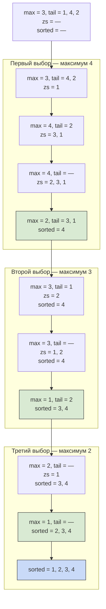

# Сортировка выбором

**Алгоритм:**

Шаги [алгоритма сортировки выбором](https://ru.wikipedia.org/wiki/%D0%A1%D0%BE%D1%80%D1%82%D0%B8%D1%80%D0%BE%D0%B2%D0%BA%D0%B0_%D0%B2%D1%8B%D0%B1%D0%BE%D1%80%D0%BE%D0%BC):

- находим номер минимального (максимального) значения в текущем списке
- производим обмен этого значения со значением первой неотсортированной позиции (обмен не нужен, если минимальный (максимального) элемент уже находится на данной позиции)
- теперь сортируем хвост списка, исключив из рассмотрения уже отсортированные элементы

**Оценка:**

- **Время**:
  - Худшее - \\(O(n^{2})\\)
  - Лучшее - \\(O(n^{2})\\)
  - Среднее - \\(O(n^{2})\\)
- **Память** - \\(O(1)\\)

**Код:**

Реализация сортировки выбором с помощью ФП может выглядеть так:

- вспомогательный метод `loop` принимает следующие аргументы: 
    - `max` - текущий максимальный элемент
    - `tail` - часть неотсортированного списка, где осталось сравнить элементы с максимальным
    - `zs` - часть неотсортированного списка, каждый элемент которого не более максимального
    - `sorted` - отсортированная часть списка
- если `tail` пустой, то `max` - максимальный элемент в неотсортированной части списка
    - если `zs` тоже пустой, то неотсортированной части не осталось, возвращаем `max :: sorted` 
      (в отсортированной части `sorted` все элементы не менее `max`, 
      поэтому `max :: sorted` остается отсортированным по возрастанию)
    - если `zs` не пустой, то добавляем `max` к отсортированной части 
      и продолжаем поиск следующего максимального элемента среди `zs`
- если `tail` не пустой, то берем его заглавный элемент - `h`:
    - если `max` больше `h`, то добавляем `h` в просмотренный список `zs`
    - если нет, то добавляем `max` в просмотренный список `zs`
    - продолжаем поиск с "новым" максимальным элементом по оставшейся части `tail`

```dotty
def selectionSort[A: Ordering](list: List[A]): List[A] =
  @tailrec
  def loop(max: A, tail: List[A], zs: List[A], sorted: List[A]): List[A] =
    (tail, zs) match
      case (Nil, Nil)             => max :: sorted
      case (Nil, h :: t)          => loop(h, t, Nil, max :: sorted)
      case (h :: t, _) if max > h => loop(max, t, h :: zs, sorted)
      case (h :: t, _)            => loop(h, t, max :: zs, sorted)

  list match
    case Nil          => Nil
    case head :: tail => loop(head, tail, Nil, Nil)
      
selectionSort(List(3, 1, 4, 2))
// List(1, 2, 3, 4)
```

**Визуализация:**

Разберём, как алгоритм работает на примере списка `3, 1, 4, 2`.
Ниже показано состояние четырёх значений (`max`, `tail`, `zs`, `sorted`) на каждом шаге рекурсивной функции `loop`:

| Шаг | `max` | `tail`              | Операция                    | `zs`    | `sorted`   |
| --- | ----- | ------------------- | --------------------------- | ------- | ---------- |
| 1   | 3     | 1, 4, 2             | 3 > 1: сохраняем 1          | 1       | —          |
| 2   | 3     | 4, 2                | 3 < 4: новый `max` = 4      | 3, 1    | —          |
| 3   | 4     | 2                   | 4 > 2: сохраняем 2          | 2, 3, 1 | —          |
| 4   | 4     | —                   | `tail` пуст: `max` = 4      | 2, 3, 1 | —          |
| 5   | 4     | — (из `zs` берём 2) | добавляем 4 к `sorted`      | 3, 1    | 4          |
| 6   | 2     | 3, 1                | 2 < 3: новый `max` = 3      | 2       | 4          |
| 7   | 3     | 1                   | 3 > 1: сохраняем 1          | 1, 2    | 4          |
| 8   | 3     | —                   | `tail` пуст: `max` = 3      | 1, 2    | 4          |
| 9   | 3     | — (из `zs` берём 1) | добавляем 3 к `sorted`      | -       | 3, 4       |
| 10  | 1     | 2                   | 1 < 2: новый `max` = 2      | 1       | 3, 4       |
| 11  | 2     | —                   | `tail` пуст: `max` = 2      | 1       | 3, 4       |
| 12  | 2     | — (из `zs` берём 1) | добавляем 2 к `sorted`      | —       | 2, 3, 4    |
| 13  | 1     | —                   | `tail` и `zs` пусты: готово | —       | 1, 2, 3, 4 |



Зелёным цветом выделены шаги, на которых очередной максимум переходит в начало отсортированной части,
а итоговое состояние отмечено синим.

---

**Ссылки:**

- [Исходный код][sample]
- [Bhim P. Upadhyaya - Data Structures and Algorithms with Scala](https://idp.springer.com/authorize?response_type=cookie&amp;client_id=springerlink&amp;redirect_uri=https%3A%2F%2Flink.springer.com%2Fbook%2F10.1007%2F978-3-030-12561-5)
- [Scalacaster](https://github.com/vkostyukov/scalacaster/tree/master)
- [Алгоритмика - Сортировка выбором](https://ru.algorithmica.org/cs/sorting/selection/)
- [Никлаус Вирт - Алгоритмы + Структуры данных = Программы](https://en.wikipedia.org/wiki/Algorithms_%2B_Data_Structures_%3D_Programs)

[sample]: https://gitverse.ru/scalabook/algorithms
