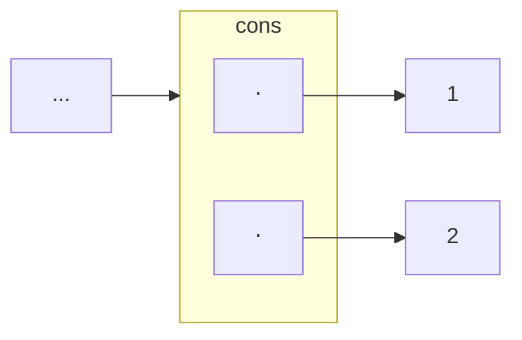
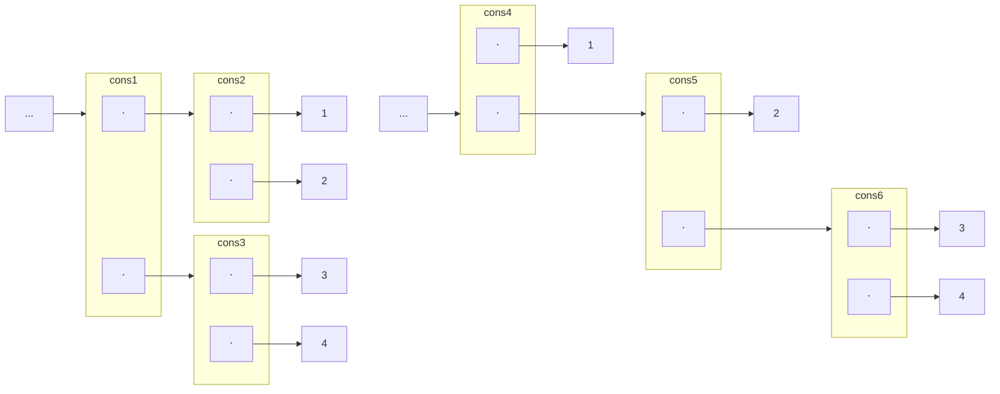
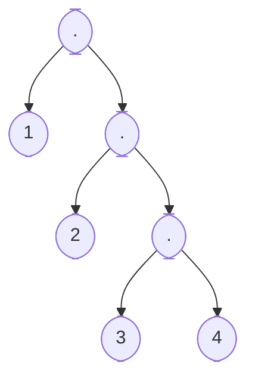
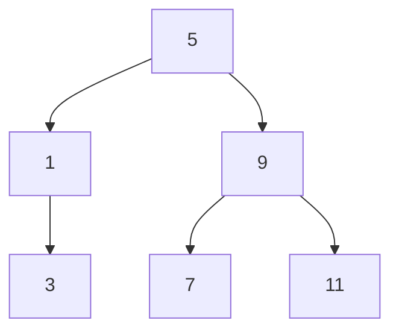

# Глава 2

## Глава 2. Построение абстракций с помощью данных

В этой главе мы обращаемся к другой важной характеристике всякого языка программирования:
тем средствам, которые он предоставляет для создания абстракций с помощью сочетания
объектов данных и построения _составных данных_ (_compound data_).

_Составной объект данных_ (_compound data object_) – это структура данных,
которая состоит из нескольких элементов данных различных типов.
Эти элементы могут быть как простыми (например, числа, строки),
так и сложными (например, массивы, другие составные объекты).

Общий метод отделения частей программы, которые имеют дело с представлением
объектов данных, от тех частей, где эти объекты данных используются, — это мощная
методология проектирования, называемая _абстракция данных_ (_data abstraction_).

Абстракция является методом ограничения сложности. Абстракция данных позволяет возводить полезные
_барьеры абстракции_ (_abstraction barriers_) между разными частями программы.

Важная идея в работе с составными данными — понятие _замыкания_ (_closure_):
клей для сочетания объектов данных должен позволять склеивать не только элементарные объекты данных, но и составные.
Еще одна важная идея состоит в том, что составные объекты данных могут служить
_стандартными интерфейсами_ (_conventional interfaces_), так, чтобы модули программы могли сочетаться методом подстановки.

_Символьные выражения_ (_symbolic expressions_) — данные,
элементарные части которых могут быть произвольными символами, а не только числами.

_Обобщенные операции_ (_generic operations_) обрабатывают много различных типов данных.
Поддержка модульности в присутствии обобщенных операций требует более мощных барьеров абстракции,
чем тех, что получаются с помощью простой абстракции данных.
А именно, мы вводим _программирование, управляемое данными_ (_data-directed programming_) как метод,
который позволяет проектировать представления данных отдельно,
а затем сочетать их _аддитивно_ (_additively_) (т.е., без модификации).

## 2.1. Введение в абстракцию данных

_Абстракция данных_ (_data abstraction_) — это методология, которая позволяет отделить способ использования
составного объекта данных от деталей того, как он составлен из элементарных данных.

Основная идея абстракции данных состоит в том, чтобы строить программы, работающие с составными данными,
так, чтобы иметь дело с «абстрактными данными».
То есть, используя данные, наши программы не должны делать о них никаких предположений,
кроме абсолютно необходимых для выполнения поставленной задачи.
В то же время «конкретное» представление данных определяется независимо от программ,
которые эти данные используют. Интерфейсом между двумя этими частями системы служит
набор процедур, называемых _селекторами_ (_selectors_) и _конструкторами_ (_constructors_),
реализующих абстрактные данные в терминах конкретного представления.

### 2.1.1. Пример: арифметические операции над рациональными числами

##### Пары

Для реализации конкретного уровня абстракции данных в нашем языке имеется составная структура,
называемая [_кортеж_](../../scala/collections/tuple.md) (_tuple_).
Объекты данных, составленные из кортежей, называются _данные со списковой структурой_ (_list-structured data_).

```dotty
opaque type Pair = (Long, Long)
val cons: Pair = (-5, 7)
// cons: Tuple2[Long, Long] = (-5L, 7L)
val car = cons._1
// car: Long = -5L
val cdr = cons._2
// cdr: Long = 7L
```

##### Представление рациональных чисел

Представление рациональных чисел в виде `case class`-а:

```dotty
final case class Rational private (numer: Long, denom: Long):
  import Rational.makeRat

  lazy val print: String = s"$numer/$denom"

  def +(that: Rational): Rational =
    makeRat(numer * that.denom + that.numer * denom, denom * that.denom)

  def -(that: Rational): Rational =
    makeRat(numer * that.denom - that.numer * denom, denom * that.denom)

  def *(that: Rational): Rational =
    makeRat(numer * that.numer, denom * that.denom)

  def /(that: Rational): Rational =
    makeRat(numer * that.denom, denom * that.numer)

  def ===(that: Rational): Boolean =
    numer * that.denom == denom * that.numer

object Rational:
  def makeRat(numer: Long, denom: Long): Rational =
    Rational(numer, denom)

Rational.makeRat(-5, 7).print
// res0: String = "-5/7"
Rational.makeRat(-5, 7) + Rational.makeRat(3, 7)
// res1: Rational = Rational(numer = -14L, denom = 49L)
Rational.makeRat(-5, 7) - Rational.makeRat(3, 7)
// res2: Rational = Rational(numer = -56L, denom = 49L)
Rational.makeRat(-5, 7) * Rational.makeRat(3, 7)
// res3: Rational = Rational(numer = -15L, denom = 49L)
Rational.makeRat(-5, 7) / Rational.makeRat(3, 7)
// res4: Rational = Rational(numer = -35L, denom = 21L)
Rational.makeRat(-5, 7) === Rational.makeRat(-10, 14)
// res5: Boolean = true
```

#### Упражнение 2.1

> Определите улучшенную версию mul-rat, которая принимала бы как положительные, так и отрицательные аргументы.
> Make-rat должна нормализовывать знак так,
> чтобы в случае, если рациональное число положительно, то и его числитель, и знаменатель были бы положительны,
> а если оно отрицательно, то чтобы только его числитель был отрицателен.

```dotty
object Rational:
  def makeRat(numer: Long, denom: Long): Rational =
    val g = gcd(numer, denom)
    val sign = if denom < 0 then -1 else 1
    Rational(sign * numer / g, sign * denom / g)
```

```dotty
Rational.makeRat(14, 49).print
// res7: String = "2/7"
Rational.makeRat(1, 2).print
// res8: String = "1/2"
Rational.makeRat(-1, -2).print
// res9: String = "1/2"
Rational.makeRat(-1, 2).print
// res10: String = "-1/2"
Rational.makeRat(1, -2).print
// res11: String = "-1/2"
```

[Scala worksheet](https://scastie.scala-lang.org/B9k1gvnISCqx9BEH9pEvtw)

### 2.1.2. Барьеры абстракции

#### Упражнение 2.2

> Рассмотрим задачу представления отрезков прямой на плоскости.
> Каждый отрезок представляется как пара точек: начало и конец.
> Определите конструктор make-segment и селекторы startsegment и end-segment,
> которые определяют представление отрезков в терминах точек.
> Далее, точку можно представить как пару чисел: координата x и координата y.
> Соответственно, напишите конструктор make-point и селекторы x-point и y-point, которые определяют такое представление.
> Наконец, используя свои селекторы и конструктор, напишите процедуру midpointsegment,
> которая принимает отрезок в качестве аргумента и возвращает его середину
> (точку, координаты которой являются средним координат концов отрезка).
> Чтобы опробовать эти процедуры, Вам потребуется способ печатать координаты точек

```dotty
final case class Point(x: Double, y: Double):
  override def toString(): String = s"($x,$y)"

final case class Segment(start: Point, end: Point):
  lazy val midpoint: Point = Point((start.x + end.x) / 2, (start.y + end.y) / 2)

Segment(Point(1, 0), Point(0, 1)).midpoint.toString
// res12: String = "(0.5,0.5)"
```

[Scala worksheet](https://scastie.scala-lang.org/3SvZKbYZRPaSqiCyNtwikQ)

#### Упражнение 2.3

> Реализуйте представление прямоугольников на плоскости.
> (Подсказка: Вам могут потребоваться результаты упражнения 2.2.)
> Определите в терминах своих конструкторов и селекторов процедуры, которые вычисляют периметр и площадь прямоугольника.
> Теперь реализуйте другое представление для прямоугольников.
> Можете ли Вы спроектировать свою систему с подходящими барьерами абстракции так,
> чтобы одни и те же процедуры вычисления периметра и площади работали с любым из Ваших представлений?

```dotty
final case class Point(x: Double, y: Double):
  override def toString(): String = s"($x,$y)"

final case class Segment(start: Point, end: Point):
  lazy val midpoint: Point = Point((start.x + end.x) / 2, (start.y + end.y) / 2)
  lazy val length: Double =
    math.sqrt(math.pow(start.x - end.x, 2.0) + math.pow(start.y - end.y, 2.0))

final case class Rectangle(
    topLeft: Point,
    topRight: Point,
    bottomRight: Point,
    bottomLeft: Point
):
  private lazy val topSideLength: Double = Segment(topLeft, topRight).length
  private lazy val leftSideLength: Double = Segment(topLeft, bottomLeft).length

  lazy val perimeter: Double =
    2 * (topSideLength + leftSideLength)
  lazy val square: Double =
    topSideLength * leftSideLength

object Rectangle:
  def apply(segment1: Segment, segment2: Segment): Rectangle =
    Rectangle(segment1.start, segment1.end, segment2.start, segment2.end)

val rect = Rectangle(Point(0, 0), Point(1, 0), Point(1, 1), Point(0, 1))
rect.perimeter
// res14: Double = 4.0
rect.square
// res15: Double = 1.0
```

[Scala worksheet](https://scastie.scala-lang.org/WOqHhQ9qRBmR8K0fueiA3g)

### 2.1.3. Что значит слово «данные»?

Данные — это то, что определяется некоторым набором селекторов и конструкторов,
а также некоторыми условиями, которым эти процедуры должны удовлетворять, чтобы быть правильным представлением.

Пару можно реализовать, используя только одни процедуры:

```dotty
def cons[A, B](a: A, b: B): Boolean => A | B =
  def dispatch(m: Boolean): A | B =
    if m then a else b

  dispatch

def car[A, B](a: A, b: B): A | B =
  cons(a, b)(true)

def cdr[A, B](a: A, b: B): A | B =
  cons(a, b)(false)
```

#### Упражнение 2.4

> Вот еще одно процедурное представление для пар.
> Проверьте для этого представления, что при любых двух объектах x и y (car (cons x y)) возвращает x
>
> ```
> (define (cons x y)
>   (lambda (m) (m x y)))
> (define (car z)
>   (z (lambda (p q) p)))
> ```
>
> Каково соответствующее определение cdr?
> (Подсказка: Чтобы проверить, что это работает, используйте подстановочную модель из раздела 1.1.5.)

```dotty
final case class Cons[A](x: A, y: A):
  def lambda(f: (A, A) => A): A =
    f(x, y)

def car[A](z: Cons[A]): A =
  z.lambda((p: A, q: A) => p)

def cdr[A](z: Cons[A]): A =
  z.lambda((p: A, q: A) => q)
```

Рассмотрим цепочку преобразований:

- `(car (cons x y))`
- `(cons x y).lambda((p: A, q: A) => p)`
- `((p: A, q: A) => p)(x, y)`
- `x`

Аналогично для `cdr`.

#### Упражнение 2.5

> Покажите, что можно представлять пары неотрицательных целых чисел,
> используя только числа и арифметические операции, если представлять пару a и b
> как произведение \\(2^{a}*3^{b}\\).
> Дайте соответствующие определения процедур cons, car и cdr.

```dotty
final case class Cons(x: Int, y: Int):
  lazy val cons: Int = math.pow(2, x).toInt * math.pow(3, y).toInt

  def degreeOfFactor(a: Int): Int =
    def loop(n: Int, count: Int): Int =
      if n % a == 0 then loop(n / a, count + 1)
      else count 
    loop(cons, 0)

def car(z: Cons): Int =
  z.degreeOfFactor(2)

def cdr(z: Cons): Int =
  z.degreeOfFactor(3)
```

#### Упражнение 2.6

> Если представление пар как процедур было для Вас еще недостаточно сумасшедшим,
> то заметьте, что в языке, который способен манипулировать процедурами,
> мы можем обойтись и без чисел (по крайней мере, пока речь идет о неотрицательных числах),
> определив 0 и операцию прибавления 1 так:
>
> ```
> (define zero (lambda (f) (lambda (x) x)))
>
> (define (add-1 n)
>   (lambda (f) (lambda (x) (f ((n f) x)))))
> ```
>
> Такое представление известно как числа Чёрча (Church numerals),
> по имени его изобретателя, Алонсо Чёрча, того самого логика, который придумал λ-исчисление.
> Определите one (единицу) и two (двойку) напрямую (не через zero и add-1).
> (Подсказка: вычислите (add-1 zero) с помощью подстановки.)
> Дайте прямое определение процедуры сложения + (не в терминах повторяющегося применения add-1).

Число Чёрча можно определить как n-кратное применение заданной функции к аргументу.

Например, вот так:

```dotty
def zero[A](f: A => A): A => A = x => x

def add1[A](f: A => A, n: Int): A => A =
  if n == 0 then zero(f)
  else (a: A) => add1(f, n - 1)(a)
```

Тогда единица - это однократное применение функции, двойка - двукратное, а сложение `a` и `b` -
это применение функции `f` к аргументу `a + b` раз.

### 2.1.4. Расширенный пример: интервальная арифметика

#### Упражнение 2.7

> Программа Лизы неполна, поскольку она не определила, как реализуется абстракция интервала.
> Вот определение конструктора интервала: `(define (make-interval a b) (cons a b))`
> Завершите реализацию, определив селекторы upper-bound и lower-bound.

```dotty
final case class Interval(a: Double, b: Double):
  lazy val upperBound: Double = math.max(a, b)
  lazy val lowerBound: Double = math.min(a, b)

  def add(that: Interval): Interval =
    Interval(
      this.lowerBound + that.lowerBound,
      this.upperBound + that.upperBound
    )

  def mul(that: Interval): Interval =
    val p1 = this.lowerBound * that.lowerBound
    val p2 = this.lowerBound * that.upperBound
    val p3 = this.upperBound * that.lowerBound
    val p4 = this.upperBound * that.upperBound
    Interval(
      math.min(math.min(p1, p2), math.min(p3, p4)),
      math.max(math.max(p1, p2), math.max(p3, p4))
    )

  def div(that: Interval): Interval =
    mul(Interval(1.0 / that.upperBound, 1.0 / that.lowerBound))
```

[Scala worksheet](https://scastie.scala-lang.org/vZmsk52FRryWBvPmGz1bvA)

#### Упражнение 2.8

> Рассуждая в духе Лизы, опишите, как можно вычислить разность двух интервалов.
> Напишите соответствующую процедуру вычитания, называемую sub-interval.

```dotty
def sub(that: Interval): Interval =
  Interval(
    this.lowerBound - that.upperBound,
    this.upperBound - that.lowerBound
  )
```

#### Упражнение 2.9

> Радиус (width) интервала определяется как половина расстояния между его верхней и нижней границами.
> Радиус является мерой неопределенности числа, которое обозначает интервал.
> Есть такие математические операции, для которых радиус результата зависит только от радиусов интервалов-аргументов,
> а есть такие, для которых радиус результата не является функцией радиусов аргументов.
> Покажите, что радиус суммы (или разности) двух интервалов зависит только от радиусов интервалов,
> которые складываются (или вычитаются).
> Приведите примеры, которые показывают, что для умножения или деления это не так.

```dotty
lazy val width: Double = (upperBound - lowerBound) / 2.0
```

Радиус суммы интервалов будет вычисляться так:

- `((this.upperBound + that.upperBound) - (this.lowerBound + that.lowerBound)) / 2.0`
- `((this.upperBound - this.lowerBound) / 2.0 + (that.upperBound - that.lowerBound) / 2.0)`
- `this.width + that.width`

Радиус разности интервалов будет вычисляться так:

- `((this.upperBound - that.lowerBound) - (this.lowerBound - that.upperBound)) / 2.0`
- `((this.upperBound - this.lowerBound) / 2.0 + (that.upperBound - that.lowerBound) / 2.0)`
- `this.width + that.width`

С умножением и делением ситуация иная: если взять два интервала радиуса `1`: `(0, 2)` и `(2, 4)`,
то произведением интервалов будет интервал `(0, 8)` с радиусом `4`,
а результат деления - интервал `(0, 1)` с радиусом `0.5`.

#### Упражнение 2.10

> Бен Битобор, системный программист-эксперт, смотрит через плечо Лизы и замечает:
> неясно, что должно означать деление на интервал, пересекающий ноль.
> Модифицируйте код Лизы так, чтобы программа проверяла это условие и сообщала об ошибке, если оно возникает.

```dotty
def div(that: Interval): Option[Interval] =
  if that.lowerBound <= 0.0 && that.upperBound >= 0.0 then None
  else Some(mul(Interval(1.0 / that.upperBound, 1.0 / that.lowerBound)))
```

#### Упражнение 2.11

> Проходя мимо, Бен делает туманное замечание:
> «Если проверять знаки концов интервалов, можно разбить mul-interval на девять случаев,
> из которых только в одном требуется более двух умножений».
> Перепишите эту процедуру в соответствии с предложением Бена.

```dotty
def mul(that: Interval): Interval =
  (
    this.lowerBound < 0,
    this.upperBound < 0,
    that.lowerBound < 0,
    that.upperBound < 0
  ) match
    case (true, true, true, true) =>
      Interval(
        this.upperBound * that.upperBound,
        this.lowerBound * that.lowerBound
      )
    case (true, true, true, false) =>
      Interval(
        this.lowerBound * that.upperBound,
        this.lowerBound * that.lowerBound
      )
    case (true, true, false, false) =>
      Interval(
        this.lowerBound * that.upperBound,
        this.upperBound * that.lowerBound
      )
    case (true, false, true, true) =>
      Interval(
        this.upperBound * that.lowerBound,
        this.lowerBound * that.lowerBound
      )
    case (true, false, true, false) =>
      val p1 = this.lowerBound * that.lowerBound
      val p2 = this.lowerBound * that.upperBound
      val p3 = this.upperBound * that.lowerBound
      val p4 = this.upperBound * that.upperBound
      Interval(
        math.min(p2, p3),
        math.max(p1, p4)
      )
    case (true, false, false, false) =>
      Interval(
        this.lowerBound * that.upperBound,
        this.upperBound * that.upperBound
      )
    case (false, false, true, true) =>
      Interval(
        this.upperBound * that.lowerBound,
        this.lowerBound * that.upperBound
      )
    case (false, false, true, false) =>
      Interval(
        this.upperBound * that.lowerBound,
        this.upperBound * that.upperBound
      )
    case (false, false, false, false) =>
      Interval(
        this.lowerBound * that.lowerBound,
        this.upperBound * that.upperBound
      )
```

#### Упражнение 2.12

> Определите конструктор make-center-percent,
> который принимает среднее значение и погрешность в процентах и выдает требуемый интервал.
> Нужно также определить селектор percent, который для данного интервала выдает погрешность в процентах.
> Селектор center остается тем же, что приведен выше.

```dotty
final case class Interval(a: Double, b: Double):
  lazy val upperBound: Double = math.max(a, b)
  lazy val lowerBound: Double = math.min(a, b)
  lazy val center: Double = (upperBound + lowerBound) / 2.0
  lazy val width: Double = (upperBound - lowerBound) / 2.0
  lazy val percent: Double = (width / center) * 100

  // ...

object Interval:
  def makeCenterWidth(center: Double, width: Double): Interval =
    Interval(center - width, center + width)

  def makeCenterPercent(center: Double, percent: Double): Interval =
    val width: Double = percent * center / 100.0
    makeCenterWidth(center, width)
```

#### Упражнение 2.13

> Покажите, что, если предположить, что погрешность составляет малую долю величины интервала,
> то погрешность в процентах произведения двух интервалов можно получить
> из погрешности в процентах исходных интервалов по простой приближенной формуле.
> Задачу можно упростить, если предположить, что все числа положительные.

Рассмотрим произведение двух интервалов с маленькой погрешностью:

- `Interval(c1 - w1, c1 + w1) * Interval(c2 - w2, c2 + w2)`
- `Interval((c1 - w1) * (c2 - w2), (c1 + w1) * (c2 + w2))`
- `mulCenter = ((c1 * c2 + w1 * c2 + w2 * c1 + w1 * w2) + (c1 * c2 - w1 * c2 - w2 * c1 + w1 * w2)) / 2`
- `mulCenter = (c1 * c2 + w1 * w2)`
- т.к. погрешность малая величина, то слагаемым `w1 * w2` можно пренебречь
- `mulWidth = ((c1 * c2 + w1 * c2 + w2 * c1 + w1 * w2) - (c1 * c2 - w1 * c2 - w2 * c1 + w1 * w2)) / 2`
- `mulWidth = (w1 * c2 + w2 * c1)`
- `mulPercent = ((w1 * c2 + w2 * c1) / (c1 * c2)) * 100 = (w1 / c1) * 100 + (w2 / c2) * 100`
- таким образом погрешность произведения приближенно равна сумме погрешностей множителей

#### Упражнение 2.14

> Покажите, что Дайко прав.
> Исследуйте поведение системы на различных арифметических выражениях.
> Создайте несколько интервалов A и B и вычислите с их помощью выражения A/A и A/B.
> Наибольшую пользу Вы получите, если будете использовать интервалы,
> радиус которых составляет малую часть от среднего значения.
> Исследуйте результаты вычислений в форме центр/проценты (см. упражнение 2.12).

```dotty
def par1(r1: Interval, r2: Interval): Option[Interval] =
  (r1.mul(r2)).div(r1.add(r2))

def par2(r1: Interval, r2: Interval): Option[Interval] =
  for
    one <- Interval(1, 2).div(Interval(1, 2))
    oneDivR1 <- one.div(r1)
    oneDivR2 <- one.div(r2)
    result <- one.div(oneDivR1.add(oneDivR2))
  yield result

val r1 = Interval.makeCenterWidth(10, 0.01)
// r1: Interval = Interval(a = 9.99, b = 10.01)
val r2 = Interval.makeCenterWidth(20, 0.01)
// r2: Interval = Interval(a = 19.99, b = 20.01)
par1(r1, r2)
// res17: Option[Interval] = Some(
//   value = Interval(a = 6.652235176548966, b = 6.681124082721815)
// )
par2(r1, r2)
// res18: Option[Interval] = Some(
//   value = Interval(a = 1.6652776851234157, b = 26.6888874083944)
// )
```

Методы действительно отдают различные результаты, потому что деление интервала на себя (A/A) - это не единица,
а интервал, имеющий небольшую погрешность.

[Scala worksheet](https://scastie.scala-lang.org/56fiIZVmSTitSmDRQmMFtw)

## 2.2. Иерархические данные и свойство замыкания

Представление (cons 1 2) в виде стрелочной диаграммы:



В этом представлении, которое называется _стрелочная диаграмма_ (_box-and-pointer notation_),
каждый объект изображается в виде _стрелки_ (_pointer_), указывающей на какую-нибудь ячейку.
Ячейка, изображающая элементарный объект, содержит представление этого объекта.
Например, ячейка, соответствующая числу, содержит числовую константу.
Изображение пары состоит из двух ячеек, причем верхняя из них содержит (указатель на) car этой пары, а нижняя — ее cdr.

На диаграмме ниже показаны два способа соединить числа 1, 2, 3 и 4 при помощи пар:

- `((1, 2), (3, 4))`
- `(1, (2, (3, 4)))`



Возможность создавать пары, элементы которых сами являются парами,
определяет значимость списковой структуры как средства представления данных.
Мы называем эту возможность _свойством замыкания_ (_closure property_) для cons.
В общем случае, операция комбинирования объектов данных обладает свойством замыкания в том случае,
если результаты соединения объектов с помощью этой операции сами могут соединяться этой же операцией.
Замыкание — это ключ к выразительной силе для любого средства комбинирования,
поскольку оно позволяет строить _иерархические_ (_hierarchical_) структуры,
то есть структуры, составленные из частей, которые сами составлены из частей, и так далее.

### 2.2.1. Представление последовательностей

Одна из полезных структур, которые можно построить с помощью пар — это _последовательность_ (_sequence_),
то есть упорядоченная совокупность объектов данных.

`Cons(1, Cons(2, Cons(3, Cons(4, Nil))))` - такая последовательность пар,
порождаемая вложенными cons-ами, называется _список_ (_list_).
Или более кратко - `1 :: 2 :: 3 :: 4 :: Nil`.
Значение `Nil`, которым завершается цепочка пар, можно рассматривать как последовательность без элементов,
_пустой список_ (_empty list_).
Слово nil произошло от стяжения латинского nihil, что значит «ничто».

#### Операции со списками

Процедура `list-ref` берет в качестве аргументов список и число n и возвращает n-й элемент списка.
Обычно элементы списка нумеруют, начиная с 0. Метод вычисления `list-ref` следующий:

- Если n = 0, `list-ref` должна вернуть car списка.
- В остальных случаях `list-ref` должна вернуть (n − 1)-й элемент от cdr списка.

```dotty
def listRef[A](items: List[A], n: Int): Option[A] =
  if n <= 0 then items.headOption
  else
    items match
      case Nil          => None
      case head :: tail => listRef(tail, n - 1)

listRef(List(1, 4, 9, 16, 25), 3)
// Some(16)
```

Процедура `length`, которая возвращает число элементов в списке:

```dotty
def length[A](items: List[A]): Int =
  items match
    case Nil       => 0
    case _ :: tail => 1 + length(tail)

length(List(1, 3, 5, 7))
// 4
```

Процедура `length` реализует простую рекурсивную схему. Шаг редукции таков:

- Длина любого списка равняется 1 плюс длина cdr этого списка

Этот шаг последовательно применяется, пока мы не достигнем базового случая:

- Длина пустого списка равна `0`.

Мы можем вычислить `length` и в итеративном стиле:

```dotty
def length[A](items: List[A]): Int =
  @tailrec
  def loop(items: List[A], l: Int): Int =
    items match
      case Nil       => l
      case _ :: tail => loop(tail, l + 1)

  loop(items, 0)

length(List(1, 3, 5, 7))
// 4
```

`Append` также реализуется по рекурсивной схеме.
Чтобы соединить списки `list1` и `list2`, нужно сделать следующее:

- Если список `list1` пуст, то результатом является просто `list2`.
- В противном случае, нужно соединить `cdr` от `list1` с `list2`,
  а к результату прибавить `car` от `list1` с помощью `cons`:

```dotty
def append[A](list1: List[A], list2: List[A]): List[A] =
  list1 match
    case Nil => list2
    case head :: tail =>
      head :: append(tail, list2)

append(List(1, 4, 9, 16, 25), List(1, 3, 5, 7))
// List(1, 4, 9, 16, 25, 1, 3, 5, 7)
```

#### Упражнение 2.17

> Определите процедуру `last-pair`, которая возвращает список,
> содержащий только последний элемент данного (непустого) списка.
> (last-pair (list 23 72 149 34))
> (34)

```dotty
def lastPair[A](list: List[A]): List[A] =
  list match
    case Nil      => Nil
    case h :: Nil => List(h)
    case _ :: t   => lastPair(t)

lastPair(List(23, 72, 149, 34)) 
// List(34)
```

#### Упражнение 2.18

> Определите процедуру `reverse`, которая принимает список как аргумент и возвращает список,
> состоящий из тех же элементов в обратном порядке:
> (reverse (list 1 4 9 16 25))
> (25 16 9 4 1)

```dotty
def reverse[A](list: List[A]): List[A] =
  list match
    case Nil => Nil
    case h :: t   => t.reverse :+ h

reverse(List(1, 4, 9, 16, 25)) // List(25, 16, 9, 4, 1)
```

#### Упражнение 2.19

> Рассмотрим программу подсчета способов размена из раздела 1.2.2.
> Было бы приятно иметь возможность легко изменять валюту, которую эта программа использует,
> так, чтобы можно было, например, вычислить, сколькими способами можно разменять британский фунт.
> Эта программа написана так, что знание о валюте распределено между процедурами `first-denomination`
> и `count-change` (которая знает, что существует пять видов американских монет).
> Приятнее было бы иметь возможность просто задавать список монет, которые можно использовать при размене.
>
> Мы хотим переписать процедуру `cc` так, чтобы ее вторым аргументом был список монет,
> а не целое число, которое указывает, какие монеты использовать.
> Тогда у нас могли бы быть списки, определяющие типы валют:
>
> `val usCoins = List(50, 25, 10, 5, 1)`
>
> `val ukCoins = List(100, 50, 20, 10, 5, 2, 1, 0.5)`
>
> Можно было бы вызывать `cc` следующим образом:
>
> `cc(100.0, usCoins) // 292`
>
> Это потребует некоторых изменений в программе `cc`.
> Ее форма останется прежней, но со вторым аргументом она будет работать иначе, вот так:
>
> ```dotty
> def noMore(coinValues: List[Double]): Boolean = ???
>
> def exceptFirstDenomination(coinValues: List[Double]): List[Double] = ???
>
> def firstDenomination(coinValues: List[Double]): Double = ???
>
> def cc(amount: Double, coinValues: List[Double]): Int =
>   if amount == 0 then 1
>   else if amount < 0 || noMore(coinValues) then 0
>   else
>     cc(amount, exceptFirstDenomination(coinValues)) +
>     cc(amount - firstDenomination(coinValues), coinValues)
> ```
>
> Определите процедуры `firstDenomination`, `exceptFirstDenomination` и `noMore`
> в терминах элементарных операций над списковыми структурами.
> Влияет ли порядок списка `coinValues` на результат, получаемый `cc`?
> Почему?

```dotty
def noMore(coinValues: List[Double]): Boolean =
  coinValues match
    case Nil => true
    case _   => false

def exceptFirstDenomination(coinValues: List[Double]): List[Double] =
  coinValues match
    case Nil    => Nil
    case _ :: t => t

def firstDenomination(coinValues: List[Double]): Double =
  coinValues match
    case Nil    => 0.0
    case h :: _ => h
```

[Scala worksheet](https://scastie.scala-lang.org/2Yd4XGN2RKicv3pFSWUepA)

Порядок списка `coinValues` на результат не влияет, потому что вне зависимости от того, какая монета идет первой,
все варианты можно разделить на две категории: сумма использует первую монету или не использует.

#### Упражнение 2.20

> Процедуры `+`, `*` и `list` принимают произвольное число аргументов.
> Один из способов определения таких процедур состоит в использовании _точечной записи_ (_dotted-tail notation_).
> В определении процедуры список параметров с точкой перед именем последнего члена означает,
> что, когда процедура вызывается, начальные параметры (если они есть) будут иметь в качестве значений
> начальные аргументы, как и обычно,
> но значением последнего параметра будет _список_ всех оставшихся аргументов.
> Например, если дано определение
>
> `(define (f x y . z) <тело>)`
>
> то процедуру `f` можно вызывать с двумя и более аргументами. Если мы вычисляем
>
> `(f 1 2 3 4 5 6)`
>
> то в теле `f` переменная `x` будет равна `1`, `y` будет равно `2`, а `z` будет списком `(3 4 5 6)`.
> Если дано определение
>
> `(define (g . w) <тело>)`
>
> то процедура `g` может вызываться с нулем и более аргументов. Если мы вычислим
>
> `(g 1 2 3 4 5 6)`
>
> то в теле `g` значением переменной `w` будет список `(1 2 3 4 5 6)`.
>
> Используя эту нотацию, напишите процедуру `same-parity`, которая принимает одно или более целое число
> и возвращает список всех тех аргументов, у которых четность та же, что у первого аргумента.
> Например,
>
> `(same-parity 1 2 3 4 5 6 7)`
>
> `(1 3 5 7)`
>
> `(same-parity 2 3 4 5 6 7)`
>
> `(2 4 6)`

```dotty
import scala.annotation.tailrec

def sameParity(first: Int, others: Int*): List[Int] =
  @tailrec
  def loop(rest: List[Int], acc: List[Int]): List[Int] =
    rest match
      case Nil => acc
      case head :: tail if head % 2 == first % 2 =>
        loop(tail, head :: acc)
      case _ :: tail =>
        loop(tail, acc)

  loop(others.toList, List(first))

sameParity(1, 2, 3, 4, 5, 6, 7)
// List(7, 5, 3, 1)
sameParity(2, 3, 4, 5, 6, 7)
// List(6, 4, 2)
```

#### Отображение списков

Крайне полезной операцией является применение какого-либо преобразования к каждому элементу списка
и порождение списка результатов.
Например, следующая процедура умножает каждый элемент списка на заданное число.

```dotty
def scaleList(items: List[Int], factor: Int): List[Int] =
  items match
    case Nil => Nil
    case h :: t =>
      (h * factor) :: scaleList(t, factor)

scaleList(List(1, 2, 3, 4, 5), 10)
// List(10, 20, 30, 40, 50)
```

Мы можем выделить здесь общую идею и зафиксировать ее как схему,
выраженную в виде процедуры высшего порядка, в точности как в разделе 1.3.
Здесь эта процедура высшего порядка называется `map`.
`Map` берет в качестве аргументов процедуру от одного аргумента и список,
а возвращает список результатов, полученных применением процедуры к каждому элементу списка:

```dotty
def map[A, B](items: List[A], proc: A => B): List[B] =
  items match
    case Nil => Nil
    case h :: t =>
      proc(h) :: map(t, proc)

map(List(-10, 2.5, -11.6, 17), math.abs)
// List(10.0, 2.5, 11.6, 17.0)
map(List(1, 2, 3, 4), x => x * x)
// List(1, 4, 9, 16)
```

Теперь мы можем дать новое определение `scale-list` через `map`:

```dotty
def scaleList(items: List[Int], factor: Int): List[Int] =
  map(items, _ * factor)
```

#### Упражнение 2.21

> Процедура square-list принимает в качестве аргумента список чисел и возвращает список квадратов этих чисел.
>
> `(square-list (list 1 2 3 4))`
>
> `(1 4 9 16)`
>
> Перед Вами два различных определения square-list. Закончите их, вставив пропущенные выражения:
>
> ```
> (define (square-list items)
>   (if (null? items)
>       nil
>       (cons <??> <??>)))
>
> (define (square-list items)
>   (map h??i h??i))
> ```

```dotty
def squareList(items: List[Int]): List[Int] =
  if items.isEmpty then Nil
  else
    val h = items.head
    (h * h) :: squareList(items.tail)

def squareList(items: List[Int]): List[Int] =
  map(items, x => x * x)
```

#### Упражнение 2.22

> Хьюго Дум пытается переписать первую из процедур square-list из упражнения 2.21 так,
> чтобы она работала как итеративный процесс:
>
> ```
> (define (square-list items)
>   (define (iter things answer)
>     (if (null? things)
>         answer
>         (iter (cdr things)
>               (cons (square (car things))
>                     answer))))
>   (iter items nil))
> ```
>
> К сожалению, такое определение square-list выдает список результатов в порядке, обратном желаемому. Почему?
>
> Затем Хьюго пытается исправить ошибку, обменяв аргументы cons:
>
> ```
> (define (square-list items)
>   (define (iter things answer)
>     (if (null? things)
>         answer
>         (iter (cdr things)
>               (cons answer
>                     (square (car things))))))
>   (iter items nil))
> ```
>
> И так программа тоже не работает. Объясните это.

В первом случае каждый следующий элемент списка после преобразования добавляется в начало ответа.
В результате, после всех преобразований в начале итогового ответа будет преобразованный
последний элемент исходного списка, а элементы будут идти в обратном порядке от исходного.

Во втором случае мы получаем не список элементов, а список от многих списков:
`List(List(List(List(List(List(0), 1), 2), 3), 4), 5)`

#### Упражнение 2.23

> Процедура for-each похожа на map. В качестве аргументов она принимает процедуру и список элементов.
> Однако вместо того, чтобы формировать список результатов, for-each просто
> применяет процедуру по очереди ко всем элементам слева направо.
> Результаты применения процедуры к аргументам не используются вообще —
> for-each применяют к процедурам, которые осуществляют какое-либо действие вроде печати.
> Например,
>
> ```
> (for-each (lambda (x) (newline) (display x))
>
> (list 57 321 88))
> 57
> 321
> 88
> ```
>
> Значение, возвращаемое вызовом for-each (оно в листинге не показано) может быть каким угодно, например истина.
> Напишите реализацию for-each.

```dotty
def foreach[A](items: List[A], proc: A => Unit): Unit =
  items match
    case Nil => ()
    case h :: t =>
      proc(h) 
      foreach(t, proc)

foreach(List(1, 2, 3), i => println(i))
```

### 2.2.2. Иерархические структуры

Еще один способ думать о последовательностях последовательностей — _деревья_ (_trees_).
Элементы последовательности являются ветвями дерева, а элементы,
которые сами по себе последовательности — поддеревьями.

Естественным инструментом для работы с деревьями является рекурсия,
поскольку часто можно свести операции над деревьями к операциям над их ветвями,
которые сами сводятся к операциям над ветвями ветвей, и так далее,
пока мы не достигнем листьев дерева.

Например, подсчет листьев дерева:

```dotty
enum Tree[+A]:
  self =>

  case Leaf(value: A)
  case Branch(left: Tree[A], right: Tree[A])

  lazy val countLeaves: Int =
    self match
      case Leaf(_)             => 1
      case Branch(left, right) => left.countLeaves + right.countLeaves

import Tree.*

val tree = Branch(Branch(Leaf(1), Leaf(2)), Branch(Leaf(3), Leaf(4)))
tree.countLeaves // 4
```

#### Упражнение 2.24

> Предположим, мы вычисляем выражение (list 1 (list 2 (list 3 4))).
> Укажите, какой результат напечатает интерпретатор, изобразите его в виде стрелочной диаграммы,
> а также его интерпретацию в виде дерева (как на рисунке 2.6).

Стрелочная диаграмма:



#### Упражнение 2.28

> Напишите процедуру `fringe`, которая берет в качестве аргумента дерево
> (представленное в виде списка) и возвращает список, элементы которого — все листья дерева,
> упорядоченные слева направо.
> Например,
>
> (define x (list (list 1 2) (list 3 4)))
>
> (fringe x)
>
> (1 2 3 4)
>
> (fringe (list x x))
>
> (1 2 3 4 1 2 3 4)

```dotty
val tree = Branch(Branch(Leaf(1), Leaf(2)), Branch(Leaf(3), Leaf(4)))

def fringe[A](tree: Tree[A]): List[A] =
  tree match
    case Leaf(a)             => List(a)
    case Branch(left, right) => fringe(left) ++ fringe(right)

fringe(tree) 
// List(1, 2, 3, 4)
fringe(Branch(tree, tree))
// List(1, 2, 3, 4, 1, 2, 3, 4)
```

#### Отображение деревьев

Преобразование дерева реализуется аналогично преобразованию списка:

```dotty
enum Tree[+A]:
  self =>

  case Leaf(value: A)
  case Branch(left: Tree[A], right: Tree[A])

  def map[B](f: A => B): Tree[B] =
    self match
      case Leaf(value) => Leaf(f(value))
      case Branch(left, right) =>
        Branch(left.map(f), right.map(f))
```

#### Упражнение 2.30

> Определите процедуру square-tree, подобную процедуре square-list из упражнения 2.21.
> А именно, square-tree должна вести себя следующим образом:
>
> ```text
> (square-tree
>   (list 1
>         (list 2 (list 3 4) 5)
>         (list 6 7)))
> (1 (4 (9 16) 25) (36 49))
> ```
>
> Определите square-tree как прямо (то есть без использования процедур высших порядков),
> так и с помощью `map` и рекурсии.

```dotty
def squareTree(tree: Tree[Int]): Tree[Int] =
  tree match
    case Tree.Leaf(value) => Tree.Leaf(value * value)
    case Tree.Branch(left, right) =>
      Tree.Branch(squareTree(left), squareTree(right))

def squareTree2(tree: Tree[Int]): Tree[Int] =
  tree.map(x => x * x)

val tree = Tree.Branch(Tree.Leaf(1), Tree.Branch(Tree.Leaf(2), Tree.Leaf(3)))
squareTree2(tree)
// Branch(Leaf(1),Branch(Leaf(4),Leaf(9)))
```

####  Упражнение 2.31

> Абстрагируйте свой ответ на упражнение 2.30, получая процедуру tree-map, так, 
> чтобы square-tree можно было определить следующим образом:
>
> ```
> (define (square-tree tree) (tree-map square tree))
> ```

```dotty
def squareTree3[A, B](tree: Tree[A])(
    fmap: (Tree[A], A => B) => Tree[B],
    f: A => B
): Tree[B] =
  fmap(tree, f)

val tree = Tree.Branch(Tree.Leaf(1), Tree.Branch(Tree.Leaf(2), Tree.Leaf(3)))
squareTree3[Int, Int](tree)((t, f) => t.map(f), x => x * x)
// Branch(Leaf(1),Branch(Leaf(4),Leaf(9)))
```

####  Упражнение 2.32

> Множество можно представить как список его различных элементов, 
> а множество его подмножествкак список списков. 
> Например, если множество равно (1 2 3), то множество его подмножеств равно (() (3) (2) (2 3) (1) (1 3) (1 2) (1 2 3)). 
> Закончите следующее определение процедуры, которая порождает множество подмножеств 
> и дайте ясное объяснение, почему она работает:
>
> ```
> (define (subsets s)
>   (if (null? s)
>       (list nil)
>       (let ((rest (subsets (cdr s))))
>         (append rest (map <??> rest)))))
> ```

Для пустого входящего списка множество различных элементов - это список из одного элемента - самого пустого списка.
Если список не пустой, то множество его элементов можно разделить на две части: множество элементов без первого члена списка
и это же множество с добавление первого члена.

```dotty
def subset[A](list: List[A]): List[List[A]] =
  list match
    case Nil => List(Nil)
    case head :: tail =>
      val rest = subset(tail)
      rest ++ rest.map(head :: _)

subset(List(1, 2, 3))
// List(List(), List(3), List(2), List(2, 3), List(1), List(1, 3), List(1, 2), List(1, 2, 3))      
```

### 2.2.3. Последовательности как стандартные интерфейсы

В этом разделе представлен еще один мощный принцип проектирования для работы со структурами данных — 
использование _стандартных интерфейсов_ (_conventional interfaces_).

#### Операции над последовательностями

Просеивание последовательности, выбирающее только те элементы, 
которые удовлетворяют данному предикату, осуществляется при помощи:

```dotty
def filter[A](predicate: A => Boolean, sequence: List[A]): List[A] =
  if sequence.isEmpty then Nil
  else if predicate(sequence.head) then
    sequence.head :: filter(predicate, sequence.tail)
  else filter(predicate, sequence.tail)

filter[Int](_ % 2 == 0, List(1, 2, 3, 4, 5))
// List(2, 4)  
```

Накопление осуществляется посредством:

```dotty
def accumulate[A, B](op: (A, B) => B, initial: B, sequence: List[A]): B =
  sequence match
    case Nil          => initial
    case head :: tail => op(head, accumulate(op, initial, tail))

accumulate[Int, Int](_ * _, 1, List(1, 2, 3, 4, 5))
// 120
accumulate[String, String](_ + _, "", List("a", "b", "c", "d", "e"))
// "abcde"
```

#### Упражнение 2.33

> Заполните пропущенные выражения, так, чтобы получились определения некоторых базовых операций по работе со списками в виде накопления:
>
> ```
> (define (map p sequence)
>   (accumulate (lambda (x y) <??>) nil sequence))
> 
> (define (append seq1 seq2)
>   (accumulate cons <??> <??>))
> 
> (define (length sequence)
>   (accumulate <??> 0 sequence))
> ```

```dotty
def map[A, B](f: A => B, sequence: List[A]): List[B] =
  accumulate[A, List[B]]((a, listB) => f(a) :: listB, List.empty[B], sequence)

def append[A](seq1: List[A], seq2: List[A]): List[A] =
  accumulate[A, List[A]]((a, listA) => a :: listA, seq1, seq2)

def length[A](list: List[A]): Int =
  accumulate[A, Int]((_, acc) => acc + 1, 0, list)

map[Int, Int](_ * 2, List(1, 2, 3, 4, 5))
// List(2, 4, 6, 8, 10)
append[Int](List(1, 2, 3), List(4, 5, 6))
// List(4, 5, 6, 1, 2, 3)
length[Int](List(1, 2, 3, 4, 5))
// 5 
```

#### Упражнение 2.34

> Вычисление многочлена с переменной x при данном значении x можно сформулировать в виде накопления. 
> Мы вычисляем многочлен \\(a\_{n}x^{n} + a\_{n−1}x^{n−1} + ... + a\_{1}x + a\_{0}\\) по известному алгоритму, 
> называемому _схема Горнера_ (_Horner’s rule_), которое переписывает формулу в виде
> \\((... (a\_{n}x + a\_{n−1})x + ... + a\_{1})x + a\_{0})\\)
> 
> Другими словами, мы начинаем с \\(a\_{n}\\), умножаем его на x, и так далее, пока не достигнем \\(a\_{0}\\).
> Заполните пропуски в следующей заготовке так, чтобы получить процедуру, которая вычисляет многочлены по схеме Горнера. 
> Предполагается, что коэффициенты многочлена представлены в виде последовательности, от \\(a\_{0}\\) до \\(a\_{n}\\).
>
> ```
> (define (horner-eval x coefficient-sequence)
>   (accumulate (lambda (this-coeff higher-terms) <??>)
>               0
>               coefficient-sequence))
> ```
>
> Например, чтобы вычислить \\(1 + 3x + 5x^{3} + x^{5}\\) в точке x = 2, нужно ввести (horner-eval 2 (list 1 3 0 5 0 1))

```dotty
def hornerEval(x: Int, coeff: List[Int]): Int =
  accumulate[Int, Int]((c, acc) => c + acc * x, 0, coeff)

hornerEval(2, List(1, 3, 0, 5, 0, 1)) 
// 79
```

#### Упражнение 2.35

> Переопределите count-leaves из раздела 2.2.2 в виде накопления:
> 
> ```
> (define (count-leaves t)
>   (accumulate <??> <??> (map <??> <??>)))
> ```

```dotty
enum Tree[+A]:
  self =>

  case Leaf(value: A)
  case Branch(left: Tree[A], right: Tree[A])

  def map[B](f: A => B): Tree[B] =
    self match
      case Leaf(value) => Leaf(f(value))
      case Branch(left, right) =>
        Branch(left.map(f), right.map(f))

def accumulate[A, B](op: (A, B) => B, initial: B, tree: Tree[A]): B =
  tree match
    case Tree.Leaf(value) => op(value, initial)
    case Tree.Branch(left, right) =>
      accumulate(op, accumulate(op, initial, left), right)

def countLeaves[A](tree: Tree[A]): Int =
  accumulate[Int, Int](_ + _, 0, tree.map(_ => 1))

countLeaves(Tree.Branch(Tree.Leaf(1), Tree.Branch(Tree.Leaf(2), Tree.Leaf(3))))
// 3
```

#### Упражнение 2.36

> Процедура accumulate-n подобна accumulate, только свой третий аргумент она воспринимает как последовательность последовательностей, 
> причем предполагается, что все они содержат одинаковое количество элементов. 
> Она применяет указанную процедуру накопления ко всем первым элементам последовательностей, 
> вторым элементам последовательностей и так далее, и возвращает последовательность результатов. 
> Например, если s есть последовательность, состоящая из четырех последовательностей, ((1 2 3) (4 5 6) (7 8 9) (10 11 12)), 
> то значением (accumulate-n + 0 s) будет последовательность (22 26 30). 
> Заполните пробелы в следующем определении accumulate-n:
>
> ```
> (define (accumulate-n op init seqs)
>   (if (null? (car seqs))
>       nil
>       (cons (accumulate op init <??>)
>             (accumulate-n op init <??>))))
> ```

```dotty
def accumulateN[A, B](
    op: (A, B) => B,
    initial: B,
    seqs: List[List[A]]
): List[B] =
  seqs match
    case head :: tail if head.nonEmpty =>
      accumulate(op, initial, seqs.map(_.head)) ::
        accumulateN(op, initial, seqs.map(_.tail))
    case _ => Nil

accumulateN[Int, Int]((x, y) => x + y, 0, List(List(1, 2, 3), List(4, 5, 6), List(7, 8, 9), List(10,11,12)))
// List(22, 26, 30) 
```

#### Упражнение 2.37

> Предположим, что мы представляем векторы \\(v = (v\_{i})\\) как последовательности чисел, 
> а матрицы \\(m = (m\_{ij})\\) как последовательности векторов (рядов матрицы). 
> Например, матрица
> 
> \\(\begin{bmatrix} 1 & 2 & 3 & 4 \\\\ 4 & 5 & 6 & 6 \\\\ 6 & 7 & 8 & 9 \end{bmatrix}\\)
>
> представляется в виде последовательности ((1 2 3 4) (4 5 6 6) (6 7 8 9)). 
> Имея такое представление, мы можем использовать операции над последовательностями, 
> чтобы кратко выразить основные действия над матрицами и векторами. 
> Эти операции (описанные в любой книге по матричной алгебре) следующие:
>
> **Скалярное произведение** (dot-product v w) - возвращает сумму \\(\sum\_{i}^{}v\_{i}w\_{i}\\);
> 
> **Произведение матрицы и вектора** (matrix-*-vector m v) возвращает вектор t, \\(t\_{i} = \sum\_{i}^{}m\_{ij}v\_{i}\\);
> 
> **Произведение матриц** (matrix-*-matrix m n) возвращает матрицу p, где \\(p\_{ij} = \sum\_{k}^{}m\_{ik}n\_{kj}\\)
> 
> **Транспозиция** (transpose m) возвращает матрицу n, где \\(n\_{ij} = m\_{ji}\\)
> 
> Скалярное произведение мы можем определить так:
>
> ```
> (define (dot-product v w)
>   (accumulate + 0 (map * v w)))
> ```
>
> Заполните пропуски в следующих процедурах для вычисления остальных матричных операций.
>
> ```
> (define (matrix-*-vector m v)
>   (map <??> m))
>
> (define (transpose mat)
>   (accumulate-n <??> <??> mat))
>
> (define (matrix-*-matrix m n)
>   (let ((cols (transpose n)))
>     (map <??> m)))
> ```

Определим операцию `map2`, которая принимает два списка и возвращает список, в котором каждый элемент - 
результат применения заданной функции к соответствующей паре элементов заданных двух списков.
`dotProduct` определяется через `map2`:

```dotty
def map2[A, B, C](seq1: List[A], seq2: List[B], f: (A, B) => C): List[C] =
  seq1.lazyZip(seq2).map{ case (a, b) => f(a, b) }

def dotProduct(v: List[Int], w: List[Int]): Int =
  accumulate[Int, Int](_ + _, 0, map2(v, w, _ * _))

dotProduct(List(1, 2, 3), List(4, 5, 6))
// 32
```

Остальные операции определяются через `dotProduct`:

```dotty
def matrixVectorMultiply(m: List[List[Int]], v: List[Int]): List[Int] =
  map(row => dotProduct(row, v), m)

matrixVectorMultiply(
  List(List(1, 2, 3), List(4, 5, 6), List(7, 8, 9)),
  List(1, 2, 3)
)
// List(14, 32, 50)

def transpose[A](m: List[List[A]]): List[List[A]] =
  accumulateN[A, List[A]]((a, acc) => a :: acc, List.empty, m)

transpose(List(List(1, 2, 3), List(4, 5, 6), List(7, 8, 9)))
// List(List(1, 4, 7), List(2, 5, 8), List(3, 6, 9))

def matrixMatrixMultiply(m: List[List[Int]],  n: List[List[Int]]): List[List[Int]] =
  val cols = transpose(n)
  val matrix =  map((col: List[Int]) => matrixVectorMultiply(m, col), cols)
  transpose(matrix)

matrixMatrixMultiply(
  List(List(1, 2, 3), List(4, 5, 6), List(7, 8, 9)),
  List(List(1, 4, 7), List(2, 5, 8), List(3, 6, 9))
)
// List(List(14, 32, 50), List(32, 77, 122), List(50, 122, 194))
```

#### Упражнение 2.38

> Процедура accumulate известна также как fold-right (правая свертка), 
> поскольку она комбинирует первый элемент последовательности с результатом комбинирования всех элементов справа от него. 
> Существует также процедура fold-left (левая свертка), которая подобна fold-right, 
> но комбинирует элементы в противоположном направлении:
>
> ```
> (define (fold-left op initial sequence)
>   (define (iter result rest)
>     (if (null? rest)
>         result
>         (iter (op result (car rest))
>               (cdr rest))))
>   (iter initial sequence))
> ```
>
> Каковы значения следующих выражений?
> 
> ```
> (fold-right / 1 (list 1 2 3))
> (fold-left / 1 (list 1 2 3))
> (fold-right list nil (list 1 2 3))
> (fold-left list nil (list 1 2 3))
> ```
>
> Укажите свойство, которому должна удовлетворять op, 
> чтобы для любой последовательности fold-right и fold-left давали одинаковые результаты.

Процедура `foldLeft` на Scala:

```dotty
def foldLeft[A, B](op: (B, A) => B, initial: B, sequence: List[A]): B =
  def iter(result: B, rest: List[A]): B =
    rest match
      case Nil => result
      case head :: next =>
        iter(op(result, head), next)

  iter(initial, sequence)
```

Результат выполнения операций:

```dotty
foldRight[Double, Double](_ / _, 1.0, List(1.0, 2.0, 3.0))
// 1.5
foldLeft[Double, Double](_ / _, 1.0, List(1.0, 2.0, 3.0))
// 0.16666666666666666

foldRight[Int, List[Int]](_ :: _, Nil, List(1, 2, 3))
// List(1, 2, 3)
foldLeft[Int, List[Int]]((b, a) => a :: b, Nil, List(1, 2, 3))
// List(3, 2, 1)
```

Если операция `op` ассоциативна, то результаты `foldLeft` и `foldRight` будут одинаковыми. 
Ассоциативность операции означает, что для любых трех аргументов `a`, `b` и `c` выполняется следующее условие 
`op(a, op(b, c)) = op(op(a, b), c)`.

#### Упражнение 2.39

> Закончите следующие определения reverse (упражнение 2.18) в терминах процедур fold-right и fold-left из упражнения 2.38.
>
> ```
> (define (reverse sequence)
>   (fold-right (lambda (x y) <??>) nil sequence))
> (define (reverse sequence)
>   (fold-left (lambda (x y) <??>) nil sequence))
> ```

```dotty
def reverseViaFoldRight[A](sequence: List[A]): List[A] =
  foldRight((a: A, b: List[A]) => b :+ a, Nil, sequence)

def reverseViaFoldLeft[A](sequence: List[A]): List[A] =
  foldLeft((b: List[A], a: A) => a :: b, Nil, sequence)

reverseViaFoldRight(List(1, 2, 3))
// List(3, 2, 1)
reverseViaFoldLeft(List(1, 2, 3))
// List(3, 2, 1)
```

#### Вложенные отображения

Вот способ породить последовательность пар: 
для каждого целого i ≤ n перечислить целые числа j < i, и для каждых таких i и j породить пару (i, j). 
В терминах операций над последовательностями, мы производим отображение последовательности (enumerate-interval 1 n). 
Для каждого i из этой последовательности мы производим отображение последовательности (enumerate-interval 1 (- i 1)).  
Для каждого j в этой последовательности мы порождаем пару (list i j). 
Это дает нам последовательность пар для каждого i. 
Скомбинировав последовательности для всех i (путем накопления через append), получаем необходимую нам последовательность пар.

```dotty
val n = 6  
val lists = map((i: Int) => map((j: Int) => List(i, j), (1 until i).toList), (1 to n).toList)
accumulate(append[List[Int]], Nil, lists)
```

Комбинация из отображения и накопления через `append` в такого рода программах настолько обычна, 
что мы ее выразим как отдельную процедуру:

```dotty
def flatMap[A, B](proc: A => List[B], sequence: List[A]): List[B] =
  accumulate(
    (a: A, listB: List[B]) => append(proc(a), listB),
    Nil: List[B],
    sequence
  )
```

Допустим, нам нужно перечислить все перестановки множества S, то есть все способы упорядочить это множество. 
Например, перестановки множества {1, 2, 3} — это {1, 2, 3}, {1, 3, 2}, {2, 1, 3}, {2, 3, 1}, {3, 1, 2} и {3, 2, 1}. 
Вот план того, как можно породить все перестановки S: 
Для каждого элемента x из S, нужно рекурсивно породить все множество перестановок S−x, 
затем добавить x к началу каждой из них.
Для каждого x из S это дает множество всех перестановок S, которые начинаются с x.
Комбинация всех последовательностей для всех x дает нам все перестановки S:

```dotty
def permutations[A](sequence: List[A]): List[List[A]] =
  sequence match
    case Nil => List(Nil)
    case _ =>
      flatMap(
        (a: A) =>
          map((b: List[A]) => a :: b, permutations(sequence.filterNot(_ == a))),
        sequence
      )

permutations(List(1, 2, 3))
// List(List(3, 2, 1), List(3, 1, 2), List(2, 3, 1), List(2, 1, 3), List(1, 3, 2), List(1, 2, 3))
```

Заметим, что такая стратегия сводит задачу порождения перестановок S к задаче порождения перестановок для множества, которое меньше, чем S. 
В граничном случае мы добираемся до пустого списка, который представляет множество, не содержащее элементов. 
Для этого множества мы порождаем (`List(Nil)`), которое является последовательностью из одного члена, а именно множества без элементов.

#### Упражнение 2.40

> Определите процедуру `unique-pairs`, которая, получая целое число n, 
> порождает последовательность пар (i, j), таких, что 1 ≤ j < i ≤ n. 
> С помощью `unique-pairs` упростите данное выше определение `prime-sum-pairs`.

```dotty
def uniquePairs(n: Int): List[(Int, Int)] =
  flatMap(
    (i: Int) => map((j: Int) => (i, j), (1 until i).toList),
    (1 to n).toList
  )

uniquePairs(6)
// List((6,1), (6,2), (6,3), (6,4), (6,5), (5,1), (5,2), (5,3), (5,4), (4,1), (4,2), (4,3), (3,1), (3,2), (2,1))
```

#### Упражнение 2.41

> Напишите процедуру, которая находит все такие упорядоченные тройки различных положительных целых чисел i, j и k,
> меньших или равных данному целому числу n, сумма которых равна данному числу s.

```dotty
def filter[A](p: A => Boolean, list: List[A]): List[A] =
  flatMap(
    (a: A) => if p(a) then List(a) else Nil,
    list
  )

// 1 <= k < j < i <= n
def trimples(n: Int, sum: Int): List[(Int, Int, Int)] =
  filter(
    (i, j, k) => i + j + k == sum,
    flatMap(
      (i: Int) =>
        flatMap(
          (j: Int) => map((k: Int) => (i, j, k), (1 until j).toList),
          (1 until i).toList
        ),
      (1 to n).toList
    )
  )

trimples(6, 8)
// List((4,3,1), (5,2,1))
```

#### Упражнение 2.42

> В «задаче о восьми ферзях» спрашивается, как расставить на шахматной доске восемь ферзей так,
> чтобы ни один из них не бил другого (то есть никакие два ферзя не должны находиться на одной вертикали, горизонтали или диагонали). 
> Один из способов решать эту задачу состоит в том, чтобы идти поперек доски, устанавливая по ферзю в каждой вертикали. 
> После того, как k − 1 ферзя мы уже разместили, нужно разместить k-го в таком месте, 
> где он не бьет ни одного из тех, которые уже находятся на доске. 
> Этот подход можно сформулировать рекурсивно: предположим, 
> что мы уже породили последовательность из всех возможных способов разместить k − 1 ферзей на первых k − 1 вертикалях доски. 
> Для каждого из этих способов мы порождаем расширенный набор позиций, добавляя ферзя на каждую горизонталь k-й вертикали. 
> Затем эти позиции нужно отфильтровать, оставляя только те, где ферзь на k-й вертикали не бьется ни одним из остальных. 
> Продолжая этот процесс, мы породим не просто одно решение, а все решения этой задачи.
>
> Это решение мы реализуем в процедуре queens, которая возвращает последовательность решений задачи размещения n ферзей на доске n × n. 
> В процедуре queens есть внутренняя процедура queen-cols, 
> которая возвращает последовательность всех способов разместить ферзей на первых k вертикалях доски.
>
> ```
> (define (queens board-size)
>   (define (queen-cols k)
>     (if (= k 0)
>         (list empty-board)
>         (filter
>           (lambda (positions) (safe? k positions))
>           (flatmap
>             (lambda (rest-of-queens)
>               (map (lambda (new-row)
>                      (adjoin-position new-row k rest-of-queens))
>                    (enumerate-interval 1 board-size)))
>             (queen-cols (- k 1))))))
>   (queen-cols board-size))
> ```
>
> В этой процедуре rest-of-queens есть способ размещения k − 1 ферзя на первых k − 1 вертикалях, 
> а new-row — это горизонталь, на которую предлагается поместить ферзя с k-й вертикали.
> 
> Завершите эту программу, реализовав представление множеств позиций ферзей на доске, включая процедуру adjoin-position, 
> которая добавляет нового ферзя на определенных горизонтали и вертикали к заданному множеству позиций, 
> и empty-board, которая представляет пустое множество позиций. 
> Еще нужно написать процедуру safe?, которая для множества позиций определяет, находится ли ферзь с k-й вертикали в безопасности от остальных. 
> (Заметим, что нам требуется проверять только то, находится ли в безопасности новый ферзь — 
> для остальных ферзей безопасность друг от друга уже гарантирована.)

- метод `adjoinPosition` в начало позиций добавляет новую позицию в k-том столбце
- метод `isSafe` проверяет, находится ли начальный ферзь в безопасности от остальных ферзей.
  Т.к. новые ферзи добавляются всегда в начало, то проверяем только первого ферзя.
  Проверка "тот же столбец" избыточная, т.к. столбцы всегда разные, но здесь оставлена для симметрии.

```dotty
def queens(boardSize: Int): List[List[(Int, Int)]] =
  val emptyBoard: List[(Int, Int)] = List.empty

  def adjoinPosition(
      newRow: Int,
      k: Int,
      restOfQueens: List[(Int, Int)]
  ): List[(Int, Int)] = (newRow, k) :: restOfQueens

  def isSafe(positions: List[(Int, Int)]): Boolean =
    positions match
      case Nil => true
      case head :: tail =>
        val (row, col) = head
        tail.forall: (r, c) =>
          r != row && c != col &&                  // та же строка или столбец
            math.abs(r - row) != math.abs(c - col) // та же диагональ

  def queenCols(k: Int): List[List[(Int, Int)]] =
    if k == 0 then List(emptyBoard)
    else
      filter(
        (positions: List[(Int, Int)]) => isSafe(positions),
        flatMap(
          (restOfQueens: List[(Int, Int)]) =>
            map(
              (newRow: Int) => adjoinPosition(newRow, k, restOfQueens),
              (1 to boardSize).toList
            ),
          queenCols(k - 1)
        )
      )

  queenCols(boardSize)
end queens

queens(8).head
// List((5,8), (7,7), (2,6), (6,5), (3,4), (1,3), (4,2), (8,1))
```

#### Упражнение 2.43

> У Хьюго Дума ужасные трудности при решении упражнения 2.42. 
> Его процедура `queens` вроде бы работает, но невероятно медленно. 
> (Хьюго ни разу не удается дождаться, пока она решит хотя бы задачу 6 × 6.) 
> Когда Хьюго просит о помощи Еву Лу Атор, она указывает, что он поменял местами порядок 
> вложенных отображений в вызове процедуры `flatmap`, записав его в виде
>
> ```
> (flatmap
>   (lambda (new-row)
>     (map (lambda (rest-of-queens)
>            (adjoin-position new-row k rest-of-queens))
>          (queen-cols (- k 1))))
>   (enumerate-interval 1 board-size))
> ```
> 
> Объясните, почему из-за такой перестановки программа работает медленно. 
> Оцените, насколько долго программа Хьюго будет решать задачу с восемью ферзями, 
> если предположить, что программа, приведенная в упражнении 2.42, решает ее за время T.

Проблема в том, что для каждой новой строки `new-row` рекурсивно вызывается `queen-cols (- k 1)` - 
самая затратная по времени операция, хотя в этом нет необходимости.

## 2.3. Символьные данные

### 2.3.1. Кавычки

Чтобы работать с символами, в языке нужен новый элемент: способность _закавычить_ (_quote_) объект данных.
Допустим, нам хочется построить список `(a b)`. Этого нельзя добиться через `(list a b)`, 
поскольку это выражение строит список из значений символов `a` и `b`, а не из них самих.

### 2.3.2. Пример: символьное дифференцирование

[Пример разобран в разделе Алгоритмы](../../algorithms/algorithms/derivative.md)

### 2.3.3. Пример: представление множеств

Говоря неформально, множество есть просто набор различных объектов. 
Чтобы дать ему более точное определение, можно использовать метод абстракции данных. 
А именно, мы определяем «множество», указывая операции, которые можно производить над множествами. 
Это операции `unionSet` (объединение), `intersectionSet` (пересечение), 
`elementOfSet` (проверка на принадлежность) и `adjoinSet` (добавление элемента). 
`elementOfSet` — это предикат, который определяет, является ли данный объект элементом множества. 
`adjoinSet` принимает как аргументы объект и множество, и возвращает множество, 
которое содержит все элементы исходного множества плюс добавленный элемент. 
`unionSet` вычисляет объединение двух множеств, то есть множество, 
содержащее те элементы, которые присутствуют хотя бы в одном из аргументов. 
`intersectionSet` вычисляет пересечение двух множеств, то есть множество, 
которое содержит только те элементы, которые присутствуют в обоих аргументах.
С точки зрения абстракции данных, мы имеем право взять любое представление, 
позволяющее нам использовать эти операции способом, который согласуется с вышеуказанной интерпретацией.

#### Множества как неупорядоченные списки

Можно представить множество как список, в котором ни один элемент не содержится более одного раза. 
Пустое множество представляется пустым списком. 
При таком представлении `elementOfSet` подобен процедуре `memq` из раздела 2.3.1. 

```dotty
def elementOfSet[A](set: List[A], a: A): Boolean = 
  set match
    case Nil => false
    case h :: _ if h == a => true
    case _ :: t => elementOfSet(t, a)
```

Используя эту процедуру, мы можем написать `adjoinSet`. 
Если объект, который требуется добавить, уже принадлежит множеству, мы просто возвращаем исходное множество. 
В противном случае мы используем `cons`, чтобы добавить объект к списку, представляющему множество:

```dotty
def adjoinSet[A](set: List[A], a: A): List[A] =
  if elementOfSet(set, a) then set else a :: set
```

Для `intersectionSet` можно использовать рекурсивную стратегию. 
Если мы знаем, как получить пересечение set2 и cdr от set1, нам нужно только понять, 
надо ли добавить к нему car от set1. 
Это зависит от того, принадлежит ли (car set1) еще и set2. 
Получается такая процедура:

```dotty
def intersectionSet[A](set1: List[A], set2: List[A]): List[A] =
  (set1, set2) match
    case (Nil, _) => Nil
    case (_, Nil) => Nil
    case (head :: tail, _) if elementOfSet(set2, head) =>
      head :: intersectionSet(tail, set2)
    case (head :: tail, _) => intersectionSet(tail, set2)
```

Сложность операций `elementOfSet` и `adjoinSet` равна \\(\Theta(n)\\).
Сложность `intersectionSet` и `unionSet` равна \\(\Theta(n^2)\\).

#### Упражнение 2.59

> Реализуйте операцию union-set для представления множеств в виде неупорядоченных списков.

`unionSet` возвращает объединение множеств `set1` и `set2`.
Он работает, проверяя каждый элемент множества `set1`, и если элемент не найден во множестве `set2`, то добавляет его в результат.
Если элемент найден, то он пропускается, чтобы избежать повторения элементов в результате.

```dotty
def unionSet[A](set1: List[A], set2: List[A]): List[A] =
  (set1, set2) match
    case (Nil, _) => set2
    case (_, Nil) => set1
    case (head :: tail, _) if elementOfSet(set2, head) =>
      unionSet(tail, set2)
    case (head :: tail, _) =>
      head :: unionSet(tail, set2)
```

#### Упражнение 2.60

> Мы указали, что множество представляется как список без повторяющихся элементов. 
> Допустим теперь, что мы разрешаем повторяющиеся элементы. 
> Например, множество {1, 2, 3} могло бы быть представлено как список (2 3 2 1 3 2 2). 
> Разработайте процедуры element-of-set?, adjoin-set, union-set и intersection-set, которые бы работали с таким представлением.
> Как соотносится эффективность этих операций с эффективностью соответствующих процедур для представления без повторений? 
> Существуют ли приложения, в которых Вы бы использовали скорее это представление, чем представление без повторений?

`elementOfSet` не меняется в случае разрешения дубликатов - по-прежнему ищем первый элемент, который равен заданному.

Сложность операции `elementOfSet` равна \\(\Theta(n)\\).

```dotty
def elementOfSet[A](set: List[A], a: A): Boolean =
  set match
    case Nil              => false
    case h :: _ if h == a => true
    case _ :: t           => elementOfSet(t, a)

elementOfSet(List(1, 2, 3, 2, 3, 1), 2) // true
elementOfSet(List(1, 2, 3, 2, 3, 1), 4) // false
```

Добавление элемента упрощается - необязательно проверять, есть ли он уже в множестве.

Сложность операции `adjoinSet` равна \\(\Theta(1)\\).

```dotty
def adjoinSet[A](set: List[A], a: A): List[A] =
  a :: set

adjoinSet(List(1, 2, 3), 2)  // List(2, 1, 2, 3)
adjoinSet(List(1, 2, 3), 4)  // List(4, 1, 2, 3) 
```

Пересечение множеств не меняется - по-прежнему проверяем наличие элемента во втором множестве.

Сложность `intersectionSet` равна \\(\Theta(n^2)\\). 

```dotty
def intersectionSet[A](set1: List[A], set2: List[A]): List[A] =
  (set1, set2) match
    case (Nil, _) => Nil
    case (_, Nil) => Nil
    case (head :: tail, _) if elementOfSet(set2, head) =>
      head :: intersectionSet(tail, set2)
    case (head :: tail, _) => intersectionSet(tail, set2)

intersectionSet(List(1, 2, 3, 2, 3), List(2, 3, 4, 4, 3)) 
// List(2, 3, 2, 3)
intersectionSet(List(1, 2, 3), List())
// List()
```

Объединение множеств упрощается - нет необходимости проверять наличие элемента одного множества во втором.

Сложность `unionSet` равна \\(\Theta(n)\\).

```dotty
def unionSet[A](set1: List[A], set2: List[A]): List[A] =
  (set1, set2) match
    case (Nil, _) => set2
    case (head :: tail, _) =>
      head :: unionSet(tail, set2)

unionSet(List(1, 2, 3, 2, 3), List(2, 3, 4, 4, 3))
// List(1, 2, 3, 2, 3, 2, 3, 4, 4, 3)
```

В приложениях, где наиболее используемые операции - добавление элемента и объединение множеств, можно использовать второй подход.
Но в этом случае сильно растет размерность множества и, как следствие, время работы всех операций, кроме добавления элемента. 

#### Множества как упорядоченные списки

Один из способов ускорить операции над множествами состоит в том, чтобы изменить
представление таким образом, чтобы элементы множества перечислялись в порядке возрастания. 
Для этого нам потребуется способ сравнения объектов, так, чтобы можно было сказать, какой из них больше.
В то время как первая реализация позволяла представлять множество `{1, 3, 6, 10} `
путем перечисления его элементов в произвольном порядке, 
в новом представлении разрешен только список `(1 3 6 10)`.

Одно из преимуществ упорядочения проявляется в element-of-set?: проверяя наличие элемента, больше незачем просматривать все множество. 
Если мы достигли элемента, который больше того объекта, который мы ищем, 
можем уже сказать, что искомого в списке нет:

```dotty
def elementOfSet[A: Ordering](set: List[A], a: A): Boolean =
  val ord = summon[Ordering[A]]
  set match
    case Nil                       => false
    case h :: _ if ord.equiv(h, a) => true
    case h :: _ if ord.lt(a, h)    => false
    case _ :: t                    => elementOfSet(t, a)

elementOfSet(List(1, 2, 3, 4, 5), 3) // true
elementOfSet(List(1, 3, 4, 5, 6), 2) // false
```

Сколько шагов мы на этом выигрываем? 
В худшем случае, объект, который мы ищем, может быть наибольшим в множестве, 
так что число шагов то же, что и для неупорядоченного представления. 
С другой стороны, если мы ищем элементы разных размеров, 
можно ожидать, что иногда мы сможем останавливаться близко к началу списка, 
а иногда нам все же потребуется просмотреть большую его часть. 
В среднем мы можем ожидать, что потребуется просмотреть около половины элементов множества. 
Таким образом, среднее число требуемых шагов будет примерно n/2. 
Это все еще рост порядка \\(\Theta(n)\\), но это экономит нам в среднем половину числа шагов по сравнению с предыдущей реализацией.

Более впечатляющее ускорение мы получаем в intersection-set. 
При неупорядоченном представлении эта операция требовала \\(\Theta(n^2)\\) шагов, 
поскольку мы производили полный поиск в set2 для каждого элемента set1. 
Однако при упорядоченном представлении мы можем воспользоваться более разумным методом. 
Начнем со сравнения первых элементов двух множеств, x1 и x2. 
Если x1 равно x2, мы получаем один элемент пересечения, а остальные элементы пересечения мы можем получить, 
пересекая оставшиеся элементы списков-множеств. 
Допустим, однако, что x1 меньше, чем x2. 
Поскольку x2 — наименьший элемент set2, мы можем немедленно заключить, 
что x1 больше нигде в set2 не может встретиться и, следовательно, не принадлежит пересечению. 
Следовательно пересечение двух множеств равно пересечению set2 с cdr от set1. 
Подобным образом, если x2 меньше, чем x1, то пересечение множеств получается путем пересечения set1 с cdr от set2. 
Вот процедура:

```dotty
def intersectionSet[A: Ordering](set1: List[A], set2: List[A]): List[A] =
  val ord = summon[Ordering[A]]
  (set1, set2) match
    case (Nil, _) => Nil
    case (_, Nil) => Nil
    case (head1 :: tail1, head2 :: tail2) if ord.equiv(head1, head2) =>
      head1 :: intersectionSet(tail1, tail2)
    case (head1 :: tail1, head2 :: _) if ord.lt(head1, head2) =>
      intersectionSet(tail1, set2)
    case (_, _ :: tail2) =>
      intersectionSet(set1, tail2)

intersectionSet(List(1, 2, 3, 4, 5), List(4, 5, 6, 7, 8))
// List(4, 5)
intersectionSet(List(1, 3, 5, 7, 9), List(2, 4, 6, 8, 10))
// List()
intersectionSet(List(1, 2, 3, 4, 5), List(1, 2, 3, 4, 5))
// List(1, 2, 3, 4, 5)
```

Чтобы оценить число шагов, необходимое для этого процесса, заметим, 
что на каждом шаге мы сводим задачу нахождения пересечения к 
вычислению пересечения меньших множеств — убирая первый элемент либо из set1, либо из set2, либо из обоих. 
Таким образом, число требуемых шагов не больше суммы размеров set1 и set2, 
а не их произведения, как при неупорядоченном представлении. 
Это рост \\(\Theta(n)\\), а не \\(\Theta(n^2)\\) — заметное ускорение, даже для множеств небольшого размера.

#### Упражнение 2.61

> Напишите реализацию adjoin-set для упорядоченного представления. 
> По аналогии с element-of-set? покажите, как использовать упорядочение, 
> чтобы получить процедуру, которая в среднем требует только половину числа шагов, 
> которое требуется при неупорядоченном представлении.

Алгоритм работы метода `adjoinSet`:

- Если множество пустое, то возвращаем новое множество из единственного элемента.
- Если элемент уже есть в множестве, то возвращаем исходное множество.
- Если элемент меньше первого элемента в множестве, то добавляем элемент в начало множества и возвращаем новое множество.
- Если элемент больше первого элемента в множестве, то рекурсивно вызываем метод `adjoinSet` 
  для остальной части множества и добавляем первый элемент в начало результата.

```dotty
def adjoinSet[A: Ordering](set: List[A], a: A): List[A] =
  val ord = summon[Ordering[A]]
  set match
    case Nil                       => a :: Nil
    case h :: _ if ord.equiv(h, a) => set
    case h :: _ if ord.lt(a, h)    => a :: set
    case h :: t                    => h :: adjoinSet(t, a)

adjoinSet(List(1, 2, 3, 4, 5), 3)
// List(1, 2, 3, 4, 5)
adjoinSet(List(1, 3, 4, 5, 6), 2)
// List(1, 2, 3, 4, 5, 6)
adjoinSet(List(1, 2, 3, 4, 5), 6)
// List(1, 2, 3, 4, 5, 6)
```

#### Упражнение 2.62

> Дайте представление порядка \\(\Theta(n)\\) для операции union-set с представлением в виде упорядоченных списков.

Алгоритм работы метода `unionSet`:

- Если первое множество пустое, то возвращаем второе множество.
- Если второе множество пустое, то возвращаем первое множество.
- Если первые элементы в обоих множествах равны, то добавляем первый элемент в результат и 
  рекурсивно вызываем метод `unionSet` для остальных элементов множеств.
- Если первый элемент из первого множества меньше первого элемента из второго множества, 
  то добавляем элемент из первого множества в результат и рекурсивно вызываем метод `unionSet` 
  для остальных элементов первого множества и всего второго множества.
- Если первый элемент из первого множества больше первого элемента из второго множества, 
  то добавляем первый элемент из второго множества в результат и рекурсивно вызываем метод `unionSet` 
  для всего первого множества и остальных элементов второго множества.

```dotty
def unionSet[A: Ordering](set1: List[A], set2: List[A]): List[A] =
  val ord = summon[Ordering[A]]
  (set1, set2) match
    case (Nil, _) => set2
    case (_, Nil) => set1
    case (head1 :: tail1, head2 :: tail2) if ord.equiv(head1, head2) =>
      head1 :: unionSet(tail1, tail2)
    case (head1 :: tail1, head2 :: _) if ord.lt(head1, head2) =>
      head1 :: unionSet(tail1, set2)
    case (_, head2 :: tail2) =>
      head2 :: unionSet(set1, tail2)

unionSet(List(1, 2, 3, 4, 5), List(4, 5, 6, 7, 8))
// List(1, 2, 3, 4, 5, 6, 7, 8)
unionSet(List(1, 3, 5, 7, 9), List(2, 4, 6, 8, 10))
// List(1, 2, 3, 4, 5, 6, 7, 8, 9, 10)
unionSet(List(1, 2, 3, 4, 5), List(1, 2, 3, 4, 5))
// List(1, 2, 3, 4, 5)
```

#### Множества как бинарные деревья

Можно добиться еще лучших результатов, чем при представлении в виде упорядоченных списков, 
если расположить элементы множества в виде дерева. 
Каждая вершина дерева содержит один элемент множества, называемый «входом» этой вершины, 
и указатели (возможно, пустые) на две другие вершины. 
«Левый» указатель указывает на элементы, меньшие, чем тот, который содержится в вершине, 
а «правый» на элементы, большие, чем тот, который содержится в вершине.

Мы можем описать дерево с помощью case class-а:

```dotty
sealed trait Tree
case object Empty extends Tree
case class Node(entry: Int, leftBranch: Tree, rightBranch: Tree) extends Tree

object Tree:
  def makeTree(entry: Int, leftBranch: Tree, rightBranch: Tree): Tree =
    Node(entry, leftBranch, rightBranch)
```

Преимущество древовидного представления следующее. 
Предположим, мы хотим проверить, содержится ли в множестве число x. 
Начнем с того, что сравним x со входом начальной вершины. 
Если x меньше его, то мы уже знаем, что достаточно просмотреть только левое поддерево; 
если x больше, достаточно просмотреть правое поддерево. 
Если дерево «сбалансировано», то каждое из поддеревьев будет 
по размеру примерно вполовину меньше. 
Таким образом, за один шаг мы свели задачу поиска в дереве размера n
к задаче поиска в дереве размера n/2. 
Поскольку размер дерева уменьшается вдвое на каждом шаге, следует ожидать, 
что число шагов, требуемых для поиска в дереве размера n, растет как \\(\Theta(log (n))\\).

Теперь можно написать процедуру `elementOfSet` с использованием вышеописанной стратегии:

```dotty
def elementOfSet(tree: Tree, element: Int): Boolean =
  tree match
    case Empty                                 => false
    case Node(entry, _, _) if entry == element => true
    case Node(entry, leftBranch, _) if element < entry =>
      elementOfSet(leftBranch, element)
    case Node(entry, _, rightBranch) =>
      elementOfSet(rightBranch, element)

elementOfSet(Node(5, Node(3, Empty, Empty), Node(7, Empty, Empty)), 3)
// true
```

Добавление элемента к множеству реализуется похожим образом и также требует \\(\Theta(log (n))\\) шагов. 
Чтобы добавить объект x, мы сравниваем его с входом вершины и определяем, должны ли мы добавить x к левой или правой ветви, 
а добавив x к соответствующей ветви, мы соединяем результат с изначальным входом и второй ветвью.
Если x равен входу, мы просто возвращаем вершину. 
Если нам требуется добавить x к пустому дереву, мы порождаем дерево, 
которое содержит x на входе и пустые левое и правое поддеревья. 
Вот процедура:

```dotty
def adjoinSet(tree: Tree, element: Int): Tree =
  tree match
    case Empty                                 => Node(element, Empty, Empty)
    case Node(entry, _, _) if entry == element => tree
    case Node(entry, leftBranch, rightBranch) if element < entry =>
      Node(entry, adjoinSet(leftBranch, element), rightBranch)
    case Node(entry, leftBranch, rightBranch) =>
      Node(entry, leftBranch, adjoinSet(rightBranch, element))

adjoinSet(Node(5, Node(3, Empty, Empty), Node(7, Empty, Empty)), 1)
// Node(5,Node(3,Node(1,Empty,Empty),Empty),Node(7,Empty,Empty))
```

Утверждение, что поиск в дереве можно осуществить за логарифмическое число шагов, 
основывается на предположении, что дерево «сбалансировано», 
то есть что левое и правое его поддеревья содержат приблизительно одинаковое число элементов, 
так что каждое поддерево содержит приблизительно половину элементов своего родителя. 
Но как нам добиться того, чтобы те деревья, которые мы строим, были сбалансированы? 
Даже если мы начинаем со сбалансированного дерева, 
добавление элементов при помощи adjoin-set может дать несбалансированный результат.
Одним из способов решения этой проблемы было бы определение операции, 
которая переводит произвольное дерево в сбалансированное с теми же элементами.

#### Упражнение 2.63

> Каждая из следующих двух процедур преобразует дерево в список.
>
> ```dotty
> def treeToList1(tree: Tree): List[Int] =
>   tree match
>     case Empty => Nil
>     case Node(entry, leftBranch, rightBranch) =>
>       treeToList1(leftBranch) ++ (entry :: treeToList1(rightBranch))
> 
> def treeToList2(tree: Tree): List[Int] =
>   def copyToList(tree: Tree, resultList: List[Int]): List[Int] =
>     tree match
>       case Empty => resultList
>       case Node(entry, leftBranch, rightBranch) =>
>         copyToList(leftBranch, entry :: copyToList(rightBranch, resultList))
> 
>   copyToList(tree, Nil)
> ```
>
> а. Для всякого ли дерева эти процедуры дают одинаковый результат? 
> Если нет, то как их результаты различаются? 
> Какой результат дают эти две процедуры для деревьев с рисунка 2.16?
> 
> б. Одинаков ли порядок роста этих процедур по отношению к числу шагов, 
> требуемых для преобразования сбалансированного с n элементами в список? 
> Если нет, которая из них растет медленнее?

а. Обе процедуры дают одинаковый результат для всех деревьев — упорядоченный обход.

```dotty
treeToList1(Node(5, Node(3, Node(1, Empty, Empty), Empty), Node(9, Node(7, Empty, Empty), Node(11, Empty, Empty))))
// List(1, 3, 5, 7, 9, 11)
treeToList2(Node(5, Node(3, Node(1, Empty, Empty), Empty), Node(9, Node(7, Empty, Empty), Node(11, Empty, Empty))))
// List(1, 3, 5, 7, 9, 11) 
```

б. Оба требуют \\(\Theta(n)\\) шагов.

#### Упражнение 2.64

> Следующая процедура list->tree преобразует упорядоченный список в сбалансированное бинарное дерево. 
> Вспомогательная процедура partial-tree принимает в качестве аргументов целое число n 
> и список по крайней мере из n элементов, и строит сбалансированное дерево из первых n элементов дерева. 
> Результат, который возвращает partial-tree, — это пара (построенная через cons), 
> car которой есть построенное дерево, а cdr — список элементов, не включенных в дерево.
>
> ```dotty
> def listToTree(elements: List[Int]): Tree =
>   partialTree(elements, elements.length)._1
> 
> def partialTree(elements: List[Int], n: Int): (Tree, List[Int]) = 
>   if n == 0 then (Empty, elements)
>   else 
>     val leftSize = (n - 1) / 2
>     val (leftTree, nonLeftElements) = partialTree(elements, leftSize)
>     val thisEntry = nonLeftElements.head
>     val rightSize = n - (leftSize + 1)
>     val (rightTree, remainingElements) = partialTree(nonLeftElements.tail, rightSize)
>     (Node(thisEntry, leftTree, rightTree), remainingElements)
> ```
>
> а. Дайте краткое описание, как можно более ясно объясняющее работу partialtree. 
> Нарисуйте дерево, которое partial-tree строит из списка (1 3 5 7 9 11)
> 
> б. Каков порядок роста по отношению к числу шагов, которые требуются процедуре list->tree для преобразования дерева из n элементов?

Алгоритм работы метода `partialTree`:

- Если количество элементов равно `0`, то возвращаем пустое дерево и исходный список элементов.
- В противном случае вычисляем размер левого поддерева, который равен целой части от деления `n-1` на `2`.
- Рекурсивно вызываем `partialTree` для левого поддерева.
- Извлекаем корневой элемент из списка, который остался после обработки левого поддерева.
- Вычисляем размер правого поддерева, который равен `n - (leftSize + 1)`.
- Рекурсивно вызываем `partialTree` для правого поддерева.
- Возвращаем корневой узел дерева, левое и правое поддеревья которого были построены на предыдущих шагах, 
  и список элементов, которые остались после обработки правого поддерева.

```dotty
listToTree(List(1, 3, 5, 7, 9, 11))
// Node(5,Node(1,Empty,Node(3,Empty,Empty)),Node(9,Node(7,Empty,Empty),Node(11,Empty,Empty)))
```

Дерево из списка (1 3 5 7 9 11) имеет следующую структуру:



б. Порядок роста \\(\Theta(n)\\).

#### Упражнение 2.65

> Используя результаты упражнений 2.63 и 2.64, постройте реализации union-set и intersection-set 
> порядка \\(\Theta(n)\\) для множеств, реализованных как (сбалансированные) бинарные деревья.

Реализация `unionSet`:

```dotty
def unionSet[A: Ordering](set1: List[A], set2: List[A]): List[A] =
  ... // Определено выше

def unionSet(tree1: Tree, tree2: Tree): Tree =
  listToTree(unionSet[Int](treeToList1(tree1), treeToList1(tree2)))

unionSet(
  Node(5, Node(3, Empty, Empty), Node(7, Empty, Empty)),
  Node(5, Node(3, Empty, Empty), Node(9, Empty, Empty))
)
// Node(5,Node(3,Empty,Empty),Node(7,Empty,Node(9,Empty,Empty)))
```

Реализация `intersectionSet`:

```dotty
def intersectionSet[A: Ordering](set1: List[A], set2: List[A]): List[A] =
  ... // Определено выше

def intersectionSet(tree1: Tree, tree2: Tree): Tree =
  listToTree(intersectionSet[Int](treeToList1(tree1), treeToList1(tree2)))

intersectionSet(
  Node(5, Node(3, Empty, Empty), Node(7, Empty, Empty)),
  Node(5, Node(3, Empty, Empty), Node(9, Empty, Empty))
)
// Node(3,Empty,Node(5,Empty,Empty))
```

#### Множества и поиск информации

---

**Ссылки:**

- [Abelson Harold, Sussman Gerald Jay, Sussman Julie - Structure and Interpretation of Computer Programs][SICP]
- [Eli Bendersky's solution](https://eli.thegreenplace.net/tag/sicp)

[SICP]: https://web.mit.edu/6.001/6.037/sicp.pdf
