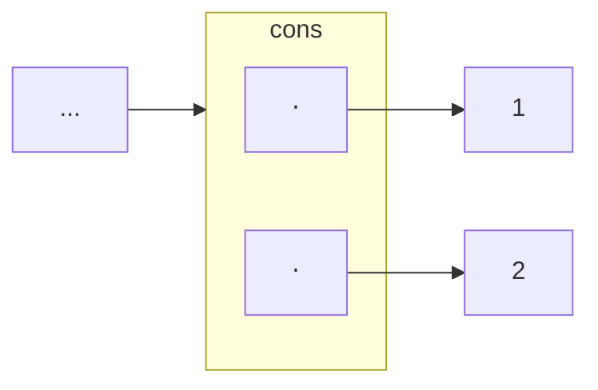
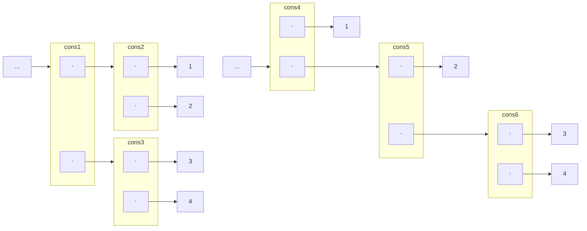

# Глава 2

## Глава 2. Построение абстракций с помощью данных

В этой главе мы обращаемся к другой важной характеристике всякого языка программирования: 
тем средствам, которые он предоставляет для создания абстракций с помощью сочетания 
объектов данных и построения _составных данных_ (_compound data_).

_Составной объект данных_ (_compound data object_) – это структура данных, 
которая состоит из нескольких элементов данных различных типов. 
Эти элементы могут быть как простыми (например, числа, строки), 
так и сложными (например, массивы, другие составные объекты).

Общий метод отделения частей программы, которые имеют дело с представлением
объектов данных, от тех частей, где эти объекты данных используются, — это мощная
методология проектирования, называемая _абстракция данных_ (_data abstraction_).

Абстракция является методом ограничения сложности. Абстракция данных позволяет возводить полезные 
_барьеры абстракции_ (_abstraction barriers_) между разными частями программы.

Важная идея в работе с составными данными — понятие _замыкания_ (_closure_): 
клей для сочетания объектов данных должен позволять склеивать не только элементарные объекты данных, но и составные. 
Еще одна важная идея состоит в том, что составные объекты данных могут служить 
_стандартными интерфейсами_ (_conventional interfaces_), так, чтобы модули программы могли сочетаться методом подстановки.

_Символьные выражения_ (_symbolic expressions_) — данные, 
элементарные части которых могут быть произвольными символами, а не только числами.

_Обобщенные операции_ (_generic operations_) обрабатывают много различных типов данных. 
Поддержка модульности в присутствии обобщенных операций требует более мощных барьеров абстракции, 
чем тех, что получаются с помощью простой абстракции данных. 
А именно, мы вводим _программирование, управляемое данными_ (_data-directed programming_) как метод, 
который позволяет проектировать представления данных отдельно, 
а затем сочетать их _аддитивно_ (_additively_) (т.е., без модификации).

## 2.1. Введение в абстракцию данных

_Абстракция данных_ (_data abstraction_) — это методология, которая позволяет отделить способ использования 
составного объекта данных от деталей того, как он составлен из элементарных данных.

Основная идея абстракции данных состоит в том, чтобы строить программы, работающие с составными данными, 
так, чтобы иметь дело с «абстрактными данными». 
То есть, используя данные, наши программы не должны делать о них никаких предположений, 
кроме абсолютно необходимых для выполнения поставленной задачи. 
В то же время «конкретное» представление данных определяется независимо от программ, 
которые эти данные используют. Интерфейсом между двумя этими частями системы служит
набор процедур, называемых _селекторами_ (_selectors_) и _конструкторами_ (_constructors_),
реализующих абстрактные данные в терминах конкретного представления. 

### 2.1.1. Пример: арифметические операции над рациональными числами

##### Пары

Для реализации конкретного уровня абстракции данных в нашем языке имеется составная структура, 
называемая [_кортеж_](../../scala/collections/tuple.md) (_tuple_).
Объекты данных, составленные из кортежей, называются _данные со списковой структурой_ (_list-structured data_).

```dotty
opaque type Pair = (Long, Long)
val cons: Pair = (-5, 7)
// cons: Tuple2[Long, Long] = (-5L, 7L)
val car = cons._1
// car: Long = -5L
val cdr = cons._2
// cdr: Long = 7L
```

##### Представление рациональных чисел

Представление рациональных чисел в виде `case class`-а:

```dotty
final case class Rational private (numer: Long, denom: Long):
  import Rational.makeRat

  lazy val print: String = s"$numer/$denom"

  def +(that: Rational): Rational =
    makeRat(numer * that.denom + that.numer * denom, denom * that.denom)

  def -(that: Rational): Rational =
    makeRat(numer * that.denom - that.numer * denom, denom * that.denom)

  def *(that: Rational): Rational =
    makeRat(numer * that.numer, denom * that.denom)

  def /(that: Rational): Rational =
    makeRat(numer * that.denom, denom * that.numer)

  def ===(that: Rational): Boolean =
    numer * that.denom == denom * that.numer

object Rational:
  def makeRat(numer: Long, denom: Long): Rational =
    Rational(numer, denom)

Rational.makeRat(-5, 7).print
// res0: String = "-5/7"
Rational.makeRat(-5, 7) + Rational.makeRat(3, 7)
// res1: Rational = Rational(numer = -14L, denom = 49L)
Rational.makeRat(-5, 7) - Rational.makeRat(3, 7)
// res2: Rational = Rational(numer = -56L, denom = 49L)
Rational.makeRat(-5, 7) * Rational.makeRat(3, 7)
// res3: Rational = Rational(numer = -15L, denom = 49L)
Rational.makeRat(-5, 7) / Rational.makeRat(3, 7)
// res4: Rational = Rational(numer = -35L, denom = 21L)
Rational.makeRat(-5, 7) === Rational.makeRat(-10, 14)
// res5: Boolean = true
```

#### Упражнение 2.1

> Определите улучшенную версию mul-rat, которая принимала бы как положительные, так и отрицательные аргументы.
> Make-rat должна нормализовывать знак так,
> чтобы в случае, если рациональное число положительно, то и его числитель, и знаменатель были бы положительны,
> а если оно отрицательно, то чтобы только его числитель был отрицателен.

```dotty
object Rational:
  def makeRat(numer: Long, denom: Long): Rational =
    val g = gcd(numer, denom)
    val sign = if denom < 0 then -1 else 1
    Rational(sign * numer / g, sign * denom / g)
```

```dotty
Rational.makeRat(14, 49).print
// res7: String = "2/7"
Rational.makeRat(1, 2).print
// res8: String = "1/2"
Rational.makeRat(-1, -2).print
// res9: String = "1/2"
Rational.makeRat(-1, 2).print
// res10: String = "-1/2"
Rational.makeRat(1, -2).print
// res11: String = "-1/2"
```

[Scala worksheet](https://scastie.scala-lang.org/B9k1gvnISCqx9BEH9pEvtw)

### 2.1.2. Барьеры абстракции

#### Упражнение 2.2

> Рассмотрим задачу представления отрезков прямой на плоскости.
> Каждый отрезок представляется как пара точек: начало и конец.
> Определите конструктор make-segment и селекторы startsegment и end-segment,
> которые определяют представление отрезков в терминах точек.
> Далее, точку можно представить как пару чисел: координата x и координата y.
> Соответственно, напишите конструктор make-point и селекторы x-point и y-point, которые определяют такое представление.
> Наконец, используя свои селекторы и конструктор, напишите процедуру midpointsegment,
> которая принимает отрезок в качестве аргумента и возвращает его середину
> (точку, координаты которой являются средним координат концов отрезка).
> Чтобы опробовать эти процедуры, Вам потребуется способ печатать координаты точек

```dotty
final case class Point(x: Double, y: Double):
  override def toString(): String = s"($x,$y)"

final case class Segment(start: Point, end: Point):
  lazy val midpoint: Point = Point((start.x + end.x) / 2, (start.y + end.y) / 2)

Segment(Point(1, 0), Point(0, 1)).midpoint.toString
// res12: String = "(0.5,0.5)"
```

[Scala worksheet](https://scastie.scala-lang.org/3SvZKbYZRPaSqiCyNtwikQ)

#### Упражнение 2.3

> Реализуйте представление прямоугольников на плоскости.
> (Подсказка: Вам могут потребоваться результаты упражнения 2.2.)
> Определите в терминах своих конструкторов и селекторов процедуры, которые вычисляют периметр и площадь прямоугольника.
> Теперь реализуйте другое представление для прямоугольников.
> Можете ли Вы спроектировать свою систему с подходящими барьерами абстракции так,
> чтобы одни и те же процедуры вычисления периметра и площади работали с любым из Ваших представлений?

```dotty
final case class Point(x: Double, y: Double):
  override def toString(): String = s"($x,$y)"

final case class Segment(start: Point, end: Point):
  lazy val midpoint: Point = Point((start.x + end.x) / 2, (start.y + end.y) / 2)
  lazy val length: Double =
    math.sqrt(math.pow(start.x - end.x, 2.0) + math.pow(start.y - end.y, 2.0))

final case class Rectangle(
    topLeft: Point,
    topRight: Point,
    bottomRight: Point,
    bottomLeft: Point
):
  private lazy val topSideLength: Double = Segment(topLeft, topRight).length
  private lazy val leftSideLength: Double = Segment(topLeft, bottomLeft).length

  lazy val perimeter: Double =
    2 * (topSideLength + leftSideLength)
  lazy val square: Double =
    topSideLength * leftSideLength

object Rectangle:
  def apply(segment1: Segment, segment2: Segment): Rectangle =
    Rectangle(segment1.start, segment1.end, segment2.start, segment2.end)

val rect = Rectangle(Point(0, 0), Point(1, 0), Point(1, 1), Point(0, 1))
rect.perimeter
// res14: Double = 4.0
rect.square
// res15: Double = 1.0
```

[Scala worksheet](https://scastie.scala-lang.org/WOqHhQ9qRBmR8K0fueiA3g)

### 2.1.3. Что значит слово «данные»?

Данные — это то, что определяется некоторым набором селекторов и конструкторов, 
а также некоторыми условиями, которым эти процедуры должны удовлетворять, чтобы быть правильным представлением.

Пару можно реализовать, используя только одни процедуры:

```dotty
def cons[A, B](a: A, b: B): Boolean => A | B =
  def dispatch(m: Boolean): A | B =
    if m then a else b

  dispatch

def car[A, B](a: A, b: B): A | B =
  cons(a, b)(true)

def cdr[A, B](a: A, b: B): A | B =
  cons(a, b)(false)
```

#### Упражнение 2.4

> Вот еще одно процедурное представление для пар.
> Проверьте для этого представления, что при любых двух объектах x и y (car (cons x y)) возвращает x
> ```
> (define (cons x y)
>   (lambda (m) (m x y)))
> (define (car z)
>   (z (lambda (p q) p)))
> ```
> Каково соответствующее определение cdr?
> (Подсказка: Чтобы проверить, что это работает, используйте подстановочную модель из раздела 1.1.5.)

```dotty
final case class Cons[A](x: A, y: A):
  def lambda(f: (A, A) => A): A =
    f(x, y)

def car[A](z: Cons[A]): A =
  z.lambda((p: A, q: A) => p)

def cdr[A](z: Cons[A]): A =
  z.lambda((p: A, q: A) => q)
```

Рассмотрим цепочку преобразований:

- `(car (cons x y))`
- `(cons x y).lambda((p: A, q: A) => p)`
- `((p: A, q: A) => p)(x, y)`
- `x`

Аналогично для `cdr`.

#### Упражнение 2.5

> Покажите, что можно представлять пары неотрицательных целых чисел,
> используя только числа и арифметические операции, если представлять пару a и b
> как произведение \\(2^{a}*3^{b}\\).
> Дайте соответствующие определения процедур cons, car и cdr.

```dotty
final case class Cons(x: Int, y: Int):
  lazy val cons: Int = math.pow(2, x).toInt * math.pow(3, y).toInt

  def degreeOfFactor(a: Int): Int =
    def loop(n: Int, count: Int): Int =
      if n % a == 0 then loop(n / a, count + 1)
      else count 
    loop(cons, 0)

def car(z: Cons): Int =
  z.degreeOfFactor(2)

def cdr(z: Cons): Int =
  z.degreeOfFactor(3)
```

#### Упражнение 2.6

> Если представление пар как процедур было для Вас еще недостаточно сумасшедшим,
> то заметьте, что в языке, который способен манипулировать процедурами,
> мы можем обойтись и без чисел (по крайней мере, пока речь идет о неотрицательных числах),
> определив 0 и операцию прибавления 1 так:
> ```
> (define zero (lambda (f) (lambda (x) x)))
> 
> (define (add-1 n)
>   (lambda (f) (lambda (x) (f ((n f) x)))))
> ```
> Такое представление известно как числа Чёрча (Church numerals),
> по имени его изобретателя, Алонсо Чёрча, того самого логика, который придумал λ-исчисление.
> Определите one (единицу) и two (двойку) напрямую (не через zero и add-1).
> (Подсказка: вычислите (add-1 zero) с помощью подстановки.)
> Дайте прямое определение процедуры сложения + (не в терминах повторяющегося применения add-1).

Число Чёрча можно определить как n-кратное применение заданной функции к аргументу.

Например, вот так:

```dotty
def zero[A](f: A => A): A => A = x => x

def add1[A](f: A => A, n: Int): A => A =
  if n == 0 then zero(f)
  else (a: A) => add1(f, n - 1)(a)
```

Тогда единица - это однократное применение функции, двойка - двукратное, а сложение `a` и `b` -
это применение функции `f` к аргументу `a + b` раз.

### 2.1.4. Расширенный пример: интервальная арифметика

#### Упражнение 2.7

> Программа Лизы неполна, поскольку она не определила, как реализуется абстракция интервала.
> Вот определение конструктора интервала: `(define (make-interval a b) (cons a b))`
> Завершите реализацию, определив селекторы upper-bound и lower-bound.

```dotty
final case class Interval(a: Double, b: Double):
  lazy val upperBound: Double = math.max(a, b)
  lazy val lowerBound: Double = math.min(a, b)

  def add(that: Interval): Interval =
    Interval(
      this.lowerBound + that.lowerBound,
      this.upperBound + that.upperBound
    )

  def mul(that: Interval): Interval =
    val p1 = this.lowerBound * that.lowerBound
    val p2 = this.lowerBound * that.upperBound
    val p3 = this.upperBound * that.lowerBound
    val p4 = this.upperBound * that.upperBound
    Interval(
      math.min(math.min(p1, p2), math.min(p3, p4)),
      math.max(math.max(p1, p2), math.max(p3, p4))
    )

  def div(that: Interval): Interval =
    mul(Interval(1.0 / that.upperBound, 1.0 / that.lowerBound))
```

[Scala worksheet](https://scastie.scala-lang.org/vZmsk52FRryWBvPmGz1bvA)

#### Упражнение 2.8

> Рассуждая в духе Лизы, опишите, как можно вычислить разность двух интервалов.
> Напишите соответствующую процедуру вычитания, называемую sub-interval.

```dotty
def sub(that: Interval): Interval =
  Interval(
    this.lowerBound - that.upperBound,
    this.upperBound - that.lowerBound
  )
```

#### Упражнение 2.9

> Радиус (width) интервала определяется как половина расстояния между его верхней и нижней границами.
> Радиус является мерой неопределенности числа, которое обозначает интервал.
> Есть такие математические операции, для которых радиус результата зависит только от радиусов интервалов-аргументов,
> а есть такие, для которых радиус результата не является функцией радиусов аргументов.
> Покажите, что радиус суммы (или разности) двух интервалов зависит только от радиусов интервалов,
> которые складываются (или вычитаются).
> Приведите примеры, которые показывают, что для умножения или деления это не так.

```dotty
lazy val width: Double = (upperBound - lowerBound) / 2.0
```

Радиус суммы интервалов будет вычисляться так:

- `((this.upperBound + that.upperBound) - (this.lowerBound + that.lowerBound)) / 2.0`
- `((this.upperBound - this.lowerBound) / 2.0 + (that.upperBound - that.lowerBound) / 2.0)`
- `this.width + that.width`

Радиус разности интервалов будет вычисляться так:

- `((this.upperBound - that.lowerBound) - (this.lowerBound - that.upperBound)) / 2.0`
- `((this.upperBound - this.lowerBound) / 2.0 + (that.upperBound - that.lowerBound) / 2.0)`
- `this.width + that.width`

С умножением и делением ситуация иная: если взять два интервала радиуса `1`: `(0, 2)` и `(2, 4)`,
то произведением интервалов будет интервал `(0, 8)` с радиусом `4`,
а результат деления - интервал `(0, 1)` с радиусом `0.5`.

#### Упражнение 2.10

> Бен Битобор, системный программист-эксперт, смотрит через плечо Лизы и замечает:
> неясно, что должно означать деление на интервал, пересекающий ноль.
> Модифицируйте код Лизы так, чтобы программа проверяла это условие и сообщала об ошибке, если оно возникает.

```dotty
def div(that: Interval): Option[Interval] =
  if that.lowerBound <= 0.0 && that.upperBound >= 0.0 then None
  else Some(mul(Interval(1.0 / that.upperBound, 1.0 / that.lowerBound)))
```

#### Упражнение 2.11

> Проходя мимо, Бен делает туманное замечание:
> «Если проверять знаки концов интервалов, можно разбить mul-interval на девять случаев,
> из которых только в одном требуется более двух умножений».
> Перепишите эту процедуру в соответствии с предложением Бена.

```dotty
def mul(that: Interval): Interval =
  (
    this.lowerBound < 0,
    this.upperBound < 0,
    that.lowerBound < 0,
    that.upperBound < 0
  ) match
    case (true, true, true, true) =>
      Interval(
        this.upperBound * that.upperBound,
        this.lowerBound * that.lowerBound
      )
    case (true, true, true, false) =>
      Interval(
        this.lowerBound * that.upperBound,
        this.lowerBound * that.lowerBound
      )
    case (true, true, false, false) =>
      Interval(
        this.lowerBound * that.upperBound,
        this.upperBound * that.lowerBound
      )
    case (true, false, true, true) =>
      Interval(
        this.upperBound * that.lowerBound,
        this.lowerBound * that.lowerBound
      )
    case (true, false, true, false) =>
      val p1 = this.lowerBound * that.lowerBound
      val p2 = this.lowerBound * that.upperBound
      val p3 = this.upperBound * that.lowerBound
      val p4 = this.upperBound * that.upperBound
      Interval(
        math.min(p2, p3),
        math.max(p1, p4)
      )
    case (true, false, false, false) =>
      Interval(
        this.lowerBound * that.upperBound,
        this.upperBound * that.upperBound
      )
    case (false, false, true, true) =>
      Interval(
        this.upperBound * that.lowerBound,
        this.lowerBound * that.upperBound
      )
    case (false, false, true, false) =>
      Interval(
        this.upperBound * that.lowerBound,
        this.upperBound * that.upperBound
      )
    case (false, false, false, false) =>
      Interval(
        this.lowerBound * that.lowerBound,
        this.upperBound * that.upperBound
      )
```

#### Упражнение 2.12

> Определите конструктор make-center-percent,
> который принимает среднее значение и погрешность в процентах и выдает требуемый интервал.
> Нужно также определить селектор percent, который для данного интервала выдает погрешность в процентах.
> Селектор center остается тем же, что приведен выше.

```dotty
final case class Interval(a: Double, b: Double):
  lazy val upperBound: Double = math.max(a, b)
  lazy val lowerBound: Double = math.min(a, b)
  lazy val center: Double = (upperBound + lowerBound) / 2.0
  lazy val width: Double = (upperBound - lowerBound) / 2.0
  lazy val percent: Double = (width / center) * 100

  // ...

object Interval:
  def makeCenterWidth(center: Double, width: Double): Interval =
    Interval(center - width, center + width)

  def makeCenterPercent(center: Double, percent: Double): Interval =
    val width: Double = percent * center / 100.0
    makeCenterWidth(center, width)
```

#### Упражнение 2.13

> Покажите, что, если предположить, что погрешность составляет малую долю величины интервала,
> то погрешность в процентах произведения двух интервалов можно получить
> из погрешности в процентах исходных интервалов по простой приближенной формуле.
> Задачу можно упростить, если предположить, что все числа положительные.

Рассмотрим произведение двух интервалов с маленькой погрешностью:

- `Interval(c1 - w1, c1 + w1) * Interval(c2 - w2, c2 + w2)`
- `Interval((c1 - w1) * (c2 - w2), (c1 + w1) * (c2 + w2))`
- `mulCenter = ((c1 * c2 + w1 * c2 + w2 * c1 + w1 * w2) + (c1 * c2 - w1 * c2 - w2 * c1 + w1 * w2)) / 2`
- `mulCenter = (c1 * c2 + w1 * w2)`
- т.к. погрешность малая величина, то слагаемым `w1 * w2` можно пренебречь
- `mulWidth = ((c1 * c2 + w1 * c2 + w2 * c1 + w1 * w2) - (c1 * c2 - w1 * c2 - w2 * c1 + w1 * w2)) / 2`
- `mulWidth = (w1 * c2 + w2 * c1)`
- `mulPercent = ((w1 * c2 + w2 * c1) / (c1 * c2)) * 100 = (w1 / c1) * 100 + (w2 / c2) * 100`
- таким образом погрешность произведения приближенно равна сумме погрешностей множителей

#### Упражнение 2.14

> Покажите, что Дайко прав.
> Исследуйте поведение системы на различных арифметических выражениях.
> Создайте несколько интервалов A и B и вычислите с их помощью выражения A/A и A/B.
> Наибольшую пользу Вы получите, если будете использовать интервалы,
> радиус которых составляет малую часть от среднего значения.
> Исследуйте результаты вычислений в форме центр/проценты (см. упражнение 2.12).

```dotty
def par1(r1: Interval, r2: Interval): Option[Interval] =
  (r1.mul(r2)).div(r1.add(r2))

def par2(r1: Interval, r2: Interval): Option[Interval] =
  for
    one <- Interval(1, 2).div(Interval(1, 2))
    oneDivR1 <- one.div(r1)
    oneDivR2 <- one.div(r2)
    result <- one.div(oneDivR1.add(oneDivR2))
  yield result

val r1 = Interval.makeCenterWidth(10, 0.01)
// r1: Interval = Interval(a = 9.99, b = 10.01)
val r2 = Interval.makeCenterWidth(20, 0.01)
// r2: Interval = Interval(a = 19.99, b = 20.01)
par1(r1, r2)
// res17: Option[Interval] = Some(
//   value = Interval(a = 6.652235176548966, b = 6.681124082721815)
// )
par2(r1, r2)
// res18: Option[Interval] = Some(
//   value = Interval(a = 1.6652776851234157, b = 26.6888874083944)
// )
```

Методы действительно отдают различные результаты, потому что деление интервала на себя (A/A) - это не единица,
а интервал, имеющий небольшую погрешность.

[Scala worksheet](https://scastie.scala-lang.org/56fiIZVmSTitSmDRQmMFtw)

#### Упражнение 2.15

> Ева Лу Атор, другой пользователь Лизиной программы, тоже заметила, что алгебраически эквивалентные, но различные выражения могут давать разные результаты. Она говорит, что формула для
вычисления интервалов, которая использует Лизину систему, будет давать более узкие границы
погрешности, если ее удастся записать так, чтобы ни одна переменная, представляющая неточную величину, не повторялась. Таким образом, говорит она, par2 «лучше» как программа для
параллельных резисторов, чем par1. Права ли она? Почему?

[SICP section 2.1.4 - Eli Bendersky](https://eli.thegreenplace.net/2007/07/27/sicp-section-214)

#### Упражнение 2.16

> Объясните в общем случае, почему эквивалентные алгебраические выражения могут давать разные
результаты. Можете ли Вы представить себе пакет для работы с интервальной арифметикой,
который бы не обладал этим недостатком, или такое невозможно? (Предупреждение: эта задача
очень сложна.)

[SICP section 2.1.4 - Eli Bendersky](https://eli.thegreenplace.net/2007/07/27/sicp-section-214)

## 2.2. Иерархические данные и свойство замыкания

Представление (cons 1 2) в виде стрелочной диаграммы:



В этом представлении, которое называется _стрелочная диаграмма_ (_box-and-pointer notation_),
каждый объект изображается в виде _стрелки_ (_pointer_), указывающей на какую-нибудь ячейку. 
Ячейка, изображающая элементарный объект, содержит представление этого объекта. 
Например, ячейка, соответствующая числу, содержит числовую константу.
Изображение пары состоит из двух ячеек, причем верхняя из них содержит (указатель на) car этой пары, а нижняя — ее cdr.

На диаграмме ниже показаны два способа соединить числа 1, 2, 3 и 4 при помощи пар:

- `((1, 2), (3, 4))`
- `(1, (2, (3, 4)))`



Возможность создавать пары, элементы которых сами являются парами, 
определяет значимость списковой структуры как средства представления данных. 
Мы называем эту возможность _свойством замыкания_ (_closure property_) для cons. 
В общем случае, операция комбинирования объектов данных обладает свойством замыкания в том случае,
если результаты соединения объектов с помощью этой операции сами могут соединяться этой же операцией. 
Замыкание — это ключ к выразительной силе для любого средства комбинирования, 
поскольку оно позволяет строить _иерархические_ (_hierarchical_) структуры, 
то есть структуры, составленные из частей, которые сами составлены из частей, и так далее.

### 2.2.1. Представление последовательностей

Одна из полезных структур, которые можно построить с помощью пар — это _последовательность_ (_sequence_), 
то есть упорядоченная совокупность объектов данных.

`Cons(1, Cons(2, Cons(3, Cons(4, Nil))))` - такая последовательность пар, 
порождаемая вложенными cons-ами, называется _список_ (_list_).
Или более кратко - `1 :: 2 :: 3 :: 4 :: Nil`.
Значение `Nil`, которым завершается цепочка пар, можно рассматривать как последовательность без элементов, 
_пустой список_ (_empty list_). 
Слово nil произошло от стяжения латинского nihil, что значит «ничто».

#### Операции со списками

Процедура `list-ref` берет в качестве аргументов список и число n и возвращает n-й элемент списка. 
Обычно элементы списка нумеруют, начиная с 0. Метод вычисления `list-ref` следующий:

- Если n = 0, `list-ref` должна вернуть car списка.
- В остальных случаях `list-ref` должна вернуть (n − 1)-й элемент от cdr списка.

```dotty
def listRef[A](items: List[A], n: Int): Option[A] =
  if n <= 0 then items.headOption
  else
    items match
      case Nil          => None
      case head :: tail => listRef(tail, n - 1)

listRef(List(1, 4, 9, 16, 25), 3)
// Some(16)
```

Процедура `length`, которая возвращает число элементов в списке:

```dotty
def length[A](items: List[A]): Int =
  items match
    case Nil       => 0
    case _ :: tail => 1 + length(tail)

length(List(1, 3, 5, 7))
// 4
```

Процедура `length` реализует простую рекурсивную схему. Шаг редукции таков:

- Длина любого списка равняется 1 плюс длина cdr этого списка

Этот шаг последовательно применяется, пока мы не достигнем базового случая:

- Длина пустого списка равна `0`.

Мы можем вычислить `length` и в итеративном стиле:

```dotty
def length[A](items: List[A]): Int =
  @tailrec
  def loop(items: List[A], l: Int): Int =
    items match
      case Nil       => l
      case _ :: tail => loop(tail, l + 1)

  loop(items, 0)

length(List(1, 3, 5, 7))
// 4
```

`Append` также реализуется по рекурсивной схеме. 
Чтобы соединить списки `list1` и `list2`, нужно сделать следующее:

- Если список `list1` пуст, то результатом является просто `list2`.
- В противном случае, нужно соединить `cdr` от `list1` с `list2`, 
  а к результату прибавить `car` от `list1` с помощью `cons`:

```dotty
def append[A](list1: List[A], list2: List[A]): List[A] =
  list1 match
    case Nil => list2
    case head :: tail =>
      head :: append(tail, list2)

append(List(1, 4, 9, 16, 25), List(1, 3, 5, 7))
// List(1, 4, 9, 16, 25, 1, 3, 5, 7)
```

#### Упражнение 2.17

> Определите процедуру `last-pair`, которая возвращает список,
> содержащий только последний элемент данного (непустого) списка.
> (last-pair (list 23 72 149 34))
> (34)

```dotty
def lastPair[A](list: List[A]): List[A] =
  list match
    case Nil      => Nil
    case h :: Nil => List(h)
    case _ :: t   => lastPair(t)

lastPair(List(23, 72, 149, 34)) 
// List(34)
```

#### Упражнение 2.18

> Определите процедуру `reverse`, которая принимает список как аргумент и возвращает список,
> состоящий из тех же элементов в обратном порядке:
> (reverse (list 1 4 9 16 25))
> (25 16 9 4 1)

```dotty
def reverse[A](list: List[A]): List[A] =
  list match
    case Nil => Nil
    case h :: t   => t.reverse :+ h

reverse(List(1, 4, 9, 16, 25)) // List(25, 16, 9, 4, 1)
```

#### Упражнение 2.19

> Рассмотрим программу подсчета способов размена из раздела 1.2.2. 
> Было бы приятно иметь возможность легко изменять валюту, которую эта программа использует, 
> так, чтобы можно было, например, вычислить, сколькими способами можно разменять британский фунт. 
> Эта программа написана так, что знание о валюте распределено между процедурами `first-denomination` 
> и `count-change` (которая знает, что существует пять видов американских монет). 
> Приятнее было бы иметь возможность просто задавать список монет, которые можно использовать при размене.
> 
> Мы хотим переписать процедуру `cc` так, чтобы ее вторым аргументом был список монет, 
> а не целое число, которое указывает, какие монеты использовать. 
> Тогда у нас могли бы быть списки, определяющие типы валют:
> 
> `val usCoins = List(50, 25, 10, 5, 1)`
> 
> `val ukCoins = List(100, 50, 20, 10, 5, 2, 1, 0.5)`
>
> Можно было бы вызывать `cc` следующим образом:
> 
> `cc(100.0, usCoins) // 292`
> 
> Это потребует некоторых изменений в программе `cc`. 
> Ее форма останется прежней, но со вторым аргументом она будет работать иначе, вот так:
> 
> ```dotty
> def noMore(coinValues: List[Double]): Boolean = ???
> 
> def exceptFirstDenomination(coinValues: List[Double]): List[Double] = ???
> 
> def firstDenomination(coinValues: List[Double]): Double = ???
> 
> def cc(amount: Double, coinValues: List[Double]): Int =
>   if amount == 0 then 1
>   else if amount < 0 || noMore(coinValues) then 0
>   else
>     cc(amount, exceptFirstDenomination(coinValues)) +
>     cc(amount - firstDenomination(coinValues), coinValues)
> ```
> 
> Определите процедуры `firstDenomination`, `exceptFirstDenomination` и `noMore` 
> в терминах элементарных операций над списковыми структурами. 
> Влияет ли порядок списка `coinValues` на результат, получаемый `cc`? 
> Почему?

```dotty
def noMore(coinValues: List[Double]): Boolean =
  coinValues match
    case Nil => true
    case _   => false

def exceptFirstDenomination(coinValues: List[Double]): List[Double] =
  coinValues match
    case Nil    => Nil
    case _ :: t => t

def firstDenomination(coinValues: List[Double]): Double =
  coinValues match
    case Nil    => 0.0
    case h :: _ => h
```

[Scala worksheet](https://scastie.scala-lang.org/2Yd4XGN2RKicv3pFSWUepA)

Порядок списка `coinValues` на результат не влияет, потому что вне зависимости от того, какая монета идет первой,
все варианты можно разделить на две категории: сумма использует первую монету или не использует.

#### Упражнение 2.20

> Процедуры `+`, `*` и `list` принимают произвольное число аргументов. 
> Один из способов определения таких процедур состоит в использовании _точечной записи_ (_dotted-tail notation_). 
> В определении процедуры список параметров с точкой перед именем последнего члена означает, 
> что, когда процедура вызывается, начальные параметры (если они есть) будут иметь в качестве значений 
> начальные аргументы, как и обычно, 
> но значением последнего параметра будет _список_ всех оставшихся аргументов. 
> Например, если дано определение
> 
> `(define (f x y . z) <тело>)`
> 
> то процедуру `f` можно вызывать с двумя и более аргументами. Если мы вычисляем
> 
> `(f 1 2 3 4 5 6)`
> 
> то в теле `f` переменная `x` будет равна `1`, `y` будет равно `2`, а `z` будет списком `(3 4 5 6)`. 
> Если дано определение
> 
> `(define (g . w) <тело>)`
> 
> то процедура `g` может вызываться с нулем и более аргументов. Если мы вычислим
> 
> `(g 1 2 3 4 5 6)`
> 
> то в теле `g` значением переменной `w` будет список `(1 2 3 4 5 6)`.
> 
> Используя эту нотацию, напишите процедуру `same-parity`, которая принимает одно или более целое число 
> и возвращает список всех тех аргументов, у которых четность та же, что у первого аргумента. 
> Например,
> 
> `(same-parity 1 2 3 4 5 6 7)`
> 
> `(1 3 5 7)`
> 
> `(same-parity 2 3 4 5 6 7)`
> 
> `(2 4 6)`

```dotty
import scala.annotation.tailrec

def sameParity(first: Int, others: Int*): List[Int] =
  @tailrec
  def loop(rest: List[Int], acc: List[Int]): List[Int] =
    rest match
      case Nil => acc
      case head :: tail if head % 2 == first % 2 =>
        loop(tail, head :: acc)
      case _ :: tail =>
        loop(tail, acc)

  loop(others.toList, List(first))

sameParity(1, 2, 3, 4, 5, 6, 7)
// List(7, 5, 3, 1)
sameParity(2, 3, 4, 5, 6, 7)
// List(6, 4, 2)
```

#### Отображение списков

Крайне полезной операцией является применение какого-либо преобразования к каждому элементу списка 
и порождение списка результатов. 
Например, следующая процедура умножает каждый элемент списка на заданное число.

```dotty
def scaleList(items: List[Int], factor: Int): List[Int] =
  items match
    case Nil => Nil
    case h :: t =>
      (h * factor) :: scaleList(t, factor)

scaleList(List(1, 2, 3, 4, 5), 10)
// List(10, 20, 30, 40, 50)
```

Мы можем выделить здесь общую идею и зафиксировать ее как схему, 
выраженную в виде процедуры высшего порядка, в точности как в разделе 1.3. 
Здесь эта процедура высшего порядка называется `map`. 
`Map` берет в качестве аргументов процедуру от одного аргумента и список, 
а возвращает список результатов, полученных применением процедуры к каждому элементу списка:

```dotty
def map[A, B](items: List[A], proc: A => B): List[B] =
  items match
    case Nil => Nil
    case h :: t =>
      proc(h) :: map(t, proc)

map(List(-10, 2.5, -11.6, 17), math.abs)
// List(10.0, 2.5, 11.6, 17.0)
map(List(1, 2, 3, 4), x => x * x)
// List(1, 4, 9, 16)
```

Теперь мы можем дать новое определение `scale-list` через `map`:

```dotty
def scaleList(items: List[Int], factor: Int): List[Int] =
  map(items, _ * factor)
```

#### Упражнение 2.21

> Процедура square-list принимает в качестве аргумента список чисел и возвращает список квадратов этих чисел.
> 
> `(square-list (list 1 2 3 4))`
> 
> `(1 4 9 16)`
> 
> Перед Вами два различных определения square-list. Закончите их, вставив пропущенные выражения:
> 
> ```
> (define (square-list items)
>   (if (null? items)
>       nil
>       (cons h??i h??i)))
> 
> (define (square-list items)
>   (map h??i h??i))
> ```

```dotty
def squareList(items: List[Int]): List[Int] =
  items match
    case Nil => Nil
    case h :: t =>
      (h * h) :: squareList(t)

def squareList(items: List[Int]): List[Int] =
  map(items, x => x * x)
```

#### Упражнение 2.22

> Хьюго Дум пытается переписать первую из процедур square-list из упражнения 2.21 так, 
> чтобы она работала как итеративный процесс:
> 
> ```
> (define (square-list items)
>   (define (iter things answer)
>     (if (null? things)
>         answer
>         (iter (cdr things)
>               (cons (square (car things))
>                     answer))))
>   (iter items nil))
> ```
> 
> К сожалению, такое определение square-list выдает список результатов в порядке, обратном желаемому. Почему?
> 
> Затем Хьюго пытается исправить ошибку, обменяв аргументы cons:
> 
> ```
> (define (square-list items)
>   (define (iter things answer)
>     (if (null? things)
>         answer
>         (iter (cdr things)
>               (cons answer
>                     (square (car things))))))
>   (iter items nil))
> ```
> 
> И так программа тоже не работает. Объясните это.

В первом случае каждый следующий элемент списка после преобразования добавляется в начало ответа. 
В результате, после всех преобразований в начале итогового ответа будет преобразованный
последний элемент исходного списка, а элементы будут идти в обратном порядке от исходного.

Во втором случае мы получаем не список элементов, а список от многих списков: 
`List(List(List(List(List(List(0), 1), 2), 3), 4), 5)`

#### Упражнение 2.23

> Процедура for-each похожа на map. В качестве аргументов она принимает процедуру и список элементов. 
> Однако вместо того, чтобы формировать список результатов, for-each просто
> применяет процедуру по очереди ко всем элементам слева направо. 
> Результаты применения процедуры к аргументам не используются вообще — 
> for-each применяют к процедурам, которые осуществляют какое-либо действие вроде печати. 
> Например,
> 
> ```
> (for-each (lambda (x) (newline) (display x))
> 
> (list 57 321 88))
> 57
> 321
> 88
> ```
> 
> Значение, возвращаемое вызовом for-each (оно в листинге не показано) может быть каким угодно, например истина. 
> Напишите реализацию for-each.

```dotty
def foreach[A](items: List[A], proc: A => Unit): Unit =
  items match
    case Nil => ()
    case h :: t =>
      proc(h) 
      foreach(t, proc)

foreach(List(1, 2, 3), i => println(i))
```

### 2.2.2. Иерархические структуры

---

**Ссылки:**

- [Abelson Harold, Sussman Gerald Jay, Sussman Julie - Structure and Interpretation of Computer Programs][SICP]
- [Eli Bendersky's solution](https://eli.thegreenplace.net/tag/sicp)
  
[SICP]: https://web.mit.edu/6.001/6.037/sicp.pdf
