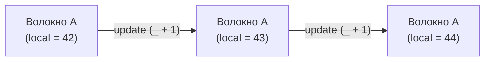
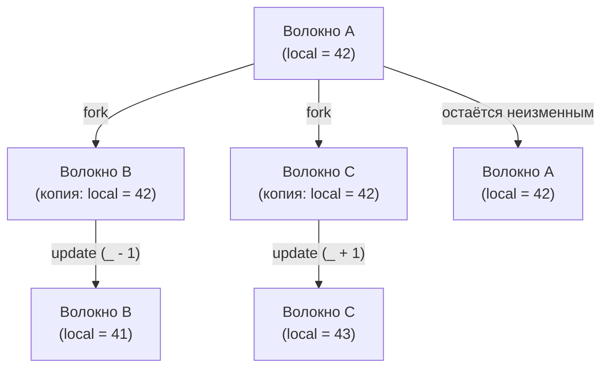
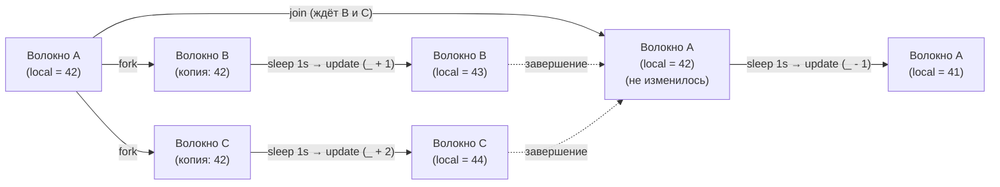

# IOLocal — Контекстно-зависимые данные для волокон

`IOLocal` — это мощный механизм Cats Effect, который позволяет передавать контекстную информацию (contextual data) 
вдоль выполнения волокон (fibers), подобно тому, как `ThreadLocal` работает с потоками в Java, 
но с существенными улучшениями и гарантиями для конкурентного асинхронного программирования.

`IOLocal` предоставляет удобный способ управления контекстом в разных областях видимости. 
В некоторых сценариях `IOLocal` можно рассматривать как альтернативу `cats.data.Kleisli`, 
но с более удобным API и поддержкой конкурентности.

## Чем `IOLocal` не является

`IOLocal` не следует рассматривать как `Ref`, поскольку первый подчиняется другим законам. 
**Ключевое отличие:** `Ref` — это разделяемое состояние, изменения которого видны всем волокнам. 
`IOLocal` — это **контекст волокна**, изменения которого видны **только текущему волокну и его дочерним волокнам** (в момент их создания).

## Основной принцип: изоляция контекста между волокнами

**Золотое правило `IOLocal`:** После создания дочернего волокна (например, с помощью `Spawn[F].start`), 
оно получает **копию** контекста родителя в момент своего создания. 
Дальнейшие изменения контекста в родителе или в разных дочерних волокнах **никак не влияют друг на друга**. 
Каждое волокно работает со своей собственной, изолированной копией.

Это фундаментальное отличие от `ThreadLocal` в Java, где изменения в дочернем потоке могут быть видны родителю 
(в зависимости от типа `ThreadLocal`). В `IOLocal` изоляция полная и предсказуемая.

## Операции над `IOLocal`

`IOLocal[F, A]` предоставляет стандартный набор операций для работы с контекстом:

- `get: F[A]` — получить текущее значение контекста.
- `set(a: A): F[Unit]` — установить новое значение контекста.
- `update(f: A => A): F[Unit]` — атомарно обновить значение контекста.
- `getAndSet(a: A): F[A]` — получить текущее и установить новое значение.
- `getAndUpdate(f: A => A): F[A]` — получить текущее и обновить его.

## Сценарий 1: Операции видны только в текущем волокне

В рамках одного волокна `IOLocal` ведёт себя как обычное изменяемое состояние. Обновления видны последовательно.



```dotty
import cats.effect.{IO, IOLocal}

def increment(idx: Int, local: IOLocal[Int]): IO[Unit] =
  local.update(_ + 1) >>
    local.get.flatMap(current => IO.println(s"update $idx: $current"))

val program =
  for
    local   <- IOLocal[Int](42)
    _       <- increment(1, local)
    _       <- increment(2, local)
    current <- local.get
    _       <- IO.println(s"fiber A: $current")
  yield ()

// Вывод:
// update 1: 43
// update 2: 44
// fiber A: 44
```

**Вывод:** Волокно A последовательно изменяет своё значение с 42 → 43 → 44.

## Сценарий 2: Дочерние волокна получают копию контекста

Когда волокно создаёт дочерние волокна (через `.start`), 
каждое дочернее волокно получает **копию** `IOLocal` родителя **на момент создания**. 
Последующие изменения в родителе или в дочерних волокнах не влияют друг на друга.



```dotty
import cats.effect.{IO, IOLocal}

def update(name: String, local: IOLocal[Int], f: Int => Int): IO[Unit] =
  local.update(f) >>
    local.get.flatMap(current => IO.println(s"$name: $current"))

val program =
  for
    local   <- IOLocal[Int](42)
    fiberB  <- update("fiber B", local, _ - 1).start
    fiberC  <- update("fiber C", local, _ + 1).start
    _       <- fiberB.joinWithNever
    _       <- fiberC.joinWithNever
    current <- local.get
    _       <- IO.println(s"fiber A: $current")
  yield ()

// Вывод:
// fiber B: 41
// fiber C: 43
// fiber A: 42
```

**Ключевые наблюдения:**

- Волокно B получило копию `42` и уменьшило её до `41`.
- Волокно C получило копию `42` и увеличило её до `43`.
- Волокно A осталось неизменным (`42`).

## Сценарий 3: Изменения в родителе после форка не видны дочерним волокнам

Даже если родитель изменит свой `IOLocal` **после** создания дочерних волокон, эти изменения не будут видны дочерним волокнам. 
Дочерние волокна уже получили свою копию на момент создания.



```dotty
import cats.effect.{IO, IOLocal}

import scala.concurrent.duration.DurationInt

def updateDelayed(name: String, local: IOLocal[Int], f: Int => Int): IO[Unit] =
  IO.sleep(1.second) >>
    local.update(f) >>
    local.get.flatMap(current => IO.println(s"$name: $current"))

val program =
  for
    local  <- IOLocal[Int](42)
    fiberB <- updateDelayed("fiber B", local, _ + 1).start
    fiberC <- updateDelayed("fiber C", local, _ + 2).start
    _      <- fiberB.joinWithNever
    _      <- fiberC.joinWithNever
    _      <- updateDelayed("fiber A", local, _ - 1)
  yield ()

// Вывод:
// fiber B: 43   (42 + 1)
// fiber C: 44   (42 + 2)
// fiber A: 41   (42 - 1)
```

Здесь `fiber A` изменяет свой контекст после того, как `fiberB` и `fiberC` уже были созданы. 
Её изменения (`-1`) применяются только к ней самой и не влияют на дочерние волокна.

## Реальный пример: Распространение TraceId

Одно из самых частых применений `IOLocal` — это сквозная передача идентификаторов трассировки (trace IDs) 
в распределённых системах. Вы можете создать `TraceIdScope`, 
который автоматически распространяет идентификатор через все вызовы в рамках одного волокна.

```dotty
import cats.Monad
import cats.effect.{IO, IOLocal, Sync, Resource}
import cats.effect.std.{Console, Random}
import cats.syntax.flatMap.*
import cats.syntax.functor.*

case class TraceId(value: String)

object TraceId:
  def gen[F[_]: Sync]: F[TraceId] =
    Random.scalaUtilRandom[F].flatMap(_.nextString(8)).map(TraceId(_))

trait TraceIdScope[F[_]]:
  def get: F[TraceId]
  def scope(traceId: TraceId): Resource[F, Unit]

object TraceIdScope:
  def apply[F[_]: {TraceIdScope as ev}]: TraceIdScope[F] = ev

  def fromIOLocal: IO[TraceIdScope[IO]] =
    for
      local <- IOLocal[TraceId](TraceId("global"))
    yield new TraceIdScope[IO]:
      def get: IO[TraceId] =
        local.get

      def scope(traceId: TraceId): Resource[IO, Unit] =
        Resource.make(local.getAndSet(traceId))(previous =>
          local.set(previous)
        ).void

def callRemote[F[_]: {Monad, Console, TraceIdScope}]: F[String] =
  for
    traceId <- TraceIdScope[F].get
    _ <- Console[F].println(s"Processing request. TraceId: ${traceId.value}")
  yield "some response"

def service[F[_]: {Sync, Console, TraceIdScope}]: F[String] =
  for
    traceId <- TraceId.gen[F]
    result  <- TraceIdScope[F].scope(traceId).use(_ => callRemote[F])
  yield result

val program =
  TraceIdScope.fromIOLocal.flatMap { implicit scope =>
    service[IO]
  }
```

**Как это работает:**

1. `TraceIdScope.fromIOLocal` создаёт `IOLocal` с глобальным значением по умолчанию (`TraceId("global")`).
2. `service` генерирует уникальный `TraceId` и вызывает `scope(traceId).use(...)`.
3. `scope` временно заменяет значение `IOLocal` на новый `traceId` для переданного блока кода (`callRemote`). 
   После выхода из блока старое значение восстанавливается.
4. `callRemote` читает текущий `TraceId` через `TraceIdScope[F].get` и выводит его.

Благодаря `Resource.make`, гарантируется, что даже при ошибке или отмене контекст будет восстановлен корректно.

## Продвинутая интеграция: `IOLocal` как `ThreadLocal` для Java-библиотек

Для поддержки интеграции с библиотеками Java, которые полагаются на `ThreadLocal`, 
Cats Effect предоставляет **небезопасный (unsafe)** механизм моста: `IOLocal#unsafeThreadLocal`. 
Это позволяет читать и записывать значение `IOLocal` в контексте текущего выполняющегося потока 
внутри синхронного побочного эффекта (`IO.delay` или `IO.blocking`).

**Пример использования (JVM-специфично):**

```dotty
// Предположим, у нас есть Java-библиотека, использующая ThreadLocal
val javaThreadLocal = new ThreadLocal[String]()
javaThreadLocal.set("global-value")

// Мы хотим связать её с IOLocal для распространения контекста через волокна
val ioLocal = IOLocal[String].unsafeThreadLocal(javaThreadLocal)

val program =
  for
    _     <- ioLocal.set("fiber-specific-value")
    value <- IO.delay {
      // Внутри этого delay значение ThreadLocal уже будет "fiber-specific-value"
      javaThreadLocal.get() // Вернёт "fiber-specific-value", а не "global-value"
    }
    _ <- IO.println(value)
  yield ()
```

**Предостережения и настройка:**

- Для использования этой функции необходимо установить флаг `cats.effect.trackFiberContext=true` 
  (через системное свойство или переменную окружения).
- **Важно:** Включение распространения контекста приводит к снижению производительности до 25% в микротестах Cats Effect. 
  Однако влияние на реальные приложения может быть значительно меньше, особенно если большая часть времени уходит на I/O, а не на CPU.
- Это **небезопасный** API в том смысле, что он нарушает чистоту `IO` (так как взаимодействует с мутабельным `ThreadLocal`). 
  Используйте его только как мост для legacy-библиотек, когда нет другого выхода.

## Резюме и рекомендации

| Характеристика                       | `Ref[F, A]`                      | `IOLocal[F, A]`                                     |
|:-------------------------------------|:---------------------------------|:----------------------------------------------------|
| **Область видимости**                | Глобальная (разделяемая)         | Локальная для волокна                               |
| **Изменения видны другим волокнам**  | Да (все видят)                   | Нет (только копия)                                  |
| **Копирование при `start`**          | Нет (та же ссылка)               | Да (копия значения)                                 |
| **Атомарность обновлений**           | Да (CAS)                         | Да                                                  |
| **Типичное применение**              | Общее состояние, счётчики, кеши  | Контекст запроса, TraceId, пользовательские сессии  |

**Лучшие практики:**

1. **Используйте `IOLocal` для контекстных данных**, которые должны «наследоваться» дочерними волокнами, 
   но не должны влиять на родителя или последователей.
2. **Избегайте использования `IOLocal` как замены `Ref` для часто изменяемых данных.** 
   Частые обновления контекста могут создавать избыточную нагрузку на память и CPU.
3. **Всегда восстанавливайте контекст после временных изменений**, используя `Resource` (как в примере с `scope`). 
   Это гарантирует, что ошибки и отмена не приведут к «утеканию» неправильного контекста.
4. **Интеграцию с Java `ThreadLocal` используйте только по необходимости**, тестируйте влияние на производительность 
   и включайте `cats.effect.trackFiberContext` только в тех средах, где это реально нужно.

---

**Ссылки:**

- [Cats effect documentation][doc]
- [Cats effect IOLocal](https://typelevel.org/cats-effect/docs/core/io-local)
- [Flavors of shared state in Cats Effect](https://blog.kubukoz.com/flavors-of-shared-state/)

[doc]: https://typelevel.org/cats-effect/docs/concepts
