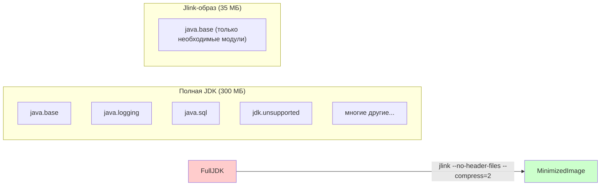



# Jlink Image

**`jlink`** — это инструмент в составе [Java Platform Module System (JPMS)](https://openjdk.org/projects/jigsaw/spec/), впервые появившийся в Java 9. 
Он позволяет создавать **кастомные, минимальные образы JDK** (рантаймы), которые содержат ровно те модули Java, 
которые необходимы вашему приложению, и ничего лишнего.

**Ключевые преимущества `jlink`:**

| Характеристика          | Полная JDK                 | Кастомный образ (jlink)                       |
|:------------------------|:---------------------------|:----------------------------------------------|
| **Размер на диске**     | 200-300 МБ                 | От 20 до 70 МБ (в зависимости от приложения)  |
| **Количество модулей**  | Все модули Java (десятки)  | Только необходимые (часто 5-10)               |
| **Время запуска**       | Стандартное                | Слегка быстрее (меньше классов загружается)   |
| **Потребление памяти**  | Высокое                    | Ниже (меньше классов в metaspace)             |
| **Совместимость**       | Полная (всё включено)      | Ограничена включёнными модулями               |

**Типичные сценарии использования jlink:**

- **Docker-образы:** Вы можете упаковать своё приложение вместе с минимальной JDK, что значительно уменьшает размер образа.
- **Serverless / FaaS:** Меньший размер образа → быстрее холодный старт.
- **Встраиваемые системы:** Каждый мегабайт на счету.
- **Десктопные приложения:** Вы распространяете программу вместе со своей "своей" Java, не требуя от пользователя устанавливать JDK.



## Совместимость Cats Effect с jlink-образами

Приложения Cats Effect зависят **только от модуля `java.base`**. 
Это самый базовый модуль JDK, содержащий `java.lang`, `java.io`, `java.util`, `java.nio`, `java.net` и другие фундаментальные пакеты.

Сборка JDK, созданная с помощью `jlink`, **всегда** содержит `java.base`. 
Поэтому проекты на Cats Effect будут работать «из коробки» на любом jlink-образе, без каких-либо дополнительных флагов или настроек.

```dotty
// Минимальный jlink-образ может быть создан примерно так:
// jlink --add-modules java.base --output minimal-jdk

// Ваше приложение на Cats Effect будет работать на этом образе:
./minimal-jdk/bin/java -jar my-app.jar   # Всё работает!
```

## Единственное ограничение: дампы волокон (Fiber Dumps)

Функциональность дампов волокон (отправка сигнала `SIGUSR1` / `SIGINFO` для вывода дампа в stderr) 
зависит от API `sun.misc.Signal`. Этот класс находится в модуле **`jdk.unsupported`**.

Поскольку стандартный jlink-образ, содержащий только `java.base`, **не включает** `jdk.unsupported`, 
механизм запуска дампов волокон через сигналы POSIX **не будет работать**.

**Что именно не работает:**

- Отправка `kill -USR1 <pid>` в Linux.
- Нажатие `Ctrl + T` в macOS (SIGINFO).
- Любой другой код, вызывающий `sun.misc.Signal`.

**Что продолжает работать:**

- Всё остальное приложение на Cats Effect.
- Программное получение дампа волокон через [MBean](fiber-dumps.md) (поскольку JMX работает через другой механизм, не требующий `sun.misc.Signal`).

## Как восстановить поддержку сигналов: модуль `jdk.unsupported`

Если дампы волокон через сигналы критичны для вас (например, для отладки производственных взаимоблокировок), 
вы можете включить модуль `jdk.unsupported` в ваш кастомный образ JDK.

**Модуль `jdk.unsupported` предоставляет:**

- `sun.misc.Unsafe` (низкоуровневые операции).
- `sun.misc.Signal` (обработка сигналов POSIX).
- Другие внутренние API, не входящие в стандартную спецификацию Java.

### Добавление модуля вручную (через `jlink`)

```bash
# Создаём образ JDK с модулями java.base И jdk.unsupported
jlink --add-modules java.base,jdk.unsupported --output jdk-with-signals

# Проверяем, что модуль включён
./jdk-with-signals/bin/java --list-modules | grep jdk.unsupported
# Вывод: jdk.unsupported@<version>
```

### Настройка в sbt-native-packager

Если вы используете плагин [`sbt-native-packager`](https://www.scala-sbt.org/sbt-native-packager/) 
для сборки Docker-образов или установщиков, вы можете настроить `jlink` так, чтобы он включал `jdk.unsupported`:

```dotty
// build.sbt
enablePlugins(JavaAppPackaging, JlinkPlugin)

// Добавляем модуль jdk.unsupported в образ
jlinkModules += "jdk.unsupported"

// (Опционально) Указываем дополнительные модули, если нужны
jlinkModules ++= Seq("java.logging", "java.sql") // при необходимости
```

После этого плагин автоматически передаст `--add-modules java.base,jdk.unsupported` (и другие) в `jlink` при сборке.

## Полный пример: сборка Docker-образа с минимальной JDK

### 1. Настройка `build.sbt`

```dotty
enablePlugins(JavaAppPackaging, JlinkPlugin)

name := "cats-effect-jlink-demo"
version := "1.0.0"
scalaVersion := "3.8.3"
libraryDependencies += "org.typelevel" %% "cats-effect" % "3.7.0"

// Настройка jlink
jlinkModules += "java.base"        // по умолчанию всегда включён
jlinkModules += "jdk.unsupported"  // для поддержки сигналов

Compile / mainClass := Some("com.example.Main")
```

### 2. Код приложения (как обычно)

```dotty
package com.example

import cats.effect.{IO, IOApp}

object Main extends IOApp.Simple:
  def run: IO[Unit] = IO.println("Hello from minimal JDK!")
```

### 3. Сборка Docker-образа

```bash
sbt docker:publishLocal
```

### 4. Проверка размера

```bash
docker images | grep cats-effect-jlink-demo
# cats-effect-jlink-demo   1.0.0   85 MB   (вместо ~300 MB для полной JDK)
```

## Заключение и рекомендации

| Сценарий                                                                   | Включить `jdk.unsupported`?  | Причина                                                        |
|:---------------------------------------------------------------------------|:-----------------------------|:---------------------------------------------------------------|
| Production-приложение, где важны дампы волокон для отладки                 | ✅ **Да**                     | Вы сможете получать дампы через сигналы.                       |
| Вы используете другую JVM-библиотеку, требующую `sun.misc.Unsafe`          | ✅ **Да**                     | Например, некоторые библиотеки для работы с off-heap памятью.  |
| Минимальный размер Docker-образа важнее отладки                            | ❌ **Нет**                    | Образ будет чуть меньше (на ~5-10 МБ).                         |
| Вы не используете дампы волокон и не вызываете `sun.misc.Unsafe` напрямую  | ❌ **Нет**                    | Оставьте `java.base` только.                                   |
| Вы хотите максимально быстрое время запуска в Serverless                   | ❌ **Нет**                    | Меньше классов → быстрее загрузка.                             |

**Итог:** Cats Effect прекрасно работает на jlink-образах. 
Единственное, что может отсутствовать, — это поддержка сигналов для дампов волокон. 
Если она вам нужна, добавьте модуль `jdk.unsupported`. 
Во всех остальных случаях образ с одним `java.base` будет работать идеально.

---

**Ссылки:**

- [Cats effect documentation][doc]
- [Cats effect Jlink Image](https://typelevel.org/cats-effect/docs/core/jlink)

[doc]: https://typelevel.org/cats-effect/docs/concepts
