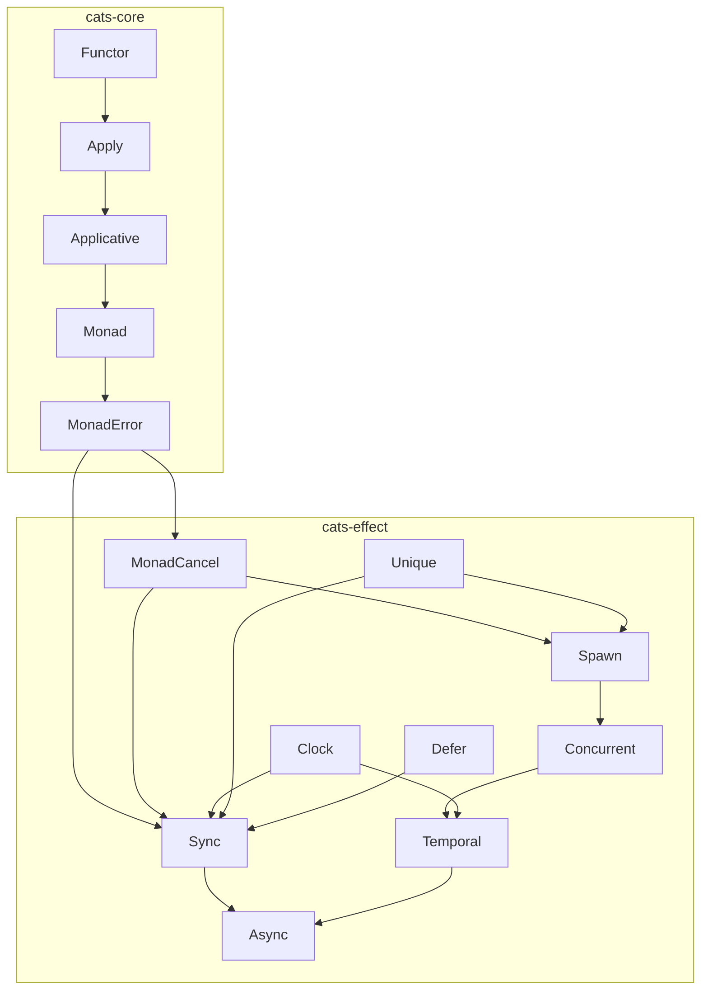



# Классы типов

## Что значит быть эффектом?

Иерархия классов типов в Cats Effect определяет **формальные правила**, которые описывают, 
что значит быть функциональным эффектом. 
Это аналогично тому, как в математике существуют аксиомы для чисел (например, коммутативность сложения).

Когда вы работаете с `IO`, `Resource`, `Kleisli` или любой другой эффектной структурой, 
вы можете полагаться на то, что она удовлетворяет определённым законам. Это позволяет:

- **Рассуждать о коде формально** — знать, что рефакторинг не сломает логику
- **Писать полиморфный код** — функции, работающие с любым эффектом `F[_]`, поддерживающим нужные возможности
- **Композировать абстракции** — строить сложные программы из простых частей

## Категории возможностей эффектов

Cats Effect организует возможности эффектов в **шесть основных категорий**, 
расположенных в порядке возрастания мощности (каждая следующая категория предполагает наличие предыдущих):

### 1. Безопасность ресурсов и отмена (Resource Safety & Cancellation)

**Базовый уровень** для всех остальных возможностей. Позволяет:

- Безопасно освобождать ресурсы (файлы, соединения с БД) при ошибках или отмене
- Отменять выполняющиеся эффекты (например, при тайм-ауте или явной отмене пользователем)
- Защищать критические секции от прерываний

**Ключевые классы типов:** `MonadCancel`, `Spawn`

### 2. Параллельное вычисление (Concurrency)

Позволяет запускать несколько эффектов одновременно и координировать их работу:

- Запуск "волокон" (fibers) — лёгких потоков выполнения
- Гонки (race) между эффектами
- Коммутация между волокнами (кооперативная многозадачность)

**Ключевые классы типов:** `Spawn`, `Concurrent`

### 3. Совместное использование состояния (Shared State)

Примитивы синхронизации для безопасного обмена данными между параллельными процессами:

- Атомарные ячейки (`Ref`)
- Однократно заполняемые переменные (`Deferred`)
- Семафоры (`Semaphore`)
- Очереди (`Queue`)

**Ключевые классы типов:** `Concurrent`

### 4. Взаимодействие со временем (Time)

Работа с временными измерениями:

- Получение текущего времени (стенные часы и монотонное время)
- Приостановка выполнения (`sleep`)
- Установка тайм-аутов

**Ключевые классы типов:** `Clock`, `Temporal`

### 5. Безопасный перехват побочных эффектов — синхронных (Sync Effects)

Преобразование обычного синхронного кода с побочными эффектами в чистое функциональное описание:

- `delay` — обёртка для побочных эффектов (`var`, `println`, `Random.nextInt`)
- `blocking` — изоляция блокирующих операций (`Thread.sleep`, чтение с диска)
- `suspend` — ленивое вычисление эффектов

**Ключевые классы типов:** `Sync`, `Defer`

### 6. Безопасный перехват побочных эффектов — асинхронных (Async Effects)

Интеграция с callback-базированными асинхронными API:

- Преобразование `(Either[Throwable, A] => Unit) => Unit` в `F[A]`
- Поддержка отмены асинхронных операций
- Смена пула потоков выполнения (`evalOn`)

**Ключевые классы типов:** `Async`

## Почему порядок именно такой?

Иерархия построена так, чтобы **невозможно было выразить более мощную концепцию через менее мощную** без "читерства":

- **Параллелизм требует отмены** — без возможности отменить волокно невозможно безопасно реализовать гонки или тайм-ауты
- **Время требует параллелизма** — чтобы наблюдать течение времени, нужна возможность приостановить одно волокно, пока другие выполняются
- **Асинхронность — самая мощная** — имея `async`, можно "под капотом" создать новый поток (`new Thread`) 
  и эмулировать любую другую возможность, но это нарушит законы и безопасность

**Ключевая идея:** чем выше уровень, тем больше гарантий вы получаете, но тем меньше типов эффектов могут его поддерживать. 
Например, `StateT` может быть монадой (`Monad`), но не может быть `Async`, 
потому что не умеет работать с реальным временем и побочными эффектами.

## Возможности из Cats Core

Прежде чем говорить об эффектах, Cats Effect опирается на **базовые абстракции из библиотеки Cats**:

| Класс типа     | Что даёт                                                                 | Пример использования                   |
|----------------|--------------------------------------------------------------------------|----------------------------------------|
| `Functor`      | `map` — преобразование значения                                          | `fa.map(_ + 1)`                        |
| `Apply`        | `ap` — применение функции в контексте, `product` — объединение эффектов  | `(fa, fb).mapN(_ + _)`                 |
| `Applicative`  | `pure` — поднятие значения в контекст                                    | `Applicative[IO].pure(42)`             |
| `Monad`        | `flatMap` — последовательная композиция с зависимостью                   | `fa.flatMap(a => fb.map(b => a + b))`  |
| `MonadError`   | `raiseError` / `handleError` — работа с ошибками                         | `fa.handleErrorWith(e => IO.pure(0))`  |

Эти возможности образуют **фундамент**, на котором строится вся экосистема. 
Без них эффекты были бы просто "запечатанными вычислениями" без возможности комбинации.

## Схема функционального эффекта



Ключевые возможности, добавляемые на каждом уровне:

| Type class          | Ключевая операция                            | Что даёт                                                                           |
|---------------------|----------------------------------------------|------------------------------------------------------------------------------------|
| `Clock`             | `realTime`, `monotonic`                      | Работа со временем (стенные часы и монотонное время)                               |
| `Sync`              | `delay`, `blocking`, `suspend`               | Отложенное синхронное вычисление, изоляция побочных эффектов, блокирующий код      |
| `Unique`            | `unique`                                     | Генерация уникальных токенов (например, для идентификации)                         |
| `Defer`             | `defer`                                      | Ленивое создание эффекта, отсрочка вычисления до выполнения                        |
| `MonadCancel`       | `cancelable`, `uncancelable`, `onCancel`     | Отмена эффектов, защита критических секций, регистрация финализаторов              |
| `Spawn`             | `start`, `racePair`, `never`, `cede`         | Запуск волокон (fibers), гонки, кооперативная многозадачность                      |
| `Concurrent`        | `ref`, `deferred`, `semaphore`, `cancelable` | Примитивы синхронизации (`Ref`, `Deferred`, `Semaphore`) и отменяемые async-вызовы |
| `Temporal`          | `sleep`, `timeout`, `timeoutTo`              | Задержки, тайм-ауты, работа со временем                                            |
| `Async`             | `async`, `evalOn`, `executionContext`        | Асинхронные FFI (`callback → F[A]`), смена пула потоков, интеграция с `Future`     |

## Практическое значение иерархии

### Для пользователей эффектов

Вы можете **точно выражать требования** к коду:

```dotty
// Требуем отмену — нельзя передать простую монаду
def withTimeout[F[_]: Temporal](fa: F[String]): F[String] =
  fa.timeout(1.second)

// Требуем всё — только IO или аналоги
def runServer[F[_]: Async](port: Int): F[Unit] = ...
```

### Для авторов библиотек

Вы можете **писать максимально обобщённый код**:

- Библиотека для работы с Redis может требовать только `Sync` (если клиент синхронный)
- Библиотека для HTTP-клиента может требовать `Async` (асинхронные запросы)
- Библиотека для rate limiting — `Concurrent` (нужны `Ref` и `Deferred`)

### Для понимания кода

Глядя на сигнатуру метода, вы сразу понимаете, **что он может делать**:

- `F[_]: Monad` — только последовательные вычисления, без ошибок и побочных эффектов
- `F[_]: Sync` — может выполнять побочные эффекты, но не может запускать параллельные процессы
- `F[_]: Async` — может всё: и побочные эффекты, и параллелизм, и асинхронность

## Итог: Законы как фундамент надёжности

Когда вы пишете `(1 + 2) + 3`, вы не задумываетесь, что будет вызвано — процессор Intel или ARM. 
Законы арифметики гарантируют одинаковый результат.

**Аналогично**, когда вы используете `MonadCancel`, вы знаете, например, что:

- `uncancelable(uncancelable(fa)) == uncancelable(fa)`
- `onCancel(onCancel(fa, fin1), fin2) == onCancel(fa, fin1 *> fin2)`

Это позволяет:

- **Рефакторить код с уверенностью** — законы гарантируют, что изменения не сломают логику
- **Писать тесты на свойствах** — проверять не конкретные значения, а соблюдение законов
- **Композировать эффекты** — как Lego, зная, что детали совместимы

**Cats Effect — это не просто библиотека для IO. Это язык описания эффектов с формальной семантикой.**

---

**Ссылки:**

- [Ссылка на репозиторий с упражнениями][sample]
- [Cats effect documentation][doc]

[doc]: https://typelevel.org/cats-effect/docs/concepts
[sample]: https://gitverse.ru/scalabook/cats
