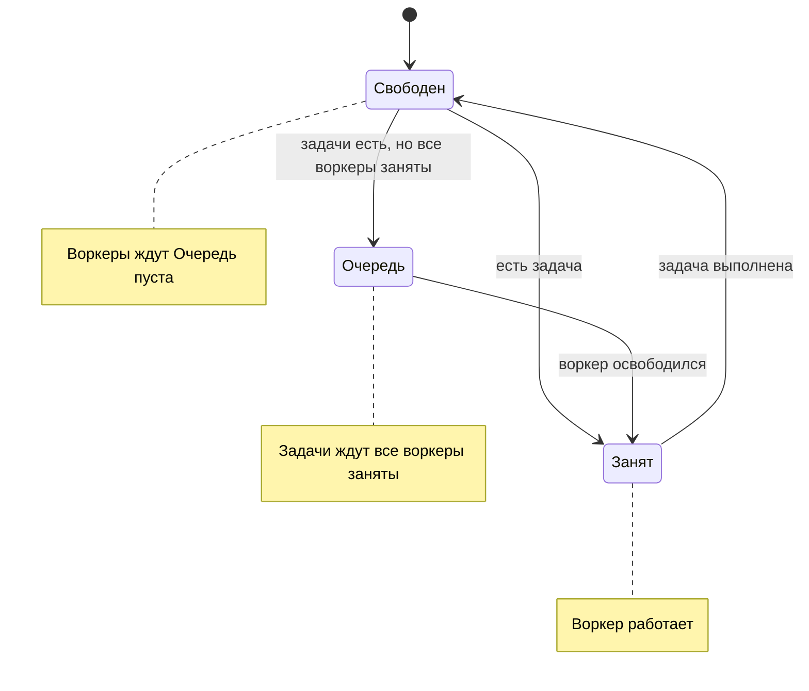

# WorkerPool

Теперь, используя все знания, построим **пул воркеров** на базе `Ref` и `Deferred`:

## Общее назначение

`WorkerPool` — это **конкурентная очередь с пулом воркеров** (аналог thread pool, но на легковесных волокнах).
Позволяет отправлять задачи в очередь, где они обрабатываются фиксированным числом параллельных воркеров.

**Ключевая особенность:** Если воркеры свободны, задача передаётся им **немедленно** без помещения в очередь (оптимизация для низкой нагрузки).

## Реализация конкурентного пула обработчиков задач

```dotty
import cats.*
import cats.effect.*
import cats.effect.implicits.*
import cats.implicits.*
import cats.syntax.all.*

import scala.collection.immutable.Queue
import scala.concurrent.duration.*

object WorkerPoolDemo extends IOApp.Simple:
  case class State[F[_], A](
      queue: Queue[A],
      waiting: Queue[Deferred[F, A]] // ← очередь ожидающих воркеров
  )

  class WorkerPool[F[_]: Concurrent, A](
      state: Ref[F, State[F, A]],
      workers: Int
  ):
    // Добавить задачу в очередь
    def submit(a: A): F[Unit] =
      state.modify {
        // Есть ожидающие воркеры — отдаём первому
        case State(queue, waiting) if waiting.nonEmpty =>
          val (waitingDeferred, newWaiting) = waiting.dequeue
          (State(queue, newWaiting), waitingDeferred.complete(a).void)

        // Нет ожидающих — кладём в очередь
        case State(queue, waiting) =>
          (State(queue.enqueue(a), waiting), Concurrent[F].unit)
      }.flatten

    // Запустить воркеров
    def start(workerTask: A => F[Unit]): Resource[F, Unit] =
      (1 to workers).toList.traverse { _ =>
        Resource.make(
          take.flatMap(workerTask).foreverM.start // запускаем
        )(_.cancel)                               // и отменяем при освобождении
      }.map(_ => ()) // объединяем все Resource в один

    // Забрать задачу (воркер вызывает этот метод)
    private def take: F[A] =
      Concurrent[F].deferred[A].flatMap { waitingDeferred =>
        state.modify {
          // Есть задача в очереди — отдаём немедленно
          case State(queue, waiting) if queue.nonEmpty =>
            val (a, newQueue) = queue.dequeue
            (State(newQueue, waiting), a.pure[F])

          // Нет задач — регистрируем ожидание
          case State(queue, waiting) =>
            (
              State(queue, waiting.enqueue(waitingDeferred)),
              waitingDeferred.get
            )
        }.flatten
      }
  end WorkerPool

  object WorkerPool:
    def make[F[_]: Concurrent, A](workers: Int): Resource[F, WorkerPool[F, A]] =
      Resource.eval(
        // Пустая очередь и пустая очередь ожидающих
        Concurrent[F].ref(State[F, A](Queue.empty, Queue.empty)).map { state =>
          new WorkerPool[F, A](state, workers)
        }
      )

  // Демонстрация параллельной работы
  def run: IO[Unit] =
    val resource: Resource[IO, WorkerPool[IO, String]] =
      for
        pool <- WorkerPool.make[IO, String](3)
        _    <- pool.start { task =>
          // Каждая задача выполняется 1 секунду
          IO.sleep(1.second) *>
            IO.println(
              s"✅ ${Thread.currentThread().getName} обработал: $task [${java.time.LocalTime.now()}]"
            )
        }
      yield pool

    resource.use { pool =>
      for
        _ <- IO.println("🚀 Отправляю 10 задач...")
        _ <- (1 to 10).toList.traverse(i => pool.submit(s"Задача $i"))
        _ <- IO.sleep(5.seconds) // Даём время на обработку
        _ <- IO.println("🏁 Завершаем работу")
      yield ()
    }
  end run
end WorkerPoolDemo
```

## Импорты и зависимости

```dotty
import cats.*
import cats.effect.*
import cats.effect.implicits.*
import cats.implicits.*
import cats.syntax.all.*

import scala.collection.immutable.Queue
import scala.concurrent.duration.*
```

Подключаются основные библиотеки Cats Effect (`IO`, `Concurrent`, `Resource`, `Deferred`, `Ref`),
синтаксические расширения для удобной работы с эффектами (`flatMap`, `traverse`, `foreverM`),
неизменяемая очередь `Queue` из стандартной библиотеки и утилиты для работы с длительностями (`Duration`, `seconds`).

## Модель состояния

```dotty
case class State[F[_], A](
    queue: Queue[A],
    waiting: Queue[Deferred[F, A]]
)
```

Состояние пула в любой момент времени представлено двумя компонентами:

- `queue` — неизменяемая очередь ожидающих задач (типа `Queue[A]`). Если воркеры заняты, задачи попадают сюда.
- `waiting` — неизменяемая очередь `Deferred[F, A]`, который представляет **волокно воркера, ожидающего задачу**. 
  Если воркер свободен, но очередь пуста, он регистрирует себя через этот `Deferred` и засыпает. 
  Как только появляется задача, она «пробуждает» ожидающего воркера через `complete`.

## Класс WorkerPool

```dotty
class WorkerPool[F[_]: Concurrent, A](
    state: Ref[F, State[F, A]],
    workers: Int
):
```

- `F[_]` — тип эффекта (например, `IO`), ограниченный классом типов `Concurrent`. Это даёт доступ к `Ref`, `Deferred`, `start`, `cancel` и другим конкурентным примитивам.
- `A` — тип задач, которые обрабатывает пул (например, `String`, `Request`, `Job` и т.п.).
- `state` — атомарная ссылка (`Ref`) на текущее состояние. Все изменения происходят через атомарные `modify`, что гарантирует потокобезопасность.
- `workers` — количество одновременно работающих воркеров.

### Метод submit — добавить задачу в пул

```dotty
def submit(a: A): F[Unit] =
  state.modify {
    case State(queue, waiting) if waiting.nonEmpty =>
      val (waitingDeferred, newWaiting) = waiting.dequeue
      (State(queue, newWaiting), waitingDeferred.complete(a).void)

    // Нет ожидающих — кладём в очередь
    case State(queue, waiting) =>
      (State(queue.enqueue(a), waiting), Concurrent[F].unit)
  }.flatten
```

`submit` — это атомарная операция, которая решает, куда направить задачу:

**Случай 1: Есть ожидающий воркер** (очередь `waiting` не пустая)

- Берем из очереди ожидающий воркер `waitingDeferred`
- Воркер уже зарегистрирован и ждёт задачу
- Мы не кладём задачу в очередь, а **передаём её напрямую** через `waitingDeferred.complete(a).void`
- Состояние обновляется: `waiting` становится `newWaiting` (очередь без `waitingDeferred`)
- Задача начинает обрабатываться немедленно

**Случай 2: Нет ожидающих воркеров** (`waiting` пустой)

- Все воркеры заняты или ещё не запущены
- Задача помещается в конец очереди: `queue.enqueue(a)`
- Очередь `waiting` остаётся неизменной (пустой)
- Возвращается `Concurrent[F].unit` (ничего не делаем, задача просто ждёт в очереди)

**Важно:** `.flatten` в конце разворачивает результат `modify` (который возвращает `F[F[Unit]]`) в `F[Unit]`. 
Первый слой — это эффект изменения состояния, второй — эффект из выбранной ветки (`waiting.complete(...)` или `unit`).

### Приватный метод take — забрать задачу

```dotty
private def take: F[A] =
  Concurrent[F].deferred[A].flatMap { waitingDeferred =>
    state.modify {
      case State(queue, waiting) if queue.nonEmpty =>
        val (a, newQueue) = queue.dequeue
        (State(newQueue, waiting), a.pure[F])
      case State(queue, waiting) =>
        (
          State(queue, waiting.enqueue(waitingDeferred)),
          waitingDeferred.get
        )
    }.flatten
  }
```

Этот метод вызывается **каждым воркером** в бесконечном цикле. Он либо получает задачу немедленно, либо засыпает до появления задачи.

**Шаг 1:** Создаётся новый `Deferred[A]` с именем `waitingDeferred`. Это будет канал связи между отправителем задачи и спящим воркером.

**Шаг 2:** Атомарно (`modify`) анализируем текущее состояние:

**Случай А: Есть задачи в очереди, и никто не ждёт**

- Извлекаем первую задачу из очереди: `queue.dequeue` возвращает `(задача, очередь_задач_без_первого_элемента)`
- Обновляем состояние: очередь становится короче, `waiting` остаётся неизменным
- Возвращаем задачу как эффект: `a.pure[F]`
- Воркер получает задачу немедленно

**Случай Б: Очередь пуста, никто не ждёт**

- Состояние обновляется: `waiting` теперь содержит наш `Deferred` (воркер регистрируется как ожидающий)
- Возвращаем `waitingDeferred.get` — это эффект, который **блокирует воркера** до тех пор, пока кто-то (в `submit`) не вызовет `waitingDeferred.complete(...)`
- Воркер засыпает, не потребляя ресурсы CPU

**Шаг 3:** `.flatten` — аналогично `submit`, разворачивает вложенный эффект.

### Метод start — запуск воркеров

```dotty
def start(workerTask: A => F[Unit]): Resource[F, Unit] =
  (1 to workers).toList.traverse { _ =>
    Resource.make(
      take.flatMap(workerTask).foreverM.start
    )(_.cancel)
  }.map(_ => ())
```

Этот метод создаёт и запускает `workers` независимых воркеров, каждый из которых работает в бесконечном цикле.

**Шаг 1:** Для каждого воркера (от 1 до `workers`) [создаётся `Resource`](../../std/resource.md):

**При создании ресурса (`Resource.make`):**
- Выполняется `take` — воркер пытается получить задачу (если нет задач — засыпает)
- `flatMap(workerTask)` — полученная задача передаётся пользовательской функции обработки
- `.foreverM` — после завершения обработки воркер повторяет цикл (снова вызывает `take` и т.д.)
- `.start` — запускает этого бесконечного воркера в отдельном волокне и возвращает `Fiber`

**При освобождении ресурса (`Resource.make` второй параметр):** вызывается `_.cancel` — отправляется сигнал отмены волокну воркера

**Шаг 2:** `.traverse` собирает все `Resource[F, Fiber[F]]` в один `Resource[F, List[Fiber[F]]]`

**Шаг 3:** `.map(_ => ())` — результат не важен, мы возвращаем `Unit`, так как нас интересует только управление жизненным циклом 
(отмена воркеров при освобождении ресурса)

**Почему `Resource`?** Потому что воркеры должны жить ровно столько, сколько используется пул. 
При выходе из `resource.use` все воркеры автоматически отменяются, что предотвращает утечку ресурсов.

## Сопутствующий объект WorkerPool

```dotty
object WorkerPool:
  def make[F[_]: Concurrent, A](workers: Int): Resource[F, WorkerPool[F, A]] =
    Resource.eval(
      Concurrent[F].ref(State[F, A](Queue.empty, Queue.empty)).map { state =>
        new WorkerPool[F, A](state, workers)
      }
    )
```

- Фабричный метод для создания экземпляра `WorkerPool`
- Инициализирует начальное состояние: пустая очередь задач, пустая очередь ожидающих воркеров
- Оборачивает создание в `Resource.eval`, потому что создание `Ref` — это эффект
- Возвращает `Resource[F, WorkerPool]`, что позволяет легко комбинировать с `start` в for-comprehension

## Демонстрация использования

```dotty
def run: IO[Unit] =
  val resource: Resource[IO, WorkerPool[IO, String]] =
    for
      pool <- WorkerPool.make[IO, String](3)
      _    <- pool.start { task =>
        IO.sleep(1.second) *>
          IO.println(
            s"✅ ${Thread.currentThread().getName} обработал: $task [${java.time.LocalTime.now()}]"
          )
      }
    yield pool

  resource.use { pool =>
    for
      _ <- IO.println("🚀 Отправляю 10 задач...")
      _ <- (1 to 10).toList.traverse(i => pool.submit(s"Задача $i"))
      _ <- IO.sleep(5.seconds) // Даём время на обработку
      _ <- IO.println("🏁 Завершаем работу")
    yield ()
  }
end run
```

**1. Создание ресурса:**

- Создаётся пул с 3 воркерами
- Запускаются 3 воркера, каждый из которых будет обрабатывать задачи с задержкой 1 секунда
- Функция обработки просто печатает сообщение о выполненной задаче

**2. Использование пула:**

- `use` гарантирует, что после выполнения блока воркеры будут корректно остановлены
- Отправляются 10 задач, каждая через `pool.submit`
- Затем программа ждёт 5 секунд, чтобы все задачи успели обработаться (они обработаются примерно за 4 секунды: 3 секунды на 9 задач в 3 потока и оставшаяся 10-я задачка)

**Ожидаемый вывод:**

```
🚀 Отправляю 10 задач...
✅ io-compute-3 обработал: Задача 2 [13:28:17.827536]
✅ io-compute-11 обработал: Задача 3 [13:28:17.827536]
✅ io-compute-2 обработал: Задача 1 [13:28:17.827552]
✅ io-compute-blocker-3 обработал: Задача 4 [13:28:18.830851]
✅ io-compute-blocker-11 обработал: Задача 5 [13:28:18.830850]
✅ io-compute-blocker-2 обработал: Задача 6 [13:28:18.831298]
✅ io-compute-blocker-16 обработал: Задача 7 [13:28:19.832875]
✅ io-compute-blocker-15 обработал: Задача 9 [13:28:19.832876]
✅ io-compute-blocker-8 обработал: Задача 8 [13:28:19.832876]
✅ io-compute-blocker-5 обработал: Задача 10 [13:28:20.834842]
🏁 Завершаем работу
```

**Как видно:** несмотря на то, что задач 10, а воркеров только 3, все задачи успешно обрабатываются благодаря очереди. 

## Диаграмма работы пула



## Итог

Этот код демонстрирует **элегантную реализацию пула воркеров** на функциональных конкурентных примитивах Cats Effect:

- **Неблокирующий** — воркеры засыпают через `Deferred.get`, не потребляя потоков ОС
- **Атомарный** — все изменения состояния через `Ref.modify`
- **Безопасный по ресурсам** — `Resource` гарантирует отмену всех воркеров
- **Оптимизированный** — задачи передаются ожидающим воркерам без попадания в очередь
- **Масштабируемый** — можно создавать тысячи воркеров, так как каждое волокно легковесно

---

**Ссылки:**

- [Исходный код](https://gitverse.ru/artemkorsakov/scalabook/content/master/examples/src/main/scala/ru/scalabook/libs/cats/effect/WorkerPoolDemo.scala)
- [Cats effect documentation][doc]
- [Cats effect Concurrent](https://typelevel.org/cats-effect/docs/typeclasses/concurrent)

[doc]: https://typelevel.org/cats-effect/docs/concepts
