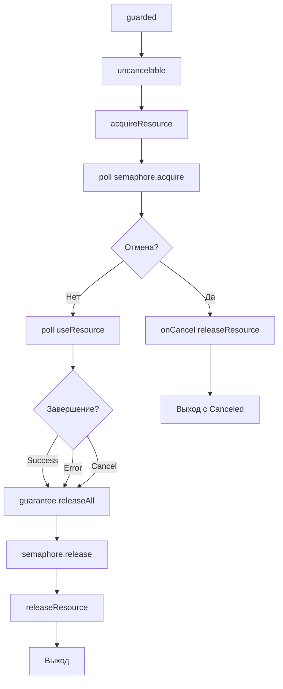



# MonadCancel — управление отменами и ресурсами

## Введение: Жизненный цикл волокна

В Cats Effect каждое волокно (fiber) может завершиться в **трёх различных состояниях**, 
что отражает фундаментальную реальность конкурентного программирования:

```dotty
sealed trait Outcome[F[_], E, A]

// Успешное завершение с результатом
final case class Succeeded[F[_], E, A](fa: F[A]) extends Outcome[F, E, A]

// Завершение с ошибкой
final case class Errored[F[_], E, A](e: E) extends Outcome[F, E, A]

// Отмена (волокно было прервано до завершения)
final case class Canceled[F[_], E, A]() extends Outcome[F, E, A]
```

**Ключевое отличие от обычного `MonadError`:** В традиционных монадах есть только два исхода — успех или ошибка. 
Cats Effect добавляет третий — **отмена**. 
Это означает, что при написании ресурсобезопасного кода мы должны учитывать не только исключения, 
но и возможность того, что наше волокно будет прервано другим волокном или тайм-аутом.

`MonadCancel[F[_], E]` — это класс типов, который расширяет `MonadError[F, E]` из Cats, 
добавляя возможность **гарантированного выполнения финализаторов даже при отмене**.

## Проблема: Почему MonadError недостаточно?

Рассмотрим типичный сценарий — работа с файлом:

```dotty
import cats.effect.IO
import cats.effect.syntax.all.*
import java.io.*

// ❌ ПРОБЛЕМА: Что произойдёт при отмене?
def readFileUnsafe(path: String): IO[String] =
  for
    fis  <- IO(new FileInputStream(path)) // Открыли ресурс
    data <- readFromStream(fis)           // Читаем данные
    _    <- IO(fis.close())               // Закрываем
  yield data
```

**Что может пойти не так:**

1. **Ошибка в `readFromStream`** — `close()` не выполнится → утечка ресурсов
2. **Отмена волокна во время `readFromStream`** — `close()` не выполнится → утечка ресурсов
3. **Отмена прямо перед `close()`** — ресурс останется открытым

`MonadError` позволяет обработать ошибки через `handleError`, но он **не знает об отменах**. `MonadCancel` решает эту проблему.

## Bracket — гарантированное освобождение ресурсов

**`bracket`** — это фундаментальный комбинатор, который работает как функциональный аналог `try`/`finally`, но с поддержкой отмен:

```dotty
def bracket[A, B](acquire: F[A])(use: A => F[B])(release: A => F[Unit]): F[B]
```

**Гарантии `bracket`:**

1. Если `acquire` успешно выполнился, то `release` **будет выполнен обязательно**
2. `release` выполнится даже если:
    - `use` выбросил ошибку
    - Волокно было **отменено** во время `use`
3. `acquire` выполняется **атомарно** и не может быть отменено — либо целиком, либо никак

### Пример с файлом:

```dotty
def copyFile[F[_]: Sync](src: String, dest: String): F[Unit] =
  // bracket гарантирует закрытие ресурсов
  val acquireSrc = Sync[F].delay(new FileInputStream(src))
  val acquireDst = Sync[F].delay(new FileOutputStream(dest))

  acquireSrc.bracket { srcStream =>
    acquireDst.bracket { dstStream =>
      // use: копируем данные
      transferData(srcStream, dstStream)
    } { dstStream =>
      // release для dest
      Sync[F].delay(dstStream.close())
    }
  } { srcStream =>
    // release для src
    Sync[F].delay(srcStream.close())
  }
```

**Что гарантировано:**

- Оба файла будут закрыты даже при отмене в середине копирования
- Если отмена произошла до открытия второго файла, первый всё равно закроется
- Нет утечек ресурсов

### bracket с указанием типа ошибки

```dotty
import cats.effect.MonadCancel
import cats.effect.syntax.all.*

def withResource[F[_], R, A](
    acquire: F[R],
    use: R => F[A],
    release: R => F[Unit]
)(using F: MonadCancel[F, Throwable]): F[A] =
  F.bracket(acquire)(use)(release)

// Использование
withResource(
  acquire = openDatabaseConnection,
  use = conn => executeQuery(conn),
  release = conn => closeConnection(conn)
)
```

## Uncancelable — защита критических секций

**`uncancelable`** — это механизм, который **временно отключает отмену** внутри своего блока.

```dotty
def uncancelable[A](body: (F ~> F) => F[A]): F[A]
```

Параметр `poll` (типа `F ~> F`) — это функция, которая позволяет **выборочно включить отмену** внутри защищённого блока.

### Простой пример:

```dotty
import cats.effect.IO
import cats.effect.syntax.all.*

val protectedBlock: IO[Int] =
  IO.uncancelable: poll =>
    for
      // Эта часть НЕ может быть отменена
      a <- IO(42)
      b <- poll(IO(computeSomething())) // Здесь отмена РАЗРЕШЕНА!
      c <- IO(a + b)                    // Снова защищено
    yield c
```

### Зачем нужен poll?

Без `poll` мы бы не могли создать **прерываемые** операции внутри неотменяемого блока. 
Это привело бы к невозможности реализации многих конкурентных примитивов.

## Реальный пример: Семафор с гарантированным освобождением

Рассмотрим классический пример — защита критической секции с помощью семафора:

```dotty
import cats.effect.{MonadCancel, Sync}
import cats.effect.std.Semaphore
import cats.effect.syntax.all.*
import cats.syntax.all.*

def guarded[F[_], R, A](
    semaphore: Semaphore[F],
    acquireResource: F[R],
    useResource: R => F[A],
    releaseResource: R => F[Unit]
)(using F: MonadCancel[F, Throwable]): F[A] =
  F.uncancelable: poll =>
    for
      // 1. Атомарно получаем ресурс (неотменяемо)
      resource <- acquireResource

      // 2. Пытаемся получить семафор (ОТМЕНЯЕМО!)
      //    Если отмена произошла, освобождаем ресурс
      _ <- poll(semaphore.acquire).onCancel(releaseResource(resource))

      // 3. Освобождаем и ресурс, и семафор
      // 4. Используем ресурс (ОТМЕНЯЕМО!)
      releaseAll = semaphore.release >> releaseResource(resource)
      result <- poll(useResource(resource)).guarantee(releaseAll)
    yield result
```

Этот пример показывает, как правильно комбинировать:

- **`uncancelable`** — защита критических секций
- **`poll`** — выборочное включение отмены
- **`onCancel`** — обработка отмены с очисткой ресурсов
- **`guarantee`** — гарантированное выполнение финализаторов

Представьте, что у вас есть:

1. **Дорогой ресурс** (`R`), который нужно получить и освободить (например, соединение с БД, файловый дескриптор)
2. **Семафор** для ограничения параллельного доступа к этому ресурсу
3. **Пользовательская операция** (`useResource`), которая работает с ресурсом

**Требования к безопасности:**

- Ресурс должен быть **обязательно освобождён** (даже при ошибках и отменах)
- Семафор должен быть **обязательно освобождён** (даже при ошибках и отменах)
- Получение ресурса должно быть **атомарным** (нельзя отменить в середине)
- Ожидание семафора должно быть **прерываемым** (чтобы не зависнуть навсегда)
- Использование ресурса должно быть **прерываемым** (чтобы можно было отменить долгую операцию)

### Сигнатура функции

```dotty
def guarded[F[_], R, A](
    semaphore: Semaphore[F],
    acquireResource: F[R],
    useResource: R => F[A],
    releaseResource: R => F[Unit]
)(using F: MonadCancel[F, Throwable]): F[A] =
```

**Параметры:**

| Параметр           | Тип             | Назначение                                          |
|--------------------|-----------------|-----------------------------------------------------|
| `semaphore`        | `Semaphore[F]`  | Ограничитель параллельного доступа                  |
| `acquireResource`  | `F[R]`          | Как получить ресурс (например, открыть соединение)  |
| `useResource`      | `R => F[A]`     | Что сделать с ресурсом                              |
| `releaseResource`  | `R => F[Unit]`  | Как освободить ресурс                               |

**Возвращает:** `F[A]` — результат использования ресурса

### Шаг 0: Вход в uncancelable

```dotty
F.uncancelable: poll =>
```

**Что происходит:** Мы входим в **критическую секцию**, где отмена **временно отключена**.

**Зачем:** Нам нужно выполнить несколько атомарных операций, которые не должны быть прерваны в середине. 
Если отмена произойдёт внутри `uncancelable`, она будет "отложена" до выхода из блока.

**Важно:** У нас есть параметр `poll` — это функция, которая позволяет **выборочно включить отмену** внутри блока.

### Шаг 1: Атомарное получение ресурса

```dotty
resource <- acquireResource
```

**Отменяемо?** ❌ **НЕТ**

**Почему:** Представьте, что `acquireResource` — это сложная операция, которая:

- Открывает соединение с БД
- Устанавливает параметры
- Начинает транзакцию

Если мы позволим отменить эту операцию в середине, мы можем получить **полу-инициализированный ресурс** в неопределённом состоянии. 
Например, соединение открыто, но транзакция не начата — что тогда освобождать?

**Гарантия:** Благодаря `uncancelable`, эта операция выполнится **целиком или никак**.

### Шаг 2: Получение семафора с обработкой отмены

```dotty
_ <- poll(semaphore.acquire).onCancel(releaseResource(resource))
```

**Отменяемо?** ✅ **ДА** (благодаря `poll`)

**Почему это сложно:**

`semaphore.acquire` может **заблокировать** волокно, если семафор уже занят. 
Мы **хотим**, чтобы другие волокна могли прервать это ожидание. 
Например, если пользователь нажал Ctrl+C или сработал тайм-аут.

**Что делает `poll`:** Он "включает" отмену для внутренней операции. 
Без `poll` вызов `semaphore.acquire` был бы неотменяемым внутри `uncancelable`.

**Что делает `onCancel`:** Если отмена **всё-таки произойдёт** во время ожидания семафора, 
мы должны освободить ресурс `resource`, который мы уже получили на шаге 1.

**Сценарий работы:**

- Нормальный сценарий:
    - `resource` получен
    - `semaphore.acquire()` - ждёт 1 секунду, получает доступ
    - `onCancel` не срабатывает (отмены не было)
- Сценарий с отменой:
    - `resource` получен
    - `semaphore.acquire()` - начал ждать
    - Внешнее волокно вызывает `fiber.cancel()`
    - `poll(semaphore.acquire)` получает сигнал отмены
    - `onCancel(releaseResource(resource))` - ресурс освобождается
    - Волокно завершается с `Canceled()`

**Почему это безопасно:** Если мы не можем получить семафор (потому что нас отменили), то ресурс нам не нужен — мы его освобождаем.

### Шаг 3: Создание комбинированного освобождения

```dotty
releaseAll = semaphore.release >> releaseResource(resource)
```

**Отменяемо?** ❌ **НЕТ** (это просто определение, не выполнение)

**Что это:** Мы создаём **эффект**, который:

1. Освобождает семафор (`semaphore.release`)
2. Освобождает ресурс (`releaseResource(resource)`)

**Важно:** Порядок важен! Сначала освобождаем семафор (чтобы другие волокна могли продолжить), потом ресурс.

### Шаг 4: Использование ресурса с `guarantee`

```dotty
result <- poll(useResource(resource)).guarantee(releaseAll)
```

**Отменяемо?** ✅ **ДА** (благодаря `poll`)

**Что здесь происходит:**

1. **`poll(useResource(resource))`** — выполняем пользовательскую операцию с **включённой отменой**. 
   Это важно, потому что `useResource` может быть долгой (обработка файла, сетевой запрос), и мы должны иметь возможность её прервать.

2. **`.guarantee(releaseAll)`** — гарантируем, что `releaseAll` выполнится **в любом случае**:
   - Если `useResource` успешно завершился → выполняем `releaseAll`
   - Если `useResource` упал с ошибкой → выполняем `releaseAll`
   - Если `useResource` был отменён → выполняем `releaseAll`

**Сравнение `guarantee` и `bracket`:**

```dotty
// guarantee — упрощённая версия bracket
fa.guarantee(finalizer)
// Эквивалентно:
fa.bracket(_ => finalizer)(_ => F.unit)

// bracket — более гибкий, позволяет использовать результат
acquire.bracket(use)(release)
```

### Полная картина: Потоки выполнения

#### Сценарий 1: Успешное выполнение

```
1. Вход в uncancelable
2. resource = acquireResource() ────────────────► Получили ресурс
3. poll(semaphore.acquire) ─────────────────────► Получили семафор
4. poll(useResource(resource)) ─────────────────► Получили результат
5. releaseAll = semaphore.release + releaseResource(resource)
6. Выход из uncancelable
```

#### Сценарий 2: Ошибка в useResource

```
1. Вход в uncancelable
2. resource = acquireResource() ────────────────► Получили ресурс
3. poll(semaphore.acquire) ─────────────────────► Получили семафор
4. poll(useResource(resource)) ──► ОШИБКА!
5. guarantee перехватывает ошибку
6. releaseAll() ────────────────────────────────► Освобождаем семафор и ресурс
7. Ошибка пробрасывается дальше
```

#### Сценарий 3: Отмена во время ожидания семафора

```
1. Вход в uncancelable
2. resource = acquireResource() ────────────────► Получили ресурс
3. poll(semaphore.acquire) ──► НАЧАЛО ОЖИДАНИЯ
4. Внешняя отмена!
5. poll получает сигнал отмены
6. onCancel(releaseResource(resource)) ─────────► Освобождаем ресурс
7. Волокно завершается с Canceled()
8. Семафор НЕ был получен, поэтому не освобождается
```

#### Сценарий 4: Отмена во время useResource

```
1. Вход в uncancelable
2. resource = acquireResource() ────────────────► Получили ресурс
3. poll(semaphore.acquire) ─────────────────────► Получили семафор
4. poll(useResource(resource)) ──► ВНЕЗАПНАЯ ОТМЕНА
5. guarantee перехватывает отмену
6. releaseAll() ────────────────────────────────► Освобождаем семафор и ресурс
7. Волокно завершается с Canceled()
```

### Визуализация: Стек вызовов



Этот паттерн настолько важен, что он вынесен в стандартную библиотеку как `Semaphore.permit.use` и `Resource`.

## Глубокое погружение в семантику poll

### Проблема, которую решает poll

`poll` — это, пожалуй, **самый сложный для понимания** элемент Cats Effect. 
Многие разработчики годами используют библиотеку, но не до конца осознают, почему `poll` работает именно так, а не иначе.

В этом разделе мы разберём **глубинную причину** такого дизайна 
и почему альтернативы (например, гипотетическая функция `cancelable`) привели бы к катастрофическим последствиям.

### Почему poll, а не cancelable?

#### Гипотетическая альтернатива: функция `cancelable`

Представьте, что вместо `poll` у нас была бы функция `cancelable`, которая просто "включает" отмену внутри `uncancelable`:

```dotty
// ❌ ГИПОТЕТИЧЕСКИЙ ДИЗАЙН
F.uncancelable: cancelable =>
  // cancelable просто включает отмену для внутренних операций
  for
    r      <- acquireResource
    _      <- cancelable(semaphore.acquire).onCancel(releaseResource(r))
    result <- cancelable(useResource(r))
  yield result
```

На первый взгляд, это выглядит проще и понятнее.

### Невозможный вопрос: что такое uncancelable при наличии cancelable?

Если у нас есть `cancelable`, который может **включать отмену** в любом месте, возникает фундаментальное противоречие:

**Что означает `uncancelable`, если кто-то всё равно может использовать `cancelable`?**

Давайте рассмотрим пример:

```dotty
// Предположим, у нас есть cancelable
def badProgram[F[_]: MonadCancel]: F[Unit] =
  F.uncancelable: cancelable =>
    // Мы в uncancelable блоке
    F.delay(println("Начало"))

    // Но мы можем включить отмену в любом месте!
    cancelable(F.canceled) // Самоотмена!

    F.delay(println("Конец")) // Выполнится или нет?
```

**Вопрос:** Выполнится ли `println("Конец")`?

Если `cancelable` действительно включает отмену, то `F.canceled` должен прервать выполнение. 
Но тогда `uncancelable` теряет свой смысл — он больше не гарантирует атомарность!

Если `cancelable` **не** включает отмену для `canceled`, то как он должен работать с другими операциями?

### Гонка вооружений между uncancelable и cancelable

Если бы существовал `cancelable`, разработчики могли бы писать такой код:

```dotty
// Абсурдный сценарий с cancelable
F.uncancelable: cancelable1 =>
  F.uncancelable: cancelable2 =>
    cancelable1(     // Включаем отмену через внешний cancelable
      cancelable2(   // Включаем отмену через внутренний cancelable
        F.uncancelable( // И так до бесконечности
          // ... что здесь происходит?
        )
      )
    )
```

Это приводит к **недетерминированному поведению**:

- Какой `cancelable` имеет приоритет?
- Если внутренний `cancelable` включает отмену, а внешний выключает — кто побеждает?
- Можно ли "переопределить" отмену несколько раз?

```dotty
// Пример спора
F.uncancelable: cancelable =>
  // cancelable включает отмену
  cancelable(
    F.uncancelable: _ =>
      // А здесь отмена снова выключена!
      // Но cancelable из внешнего блока всё ещё существует
      // Что делать?!
  )
```

**Ни одна система с такими противоречивыми требованиями не может быть детерминированной.**

### Решение: poll как "аннигилятор", а не "переключатель"

Вместо того чтобы создавать `cancelable`, который **включает** отмену, 
авторы Cats Effect создали `poll`, который **аннигилирует** (отменяет) эффект `uncancelable`.

#### Математическая аналогия

```dotty
// poll "отменяет" свой uncancelable
uncancelable(poll => poll(fa)) === fa

// Это похоже на математическое тождество:
// f(f^(-1)(x)) === x
// где f = uncancelable, f^(-1) = poll
```

### Вложенные uncancelable: правила композиции

#### Сценарий 1: Внутренний poll

```dotty
MonadCancel[F].uncancelable: outer =>
  MonadCancel[F].uncancelable: inner =>
    inner(fa)  // poll внутреннего uncancelable
```

**Разбор:**

1. Внутренний `poll` (через `inner`) **аннигилирует** внутренний `uncancelable`
2. Внешний `uncancelable` остаётся активным
3. Результат: 
   `MonadCancel[F].uncancelable(o => MonadCancel[F].uncancelable(i => i(fa)))` 
   равен `MonadCancel[F].uncancelable(o => fa)`

**Почему:** Внутренний щит отменен, но внешний продолжает защищать.

#### Сценарий 2: Внешний poll внутри внутреннего блока

```dotty
MonadCancel[F].uncancelable: outer =>
  MonadCancel[F].uncancelable: inner =>
    outer(fa)  // poll внешнего uncancelable
```

**Разбор:**

1. `outer(fa)` пытается аннигилировать **внешний** `uncancelable`
2. Но мы находимся **внутри** внутреннего `uncancelable`
3. `outer` не действует, потому что мы ещё не вышли из внутреннего блока
4. Результат: 
   `MonadCancel[F].uncancelable(o => MonadCancel[F].uncancelable(i => o(fa)))` 
   равен `MonadCancel[F].uncancelable(o => MonadCancel[F].uncancelable(i => fa))`

**Важное правило:** `poll` действует **только** на тот `uncancelable`, который его создал, и **только** на том уровне стека, где он был вызван.

#### Сценарий 3: Композиция poll'ов

```dotty
MonadCancel[F].uncancelable: outer =>
  MonadCancel[F].uncancelable: inner =>
    inner(outer(fa))  // сначала inner.poll, потом outer.poll
```

**Разбор:**

1. `inner(outer(fa))` — сначала применяется `inner.poll`
2. Внутренний `uncancelable` аннигилируется
3. Теперь `outer(fa)` применяется к результату
4. Внешний `uncancelable` тоже аннигилируется
5. Результат: `fa` (полностью без защиты)

**Порядок важен:** poll'ы применяются **от внутреннего к внешнему**, как при снятии слоёв луковицы.

### Почему такой дизайн? Сохранение локальных рассуждений

#### Ключевой принцип: Локальность

Разработчик, читая код, должен понимать его поведение, **не заглядывая** в реализацию вызываемых функций.

Рассмотрим пример, который **сломался бы**, если бы `poll` работал как `cancelable`:

```dotty
// Функция, которая полагается на неотменяемость своего аргумента
def foo[F[_]: MonadCancel, A](inner: F[A]): F[A] =
  F.uncancelable: _ =>
    // Мы предполагаем, что inner НЕ МОЖЕТ быть отменён
    // потому что мы должны очистить ресурс после него
    inner <* cleanupImportantResource

// Бар, который использует poll
def bar[F[_]: MonadCancel]: F[String] =
  F.uncancelable: poll =>
    poll(F.pure("bar"))  // Включаем отмену для тривиальной операции

// Композиция
val x = foo(bar)
```

#### Если бы poll включал отмену (НЕПРАВИЛЬНО):

```dotty
// Разворачиваем foo(bar):
F.uncancelable: _ =>
  // Подставляем bar:
  F.uncancelable{ cancelable =>
    cancelable(F.pure("bar"))
  } <* cleanupImportantResource
```

**Проблема:** Внутренний `cancelable` делает внутренний блок `uncancelable` отменяемым. 
Теперь отмена может произойти **внутри** этого блока, прямо перед `cleanupImportantResource`! 
Ресурс не будет очищен, что нарушает контракт `foo`.

#### С реальным poll (аннигиляция):

```dotty
// Реальный poll просто убирает внутренний uncancelable:
F.uncancelable: _ =>
  // bar превращается в F.pure("bar") (poll аннигилировал внутренний uncancelable)
  F.pure("bar") <* cleanupImportantResource
```

**Результат:** Всё предсказуемо. `cleanupImportantResource` выполнится обязательно, 
потому что нет внутренних `uncancelable`, которые могли бы быть "пробиты".

## Самоотмена (Self-cancellation)

**Самоотмена** — это уникальная возможность волокна отменить **само себя**.

```dotty
// Отменить текущее волокно
val canceled: F[Unit] = MonadCancel[F].canceled
```

### Пример самоотмены:

```dotty
import cats.effect.IO
import cats.effect.unsafe.implicits.global

val program: IO[Unit] =
  for
    fiber <- (
      IO.println("Начинаем работу...") >>
        IO.canceled >> // Самоотмена
        IO.println("Это НЕ выполнится")
    ).start
    result <- fiber.join
    _      <- IO.println(s"Результат: $result")
  yield ()

program.unsafeRunSync()
// Вывод:
// Начинаем работу...
// Результат: Canceled()
```

### Самоотмена vs raiseError

| Характеристика               | `canceled`  | `raiseError`             |
|------------------------------|-------------|--------------------------|
| Тип результата               | `F[Unit]`   | `F[Nothing]`             |
| Можно обработать?            | `onCancel`  | `handleError`/`attempt`  |
| Подавляется `uncancelable`?  | ✅ Да        | ❌ Нет                    |
| Можно "восстановиться"?      | ❌ Нет       | ✅ Да (через `attempt`)   |

**Важно:** Внутри `uncancelable` блоков `canceled` превращается в `F[Unit]` (не отменяет):

```dotty
IO.uncancelable: poll =>
  for
    _ <- IO.println("Это выполнится")
    _ <- IO.canceled // Здесь canceled НИЧЕГО НЕ ДЕЛАЕТ!
    _ <- IO.println("Это тоже выполнится, отмена подавлена")
  yield ()
// Отмена произойдёт ПОСЛЕ выхода из uncancelable!
```

### Отложенная самоотмена:

```dotty
import cats.effect.unsafe.implicits.global
import cats.effect.IO

val run =
  for
    fib <- (
      IO.uncancelable { _ =>
        IO.canceled >>
          IO.println("Это будет напечатано, т.к. отмена подавлена")
      } >>
        IO.println(
          "Это никогда не будет вызвано, отмена произошла после uncancelable"
        )
    ).start
    res <- fib.join
  yield res

run.unsafeRunSync()
// Вывод:
// Это будет напечатано, т.к. отмена подавлена
// (второй println не выполнился)
```

Самоотмена предназначена для таких сценариев использования, как [супервизорные сети](https://erlang.org/doc/man/supervisor.html)
и другие сложные конструкции, требующие возможности манипулировать собственным выполнением таким образом.
В прикладном коде это встречается нечасто.

## Итог: Ключевые концепции MonadCancel

| Концепция           | Назначение                                         | Пример использования                        |
|---------------------|----------------------------------------------------|---------------------------------------------|
| **`bracket`**       | Гарантированное освобождение ресурсов              | Работа с файлами, соединениями              |
| **`uncancelable`**  | Защита критических секций от отмены                | Атомарные операции, выделение ресурсов      |
| **`poll`**          | Выборочное включение отмены внутри `uncancelable`  | Ожидание семафора внутри защищённого блока  |
| **`canceled`**      | Самоотмена волокна                                 | Supervisor, сложные конкурентные структуры  |
| **`onCancel`**      | Регистрация обработчика отмены                     | Очистка ресурсов при отмене                 |

**Золотое правило:** Используйте `bracket` для ресурсов, `uncancelable` для атомарных операций, 
и помните, что `poll` — это ваш единственный способ сделать паузу внутри защищённой секции.

---

**Ссылки:**

- [Cats effect documentation][doc]
- [Cats effect MonadCancel](https://typelevel.org/cats-effect/docs/typeclasses/monadcancel)
- [Baeldung: Cancellation in Cats Effect](https://www.baeldung.com/scala/cats-effect-cancellation)

[doc]: https://typelevel.org/cats-effect/docs/concepts
