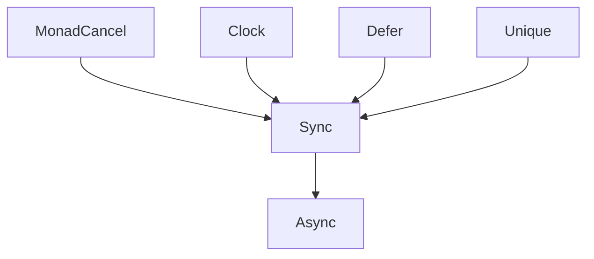



# Sync — синхронный FFI в Cats Effect

## Введение: Что такое синхронный FFI?

**FFI (Foreign Function Interface)** — это механизм, [позволяющий вызывать код на других языках](https://ru.wikipedia.org/wiki/%D0%98%D0%BD%D1%82%D0%B5%D1%80%D1%84%D0%B5%D0%B9%D1%81_%D0%B2%D0%BD%D0%B5%D1%88%D0%BD%D0%B8%D1%85_%D1%84%D1%83%D0%BD%D0%BA%D1%86%D0%B8%D0%B9)
или, в контексте Cats Effect, **взаимодействовать с "нечистым" миром побочных эффектов** из чистого функционального кода.

`Sync[F[_]]` предоставляет безопасный способ приостановки (suspend) синхронных побочных эффектов в контексте эффекта `F[_]`. 
Это мост между императивным миром (Java/Scala с побочными эффектами) и функциональным миром (Cats Effect).

```dotty
trait Sync[F[_]] extends MonadCancel[F, Throwable] with Clock[F] with Defer[F]
    with Unique[F]:
  def delay[A](thunk: => A): F[A]
  def blocking[A](thunk: => A): F[A]
  def interruptible[A](thunk: => A): F[A]
  def interruptibleMany[A](thunk: => A): F[A]
```

## Проблема, которую решает Sync

В чистом функциональном программировании у нас нет прямого доступа к побочным эффектам. Нельзя просто написать:

```dotty
// ❌ Так нельзя — побочный эффект выполнится немедленно 
// и не будет референциально прозрачным
val inc: Long = counter.incrementAndGet()
```

Вместо этого мы **описываем** вычисление как значение `F[A]`, которое будет выполнено позже рантаймом Cats Effect. 
`Sync` предоставляет примитивы для такого описания.

## Ключевое различие: блокирующие vs неблокирующие операции

Перед использованием методов `Sync` важно понимать разницу:

| Характеристика        | Неблокирующие операции                                                    | Блокирующие операции                                                    |
|-----------------------|---------------------------------------------------------------------------|-------------------------------------------------------------------------|
| **Что делают**        | Быстрые вычисления, работа с памятью, атомарные операции                  | Ожидание ввода-вывода, синхронизация, `Thread.sleep`                    |
| **Примеры**           | `AtomicLong.incrementAndGet()`, вычисления `x + y`, работа с коллекциями  | Чтение файла, сетевой запрос, `Future.get()`, `CountDownLatch.await()`  |
| **Время выполнения**  | Нано/микросекунды                                                         | Миллисекунды, секунды и более                                           |
| **Влияние на поток**  | Не блокирует поток                                                        | Блокирует поток на всё время выполнения                                 |

**Почему это важно для Cats Effect:**

- Cats Effect использует ограниченный пул вычислительных потоков (обычно = количеству ядер CPU)
- Если заблокировать такой поток, вся система может остановиться
- Блокирующие операции нужно изолировать в специальные пулы

## Детальный разбор методов Sync

### `delay` — для неблокирующих побочных эффектов

```dotty
def delay[A](thunk: => A): F[A]
```

**Назначение:** Приостановка быстрых, неблокирующих побочных эффектов.

**Когда использовать:**

- Работа с `AtomicXXX`
- Простые операции с массивами/коллекциями
- Генерация случайных чисел (`Random.nextInt`)
- Вызов методов, которые не блокируются

**Примеры:**

```dotty
import cats.effect.Sync
import java.util.concurrent.atomic.AtomicLong
import scala.util.Random

def incrementCounter[F[_]: Sync](counter: AtomicLong): F[Long] =
  Sync[F].delay(counter.incrementAndGet())

def getRandomNumber[F[_]: Sync]: F[Int] =
  Sync[F].delay(Random.nextInt(100))

def currentTimeMillis[F[_]: Sync]: F[Long] =
  Sync[F].delay(System.currentTimeMillis())
```

**Важно:** `delay` НЕ должен использоваться для блокирующих операций!

```dotty
// ❌ ПЛОХО: блокирующая операция через delay
val badFileRead: IO[String] = IO.delay:
  Source.fromFile("huge-file.txt").mkString // Блокирует вычислительный поток!

// ✅ ПРАВИЛЬНО: используем blocking
val goodFileRead: IO[String] = IO.blocking:
  Source.fromFile("huge-file.txt").mkString
```

### `blocking` — для блокирующих операций

```dotty
def blocking[A](thunk: => A): F[A]
```

**Назначение:** Выполнение блокирующих операций в специальном пуле потоков.

**Как работает:**

1. Cats Effect имеет **отдельный пул потоков для блокирующих операций** (обычно неограниченный или с большим количеством потоков)
2. `blocking` переносит выполнение в этот пул
3. Вычислительный пул (compute pool) остаётся свободным для других волокон
4. После завершения операции управление возвращается в вычислительный пул

**Когда использовать:**

- Чтение/запись файлов
- Сетевые запросы через синхронные клиенты (JDBC, HttpURLConnection)
- `Thread.sleep`
- Ожидание блокировок (`CountDownLatch`, `Semaphore` из Java)
- Работа с `java.io` (не `java.nio`)

**Примеры:**

```dotty
import cats.effect.Sync

import scala.io.Source
import java.io.*
import java.net.*

def readFile[F[_]: Sync](path: String): F[String] =
  Sync[F].blocking:
    val source = Source.fromFile(path)
    try source.mkString
    finally source.close()

def jdbcQuery[F[_]: Sync](conn: Connection, sql: String): F[ResultSet] =
  Sync[F].blocking:
    conn.createStatement().executeQuery(sql) // JDBC — блокирующий!

def sleepSeconds[F[_]: Sync](seconds: Int): F[Unit] =
  Sync[F].blocking(Thread.sleep(seconds * 1000L))
```

### `interruptible` — блокирующие операции с поддержкой отмены

```dotty
def interruptible[A](thunk: => A): F[A]
```

**Назначение:** Выполнение блокирующей операции, которую можно прервать при отмене волокна.

**Проблема, которую решает:** Обычные блокирующие операции (через `blocking`) **нельзя отменить** до их естественного завершения. 
Например, если `Thread.sleep(10000)` был вызван, а волокно отменили через 1 секунду, оно всё равно будет ждать все 10 секунд.

**Как работает:**

1. При запуске `interruptible` Cats Effect запоминает поток, на котором выполняется операция
2. При отмене волокна поток получает сигнал прерывания (`Thread.interrupt()`)
3. Блокирующая операция должна реагировать на прерывание (обычно выбрасывая `InterruptedException`)

**Когда использовать:**

- Длительные блокирующие операции (десятки секунд и более)
- Операции, которые могут реагировать на прерывание
- Когда важна возможность быстрой отмены

**Примеры:**

```dotty
import cats.effect.{IO, IOApp, Sync}
import scala.concurrent.duration.*

def longRunningBlocking[F[_]: Sync]: F[String] =
  Sync[F].interruptible:
    // Симуляция долгой операции, которая реагирует на прерывание
    (1 to 100).foldLeft("") { case (result, i) =>
      // Проверяем прерывание на каждом шаге
      if Thread.currentThread().isInterrupted then
        throw new InterruptedException()
      else
        Thread.sleep(100) // симуляция работы
        s"Step $i\n"
    }

// Использование с тайм-аутом
val program: IO[Unit] =
  for
    fiber <- longRunningBlocking[IO].start
    _     <- IO.sleep(500.millis) // дадим немного поработать
    _ <- fiber.cancel // Отменяем — interruptible позволит прервать операцию!
    _ <- fiber.join
  yield ()
```

### `interruptibleMany` — многократные попытки прерывания

```dotty
def interruptibleMany[A](thunk: => A): F[A]
```

**Назначение:** Более агрессивная версия `interruptible`, которая продолжает посылать сигналы прерывания, пока операция не завершится.

**Разница между `interruptible` и `interruptibleMany`:**

| Характеристика                     | `interruptible`                                   | `interruptibleMany`                                |
|------------------------------------|---------------------------------------------------|----------------------------------------------------|
| **Количество попыток прерывания**  | Одна                                              | Многократные, пока операция не завершится          |
| **Когда использовать**             | Операции, которые быстро реагируют на прерывание  | Операции, которые игнорируют первый сигнал         |
| **Пример**                         | `Thread.sleep`, `Object.wait`                     | Сложные циклы с собственной обработкой прерываний  |

**Когда нужен `interruptibleMany`:**

Некоторые блокирующие операции не реагируют на первый сигнал прерывания:

- Некоторые реализации сокетов
- Собственные циклы с перехватом `InterruptedException`
- Операции, которые восстанавливают статус прерывания

```dotty
def stubborBlockingOperation: Unit =
  try
    // Какая-то долгая операция
    Thread.sleep(10000)
  catch
    case _: InterruptedException =>
      // Игнорируем прерывание! Плохая практика, но бывает
      Thread.currentThread().interrupt() // восстановили флаг
      // продолжаем работу...
      Thread.sleep(10000)

// interruptible может не сработать с таким кодом
val bad: IO[Unit] = Sync[IO].interruptible(stubborBlockingOperation)

// interruptibleMany будет посылать прерывания повторно
val good: IO[Unit] = Sync[IO].interruptibleMany(stubborBlockingOperation)
```

## Иерархия и связь с другими типами



`Sync` — это **центральный класс типов**, который:

- Наследует `MonadCancel` (поддержка отмены)
- Наследует `Clock` (работа со временем)
- Наследует `Defer` (ленивые вычисления)
- Наследует `Unique` (уникальные токены)
- Является родителем для `Async` (асинхронные операции)

## Особенности и подводные камни

### 1. Никогда не используйте `delay` для блокирующих операций

```dotty
// ❌ ПЛОХО — заблокирует вычислительный поток
val bad: IO[Unit] = IO.delay(Thread.sleep(10000))

// ✅ ХОРОШО — использует блокирующий пул
val good: IO[Unit] = IO.blocking(Thread.sleep(10000))
```

### 2. Не все блокирующие операции можно прервать

```dotty
// Некоторые операции не реагируют на interrupt()
val socketRead: IO[Array[Byte]] = IO.interruptible:
  val socket = new Socket("example.com", 80)
  val buffer = new Array[Byte](1024)
  socket.getInputStream.read(buffer) // Может игнорировать прерывания!

// Решение: использовать асинхронные альтернативы (NIO, fs2.io)
```

### 3. `interruptible` не гарантирует мгновенную отмену

```dotty
val op: IO[Unit] = IO.interruptible:
  // Если операция не проверяет статус прерывания,
  // отмена может произойти с задержкой
  var i = 0L
  while i < Long.MaxValue do i += 1 // CPU-bound, не реагирует на interrupt()
```

### 4. Правильная обработка InterruptedException

```dotty
def properInterruptibleOp[F[_]: Sync]: F[Unit] =
  Sync[F].interruptible:
    try
      Thread.sleep(10000)
    catch
      case _: InterruptedException =>
        // ВАЖНО: восстанавливаем статус прерывания
        Thread.currentThread().interrupt()
        throw new InterruptedException()
```

## Итог: выбор правильного метода

| Ситуация                                        | Метод                | Пример                                         |
|-------------------------------------------------|----------------------|------------------------------------------------|
| Быстрое вычисление (нано/микросекунды)          | `delay`              | `counter.incrementAndGet()`                    |
| Чтение файла, JDBC запрос                       | `blocking`           | `Source.fromFile().mkString`                   |
| Долгий блокирующий вызов с возможностью отмены  | `interruptible`      | `Thread.sleep(10000)`                          |
| "Упрямый" блокирующий вызов                     | `interruptibleMany`  | Собственные циклы с игнорированием прерываний  |

**Золотое правило:** Всегда задавайте себе вопрос — "Блокирует ли эта операция поток?" 
Если да, используйте `blocking`, `interruptible` или `interruptibleMany`. Если нет — `delay`. 
Правильный выбор гарантирует, что ваша программа на Cats Effect будет отзывчивой, масштабируемой и корректно обрабатывающей отмены.

---

**Ссылки:**

- [Ссылка на репозиторий с упражнениями][sample]
- [Cats effect documentation][doc]

[doc]: https://typelevel.org/cats-effect/docs/concepts
[sample]: https://gitverse.ru/scalabook/cats
