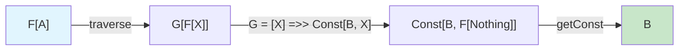



# Const: Тип-константа

## Странный тип данных

```dotty
final case class Const[A, B](getConst: A)
```

На первый взгляд `Const` кажется странной структурой данных — у него два параметра типа, но он хранит только значение первого типа. 
Какой в этом смысл? Оказывается, у него есть множество применений, 
которые служат отличным примером согласованности и элегантности функционального программирования.

## Концепция Const

Тип `Const` можно рассматривать как типизированный аналог функции `const`:

```dotty
def const[A, B](a: A)(b: => B): A = a
```

Функция `const` принимает два аргумента и просто возвращает первый, игнорируя второй.
Тип `Const` принимает два параметра типа, но хранит только значение первого типа. 
Второй параметр типа никогда не используется в данных — он называется **фантомным типом** (phantom type).

### Сравнение с другими типами

| Тип данных     | Параметры | Хранимое значение | Использование второго параметра |
|----------------|-----------|-------------------|---------------------------------|
| `Const[A, B]`  | `A`, `B`  | Только `A`        | Фантомный (не используется)     |
| `Either[E, A]` | `E`, `A`  | `E` или `A`       | Используется для ошибки         |
| `Tuple2[A, B]` | `A`, `B`  | `A` и `B`         | Оба используются                |
| `Id[A]`        | `A`       | `A`               | Только один параметр            |

## Зачем это нужно?

Казалось бы, `Const` не даёт преимуществ по сравнению с типом, у которого нет второго параметра. 
Однако существование второго параметра оказывается полезным в определённых контекстах.

## Реализация линз через Const

Линзы (lenses) — это мощная абстракция для работы с вложенными структурами данных. 
Они позволяют получать, устанавливать и модифицировать значения внутри составных типов.

```dotty
trait Lens[S, A]:
  def get(s: S): A
  def set(s: S, a: A): S
  def modify(s: S)(f: A => A): S = set(s, f(get(s)))
```

Где `S` — это "источник" (source), а `A` — "цель" (target).

### Эффектные модификации

Иногда нам нужны эффектные модификации — например, модификация, которая может завершиться ошибкой (`Option`) 
или вернуть несколько значений (`List`):

```dotty
trait Lens[S, A]:
  def get(s: S): A
  def set(s: S, a: A): S

  def modify(s: S)(f: A => A): S = set(s, f(get(s)))

  def modifyOption(s: S)(f: A => Option[A]): Option[S] =
    f(get(s)).map(a => set(s, a))

  def modifyList(s: S)(f: A => List[A]): List[S] =
    f(get(s)).map(a => set(s, a))
```

Обратите внимание, что `modifyOption` и `modifyList` имеют одинаковую реализацию. 
Единственное, что им нужно — это операция `map` над типом данных. 
Будучи хорошими функциональными программистами, мы абстрагируем это:

```dotty
import cats.Functor
import cats.syntax.all.*

trait Lens[S, A]:
  def get(s: S): A
  def set(s: S, a: A): S

  def modify(s: S)(f: A => A): S = set(s, f(get(s)))

  def modifyF[F[_]: Functor](s: S)(f: A => F[A]): F[S] =
    f(get(s)).map(a => set(s, a))
```

Теперь мы можем переопределить `modify` через `modifyF`, используя [`Id`](id.md). 
Также `set` можно рассматривать как модификацию, которая игнорирует текущее значение.

```dotty
trait Lens[S, A]:
  def modifyF[F[_]: Functor](s: S)(f: A => F[A]): F[S]

  def set(s: S, a: A): S         = modify(s)(_ => a)
  def modify(s: S)(f: A => A): S = modifyF[Id](s)(f)
  def get(s: S): A
```

### Проблема: как реализовать get через modifyF?

`get` нельзя определить через модификацию — модификации изменяют существующее значение, а `get` его извлекает. 
Но давайте попробуем.

В `modifyF` мы передаём `S` и функцию `A => F[A]`. Сложность в том, чтобы получить `A` из `F[S]`. 
Если представить, что `F` — это константная функция на уровне типов, которая принимает любой тип 
и возвращает некоторый константный тип (например, `A`), то это напоминает `Const`.

`Const` принимает два параметра, поэтому один нужно зафиксировать. 
Функция возвращает `F[S]`, но нам нужно `A`. 
Это означает, что первый параметр `Const` должен быть `A`, а второй остаётся свободным:

```
Const[A, _] вместо F[_]
```

Теперь функция требует `A => Const[A, A]` и возвращает `Const[A, S]`. 
Из определения `Const` мы знаем, что значение `Const[X, Y]` эквивалентно `X` (с некоторой обёрткой). 
Значит, нам нужна функция `A => A`. Единственное, что можно сделать — взять `A` и вернуть его обратно (подняв в `Const`).

### Реализация Functor для Const

Прежде чем использовать, заметим, что `modifyF` требует `Functor` для `F[_]`. 
Нужно определить экземпляр [`Functor`](../../typeclass/monad/functor.md) для `Const` с фиксированным первым параметром:

```dotty
given constFunctor[X]: Functor[[A] =>> Const[X, A]] =
  new Functor[[A] =>> Const[X, A]]:
    // Const[X, A] ~= X, поэтому функция f нам не нужна
    extension [A](fa: Const[X, A])
      def map[B](f: A => B): Const[X, B] = Const(fa.getConst)
```

### Реализация get через modifyF

Теперь подставим всё вместе:

```dotty
trait Lens[S, A]:
  def modifyF[F[_]: Functor](s: S)(f: A => F[A]): F[S]

  def set(s: S, a: A): S         = modify(s)(_ => a)
  def modify(s: S)(f: A => A): S = modifyF[Id](s)(f)

  def get(s: S): A =
    val storedValue = modifyF[[B] =>> Const[A, B]](s)(a => Const(a))
    storedValue.getConst
```

Это работает! Мы получаем `Const[A, S]` и просто извлекаем сохранённое значение `A`.

**Что здесь происходит?**

Мы рассматриваем эффектную "модификацию" как операцию сохранения — мы берём `A` и сохраняем его в `Const`. 
Зная только, что `F[_]` имеет экземпляр `Functor`, он может только применить `map` к `Const`, что не изменит сохранённое значение. 
После того как `modifyF` возвращает новое `S`, мы извлекаем сохранённое `A` и готово!

## Traverse и Foldable

В известной статье ["The Essence of the Iterator Pattern"](https://www.cs.ox.ac.uk/jeremy.gibbons/publications/iterator.pdf) 
Джереми Гиббонс и Бруно Оливейра описывают функциональный подход к итерации по коллекциям данных. 
Среди представленных абстракций — [`Foldable`](../../typeclass/monad/foldable.md) 
и [`Traverse`](../../typeclass/monad/traverse.md):

```dotty
import cats.{Applicative, Monoid}

trait Foldable[F[_]]:
  // Свёртка коллекции F[A] с помощью моноида B
  def foldMap[A, B: Monoid](fa: F[A])(f: A => B): B

trait Traverse[F[_]]:
  // Обход коллекции с эффектной функцией
  def traverse[G[_]: Applicative, A, B](fa: F[A])(f: A => G[B]): G[F[B]]
```

Эти два класса типов кажутся несвязанными — первый сводит коллекцию к одному значению, 
второй обходит коллекцию с эффектной функцией, собирая результаты. 
Удивительно, но `Traverse` включает в себя `Foldable`.

### Реализация Foldable через Traverse

```dotty
trait Traverse[F[_]] extends Foldable[F]:
  def traverse[G[_]: Applicative, A, X](fa: F[A])(f: A => G[X]): G[F[X]]

  def foldMap[A, B: Monoid](fa: F[A])(f: A => B): B
```

Чтобы реализовать `foldMap` через `traverse`, нам нужно получить `B`. Но `traverse` возвращает `G[F[X]]`. 
Кажется, нет способа их объединить. Однако если представить `G[_]` как константную функцию на уровне типов, 
где `F[X]` игнорируется, мы можем это сделать.

`traverse` требует, чтобы `G[_]` имел [`Applicative`](../../typeclass/monad/applicative.md). 
Определим его для `Const`:

```dotty
given constApplicative[Z: Monoid]: Applicative[[X] =>> Const[Z, X]] with
  /** Поднимает значение в контекст аппликативного функтора. */
  def unit[A](a: => A): Const[Z, A] =
    Const(Monoid[Z].empty)

  /** Применяет функцию в контексте к значению в контексте. */
  def apply[A, B](fab: Const[Z, A => B])(fa: Const[Z, A]): Const[Z, B] =
    Const(Monoid[Z].combine(fa.getConst, fab.getConst))
```

`Const[Z, A]` означает, что у нас есть значение `Z`, и мы игнорируем `A`. Нам нужно:

1. `unit` — у нас есть `A`, но нужно вернуть `Z`. Игнорируем `A` и используем `Monoid[Z].empty`
2. `apply` — у нас есть два `Z`, комбинируем их через `Monoid[Z].combine`

### Реализация foldMap

Теперь мы можем реализовать `foldMap`:

```dotty
trait Traverse[F[_]] extends Foldable[F]:
  def traverse[G[_]: Applicative, A, X](fa: F[A])(f: A => G[X]): G[F[X]]

  def foldMap[A, B: Monoid](fa: F[A])(f: A => B): B =
    val const: Const[B, F[Nothing]] =
      traverse[[X] =>> Const[B, X], A, Nothing](fa)(a => Const(f(a)))
    const.getConst
```

**Что здесь происходит?**

1. Мы используем `traverse` с `[X] =>> Const[B, X]` в качестве эффекта
2. Каждый элемент `A` преобразуется в `Const[B, Nothing]` со значением `f(a)`
3. `traverse` комбинирует все `Const` через `Applicative` для `Const`
4. Результат — `Const[B, F[Nothing]]`, из которого мы извлекаем `B`

### Почему это работает?



Магия в том, что `traverse`:

1. **Проходит** по каждому элементу коллекции
2. **Применяет** функцию `f: A => B` к каждому элементу
3. **Комбинирует** результаты через `Applicative` (который использует `Monoid` для `B`)
4. **Игнорирует** структуру `F[X]` через фантомный тип `Nothing`

## Сравнение подходов

| Подход                     | Преимущества                    | Недостатки                        |
|----------------------------|---------------------------------|-----------------------------------|
| Прямая реализация Foldable | Простота, понятность            | Дублирование кода                 |
| Реализация через Traverse  | Единообразие, переиспользование | Сложность понимания               |
| Использование Const        | Элегантность, абстракция        | Требует понимания фантомных типов |

## Итоговое резюме

`Const` — это элегантный пример того, как фантомные типы и абстракции функционального программирования позволяют:

1. **Реализовать `get` через `modifyF`** в линзах, используя `Const` как хранилище
2. **Выразить `Foldable` через `Traverse`**, используя `Const` и `Monoid`
3. **Абстрагировать эффекты** в полиморфном коде

Ключевые концепции:

- **Фантомный тип** — параметр типа, не используемый в данных
- **Const** — тип-константа, игнорирующий второй параметр
- **Applicative для Const** — требует `Monoid` для накопления значений
- **Traverse + Const = FoldMap** — обход коллекции с накоплением через моноид

---

**Ссылки:**

- [Ссылка на репозиторий с упражнениями][sample]
- [Cats](https://typelevel.org/cats/datatypes/const.html)
- [Julien Truffaut - Lens implementation - Part 1](https://functional-wizardry.blogspot.com/2014/02/lens-implementation-part-1.html)

[sample]: https://gitverse.ru/scalabook/typeclasses
