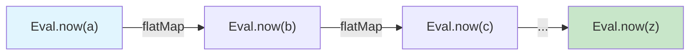



# Eval: Управление синхронными вычислениями

## Проблема управления вычислениями

В функциональном программировании важно контролировать, когда и как вычисляются выражения. 
В Scala есть несколько способов управления вычислениями:

| Способ      | Ленивость | Мемоизация | Пример                     |
|-------------|-----------|------------|----------------------------|
| `val`       | ❌         | ✅          | `val x = expensive()`      |
| `lazy val`  | ✅         | ✅          | `lazy val x = expensive()` |
| `def`       | ✅         | ❌          | `def x = expensive()`      |
| `Function0` | ✅         | ❌          | `() => expensive()`        |

Однако у этих подходов есть недостатки:

- **`lazy val`** использует блокировки для потокобезопасности, что может приводить к проблемам производительности
- **Рекурсивные вычисления** могут приводить к переполнению стека
- **Композиция вычислений** затруднена без монадического интерфейса

`Eval` — это тип данных, решающий эти проблемы и предоставляющий единообразный интерфейс для управления вычислениями.

## Тип Eval: Концепция и определение

`Eval` — это тип данных для управления **синхронными вычислениями**. 
Он обеспечивает **стекобезопасность** (stack-safety) в любой момент времени с помощью техники, 
называемой [**прыжки на батуте** (trampolining)](../../fp/external-effects/stack_overflow_error.md).

### Прыжки на батуте

[Прыжки на батуте](../../fp/external-effects/stack_overflow_error.md) — это техника, при которой рекурсивные вызовы не накапливаются в стеке, 
а выполняются в цикле, что предотвращает переполнение стека:

```dotty
import cats.Eval

// Обычная рекурсия — может привести к StackOverflowError
def factorial(n: Int): Int =
  if n == 0 then 1 else n * factorial(n - 1)

// Трамплининг — безопасен для больших n
def factorialEval(n: Int): Eval[Int] =
  if n == 0 then Eval.now(1)
  else Eval.defer(factorialEval(n - 1).map(_ * n))
```

## Стратегии вычислений

`Eval` поддерживает три стратегии вычислений, различающиеся по двум параметрам:

1. **Мемоизация** — запоминание результата после первого вычисления
2. **Ленивость** — откладывание вычисления до момента использования

### 1. Eval.now — Немедленное вычисление

`Eval.now` создаёт вычисление, которое выполняется **немедленно** (eager evaluation) и **мемоизирует** результат:

```dotty
import cats.Eval
import cats.syntax.all.*

val eager = Eval.now {
  println("Выполняется дорогое вычисление...")
  1 + 2 * 3
}
// Выполняется дорогое вычисление...  // <- печатается сразу
// eager: Eval[Int] = Now(7)

eager.value // 7 (результат уже вычислен, ничего не печатается)
```

**Особенности `Eval.now`:**

| Характеристика           | Значение                            |
|--------------------------|-------------------------------------|
| Время вычисления         | Сразу при создании                  |
| Мемоизация               | ✅ Да                                |
| Повторный вызов `.value` | Мгновенный возврат результата       |
| Применение               | Константы, уже вычисленные значения |

### 2. Eval.later — Ленивое мемоизированное вычисление

`Eval.later` создаёт вычисление, которое выполняется **лениво** (при первом вызове `.value`) 
и **запоминает** результат, аналогично `lazy val`:

```dotty
val lazyEval = Eval.later {
  println("Выполняется дорогое вычисление...")
  1 + 2 * 3
}
// lazyEval: Eval[Int] = Later(<function0>)

lazyEval.value // Выполняется дорогое вычисление...  (печатается)
// 7

lazyEval.value // 7 (мгновенно, запоминание)
```

**Сравнение с `lazy val`:**

| Характеристика     | `lazy val`              | `Eval.later`                         |
|--------------------|-------------------------|--------------------------------------|
| Мемоизация         | ✅                       | ✅                                    |
| Ленивость          | ✅                       | ✅                                    |
| Потокобезопасность | Блокировка всего класса | Блокировка только себя               |
| Сборка мусора      | Не освобождает thunk    | Освобождает thunk после вычисления   |
| Гибкость           | Ограничена              | Можно комбинировать с другими `Eval` |

**Преимущества перед `lazy val`:**

1. **Освобождение памяти** — после вычисления `Eval.later` освобождает thunk (функцию-замыкание), 
   что позволяет сборщику мусора освободить память раньше
2. **Меньшая блокировка** — `lazy val` блокирует весь класс для потокобезопасности, а `Eval.later` блокирует только себя

### 3. Eval.always — Ленивое немемоизированное вычисление

`Eval.always` создаёт вычисление, которое выполняется **лениво** (при каждом вызове `.value`) **без мемоизации**, аналогично `def`:

```dotty
val always = Eval.always {
  println("Выполняется дорогое вычисление...")
  1 + 2 * 3
}
// always: Eval[Int] = Always(<function0>)

always.value // Выполняется дорогое вычисление...  (печатается)
// 7

always.value // Выполняется дорогое вычисление...  (печатается снова!)
// 7
```

**Сравнение с другими подходами:**

| Характеристика    | `def` | `() => A`    | `Eval.always` |
|-------------------|-------|--------------|---------------|
| Мемоизация        | ❌     | ❌            | ❌             |
| Ленивость         | ✅     | ✅            | ✅             |
| Композиция        | ❌     | Ограниченная | ✅ (монада)    |
| Стекобезопасность | ❌     | ❌            | ✅             |

## Сравнение стратегий Eval

| Стратегия                 | Метод         | Мемоизация | Ленивость | Время вычисления    | Аналог в Scala   |
|---------------------------|---------------|------------|-----------|---------------------|------------------|
| Немедленная               | `Eval.now`    | ✅          | ❌         | При создании        | `val`            |
| Ленивая мемоизированная   | `Eval.later`  | ✅          | ✅         | При первом `.value` | `lazy val`       |
| Ленивая немемоизированная | `Eval.always` | ❌          | ✅         | При каждом `.value` | `def`, `() => A` |

## Композиция вычислений

### Стекобезопасность с flatMap

Одно из важнейших применений `Eval` — стекобезопасная композиция вычислений через `flatMap`. 
Это позволяет выполнять глубокие рекурсивные вычисления без риска переполнения стека.

**Пример: взаимная рекурсия**

```dotty
object MutualRecursion:
  def even(n: Int): Eval[Boolean] =
    Eval.always(n == 0).flatMap {
      case true  => Eval.True
      case false => odd(n - 1)
    }

  def odd(n: Int): Eval[Boolean] =
    Eval.always(n == 0).flatMap {
      case true  => Eval.False
      case false => even(n - 1)
    }

// Безопасно для больших чисел!
MutualRecursion.even(199999).value // false
MutualRecursion.odd(199999).value  // true
MutualRecursion.even(200000).value // true
MutualRecursion.odd(200000).value  // false
```

**Почему это работает?**



Обычная рекурсия накапливает вызовы в стеке JVM, что ограничено размером стека (обычно ~10,000 вызовов). 
`Eval` использует "прыжки на батуте", превращая рекурсивные вызовы в последовательность операций в куче, 
что ограничено только доступной памятью.

### Eval.defer — Отложенное выполнение

`Eval.defer` позволяет отложить выполнение вычисления, которое возвращает `Eval[A]`. 
Это полезно, когда вложенный вызов `.value` внутри методов создания может быть небезопасным:

```dotty
// Небезопасный подход (может привести к проблемам)
def unsafeFactorial(n: Int): Eval[Int] =
  Eval.always {
    if n == 0 then 1
    else n * unsafeFactorial(n - 1).value // НЕ ДЕЛАЙТЕ ТАК!
  }

// Безопасный подход с defer
def safeFactorial(n: Int): Eval[Int] =
  if n <= 1 then Eval.now(1)
  else Eval.defer(safeFactorial(n - 1).map(_ * n))

safeFactorial(50000).value // Безопасно!
```

## Рекомендации по использованию

| Сценарий                                    | Рекомендуемая стратегия  | Причина                              |
|---------------------------------------------|--------------------------|--------------------------------------|
| Константы и уже вычисленные значения        | `Eval.now`               | Нет смысла откладывать               |
| Дорогие вычисления, выполняемые один раз    | `Eval.later`             | Экономия ресурсов с мемоизацией      |
| Вычисления, которые должны быть актуальными | `Eval.always`            | Нет мемоизации, всегда свежие данные |
| Глубокая рекурсия                           | `Eval.defer` с `flatMap` | Стекобезопасность                    |
| Композиция вычислений                       | for-comprehension с Eval | Чистый функциональный стиль          |

---

**Ссылки:**

- [Ссылка на репозиторий с упражнениями][sample]
- [Cats](https://typelevel.org/cats/datatypes/eval.html)

[sample]: https://gitverse.ru/scalabook/typeclasses
